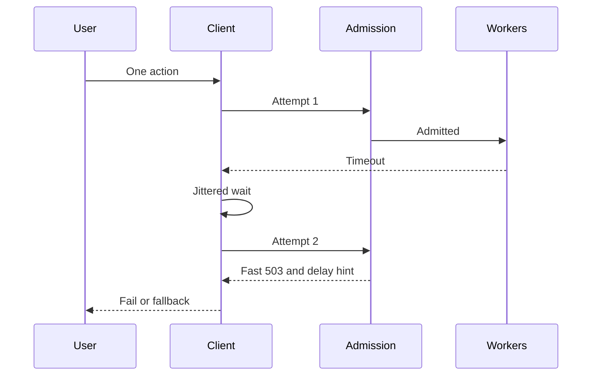

A retry turns a lost packet into a completed request. It also turns a brief saturation into an arrival process the server cannot drain. When a large client fleet shares a timeout and the same habit of trying again, an error rate becomes multiplicative load. Load shedding is the server's matching move: refuse work before it is expensive, so the work you accept can finish. The two policies are one design. A refusal that clients immediately replay is a storm with an extra status code.

## Concept

A retry storm is retry amplification that has left the envelope you sized. Each user action may produce more than one attempt. That is acceptable while the extra attempts are rare and the dependency is briefly unreachable rather than full. It stops being acceptable when the error that prompted the retry is saturation. Every extra attempt then competes with the original work, with other users, and with whatever the server needs in order to recover. Arrivals rise at the moment the service rate falls. Queues grow. More calls time out. More callers retry. This is the usual door into a metastable collapse: the server is busy, and goodput is not.

### Retry amplification

Write the multiplicity down before you argue about backoff. If the edge retries three times, a mesh retries twice, and each of several interior hops retries twice, one user click is a branching process. Even with a single retrying hop, a fleet that shares a half-second timeout delivers a square wave of attempts on that interval. A server that was modestly over its useful capacity at the first timeout is several times over at the next, while the first wave is still sitting in its queues.

Four parameters set the gain, and I want them in the design review as numbers.

- Who retries. One hop in the chain holds the budget. Interior services fail fast with a code that hop understands. A mesh that retries every route by default is a second budget nobody owns.
- Which errors are eligible. A connection failure, and a 503 that carries a delay, can be worth another attempt. A 500 from a saturated handler is saturation, and another attempt makes it worse. A 429 is an instruction to wait, not a prompt to try the next pod immediately.
- How long you wait. Exponential backoff with no jitter synchronizes the fleet. Full jitter, spreading the wait across the whole backoff window, turns a herd into a smear. Equal jitter is a reasonable compromise when you still want a minimum delay.
- What fraction of traffic may be a retry. A budget, such as at most ten percent of calls in a rolling window, caps amplification even when every call looks eligible. Once the budget is spent, further failures go to the user or to a fallback.

Idempotency decides whether a retry is safe to send. It is not a reason to retry harder. A read of immutable data is cheap to repeat. A payment capture needs an idempotency key so the second attempt is a no-op at the store. A timed-out write is an unknown outcome. The next call is a status read, not a second submit.

### Load shedding as a cheap refusal

Load shedding is admission control that says no before the expensive part of the request. The expensive part is whatever holds the scarce resource: a worker thread, a database connection, a lock, a GPU, a downstream call. Once that resource is held, refusal is slow, and slow refusal is how the client timeout becomes the real shed. The refusal belongs at the door.

A shed I will accept has four properties. It is fast, on the order of a millisecond, so the worker returns to the pool. It is explicit: HTTP 503 or 429, a gRPC resource-exhausted status, a broker throttle, so the client can tell a shed from an application bug. It carries a hint, such as Retry-After, so well-behaved clients do not invent a synchronized guess. It is preferential: retries, batch, and low-priority tenants go first, and a reserved slice remains for health checks, the control plane, and the interactive path that pays the SLO.

Where you shed matters as much as whether you shed. An edge shed protects the fleet and is coarse. A per-route shed protects a hot method and leaves the rest of the process up. A per-replica concurrency limit is the last line when the balancer is still sending work. I want all three, with the same notion of priority, so a retry marked low priority at the edge is still low priority if it reaches a pod.

### Client policy and server policy are one loop

If the server sheds with 503 and the client retries immediately, the gain is above one and you have designed the storm. If the server queues and lets the client time out, the timeout is the shed. That is the most expensive shed available: the server did the work, the client discarded it, and the client sent it again.

The pair I want written down is small. On the client: a tight retry budget, jittered backoff, honor the server's delay hint, and do not retry while a breaker is open. On the server: admit up to the concurrency that keeps goodput high, fail the rest immediately, mark retries so they shed first, and cancel work whose deadline has already expired.

The moment to game-day is the return, not the crash. The first healthy second is when every waiting client comes back together. The budget and the jitter exist for that second. A shed with no story for the return wave has only postponed the storm.

### A deep queue is a delayed storm

A short bounded queue absorbs a burst so a user who arrived on the wrong millisecond still gets a response. It becomes an amplifier the moment queue wait plus service time exceeds the client timeout. The queue is then a warehouse of work nobody will accept. Each item still consumes a worker when it reaches the head. Each client has already retried. You pay twice and deliver once, on a good day.

Cap queue wait so the last item can still finish inside the deadline. When that cap is a handful of items, you have an admission limiter. Name it that way in the review. An unbounded queue in a thread pool, a channel, or a reactive buffer is how a retry storm becomes a memory incident on the way to becoming an availability incident.

## Trade-offs

| Approach | When it wins | Cost / risk |
| -------- | ------------ | ----------- |
| No client retry, server sheds fast | Fan-out paths and any dependency already at a concurrency limit | Single-instance blips become user-visible |
| One hop retries, with jitter and a budget | Idempotent reads behind a brief failover | A budget that is too large recreates the storm; one that is too small wastes a cheap recovery |
| Server concurrency limit plus a fast 503 | Arrivals exceed the service rate and goodput must be protected | A static limit that is too low sheds on a healthy afternoon |
| Priority shed of retries and batch | Interactive and background traffic share a fleet | A wrong priority mark sheds the paying path, or never sheds the background one |
| A deep queue meant to hide errors | Bursts shorter than the timeout, and the client does not retry | Timeout-then-retry turns the queue into amplified work |
| Fleet-wide delay hints and retry budgets | Large client populations that would otherwise synchronize | Needs a server that emits the hint and clients that are required to honor it |

A retry is a loan against future capacity. The interest is the chance the dependency is saturated rather than briefly unreachable. On a calm afternoon that chance is low. During the incident you will actually page on, it is close to one. Size the policy for the incident, and write the multiplicity next to the SLO.

Priority shedding works only when the mark survives every hop. Carry it, and shed against it. A static concurrency limit will go stale as latency and machine size change, and it is still the right floor under a fast refusal. An adaptive limit can move the number later. The refusal itself has to be right before the number is clever.

## Diagram

One user action, a second attempt after jitter, and a server that refuses at the door once it is full. The healthy path is the one where the refusal is cheaper than the timeout.

## Failure modes

### Synchronized retry waves

**Detection.** Server attempt rate is a square wave whose period matches the client timeout. Error rate and CPU follow the same period. Client retry counters jump together across many replicas. The first healthy second after a blip is worse than the blip.

**Mitigation.** Full jitter on backoff. A retry budget so a synchronized fleet still cannot spend more than a fraction of traffic on retries. Shed the wave at admission. If the timeout itself is the metronome, jitter the timeout as well.

### Interior hops retrying beside the edge

**Detection.** One inbound request produces a large fan of backend spans tagged as retries. Downstream QPS stays high after user QPS has fallen. The edge retry policy cannot explain the attempt count.

**Mitigation.** Pick one hop and give it the budget. Set the others to fail fast, aside from a connection retry that does not replay the request body. A mesh default of "retry twice" needs an explicit opt-in per route, not an opt-out nobody files.

### Shedding after the expensive work

**Detection.** Latency of the 503 is close to latency of a success. Thread dumps and traces show workers inside downstream calls whose result will be discarded. Database QPS stays high while the API claims it is shedding.

**Mitigation.** Decide admission before the scarce resource is taken: before the downstream call, and before heavy parse and fan-out when those are costly. Cancel the downstream when the caller has gone. If a dependency cannot be cancelled, do not start it unless you can finish it.

### Clients that ignore the hint

**Detection.** The server emits 429 or 503 with a delay. Inbound retry timing ignores that delay. One partner SDK, or one old client version, accounts for a disproportionate share of attempts.

**Mitigation.** Put non-compliant clients behind a stricter limit or a dedicated shed. Leave the rest of the fleet on the shared budget. Publish the retry contract as part of the API, and test SDKs against a fixture that only returns a shed.

## Real-world example

The Kinesis disruption in US-EAST-1 on 25 November 2020 is the public incident I use when a team says clients will back off because the server is unhappy.

A capacity problem on the Kinesis front end raised errors and latency for puts and gets. Contained inside one service, that is ordinary overload. It did not stay contained. Other AWS services, including event sources and monitoring pipelines, consume that front end through libraries and control-plane watches that application teams do not draw as "our client." Those clients retried. New connections and repeated attempts arrived faster than the front end could accept them. Capacity was added, and the connection and retry load occupied the window in which the new capacity could have helped. Services that had never put Kinesis on their own diagram discovered they were coupled to it through a shared client habit.

Recovery was a drain, not a switch. Capacity, connection management, and time for client backoffs to stop overlapping had to move together. Callers that failed fast and showed a degradation had a shorter bad day than callers whose retries were aggressive and lined up on one timeout. From the outside it looked like many products failing at once. From inside any one client fleet it was a retry policy meeting a refusal that was too expensive, plus a graph of hidden dependents that shared the same instinct.

The review questions are specific. What is attempt multiplicity if this dependency errors for thirty seconds. Which callers retry, including the ones we do not own. Can we refuse those retries in about a millisecond, with a hint, when every client replica is on the error path at once. If the answers are "several hops, each retrying," "everyone, including the ones not on the diagram," and "after the handler has already run," the storm is already designed. It is waiting for a date.

## What to remember

- A retry storm is load multiplied by a fleet that shares a timeout. The gain is who retries, on which errors, how they wait, and what fraction of traffic may be a retry.
- A shed has to be fast, explicit, hinted, and preferential, or clients turn the refusal into the next arrival wave.
- One hop holds the retry budget. Interior retries, synchronized backoff, and deep queues turn a blip into a sustained outage.
- Game-day the return. The dangerous moment is the first healthy second, when every waiting client comes back together.
