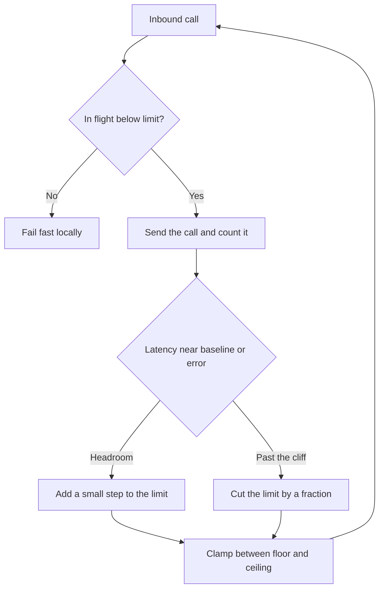

A concurrency limit is how many calls you will allow in flight, toward a dependency or into your own server, before the next call fails locally. A static number is a guess about today's latency and today's machines. An adaptive limit is a control loop: raise the number while more in-flight work still raises goodput, and cut it when latency or errors say you have passed the cliff. The rule most fleets copy is AIMD, additive increase and multiplicative decrease, the same family that keeps a transport from filling a path it cannot drain. The hard part is the signal. A loop that climbs on a lie, oscillates, or starves its own probes is a static limit with extra moving parts.

## Concept

Little's law is the sizing tool, and it belongs in the design, not in the postmortem. In-flight work equals arrival rate times how long each call stays. For a given service rate there is an in-flight level that fills the useful parallelism of the dependency: cores, disk queues, a connection pool, a downstream that is itself limited. Below that level you leave throughput on the table. Above it you buy queue time. Queue time is latency that does not create more goodput, and past a point it creates less, because timeouts and retries turn residency into waste.

A static limit tries to sit just under that point. It is wrong after a collection pause, a cold cache, a slower neighbor region, a new instance type, or a dependency deploy that moved the tail by a large factor. Too high, and you meet the cliff during the incident. Too low, and you shed on a healthy afternoon, and someone disables the limiter the next time they are on call. Adaptive limits exist because the point moves and a human will not move the config in time.

### AIMD, and why the cut is the fast half

Additive increase raises the limit by a small constant when a probe says there is headroom. The probe might be a window of successes, a round trip still near a baseline, or a goodput gradient that is still positive. Multiplicative decrease cuts the limit by a fraction, often about half, when a probe says you are past the cliff: a timeout, a 503, a latency that has left the baseline by a margin you set.

The asymmetry is the point. Climbing slowly avoids overshooting a cliff you cannot see until you are on it. Falling quickly gets you off the cliff before the next thousand calls become retries. A symmetric rule, up by ten and down by ten, spends a long time in the bad region on the way down and calls that fairness.

Gradient and Vegas-style variants replace the binary "timeout or not" with a continuous signal. Measure a minimum round trip, or latency at low concurrency, and treat a rise above that minimum as queueing. If one more in-flight call does not raise goodput, that call was queue. Service-mesh limiters and in-process libraries in this family estimate a limit from latency and outstanding work, then reject past the estimate. The names differ. The measurement does not. You need a notion of fast, and a way to notice queued.

### Where the limiter sits

A client-side limiter protects a dependency from this caller. It is the default I want on an interior hop: each replica of service A may have N calls in flight to B, and N moves with the health this replica observes. Fleet-wide concurrency is then N times A's replica count. A scale-out of A is a silent scale-out of load on B. I want that product on a chart. If A grows threefold, each of A's limiters can still look healthy while B falls over, unless B sheds on its own.

A server-side limiter protects this process from every caller, including callers that do not cooperate. It is the last line, and it is the place you can prefer one caller over another. Use both. The client limiter keeps a well-behaved A from helping to saturate B. The server limiter keeps an unknown partner, or a buggy one, from doing it anyway.

A mesh limiter is a third seat. It sees more of the fleet than one process, and less of the method. Use it as the default so every language gets a brake. Keep an in-process limiter on the few calls whose fan-out or priority the mesh cannot name.

### Signals that actually track the cliff

Latency relative to a windowed minimum is the signal I trust first, if the window is long enough to have seen a quiet period and short enough to forget the last incident. Saturation errors are the signal I trust when the cliff shows up as refusals rather than as a slow brownout. Queue time measured inside the server, when you can get it, is the cliff under a clearer name.

CPU is a poor primary signal for a service that waits on I/O. A process at a low CPU can be out of threads and drowning a database. Success rate alone is late: by the time a limiter is watching 5xx, the queue has already formed. The production mix I want is a latency gradient for the climb, and a hard multiplicative cut on saturation errors and deadlines.

The loop needs a floor and a ceiling. A floor of a few in-flight calls keeps a probe alive so recovery is observable. A ceiling stops a long healthy stretch from teaching the limiter that unlimited is safe. Set the ceiling under the threads and the connections you are willing to donate to this dependency, and under whatever the dependency has said it will accept from you.

### Retries, hedges, and the autoscaler

Order the limiter ahead of the retry. A local rejection is not a timeout. It should not consume the same retry budget as a deadline, or it should consume a smaller budget of its own. Hedged requests send a second call while the first is still in flight, so they raise concurrency by construction. Count them against the limit. A hedge the limiter cannot see is how a tail-latency feature becomes an overload.

Autoscalers that watch CPU or latency will misread a limiter that is shedding. Latency of accepted calls can look fine, CPU can look low, and the autoscaler will scale in during the incident. Feed it incoming demand and shed rate, not only the work you happened to accept. The limiter is protecting the process. It is not a claim that the process is idle and should be smaller.

## Trade-offs

| Approach | When it wins | Cost / risk |
| -------- | ------------ | ----------- |
| Static concurrency limit | A measured pool, a stable downstream, a small blast radius | Goes stale after a latency or hardware change; too low and operators disable it |
| AIMD on timeouts and 503s | A cliff that shows up as errors | A slow brownout with few errors climbs too far before the cut |
| Latency-gradient or Vegas-style limit | I/O-bound calls where queueing shows up in the round trip before errors | Collection pauses and cold starts look like congestion and cause a cut |
| Client-side adaptive limit | Interior hops you own, one dependency at a time | Fleet-wide concurrency still scales with the caller's replica count |
| Server-side adaptive limit | Mixed callers and a scarce worker pool | An aggressive cut sheds everyone, including health checks on the same pool |
| Mesh default limiter | Polyglot fleets that will not share one library | Coarse keys, and less room for per-method priority |

The loop can oscillate. It climbs until latency ticks up, cuts hard, undershoots, and climbs again. A square wave of allowed concurrency is an incident of its own when the period sits inside the window users feel. Dampen it. Use a longer measurement window on the increase than on the decrease, and hold the limit after a multiplicative cut for longer than the dependency takes to drain. The cut may be fast. The climb may not.

A limiter shared across unrelated methods repeats the mistake of one circuit-breaker key for the whole process. A batch export and a user-facing read do not share a cliff. Key the limiter on the resource you are protecting: a dependency plus a method, a thread pool, a connection pool, a disk. One number for every call is the wrong number for each of them. Priority belongs inside the limiter. If interactive traffic and retries share one limit, retries occupy the slots during the incident and the interactive path is what gets refused. Split the limit, or refuse retries before they take a slot.

## Diagram

Measure, compare to a baseline, raise slowly or cut quickly, and reject at the new limit. A loop that cannot point at the measure and the cut is a static number with extra code.

## Failure modes

### Oscillation around the cliff

**Detection.** The limit series is a sawtooth. Success rate and tail latency pulse on the same period. The dependency's autoscaler may pulse with it. The incident notes say the service keeps almost recovering.

**Mitigation.** Shrink the additive step. Require a longer healthy window before the next increase. After a cut, hold the new limit past the dependency's queue-drain time. If a collection pause is a false cliff, ignore a few latency outliers instead of cutting on every pause.

### A baseline learned during the incident

**Detection.** After a long brownout, the window's idea of healthy latency is the brownout's latency. A return to real health looks like a sudden improvement, or continued congestion looks normal and the limiter climbs into it.

**Mitigation.** Keep a minimum latency that falls quickly and rises slowly, or reset it on deploy. A ten-minute brownout must not redefine the next hour. Floor the baseline against a configured expected latency for the route so a bad window cannot become the new normal.

### No probes left to observe recovery

**Detection.** The limit sits on the floor. Every call is rejected locally. Nothing is in flight, so nothing can justify an increase. The dependency has recovered. The limiter does not believe it.

**Mitigation.** Allow a small probe rate even at the floor, with jitter so the whole caller fleet does not probe as one wave. A handful of trials, then an increase only if those trials are fast. A stampede of probes is another storm.

### Caller scale-out slipping past a healthy per-replica limit

**Detection.** Each caller replica reports a moderate in-flight count and looks within its limit. The dependency is saturated. Caller autoscaling is in progress because callers are waiting. Total in-flight work is the per-replica limit times a rising replica count.

**Mitigation.** Put a server-side limit on the dependency. Add a global or per-partition budget when one caller fleet can outgrow the callee. Feed caller autoscalers the shed rate and the wait, so blocking on B is not interpreted as a reason to become more of A.

## Real-world example

Netflix's concurrency-limits work is the public system that turned this loop into something a platform team can adopt, rather than a diagram that stays on a slide. The problem is the one every RPC fleet with elastic callers eventually meets. A modest number of interior services, a large and moving caller population, and a cliff that shifts whenever a dependency's latency shifts. The earlier bulkhead, a fixed pool per command, protected the process from one bad dependency and still required a person to pick the pool size. Too large, and a slow dependency occupied the threads. Too small, and the command shed on a Friday night that was otherwise healthy.

The adaptive approach estimates a limit from in-flight calls and observed latency, in the spirit of a delay-based transport congestion controller, and rejects work that would pass the estimate. On the client it stops one service from building a retry-amplified queue against another. On the server it keeps the process's goodput intact when callers will not limit themselves. Nothing about that failure mode is special to a streaming company. Any shop with elastic compute and synchronous calls has the same cliff, and the same temptation to pick one pool size and forget it.

Two details are the ones I copy into our own libraries. The limit is a measured quantity with a floor, a ceiling, and a metric you can graph during the incident. When it is wrong, you can see the wrongness. And rejection is local and cheap. The algorithm is wasted if "over the limit" means "wait in a queue until the caller times out." That is the old pool, with extra steps. The value of the loop is that its mistakes are fast refusals you can reason about, not hidden queue time.

I still want a ceiling a human chose. Adaptive means the number moves inside a band you would defend in a review, on a signal you would defend in an incident. It does not mean the band has no top.

## What to remember

- An adaptive concurrency limit sits near the point where more in-flight work stops raising goodput and starts raising queue time.
- AIMD raises the limit slowly while there is headroom and cuts it quickly on latency or errors. A floor, a ceiling, and a hold after each cut keep the loop from oscillating or going blind.
- Limit on the client and on the server. Caller autoscaling multiplies any per-replica number.
- A local rejection has to be fast, and it must not enter the retry or hedge path as if it were a timeout.
