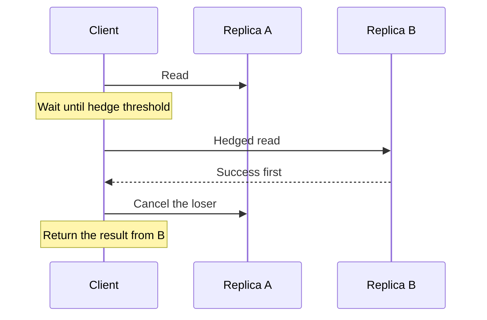

Median latency is a comfort metric. Users, and every service that fans out to you, live in the tail. A request that touches many backends in parallel finishes when the slowest of them finishes. A request that touches them in sequence finishes with the sum of their waits. In both shapes, a pause that is rare on a single replica becomes ordinary at the edge. A hedged request is a deliberate second copy, sent after a short wait or at the same time, usually to another replica, so the caller keeps the first success. It works when the tail is local to one replica, when the loser is cancelled, and when the extra load is in the budget. Miss any of those and the hedge is a retry that started early.

## Concept

Tail latency is the same system, observed on the replicas where a disk is busy, a young generation is collecting, a neighbor on the connection sent a large response, a lock is held, a page is cold, or a packet sits behind someone else's burst. At low request rates you rarely land on those replicas. At high rates, and at high fan-out, you land on them on almost every user request. The median of each backend can be excellent while the edge percentile you publish is not.

### Why fan-out makes a rare pause common

If one backend has a one percent chance of taking longer than a hundred milliseconds, a single call is a one percent problem. Twenty independent calls, all of which must finish, are a different problem: about eighteen percent of user requests wait on at least one slow backend. The edge tail is then dominated by events each backend would call rare. That arithmetic is what I walk through when a team is proud of a backend median and confused by the page that uses it.

The pauses are often correlated, which makes the arithmetic worse and the hedge weaker. A zone event, a shared disk, a configuration push, a fleet-wide collector change, a stampede on one cache key: the slow replica is a slice of the fleet at once. Hedging inside a correlated slice races two copies of the same wait. Isolation is the tool for that case. Shuffle sharding, a smaller blast radius, a tenant that is not packed onto every replica.

Queueing is the tail you can buy on purpose. A replica a little hotter than its peers grows a queue that turns a short service time into a long wait. A balancer that picks at random keeps feeding it. Choosing the less loaded of two random candidates, and balancers that can see in-flight work, exist so that queue never becomes the tail. A hedge is a weak substitute for a balancer that avoided the queued replica. It is a fair complement when the pause starts after the request is already in flight, where the balancer can no longer see it.

### Hedged requests and the threshold

A delayed hedge sends a second copy, usually to a different replica, after the first copy has waited past a threshold. The threshold is often a high percentile of healthy single-replica latency, commonly around the ninety-fifth. A tied request sends both copies at the start and keeps the first success. Everything else in the design is cancellation, idempotency, and a budget for the extra attempts.

The threshold is a bill. Hedge near the median and you nearly double load in order to race two replicas that were both going to be fast. Hedge only at the extreme tail and you rarely fire, which is kind to capacity and weak against the latency you meant to cut. I start near the healthy high percentile of one replica, measure the fraction of requests that cross the threshold, and move the threshold with that measurement in hand. Extra load is that fraction times the cost of the second call, reduced by whatever work cancellation actually stops.

Tied requests belong on paths where the tail is expensive to the user and the work is cheap enough to pay twice on every call: a tiny metadata read, a membership check, a filter that misses. They do not belong on a heavy transcode or a write that mutates. I do not hedge writes. Two writes in flight are two writes, even when both carry the same idempotency key, until the store has collapsed them. The safe follow-up to an uncertain write is a status read, not a second mutation launched because the first looked slow.

### Cancellation is half the mechanism

A hedge that does not cancel the loser is a retry that began before the first call failed. The slow replica runs to completion, holds its workers, hits the database, and may fill a cache nobody needed. At fleet scale that leftover work is the load you forgot to provision. Cancellation has to be prompt, and the server has to honor it.

Prompt means the winner's completion, or an expired deadline, sends a cancel immediately. Honored means the server stops, including downstream calls it has already started. A large number of handlers check a deadline at entry and then run to the end. A hedge into that server buys a smaller user-facing latency by spending extra load on the loser. That can be a deliberate trade if you sized the capacity for it. It is an incident if you did not, and it will show up first as a rise in backend QPS that the edge team did not put in the capacity plan.

Trace it. I want a span marked as hedged, a counter for hedges fired, a counter for hedges that won, and a counter for cancels the server actually stopped on. If wins are rare and ignored cancels are common, you are paying for a tail cut you might have bought with a better balancer or with headroom on the slow replicas.

### When the hedge is the wrong tool

Leave the hedge off when the dependency is saturated. The tail is then the system's cliff, not one unlucky replica, and a second call is a retry storm on a shorter timer. Leave it off when there is only one replica, or when the other replicas share the disk, the lock, or the cold key. Leave it off when the concurrency limiter cannot see the extra in-flight call. Leave it off on a path whose latency target is already met and whose cost is mostly the downstream's bill. Tail reduction is a budget. Spend it where fan-out makes users wait.

The setting this technique was built for is a fleet of replicas, cheap idempotent reads, occasional pauses that are not shared across the fleet, and cancellation as a real property of the RPC. Large storage and search systems used backup requests in that world. Copy the conditions, not only the client flag.

## Trade-offs

| Approach | When it wins | Cost / risk |
| -------- | ------------ | ----------- |
| No hedge; fix the tail at the source | Correlated pauses, saturation, or a single replica | Fan-out arithmetic remains if you cannot isolate the backends |
| Delayed hedge near a high percentile | Independent replica pauses on cheap idempotent reads | Extra load; useless if you cannot cancel; a storm if the fleet is saturated |
| Tied requests from the start | Tiny, highly replicated reads you will pay double for | Doubles healthy-path load; wrong for writes and for heavy work |
| Hedge only across failure domains | The tail is local: a collector, a disk, one hot host | Useless when a zone or a shared working set is the cause |
| Better balancing and a smaller fan-out | The tail is a queue on a hot replica, or a request that touches too many backends | Operational work; a pause after dispatch is still invisible to the balancer |
| Return a partial result and skip the slow backend | A page that can omit one panel | Product work; a fail-closed backend must not be skipped in silence |

Hedging buys latency with capacity. The receipt has to be visible on a dashboard before the flag is left on. A meaningful cut in edge tail latency at a small rise in backend attempts can be a bargain. The same cut at a large rise, because cancellation is a no-op and the threshold sits too close to the median, is an incident scheduled for the next peak.

Partial results are the other tail tool, and product teams underuse them. If the page can render without one of many backends, the hedge on that backend is optional. If it cannot, the hedge is racing a deadline the user will feel. Make that product decision first. Hedge what remains, and only the reads.

## Diagram

One read, a delayed second replica, a cancel of the loser, and the first success returned. If the cancel is missing from the picture, the picture is a retry.

## Failure modes

### A hedge the server will not stop

**Detection.** Backend QPS and CPU rise by about the rate at which hedges fire. Edge tail latency improves. Traces on the slow replica run to completion after the client already has a result. Cancel spans are absent, or present and ignored past the entry check.

**Mitigation.** Propagate the deadline and abort the handler, including work it has already sent downstream. If the server cannot abort, turn the hedge off for that route, or provision the extra load explicitly and treat it as a tied request you chose to pay for. Measure cancels the server honored, not only cancels the client sent.

### Hedging into a saturated dependency

**Detection.** The hedge-fire rate climbs toward every request. Both replicas are slow. Limiter rejections and explicit overload responses rise with the hedges. Goodput falls while attempt rate rises.

**Mitigation.** Disable hedges when a breaker is open, when a limiter is shedding, or when success latency has left the healthy baseline. A hedge is a tail tool for a fleet that is mostly fast and occasionally slow on one replica. It is the wrong tool for a fleet that is overloaded everywhere.

### A tail that is shared across the replica set

**Detection.** Hedges fire and lose. The second replica is as slow as the first. The slowdown lines up with a zone, a config push, a cache flush, or a collector change. Traces on both replicas show the same wait.

**Mitigation.** Stop hedging that route and fix isolation. Place shards so one tenant or one hot key is not on every replica you might hedge to. Stagger configuration pushes. Keep at least one replica out of the first wave of a cache warm. Hedge across failure domains only when those domains actually fail independently.

### A hedged write, or a read that is not safe to repeat

**Detection.** Duplicate side effects: two charges, two publishes, two mutations with different identifiers for one user action, or a stampede of cache fills caused by the second read.

**Mitigation.** Restrict hedges to idempotent reads. For anything with a side effect, wait for the first call, or follow an uncertain result with a status check. If a platform library hedges by default, turn it off on write routes in the same review that sets the retry policy.

## Real-world example

The public account of tail latency in large Google services is the record this technique comes from. The production setting was storage and search fan-out, including systems in the family of Bigtable and the Google File System, not a client flag left on for every RPC.

A search query, or a storage read that touches many tablets, issues a large number of calls. Most finish quickly. A few hit a compaction, a lock, a collection pause, or a busy disk. Waiting on those few moves user-visible latency out of the body of the distribution and into the tail, on a large fraction of queries, because of the fan-out arithmetic above. The response was a backup request. If the original call was still running at a high percentile of healthy latency, send the same read to another replica, take the first answer, and cancel the rest. Where the work was cheap enough and the replicas were plentiful, both copies went out together.

The machinery around that choice is what a careless copy drops. The reads were safe to repeat. Cancellation was a real property of the RPC stack and was honored below the handler. The extra attempts were inside a capacity budget someone could see. The target was a pause local to a replica, not a tablet server that was actually out of capacity. When a server was saturated, another copy of the same overloaded work was more load, not a shorter tail.

The review question, before the flag is enabled on our own client, is the arithmetic for this fan-out. Twenty backends that are each slow one percent of the time is a page that is slow a large fraction of the time. Three backends at the same rate is a different product and a different budget. The hedge allowance should follow that number, and the cancel-honored counter should be on the dashboard the week the flag ships.

## What to remember

- Fan-out turns rare replica pauses into common edge latency. The tail is that arithmetic, plus queues, plus events that hit many replicas together.
- Hedge cheap idempotent reads when the pause is local to one replica, the loser is cancelled, and the extra attempts are in the capacity budget.
- Saturation, writes, and a replica set that slows together are the wrong targets. Those hedges become storms and duplicate side effects.
- Count hedges fired, hedges that won, and cancels the server honored. Prefer a better balancer or a partial result before you spend a double budget.
