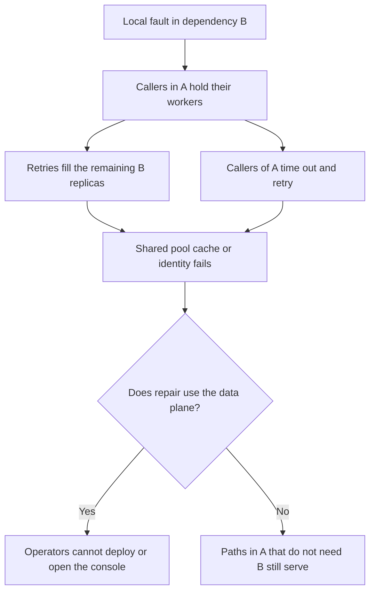

A cascading failure is a local fault that becomes a fleet fault because of a coupling nobody budgeted as a failure domain. One replica slows. Callers hold threads waiting on it. Those threads stop serving paths that were healthy. Retries move the slowdown sideways onto peers that were fine. A shared pool, a shared cache, a shared identity service, or a shared control plane takes the next system with it. The original fault may already be gone. The cascade is the incident. Case studies matter here because the couplings that do the damage are specific: a console that stored its state in the system it was supposed to repair, a name every internal tool required, a metadata service that recovery itself could not proceed without.

## Concept

I treat a cascade as a graph with a clock. Nodes are services, pools, and control planes. Edges are synchronous calls, shared resources, and hidden runtime couplings such as a process-wide lock or a configuration push that hits every replica together. The clock is how long each node will wait, and how many times it will try again, before it sheds or fails the caller. A cascade is what happens when a fault at one node pushes its neighbors past that wait before they can isolate themselves.

### Anatomy of a cascade

Four ingredients show up together often enough that I look for them in every serious write-up.

A scarce resource is held across a wait. Threads, connections, locks, buffers, file descriptors. The wait is a downstream timeout that is long relative to the arrival rate. Little's law does the rest: a slow dependency fills the pool, and once the pool is gone, healthy paths in the same process fail with it. The first service did not have to be down. It only had to be slow enough that the caller's workers never returned.

Amplification follows. Retries, fan-out inside the handler, cache fills, health-check storms, reconnects, or a reconciler that runs hotter as the data plane fails. The second wave is larger than the first, and it arrives at the remaining healthy capacity.

A shared fate was missing from the design diagram. One thread pool for every outbound call. One cache cluster for every tenant. One regional metadata store. One identity check on every request, including the request that was supposed to be the fallback. Shared fate is how a fault that should have been a feature flag becomes a site outage.

A repair path uses the failed system. Consoles whose documents live on the data plane. Deploy tools that call the same API they are trying to fix. DNS that you need in order to repair DNS. This ingredient is what turns a bad hour into a bad day, because the people who would cut the other edges cannot reach the controls.

Remove any one ingredient and you still have an incident. Remove the shared fate, or the repair coupling, and you often still have a local incident. That is the design goal. Local incidents are tolerable. Cascades are how a local incident spends the error budget of systems that were not broken.

### How the fault jumps

The first node fails in a small number of ways: a bad deploy, a full disk, a hot partition, a network blip, a capacity cliff, a person following a runbook with the wrong scope. Its callers fail differently. They fail by blocking. Blocking is how the fault crosses the process boundary. A service that could have served most of its requests from memory looks down because every worker is inside a call to a dependency that handles a sliver of the page.

From there the jump has a direction. Lateral: retries and load balancing push the remaining healthy replicas of the same service into the same sick state, and health checks may then remove them. Upward: the caller's workers are gone, so the caller's callers time out and retry, and a service that was never unhealthy is now saturated with salvage traffic. Downward: the sick service's own dependencies see a storm of retries, health checks, and reconnects, and they fail next even though their steady-state load was fine.

Bulkheads and short timeouts cut the first jump, the one that happens by blocking. Breakers cut the upward jump by stopping a caller from spending its whole pool on a dependency it already knows is sick. Retry budgets cut the lateral and downward jumps by refusing to multiply load as capacity shrinks. A repair path that does not sit on the data plane removes the edge that locks the operators out. A write-up that says only "we should have had a breaker" has usually skipped which jump did the damage, and the next incident will use a different jump.

### Couplings that are not on the architecture slide

The surprises are rarely the product calls you drew in the design review.

Process-wide pools. One server thread pool, one runtime, one default HTTP client with no per-dependency limit. The first slow call owns the process.

Control hosted on the data plane. A scheduler API in the same failure domain as the nodes it would reschedule. An admin UI that reads and writes the production store. A status page that cannot update because it stores its own status in the failing system.

Identity, DNS, and time. They sit on every request, including the fallback, including the page that was supposed to be static, including the login you need in order to open the console.

Shared client libraries. One SDK that retries, caches, and opens connections, with defaults no service owner set and no route can see. A library upgrade becomes a synchronized change in retry gain across the company.

Autoscalers and health checks. They add arrivals at the worst moment, or they remove nodes that were healthy because the check itself called the sick dependency.

If a review diagram shows only product services and product arrows, it is not a failure-mode diagram. Draw the pools, the libraries, the identity hop, and the tools you would use at 2 a.m.

### What isolation has to mean

Isolation is a named resource that can fail while a different named resource keeps serving. A bulkhead per dependency. A connection pool per downstream. A concurrency limit per tenant or per shard. A control-plane network that does not share fate with customer traffic. An admin path that does not read the customer data plane. A last-known-good copy of the few bits of configuration a process needs in order to keep answering. Failure domains that match the blast radius you are willing to take: a zone, a cell, a shard, rather than "the platform" as one name.

The test is crude and worth running on a schedule. Kill the dependency in a game day, or make it slow rather than dead, which is the more realistic fault. Do the paths that do not need it still serve. Can an operator still deploy, still page, still sign in to the repair tools. If the second answer is no, the cascade has already reserved those people. You will discover that during the incident, when it is too late to build a side door.

## Trade-offs

| Approach | When it wins | Cost / risk |
| -------- | ------------ | ----------- |
| Per-dependency bulkheads and breakers | Callers that fan out, and any process that mixes criticality | Keys to own; a key that is too wide recreates the shared pool |
| Cells, shards, or zones with static capacity | You need a hard limit on how far one fault can travel | Cost, and a global dependency still couples the cells |
| Fail open on a non-critical edge | A page that can omit a panel or a recommendation | Silent wrongness if you fail open a decision that should have failed closed |
| Fail closed with a fast error | Money, authorization, inventory, anything a guess makes worse | That feature's availability tracks the dependency, on purpose |
| Repair tools on an isolated control plane | Incidents that would otherwise lock operators out of their own system | Another system to run; if you never exercise it, it is down the day you need it |
| A deep synchronous call graph | Teams that wanted a request and a response on every edge | Every edge is a cascade edge, and timeouts stack |

Fail open and fail closed are product choices wearing an infrastructure costume. A cascade on a media homepage is a missing row. A cascade in a payment capture is a duplicated charge or a lost one. The isolation pattern can be the same bulkhead. The answer when the bulkhead is empty is not. Write that answer next to the dependency, not in a generic reliability doc.

A cell still helps when the coupling is a bad library default or a global identity outage, and only if the cells do not share that library's control path or a single metadata call on every request. A partition that still calls one global service before it can serve is a label. It is not a blast radius.

## Diagram

A local fault, callers that block, a lateral retry onto healthy peers, an upward jump, and a repair tool that needs the data plane. Cut any of those edges and the rest of the graph can stay up.

## Failure modes

### One pool for every command

**Detection.** A dependency that is a small fraction of traffic takes the process to almost no useful work. Thread dumps and profiles show most workers inside one outbound call. Other routes do not appear in traces, because they cannot obtain a worker.

**Mitigation.** A bulkhead per dependency, with a timeout that fits inside the caller's remaining deadline. A breaker so the bulkhead does not keep refilling into a peer you already know is dead. This is still the first jump I see in application cascades, and it is the cheapest one to close.

### Retries taking down the healthy peers

**Detection.** Replicas that were healthy fail minutes after the first one. Attempt rate on each remaining replica climbs as the replica count falls. Health checks may then remove the rest, which concentrates the load again.

**Mitigation.** Retry budgets, jitter, and balancer behavior that does not dump every request onto the last node still in rotation. Limit reconnect storms. Take a bad replica out yourself, before the herd does it by timeout. Shed at the survivors rather than queueing the share of load they inherited.

### The console or the control plane lives on the data plane

**Detection.** The outage notes include "we cannot open the dashboard," "deploys are stuck," or "the name of the API is served by the API." Time to repair is dominated by finding a side channel, not by the original fault.

**Mitigation.** A repair path that stands on its own: break-glass credentials, an out-of-band network, a console that does not store its state in the failing store. Prove it by locking the data plane away in a game day and still completing a deploy and a config change.

### A fallback that shares the failure

**Detection.** Breakers open and the fallback still fails. Traces show the fallback calling the same dependency, or a cache that fills from it on every miss, or an identity check that cannot be skipped.

**Mitigation.** Prefill a cache that does not share the dependency's failure domain. Keep last-known-good on the instance. Skip an identity round trip on a degraded path only when that skip is an explicit product decision with an owner. A fallback inside the same failure domain is another name for the original call.

## Real-world example

The S3 disruption in US-EAST-1 on 28 February 2017 is the cascade I still draw when a team says their blast radius is the service they own.

The trigger was a person with authorization. An operator ran a command intended to remove a small number of servers from one S3 subsystem. The command removed far more capacity than anyone meant to remove. That is a local operational fault inside one storage subsystem. It became a regional event because S3 in that region was not only a place customers put objects. Other AWS services, and parts of S3's own operations tooling, had placed that region's S3 on their request path and on their repair path.

The indexing subsystem that supports listing was hit especially hard. Services that kept configuration or state in S3 in that region degraded or stopped. The service health dashboard, which teams used to decide whether a problem was theirs or the platform's, depended on S3 and could not update. Console and recovery workflows that assumed the data plane was reachable had to be done without the tools operators were used to reaching for. Customer applications retried, which is the client behavior you should expect, and those retries arrived at a fleet that was already missing the capacity the command had taken away.

Two structural facts made the day longer than the mistaken command. A dependency that looked like a global primitive was, for a large set of callers, concentrated in one region, including callers whose own customers believed they were spread out. And parts of the status and repair path sat on the same data plane they were supposed to explain and restore. The practical review is to list every system that stores its own brain in your data plane, including your console and your status page, and to give operators a way to work when that plane is wrong. The product names in the next internal incident will differ. The jumps will not: block on a wait, amplify with retries, share a pool or a name, and lock the people who would have cut those edges.

## What to remember

- A cascade is a fault that travels along blocking waits, retries, shared pools, and repair paths that sit on the failing system.
- Cut the blocking jump with bulkheads and deadlines, the next jumps with breakers and retry budgets, shared fate with real isolation, and lockout with a repair path that does not need the data plane.
- Client-library defaults, identity, DNS, health checks, and consoles belong on the failure diagram next to the product calls.
- Game-day the lockout. If operators cannot deploy, page, or sign in without the data plane, the next cascade already includes them.
