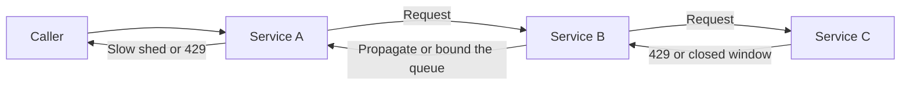

Inside one process, backpressure is a bounded queue whose put waits or fails, or a credit window that stops the producer when the consumer is not ready. Across a service boundary the invariant is the same and the signals are worse: longer delays, more hops, and neighbors who can ignore a hint. If the downstream cannot take work at the offered rate, the upstream has to slow down, refuse, or buffer in a place you have named and sized. When the signal dies at the HTTP response, the next service turns it into retries, an unbounded internal queue, and a memory incident on a machine that was not the bottleneck. Explicit backpressure is a protocol. Latency is a hint that something is wrong. It is not a contract that says send less.

## Concept

A transport already does this on a socket. The receive window shrinks, and a sender that respects the window slows down. A single request-response call mostly does not. The server's answers are that it is working, that here is the body, or that the caller gave up. HTTP/2 and gRPC put a flow-control window back on each stream. Log consumers and queue workers pull. A reactive demand for N items is a credit window inside a process and, if the streaming API honors it, across the network. The protocol details are not the lesson. Every boundary either exports a brake, absorbs a bounded amount of work with an owner, or becomes the place the pile lives until the process falls over.

### Explicit signals, not inferred slowness

Latency is late and ambiguous. A downstream can be slow because it is saturated, because one lock is held, because a neighbor region is degraded, or because you sent one pathological payload. If you infer "send less of everything" from a percentile, you will also send less when the right move was to fail that payload, that tenant, or a request whose caller has already left. Prefer a code that means one thing. An HTTP 429. A 503 that carries Retry-After. A gRPC status that says the resource is exhausted. A broker throttle. A stream window of zero. An unfulfilled credit.

The code has to stay specific as it crosses hops. "This replica is full" and "the whole fleet is full" are different instructions. The first may be tried once more, against another replica, with jitter. The second should slow the caller. It should not rotate through every pod until one of them accepts. A 429 with a delay is a rate signal. A 500 is an application outcome. Treating every 500 as backpressure is how bugs become accidental traffic shaping, and how a real overload gets retried because it did not look like a rate limit.

Carry the signal. If service C emits a 429, service B should not retry it into oblivion and then emit a success or a generic 500 toward A. B emits the same class of signal, or a 503 that A has been taught to treat as a brake, or B absorbs the work into a bounded queue that has its own latency target and a page. Absorbing with no bound is hiding the pile in B's memory and calling it decoupling.

### Pull, credit, and a bounded place to wait

Pull is the brake that is hardest to get wrong. A worker that fetches the next batch only when it has room will not be handed a push it cannot refuse. A log consumer, a queue receive loop, a subscription that asks for N items: this is the pattern I want on asynchronous pipelines. The remaining problem sits upstream of the buffer. Producers can still append faster than consumers drain. The brake then has to move to the producer: a quota, a block when the producer buffer is full, a 429 at the edge that accepted the user. Consumer lag is the signal that the brake is needed. Lag with no target and no owner is a deferred outage with a pretty chart.

Credit-based push is what you want when the API is a stream rather than a poll. Transport windows, HTTP/2 stream windows, reactive streams, a broker prefetch. The consumer grants credits. The producer may send only that many outstanding items. A prefetch of one is strict and often too slow. A prefetch of many thousands is a burst buffer that lives in RAM and will hurt the consumer on restart, when the whole window is redelivered at once. Size the window from memory and from how much in-flight work you can abandon if the consumer dies. If you cannot abandon it, the window is a durability decision, not a throughput knob.

Bounded absorb is what remains when the producer cannot slow down on your clock. A partner webhook, a sensor, a public API, a mobile client on a bad network. You accept a finite number of requests into a queue that has a name, an owner, a retention policy, and a behavior when it is full. Full means 429, or drop the oldest, or drop the newest, chosen because of what the product can stand to lose. A log used as an infinite sponge is not absorb. It is disk filling up, and it returns later as a consumer stampede or as a broker that stops accepting writes for everyone.

### The lie at the handler boundary

The lie I see most often is a request handler that writes into an unbounded in-memory queue, returns HTTP 200, and lets a background thread talk to the real downstream. The 200 claimed the work was accepted and would be done. The unbounded queue claimed the process has infinite memory. When the downstream slows, both claims fail, and they fail in the wrong order. The process runs out of memory or spends its time collecting garbage. The caller believes the work succeeded. Support then debugs missing side effects against a green success rate.

If you decouple the user request from the downstream call, the 200 is honest only after the work is on a durable, bounded store. Otherwise return 202 and a way for the caller to learn that the store is full or that the work later failed. The background worker applies backpressure to that store, not to the heap. A timeout on the caller's original request is not backpressure on a fire-and-forget path. It is how the signal disappears while the pile keeps growing.

Reactive pipelines have a typed version of the same lie. An unbounded buffer operator, a handoff onto an unbounded executor, a flat map that launches unlimited concurrent calls into a downstream RPC. The types make it look as if credit flows from the subscriber to the source. Credit flows only as far as the first unbounded stage. After that stage you have a pile with a fluent API.

### Someone must be allowed to slow the user

End-user clients and partner integrations will not all honor a 429. That is a reason to enforce the limit at an edge you control, with quotas and concurrency limits, and to degrade the product when those limits trip. It is not a reason to skip the explicit code between your own services. Interior hops should not invent retry-and-queue loops that hide an edge decision. If the billing service is full, checkout stops accepting new payment attempts or returns a clear overload. It does not accumulate those attempts in the checkout process until the browser gives up.

Priority belongs in the signal and in the window. Interactive requests and retries should not spend the same credits. When the window shrinks, retries lose their credits first. Background exports lose next. Health checks and control-plane calls need a reserved allowance, or the brake that protects the data plane will also stop you from steering it.

## Trade-offs

| Approach | When it wins | Cost / risk |
| -------- | ------------ | ----------- |
| Pull consumers with a lag target | Async pipelines and any worker that can fetch when it has room | Producers can still fill the log; the lag target needs an owner and a page |
| Credit windows on streams | gRPC, HTTP/2, reactive pipelines, a prefetch you can justify | A window that is too large is RAM; one that is too small leaves throughput on the table |
| An edge 429 with a delay hint | Public APIs and any producer you cannot block in-process | Clients that ignore it, and interior retries that erase it before the user sees it |
| A bounded durable queue, then 202 | Spiky ingest you are willing to delay and to show as pending | Delayed overload, a consumer stampede on recovery, accepted work that is not done |
| An in-process unbounded buffer | Nowhere, except as the shape of an incident | Out of memory, a false success, and a brake that never leaves the process |
| Inferring pressure only from latency | A protocol that cannot carry an explicit code | You slow the wrong callers, and you confuse overload with ordinary tail latency |

A 202 into a durable queue is an honest API only if failure to drain is visible to the product and to the operator. Telling a user the upload was accepted, then dropping it days later when retention expires, is a lost write with a broker in the middle. Publish the lag. Page on it before retention becomes the shed. Give the caller a status they can poll.

Interior retries are the enemy of backpressure that is supposed to cross a service boundary. A clean 429 that three meshes immediately replay is a 429 that never reached a decision maker. Review the retry policy and the overload policy as one change. If they disagree, the retry policy wins in production, and the overload code is documentation.

## Diagram

Service C cannot take more work. Service B must not turn that fact into memory or into a private retry loop. The caller has to observe a brake, not only a timeout.

## Failure modes

### The next hop swallows the signal

**Detection.** C is emitting 429 or an exhausted-resource status. B's error rate is high, while A's success rate still looks fine, or A sees timeouts and generic 500s rather than a rate signal. B's heap or an internal queue depth is growing. User-facing latency rises minutes after C started refusing.

**Mitigation.** Map a downstream brake to an upstream code on purpose, and test the mapping. Retry C's refusal inside B only against another replica, and only when the code means this replica is full rather than the fleet. Give B a bounded absorb with a target, or make B refuse. Prove it with a stub of C that returns only the overload code.

### A success in front of an unbounded queue

**Detection.** API success rate is green. A background queue is the real sink, and it is not durable. Memory, garbage collection, or a crash loop appears when the downstream stalls. Users report missing work that the API said it accepted.

**Mitigation.** Persist to a bounded store before you return success, or return an accepted-for-processing status from a store that can itself refuse. Keep the in-process side to a small number of items. Load-test a stalled downstream, not only the happy ingest rate.

### A credit window so large it is not a brake

**Detection.** A consumer restart dumps a huge number of in-flight messages into memory or into a downstream RPC. Throughput looks excellent until the first stall. Unacknowledged counts or stream windows sit at their ceiling all day, so the window never actually closes.

**Mitigation.** Size the window from the work you can abandon or the memory you can spend. Prefetch in the tens or low hundreds for a typical consumer that calls another service, not in the tens of thousands. Watch in-flight work and redelivery, not only throughput.

### One tenant spends the shared window

**Detection.** One tenant, one retrying client, or one batch job occupies the credits or the connection pool. Interactive traffic is refused. The service looks full, and the fullness is the wrong work.

**Mitigation.** Split windows by priority and, where a tenant can dominate, by tenant. Refuse retries before interactive calls. Cap per-tenant concurrency at the edge so one producer cannot spend the fleet's brake on everyone else's behalf.

## Real-world example

Netflix's move from the first Zuul gateway to Zuul 2 is the public system I use when a team needs backpressure that actually leaves the overloaded process.

The first gateway was a blocking server. Each inbound connection, and each call to an origin, held a thread for the whole wait. When an origin slowed, those threads were the scarce resource. The gateway stopped accepting new connections because its workers were blocked reading from a dependency. The site looked down. The only brake was running out of threads, and the client of that brake saw a connection failure or a timeout and retried.

The later gateway runs the edge on an event loop. An inbound request does not occupy a worker thread while the origin thinks. Whether the gateway will read more bytes from the client, and whether it will write more bytes to the origin, is a credit problem, closer to a transport window than to a thread pool. When an origin slows, the gateway can stop reading from the client, which is a brake the client stack already understands, or it can fail that route without taking the rest of the process with it. Per-origin isolation, deadlines, and concurrency limits still matter. The event-loop change does not replace them. It makes them enforceable, because the process is no longer paying one thread per wait and therefore still has a way to refuse.

The lesson is not that every gateway should be rewritten onto an event loop. A boundary whose only overload behavior is "we ran out of threads" cannot export a brake. The caller sees a hung connection and tries again. An explicit window, an explicit overload status, and a process that can still refuse while it waits: that is how the brake leaves the machine that is overloaded and reaches the machine that is still sending. If you are stuck with a blocking pool for now, you can still tell the truth. A concurrency limit at entry, a fast 503, a queue bound near zero, and no interior retry of that 503. That is backpressure by admission. It is less elegant than a stream window. It is more honest than an unbounded executor sitting behind a success code.

## What to remember

- Across a service boundary, backpressure is an explicit overload code or a credit window, or a bounded buffer with a target. Latency alone is not the protocol.
- Propagate 429 and resource-exhausted statuses. Do not launder them into interior retries, false successes, or heap growth.
- Pull, credit, and a bounded durable queue are brakes you can operate. An unbounded in-process buffer is a lie at the edge of the handler.
- Reserve credits for interactive traffic and for the control plane, or the brake will also stop the traffic you need in order to steer.
