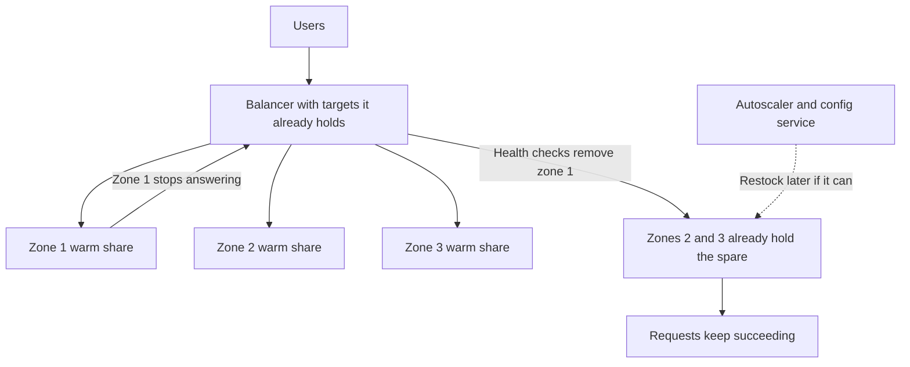

Static stability is the property that a system keeps serving, at the capacity and configuration it already has, when the control plane that would change them is wrong, slow, or unreachable. Autoscalers, deploy controllers, service discovery, certificate issuers, and configuration pushers are control loops. They are how you stay efficient on a healthy day. On a bad day they are extra dependencies with their own failure domains. A statically stable data plane is already provisioned for the next failure you have agreed to survive — a zone gone, a cell gone, a dependency gone — and it does not need a successful control-plane call in that minute in order to keep answering. The spare capacity looks idle on the cost report until the day it is the reason the error budget is intact.

## Concept

The rule I want stated in a review is short. Recovery of the data plane must not depend on the control plane. The data plane is the path a user request takes. The control plane is everything that mutates which machines, certificates, weights, flags, and names that path uses. If losing a zone requires an autoscaler to create instances in another zone before users are served, the autoscaler is inside the availability math, and so is everything it calls: image registries, schedulers, quota services, address allocation, node bootstrap, identity for the control API. That chain is longer than the window in the SLO, and it is most likely to be impaired in the same event that removed the zone.

### Capacity that is already warm

The failure unit you have signed up for, usually a zone or a cell, has to be absent from the serving math before the failure. If you need the capacity of two zones to carry peak, you run three, and any two can carry the load. Those machines are already in rotation and already taking a share of traffic. Shifting load off the failed unit uses a mechanism that does not invent capacity: health checks that stop sending to dead targets, clients that skip a bad endpoint from a list they already hold, DNS or traffic weights that still resolve to somewhere that exists.

Warm means the spare is doing real work. A replica that has never seen production traffic, with a cold cache, a cold runtime, and empty connection pools, is a control-plane action that happens to occupy memory. When the failed unit drops, the remaining units have to absorb its share immediately. They can do that only if they were already serving and already warm. Headroom is not a minimum replica count of zero plus confidence in a cluster autoscaler. Headroom is requests succeeding on the machines you have, with one failure domain removed, without launching anything.

The cost is straightforward and should be argued in availability units, not in a vague preference for efficiency. You pay for utilization that looks low so that a zone failure does not spend the error budget while you wait for instances. Teams that run every zone at a high watermark have written an implicit control-plane recovery into the SLO. Either write that dependency down and accept the risk, or lower the watermark until the loss of one unit still fits inside the capacity that is already serving.

### Last known good, with an age

Static stability is also a configuration property. A process that cannot reach the configuration service should keep serving with the last configuration it successfully applied, for a long but bounded time. It should not crash, refuse all traffic, or busy-loop against the control plane and add a retry storm to someone else's outage. Discovery clients should keep the last endpoint set that worked. Certificates should overlap in time so a failed issuer does not expire the fleet at the same minute. Feature flags on the request path should fail in a defined direction. For most flags that direction is "leave the value as it was," not "flip every flag to the default and restart."

Last known good is a cache with an honesty policy, not a hope. It lives on local disk or in the process, so it does not depend on the store you cannot reach. It has a maximum age, so a routing table or an access decision from months ago is not applied by surprise. Operators can see that the process is in a degraded control mode, on a metric and on the instance itself. And it is not a write path. Last known good continues reads and continues serving. It does not continue to mutate membership, issue credentials, or accept a new policy it cannot confirm.

### Control loops come after the data plane is safe

Autoscaling, automated remediation, and traffic steering are allowed, and on a large fleet they are necessary. They are how you return to an efficient utilization after the event, how you replace the failed unit, and how you drain a bad deploy. They are not how you survive the first minutes. The sequence I want is short enough to put in the runbook header.

The failed unit drops out of the data path by health checks and by clients using targets they already have. Users are served on the remaining capacity, with less spare room, and with whatever degradation you named in advance. Only then do control loops replace machines, rebalance, and restock, on a clock that is allowed to be slow and allowed to fail.

If the third step is required before the first can succeed, you have a race between the autoscaler and the error budget. You do not yet have static stability, however many zones appear on the architecture slide. "Deployed in three zones" is a placement fact. Zone-independent serving is the property. Three zones that share one regional control plane, one regional network translation path, one regional metadata store, or one regional identity endpoint still have a single failure in common. The remaining zones have to answer without talking to the failed zone, and without talking to a regional dependency that lived only there.

### What the property is, in practice

It is not a ban on autoscaling, and it is not a claim that you should not have a control plane. It is not active-passive failover whose runbook needs the system that is failing. A cold standby you scale up after detection is a control-plane recovery with a waiting period. A hot spare you later scale back down, once the failed unit is replaced, is static stability plus a cost action you take when you have time.

It is also not a substitute for admission control. The remaining capacity can still be overrun by retries, and by clients that cached the failed unit's share of traffic and now spray it at every survivor. Static stability gives you a chance to serve the load you planned for. Load shedding and retry budgets keep that chance when the offered load is larger than the plan. The two properties fail in different ways, and an incident often needs both.

## Trade-offs

| Approach | When it wins | Cost / risk |
| -------- | ------------ | ----------- |
| Warm spare capacity across zones or cells | An SLO that includes losing one failure domain without a human in the loop | Idle-looking cost; wasted if the real common failure is regional |
| Scale into the surviving domain when the failure is detected | A workload allowed to spend error budget while capacity appears | Depends on image pull, quota, addresses, and the scheduler during the worst minutes |
| Last-known-good config and discovery | Control-plane blips and regional metadata outages | Stale policy and stale endpoints; an age bound that is too long or too short |
| Hard fail when config cannot be fetched | A security decision you refuse to serve from a stale copy | A config outage becomes a data-plane outage, and that is intentional |
| One regional control service for every zone | The cost and operational simplicity of a single metadata system | Puts that service on the critical path of every zone's recovery |
| Cold standby, started by a runbook | A workload whose users can wait | A planned outage with steps, not static stability |

Have the cost conversation in the same units as the SLO. If losing a zone is inside the promise, the spare capacity is reliability spend, the same way redundancy in storage is reliability spend. If losing a zone is not inside the promise, stop describing the design as multi-zone resilient. Hoping an autoscaler will close the gap during the event is how that spend returns later as an incident review.

Stale last-known-good is a real hazard, especially for authorization and for anything that grants power. For those decisions, fail closed: the process keeps running, and the doubtful operation does not proceed. Serving a read from a cached routing table is one decision. Serving a delete from a cached claim that a principal may destroy a tenant is another. Do not use one cache policy for both.

## Diagram

The capacity that will carry a zone loss is already taking traffic. The control plane may replace what was lost. It is not on the path that keeps the current requests succeeding.

## Failure modes

### Recovery that waits on the autoscaler

**Detection.** Losing a node group or a zone produces pending pods, a surge of image pulls, or a quota error. User error rate tracks the gap between desired capacity and ready capacity. The timeline has a long interval whose label is waiting for machines.

**Mitigation.** Pre-position the spare and keep it in rotation. Raise the minimum in each surviving domain until the loss of one unit still carries the load you have promised. Use the autoscaler to rebuild the failed domain and to return utilization to the steady target afterward. Alert on the gap between needed and ready, and treat a gap during a zone event as an SLO miss, not as autoscaler lag you can ignore.

### Config or discovery fails closed and takes the data plane with it

**Detection.** A metadata, flag, or name-service outage turns healthy data-plane hosts into errors or crash loops. Hosts that were serving stop when their watch errors. Certificates expire together because renewal lived in the failing domain and lifetimes were aligned.

**Mitigation.** Last known good on local disk, with a visible degraded mode and a maximum age. Overlapping certificate lifetimes so one missed renewal is not an expiry. Client endpoint caches and DNS records that outlive a typical control-plane incident. Game-day the property by blocking the config API from the data plane, not by killing data-plane hosts and calling that a test of discovery.

### A regional dependency that couples the zones you thought were independent

**Detection.** A zone event shows up as errors in the zones you called unaffected. The path is a regional address translation layer, a regional API, a regional key service, or a regional database. Spare capacity in the surviving zones sits idle because every request still needs the regional dependency.

**Mitigation.** Make the remaining units able to serve without that dependency, cache the answers they need, or split the dependency so it fails with the zone. If you cannot, declare it a single failure domain and size the SLO for losing it. Several zones that still take a regional lock on every request are one failure domain with extra network latency.

### Spare capacity that has never served a request

**Detection.** Failover looks successful in replica count and fails in latency and error rate. Caches stampede. Runtime warm-up and connection setup dominate the profiles. The spare group had been scaled to zero, or it had been excluded from traffic for so long that its working set was empty.

**Mitigation.** Keep the spare in the serving path, taking a real share of production traffic. If a warm pool must sit out of rotation for a product reason, exercise it continuously: images already present, synthetic traffic, pools already open, caches already hot for the keys that matter. A pool you have never served from is a capacity theory. It is not a failover.

## Real-world example

Amazon's public writing on static stability describes the property as it is used in multi-zone data planes: load balancing, storage, and compute that have to keep taking traffic when a zone disappears and when the APIs that would launch replacements are impaired at the same time.

The design they argue for is overprovisioning that is already in the request path. If the service is built to survive the loss of one zone, each remaining zone already has room for the extra share, and the machines that will carry that share are already serving. Load balancers drop the bad targets with health checks. Clients keep using endpoints they already resolved. The control plane, including the calls that create new instances, is allowed to be slow or unavailable in the same event. In more than one regional incident, control-plane APIs have been degraded while data-plane operations on resources that already existed continued for customers who did not need to launch anything new.

That distinction is the sentence I want in our own reviews. Existing instances, existing load-balancer capacity, and existing stored objects keep working. Creating new ones might not, and the platform has said so by how these systems fail. A design, on our side or a customer's, that must launch a replacement fleet in the surviving zones in order to stay up has taken a dependency that does not belong on the recovery path. The shape we should be running is the same one. Enough capacity in each zone today, already warm. Fail over with health checks and with names the clients already hold. Treat autoscaling as the way you become inexpensive again after the event, not as the way you become available in the next few minutes.

I apply the same test to Kubernetes platforms we operate. If a zone loss requires the cluster autoscaler, the image registry, and the API server to all succeed before any additional pod is ready in the surviving zones, the platform has not bought this property. A minimum that already schedules the spare, on nodes that already have the image, with a discovery cache that survives a control-plane blip, is the statically stable version. The autoscaler is how you fill the hole once the data plane is safe, and how you stop paying for the hole once the failed zone returns.

## What to remember

- Static stability means the data plane keeps serving on capacity and configuration it already has when the control plane cannot help.
- The spare for a zone or a cell has to be warm and already in rotation. Autoscaling restocks afterward. It does not rescue the first minutes.
- Last known good covers discovery, flags, and overlapping certificates. Fail closed only on decisions that must not be served stale.
- Several zones are not this property if a regional dependency, a cold standby, or a launch API sits on the path that keeps requests succeeding.
