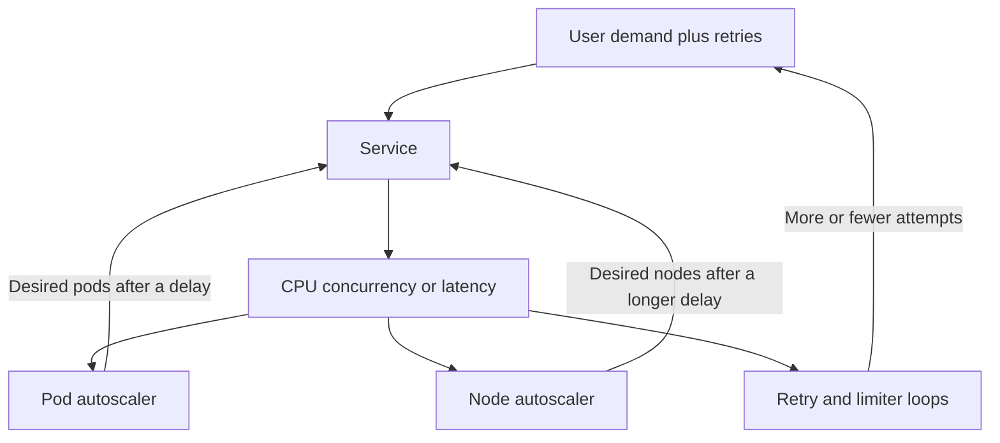

An autoscaler is a feedback controller with a delay. It reads a signal, compares that signal to a target, and changes a replica count or a node count. The delay is the part that makes the loop unstable: scrape interval, evaluation window, image pull, scheduling, readiness, cache warm-up, and then a metric that will not move until the new capacity is actually serving traffic. High gain plus a long delay overshoots. Two controllers on one signal fight each other. An application retry loop is a third controller on the same service. The replica count becomes a square wave, and the incident looks like the platform flapping. The platform is doing what the policy says, one actuator delay too late.

## Concept

The pieces have ordinary names even if nobody writes a transfer function. The plant is the service whose capacity you are trying to match to demand. The sensor is the metric. The actuator is desired replicas, desired nodes, or sometimes a concurrency limit. The error is the gap between the target and the measurement. The delay is how long the plant takes to respond to a change in the actuator. Stability, in the sense that matters on call, is whether a disturbance dies out. A traffic spike, a slow dependency, a bad deploy: does the controller's correction shrink the error, or does the correction keep the error alive after the disturbance is gone.

### Delay, gain, and the overshoot you configured

A proportional rule that says the CPU is twice the target, so double the pods, would be reasonable if pods appeared at once and CPU fell at once. They do not. During the delay the error stays large, so the next evaluation periods request still more capacity. When the first pods finally become ready, you have several times what the original spike needed. The metric collapses. A scale-in policy as eager as the scale-out policy removes the extra pods. The next spike, or the retry wave from the same spike, finds the fleet short again. That oscillation is not a bug in the controller. It is gain and delay with no damper.

The knobs I want named in a review are the ones that set those two quantities.

The signal. CPU, in-flight concurrency, queue depth, or request rate against a measured capacity per replica. A noisy signal is high gain even when you only add one replica per step, because the error keeps changing sign.

The window. A short window on a spiky metric chatters and scales on noise. A very long window misses the event and scales after users have already left. Asymmetry is useful: a shorter window to add capacity, a longer window to remove it.

The step and the cap. Adding a small number of replicas is steadier than jumping desired count to the formula's full output every interval. A maximum change per evaluation period is a rate limit on the actuator, and it is how you keep six evaluations of the same unsolved error from becoming six times the capacity.

The cooldown. After a large scale-out, wait until the plant has had time to catch up before you believe the metric again. The wait before scale-in should be longer than the wait before scale-out. Users forgive spare capacity. They do not forgive a fleet that shrinks into the next wave.

The actuator delay itself. Image size, node launch, networking, readiness probes, connection pools, cache warm. This delay is often longer than the evaluation period, and it is the number teams leave out of the model. If new pods take ninety seconds and you evaluate every fifteen, the controller sees the same error six times. Unless you hold, that is six chances to overshoot.

### Several loops on one plant

Production rarely has a single controller.

The application has its own loops: retries, hedges, concurrency limiters, breakers. Each of them changes the load the autoscaler sees.

The pod autoscaler, whether a horizontal scaler, an event-driven scaler, or a cloud target tracker, changes desired replicas from a metric.

The node autoscaler, a cluster autoscaler or a node provisioner, changes machines because pods are pending. Its delay is longer than the pod loop's delay.

The load balancer removes slow targets with health checks and thereby concentrates load on whoever remains.

Caches add fill traffic on a miss, which looks like user load to every scaler watching request rate.

A downstream service has a scaler you may not own, reacting to the connections and the QPS you just multiplied.

These loops couple through the metrics. Retries raise request rate, so the pod scaler adds pods, so the node scaler adds nodes, so a cohort becomes ready together after the retry wave has already peaked. Health checks then remove the pods that are slow because their caches are cold, and the remaining pods take a larger share. A limiter that is shedding makes CPU look low, so a CPU-based pod scaler removes replicas during the incident, which is the opposite of what the overload required.

I want one picture that answers whether we are short of capacity. It includes incoming demand, not only the work we accepted. Shed rate and queue time belong on it. CPU after a limiter has refused work is a lie about idleness. Replica count without ready nodes is a lie about capacity. Desired versus ready is the first pair of series on the dashboard, ahead of the metric the policy happens to watch.

### Oscillation that follows from the wrong sensor

Some oscillation is the controller hunting a target the plant cannot hold. A service whose wait is a downstream database will not get faster because you add pods. Extra pods open extra connections. The database gets slower. Latency rises. A scaler that watches latency adds more pods. The loop is unstable because the actuator does not move the quantity the model assumed it moved. Scaling on latency is usually this mistake. Latency is an output of the whole graph, including dependencies, retries, and queues. More of your process is not more of the database, and it is often less.

A metric that includes the controller's own side effect is the other classic. Scale on requests per pod. A brief error during a deploy, or a retry burst, adds pods. Each pod then sees fewer requests, so the target looks met by dilution. The deploy ends, traffic returns to normal, and you scale that fleet back in over the next half hour, just as the users who left during the errors come back. The policy achieved its formula and missed the capacity you needed.

Stabilizing the loop is a set of dampers, not a single clever metric. Use a signal the actuator can actually move: saturation of a resource this pool owns, concurrency against a measured capacity per replica, or a queue this pool drains. Put a floor under replica count so hunting cannot take you through a cold start. Put a ceiling so a runaway cannot take the downstream with it. Make scale-in timid, and hold scale-in during deploys and during incidents you already know about. Feed a scheduled or predicted capacity as a floor under the reactive band, so the feedback loop is not the first responder to a daily shape you could have written down yesterday.

### The same AIMD instinct, applied to replica count

Additive increase and multiplicative decrease, the rule that keeps transports and concurrency limiters from filling a path, makes replica control steadier than a formula that jumps to the implied count every period. Raise by a small number of pods, or by a modest fraction, while the error says you are short. When the error stays large for a full actuator delay, a queue that has remained high that long rather than a single noisy sample, a larger step is justified, because you have evidence the first step was not enough. Decrease slowly, and never faster than you can drain connections and finish in-flight work. The default of many horizontal pod autoscalers is closer to computing a desired count and going there. The stabilization windows and behavior limits that production policies then accumulate are the damping. They are not optional decoration around a correct formula. They are how the formula survives its own delay.

## Trade-offs

| Approach | When it wins | Cost / risk |
| -------- | ------------ | ----------- |
| Reactive scaling on a saturation signal | Unpredictable spikes, once a floor of warm capacity is already in place | Actuator delay still overshoots if the step is unbounded; the wrong signal hunts |
| A scheduled or predicted floor, plus a reactive band | Daily load shapes and events you can see coming | A stale forecast; a new spike the schedule did not contain |
| Scale on CPU | Workers that are genuinely limited by compute | Misses saturation that is threads or I/O, and fights a limiter that has already dropped CPU |
| Scale on concurrency or queue depth | Request services and worker pools with a known capacity per replica | Needs that capacity to be real; a poison message can hold the queue and scale you to the ceiling |
| Scale on latency | Almost never, unless this service owns the wait end to end | The actuator does not own the plant; you couple to the downstream and to retries |
| Fast scale-out and timid scale-in | Any service with a user-facing error budget | Cost after a spike, and leftover replicas until the long window expires |
| Aggressive scale-in to save money | Internal batch with no user-facing promise | Oscillation, and a cold start exactly when the next wave arrives |

Money saved by scaling in hard is often an error-budget transfer from the platform bill to the product. Make the transfer explicit in the review. A minimum of replicas spread across the failure domains you claim to survive is a static-stability floor. The pod scaler should not be allowed to violate it in the name of a target utilization, and the node scaler should not be allowed to pack those replicas onto one machine or one zone and call the spread intact.

The behavior policy, how long you stabilize, whether you step by count or by percent, whether you take the more cautious of two proposals, is the production interface to gain and delay. I would rather operate a boring, well-damped policy whose metric I can explain during an incident than a custom query that looks precise and that nobody can defend when the replica count is a triangle wave.

## Diagram

Demand, the service, and three controllers that all read a consequence of that service. The unstable case is all three acting on the same error before the first new pod or node has taken a request.

## Failure modes

### A sawtooth in replica count

**Detection.** Desired and ready draw a repeating wave whose period is close to evaluation time plus the time it takes a pod to become ready. CPU or requests per pod pulse in the opposite phase. Users alternate between slowness and obvious spare capacity. The cost graph looks like a fence.

**Mitigation.** Lengthen scale-in stabilization well past the actuator delay. Cap how many replicas you may add per interval. Raise the floor so the trough of the wave still serves. If the period matches a client timeout, fix the retry policy before you tune the scaler. The autoscaler is chasing amplification, and more damping alone will not remove the metronome.

### Scaling a bottleneck this service does not own

**Detection.** Replica count rises, tail latency gets worse, database connections rise, and the downstream starts refusing. CPU on your service may be low the whole time. The scaler still climbs because its metric is latency, or because retries keep the request counter high.

**Mitigation.** Change the metric to something this actuator moves: inbound concurrency against a measured per-replica capacity, or the depth of a queue this pool actually drains. Bound outbound connections so extra pods cannot open an unbounded number of sessions. Cap replicas at what the downstream has agreed to accept. Shed at the edge rather than cloning processes whose job has become waiting.

### The node loop shows up after the pod loop has already committed

**Detection.** The pod scaler is satisfied in the API object. The pods are pending. Users are not served. The node provisioner is still launching. A later cohort becomes ready together and overshoots. Scale-in may start while nodes from the previous wave are still registering.

**Mitigation.** Keep a small buffer of warm nodes, or use placeholder pods that reserve room so a scale-out does not wait on a cold machine. Do not treat desired replicas as capacity. Alert on pending pods and on ready versus desired. Slow the pod scaler to a rate nodes can actually appear, or give the node loop a pool that is already paid for.

### Scale-in during the incident because CPU fell

**Detection.** A limiter or a breaker is refusing work. CPU drops. The pod scaler removes pods. The shed rate climbs. Someone pins the replica count by hand, which means the policy and the incident disagreed.

**Mitigation.** Scale on inbound demand and on shed rate, not on the CPU of the work you happened to accept. Suspend scale-in while the shed rate is above a floor you set in advance. Make pinning the minimum an incident flag, not a change that has to ship as a deploy in the middle of the outage.

## Real-world example

The Kubernetes horizontal pod autoscaler, running next to a cluster autoscaler, is the public pair of controllers that produces this instability on ordinary platform teams. Neither controller is malfunctioning. The plant is not what the default metric assumed, and the two actuators do not share a clock.

A typical episode is ordinary enough to reconstruct from the graphs. A service scales on CPU because CPU is already being scraped and the alternative metrics were never agreed. A dependency slows. Threads block in client calls. CPU on the service falls, which is the opposite of the signal the controller needed, so it may scale in while the user path is waiting. Or the service busy-retries, CPU rises, and the pod scaler adds pods. Those pods sit pending until the node provisioner launches machines. During that wait the retry storm grows, because nothing has become ready and clients have not been told to stop. Nodes appear. A large cohort becomes ready together, each with an empty cache, and they stampede the dependency that was already slow. CPU spikes again. The scaler adds more. The dependency recovers, or the clients give up. CPU collapses. Scale-in, left shorter than warm-up and shorter than the retry budget's memory, removes the cohort in time for the next wave.

None of that requires a defect in the controllers. It is delay, plus a sensor the actuator cannot stabilize, plus an application retry loop coupled to both scalers through the same request counter. Teams whose fleets stay calm have usually done three plain things, and they are the things I ask for in review. They scale on concurrency or on a saturation signal they measured on this service, not on CPU for an I/O-bound process and not on latency. They set scale-up and scale-down behavior so the controller cannot move faster than pods and nodes can appear, and so scale-in is timid. They keep a static floor that already covers the loss of one failure domain, which is the static-stability companion: the reactive loop is allowed to add, and it is not allowed to remove the spare you need when a zone is already gone.

The same tension shows up in the public writing on large cluster managers, including Borg: automated control is how a fleet of that size is operable, and control on the wrong signal, or control that is too eager relative to its delay, creates outages that look like the scheduler misbehaved. When a write-up says the autoscaler went crazy, read it as a delayed controller given a metric it could not stabilize, often with a retry loop in the measurement. Change the metric, the damping, and the retry policy. The order matters, and the retry policy is not optional context. It is one of the controllers.

## What to remember

- An autoscaler is a feedback controller with a delay. High gain and a long time-to-ready produce overshoot and a replica count that oscillates.
- Pod scaling, node scaling, and application retries will couple through CPU, latency, and request rate unless you choose the coupling on purpose.
- Scale on a signal the actuator can move: saturation, concurrency, or queue depth. Latency is the wrong sensor, and so is CPU after a limiter has already shed.
- Fast scale-out, timid scale-in, a static floor, and a ceiling the downstream can survive are the damping. A crazy autoscaler is usually a missing damper and a retry loop in the metric.
