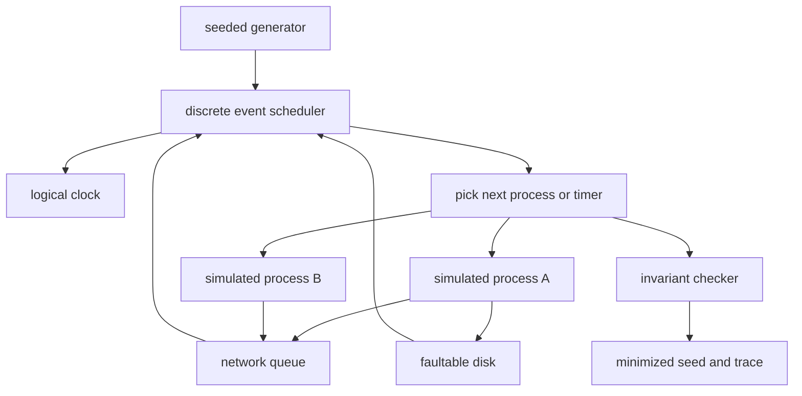

## Concept

### A clock and a scheduler you can name

Deterministic simulation testing runs the production logic inside a discrete-event runtime the test owns. The binary still decides. The harness decides when a timer fires, which process runs next, whether a packet arrives, and whether a disk write lands whole. A seed selects that sequence. Replaying the seed replays the sequence. A failed invariant becomes a file you can check in, the way you check in a failing unit test, except the failure is a cluster schedule rather than a single function.

I treat simulability as a property of the architecture. A service that reads the wall clock, starts a thread the harness cannot see, or hashes a pointer into a map has left the set of programs a seed can describe. Linux remains a valid implementation of time, scheduling, and I/O. The simulator is another implementation of the same interfaces. Both ship. The one you cannot replay is the one that will fail at 03:00 with a trace nobody can reconstruct.

### Simulation searches; chaos samples the live system

Chaos engineering applies a fault to a running system and asks whether the service level, the dashboards, and the people hold. It is the right instrument for runbooks, paging paths, firmware, noisy neighbors, and identity policies that exist only in the production account. A live cluster exercises a handful of interleavings. The bugs that corrupt a log live in combinations a quarter of production traffic will not hit: a leader crash during a membership change, a torn page, a delayed commit, then a clock step on the survivor.

Simulation asks whether any schedule the harness can generate violates an invariant. It can enumerate those combinations on one machine and shrink a counterexample to a short trace. It will not tell you that the page reached someone who knows the runbook. I fund both. A history checker can sit on either kind of run and ask whether the client-visible history matches the consistency model you promised. The checker is only as sharp as the histories and the invariants you give it.

### Interfaces that make a seed mean one history

A system is simulable when every source of nondeterminism sits behind an interface the harness implements.

Time is a logical clock. A sleep is a future event. Idle gaps can jump forward, so an hour of simulated recovery finishes in a moment of wall time.

Scheduling runs at most one user task in a simulated process. The next runnable item comes from a queue ordered by logical time and a deterministic tie-break. There is no operating-system thread race inside that process.

The network is a set of queues. Delay, drop, duplication, reordering, and partition are named events. A reliable byte stream and a datagram channel are different models. Certifying a UDP protocol with the byte-stream model certifies a protocol you did not ship.

Storage completes, tears, reorders, or stalls according to a fault model you review. "The write is durable when `fsync` returns" is a claim the model is allowed to break, because production devices sometimes break it.

Entropy for identifiers, election jitter, and replica choice comes from the seeded generator. A read of the kernel random device, or iteration order that depends on allocator addresses, splits one seed into two histories.

If you cannot name the interface, you have mocks around an integration test. I version the fault model. Every production surprise the model could have expressed becomes a new fault class before the incident is closed.

### Search, shrink, replay

The simulator searches schedules. Draw a seed. Run a workload for a bounded span of logical time. Inject faults from a policy. Check invariants at the events that can change them. The invariants are the product: a committed value stays committed, two leaders do not share a term, a replica does not apply an uncommitted prefix, a retried client mutation is idempotent, a reconfiguration does not resurrect a drained replica as a voter.

Line coverage is the wrong scoreboard. I track which fault classes fired in which protocol phases: crash during commit, partition during reconfiguration, a torn write after the process believed the page was stable, clock skew during lease renewal. Random search under that policy finds combinations a handwritten matrix of "kill the leader" cases never includes, because the matrix omits the third event that makes the bug real. When a seed fails, shrink it. Drop events that leave the violation unchanged. Store the minimized seed and the event log. Replay that seed on every change to the simulated core.

A model that only crashes processes will never find a torn page. A model that preserves send order will never find a datagram protocol that assumed TCP. Fidelity is the ceiling on what a green simulation run means.

### Shape the process so the harness can own it

A simulator bolted onto a thread-per-request server after launch does not hold. The process has to be a deterministic state machine plus effect handlers. Actors, single-threaded event loops, and shared-nothing shards fit. A shared-memory server fits only if every lock acquisition is an event the simulator orders, which is a research project I will not staff inside a product team.

The practical shape is one event loop per simulated process, no blocking syscall on that loop, and cross-process communication as messages with a canonical encoding. Persistence goes through a log interface that can tear, delay, and reorder. Clocks and configuration arrive as constructor arguments. A library that spawns its own threads stays outside the simulated core, or it gets a wrapper that returns only after the harness has taken those threads away.

The adoption cost is the removal of wall clocks, unordered iteration, and thread pools hidden inside clients. After that, an engineer reproduces a cluster bug on a laptop. The fuzzer is the easy part. The runtime is the architecture.

## Trade-offs

| Approach | When it wins | Cost / risk |
| -------- | ------------ | ----------- |
| Deterministic simulation | Protocol, recovery, and storage bugs; rare interleavings; replayable regressions | A simulable runtime and a fault model you staff |
| Chaos and production fault injection | Runbooks, real hardware, real clients, operational muscle | A tiny sample of schedules; weak replay; blast radius |
| History checks on a cluster | A black-box check of client histories against a consistency model | Slow; a narrow fault vocabulary unless a simulator feeds it |
| Unit tests with mocks | Parsers, pure functions, local decisions | Blind to scheduling and durability |
| A TLA+ model of the protocol | Exhaustive check of a small abstract design | Does not execute the binary; the spec can drift from the code |

Simulation is expensive to adopt and cheap to run once the runtime is honest. A campaign of seeds on one machine explores more recovery interleavings before lunch than a staging cluster explores in a quarter. Chaos stays mandatory for kernels, firmware, noisy neighbors, and the human loop. A formal spec stays the right tool for the protocol you intend, before the implementation exists. Simulation is the layer that executes the code you shipped.

The cost teams underestimate is fidelity. A simulator that cannot delay `fsync`, tear a page, or duplicate a datagram will bless a design production will not survive. I review the fault model in the same change as the recovery code. When the model and the kernel disagree, the model gains the fault and a seed is added so the fix cannot rot. A unit test still owns the parser. The simulator owns the torn log during a leadership change.

## Diagram

One seed drives a single scheduler. Processes, the network, and the disk are events on that timeline. The checker runs there too, and a violation becomes a trace you can replay.

## Failure modes

### A seed that takes two paths

Hash-map iteration, address-space layout, padding in a serialized struct, a request id from the kernel, or a worker the core "does not wait for" makes one seed diverge. I detect it by running the same seed twice and comparing a checksum of the event log. Divergence means the run is not deterministic, whatever the dashboard says.

Calls to wall-clock time, real entropy, and unordered iteration inside the simulated process fail the build. Iteration order is sorted. Randomness is an injected object. Wire formats are canonical. A third-party library that cannot comply stays outside the core. I would rather wrap a client than chase a flake that appears once a week on one CI agent.

### A disk model that is kinder than the device

The fake disk completes writes in order. Production storage does not. The fake network never duplicates bytes on a stream the code treats as TCP, while the real RPC is a datagram. Tests pass. A committed log entry disappears later. The signal is an incident whose trace will not replay, or a fault class the kernel has and the model lacks.

I keep a written fault-model spec beside the simulator, and I dual-run a thin slice of the same workload on a small real cluster to catch hardware behavior no simulated event produces. New production failures become simulator events before the incident closes.

### Search that never enters the dangerous phase

A million seeds that never crash a leader during a configuration change will not find the bug that lives only there. Random search without a fault policy is a warm feeling. I record which fault classes fired in which phases. If reconfiguration-plus-crash stays at zero after a week of campaigns, reconfiguration is untested.

Force each fault class at drawn checkpoints, then fuzz the schedule around those points. Count epochs, leadership changes, and recovery phases. A campaign that only kills idle followers has not tested the code you are afraid of.

### A checker that only notices crashes

Two replicas can stay up and disagree. A checker that only looks for process crashes stays green. Customers see a split history. The properties worth encoding are the ones you would defend in a design review: the consistency model you actually promise, prefix agreement on logs, uniqueness of an epoch, idempotency of a retried mutation.

A simulator without a sharp invariant is a load generator with a seed. Sabotage the checker in CI: inject a known bug, confirm the seed fails, then remove the bug. A checker you cannot force to fail is a checker you cannot trust when it passes.

## Real-world example

FoundationDB is the public proof that this is a way to build a database. Coordinators, the cluster controller, transaction logs, storage servers, and resolvers communicate by messages and run as single-threaded processes. In simulation those roles share one thread. The harness owns time and the network. It kills processes, partitions links, stalls and tears disks, and reboots machines while clients submit transactions. A failure shrinks to a seed and a trace.

That search found correctness bugs in recovery, replication, and handoff between transaction subsystems that an on-call rotation would see once and could not reconstruct. Chaos on a live cluster still tests operators and hardware. It does not enumerate those schedules. The architecture that makes simulation possible is the one that makes the database explainable: explicit messages, no shared-memory multithreading in the core, and a storage layer whose faults are injectable.

If you are building a consensus-backed store, a workflow engine, or a replication pipeline, copy the runtime. Make the process a deterministic state machine. Then search it. The fuzzer arrives after that sentence is true.

## What to remember

- Simulation searches schedules of the real code under a seeded runtime; chaos samples live systems and trains operators.
- Time, threading, I/O, and entropy sit behind harness interfaces, or a seed does not replay.
- The fault model and the invariant checker are product code; a kind disk and a crash-only checker certify a lie.
- A failing seed is an artifact: shrink it, store it, and replay it on every change to the simulated core.
