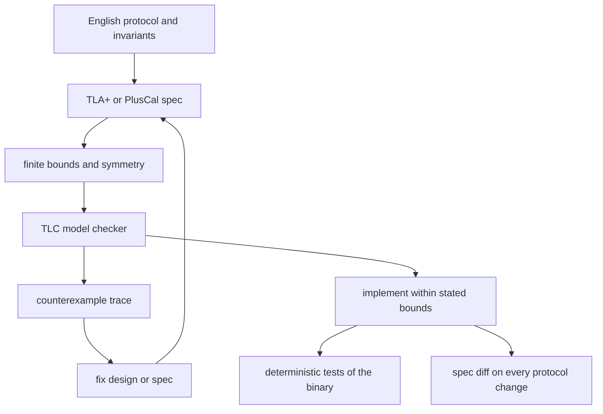

## Concept

### The artifact you bring to design review

TLA+ is a language for a mathematical model of a concurrent system. TLC explores that model by brute force over a finite state space. TLAPS can discharge proofs when you are willing to staff them. You do not compile TLA+ into the service. You compile a protocol into a spec small enough to check and precise enough to argue about.

The architect's deliverable is a list of states the system must never enter, and a shorter list of things that must eventually happen if the assumptions hold. Those lists belong next to the sequence diagrams. A spec that never runs is a wiki page with extra syntax. A spec that runs and prints a trace ends arguments that would otherwise last a quarter.

### What a successful check actually says

TLC explores the states reachable under the bounds you configured: a fixed number of processes, a fixed number of outstanding requests, finite buffers. When it reports that a safety property holds, the claim is narrow and strong. Inside those bounds, no reachable state violates the invariant. When it finds a counterexample, you get an initial state and a sequence of steps. That trace is the design review. I have watched more protocol arguments end on a short TLC trace than on a whiteboard.

Write the bounds in the header of the spec. A later reader should be able to repeat the claim without inflating it. "Checked at four acceptors, one reconfiguration in flight, crash-stop faults" is an engineering sentence. "Formally verified storage" is a different sentence, and I will not sign it because the first one is true.

### What the check leaves open

TLA+ does not prove that the implementation matches the spec. It does not prove that deadlines, torn disk sectors, or a saturated thread pool behave. It does not prove liveness if you omitted fairness. It does not speak about states outside the finite bounds. A network modeled as a set of undelivered messages will not reveal a bug that depends on a partial byte write. A crash-stop model will not reveal a Byzantine replica. Those limits belong in the header so a model check cannot be promoted into a claim about the binary.

A successful run means this protocol, at this abstraction, under these bounds, has no counterexample. That is a serious statement about the design and a weak statement about the executable. Deterministic tests of the code, and production fault injection for the glue around it, still have jobs.

### Safety, liveness, and the fragment worth modeling

Safety properties are invariants and history constraints. At most one leader in a term. A committed prefix is durable and is never rewritten. A client of a register sees a linearizable history under the model you stated. A reconfiguration does not drop an acknowledged write. A lease is not held by two nodes at once under the clock bound you wrote down. These are the bugs that page people, and they are the properties TLC checks most usefully.

Liveness says something good eventually happens: a value is chosen if messages are eventually delivered, a leader is elected under a fair scheduler, a stuck replica eventually snapshots. TLC will report a stuttering path that never elects if you forgot fairness. I write safety first. I add liveness once the invariants exist, with fairness hypotheses a reader can reject. A protocol that cannot make progress is still an incident, even when it never corrupts data.

PlusCal is the on-ramp I hand to most engineers: processes, waits, and either-or branches, compiled into TLA+. I drop to raw TLA+ for data refinement and for properties PlusCal expresses poorly. The first spec is the fragment that scares the design: membership change, multi-group commit, snapshot install, lease renewal under partition. Modeling the whole service is how TLC never finishes.

### A workflow and a state space that finish

Pick the uncertainty. Write one page of English: roles, messages, faults in scope, and the invariant. Then write the spec until TLC runs on two or three nodes and one or two requests. The first counterexamples are usually spec bugs. You allowed a step the English forbade, or you forbade a step the implementation must take. Fix the spec. The next counterexamples are design bugs. Grow the bounds one notch at a time.

Keep the spec in the same repository as the service. A protocol change and a spec change land together. Reviewers who will never run TLC can still read PlusCal. I ask them to map one implementation path onto spec actions. If they cannot, the spec is already drifting.

State-space size is the operational constraint. Unbounded counters, rich payloads, and identities that grow without limit will not check. Use small enumerations. Collapse symmetric processes so identical states under swapped names are explored once. Model a message as the fields that affect control flow. Replace real time with a tick, or with an action that says the timeout may fire. Replace the disk with a sequence of committed entries plus a variable for the last torn write, if tears are in scope.

If TLC cannot finish, you do not yet have a checkable spec. Shrink until a run completes, then add one source of complexity. A finished check of a slightly abstract protocol beats an unfinished check of a photorealistic one that times out and gets marked optional. Two nodes are often too few to embarrass a membership protocol. Three or four is where many of those bugs live.

Refinement, proving that a lower-level spec implements a higher-level one, is real and expensive. Most product teams get more from one sharp spec plus deterministic tests of the binary than from a tower of refinements they cannot staff. I reach for refinement when two teams own two layers and keep disagreeing about which layer may lose a write.

## Trade-offs

| Approach | When it wins | Cost / risk |
| -------- | ------------ | ----------- |
| TLA+ and TLC on the protocol | Membership, consensus, reconfiguration, multi-step commit | Drift from the code; finite bounds; a learning curve |
| Theorem proving with TLAPS or a proof assistant | Deep properties over infinite state | Slow; specialist staffing; still not the binary |
| Deterministic simulation of the code | Bugs in the implementation and the storage model | A simulable runtime; search is not exhaustive |
| Chaos or a history check on a cluster | Real software, real networks, an operational signal | Sparse sampling; weak replay |
| An English design review | Alignment, cheap to start | Ambiguous; cannot generate a counterexample |

TLA+ wins when the risk is a logic error in a small concurrent protocol whose failure mode is data loss or a long outage. It loses when the risk is a kernel tear you refused to model, a collector pause, or a thread pool. I model the lease the pool is supposed to implement. I test the pool with simulation and load. The two artifacts answer different questions, and both are named in the design doc.

The organizational cost is front-loaded. Someone writes the first spec and sits with engineers while TLC prints a trace they do not yet know how to read. After two or three protocols the cost drops. Design discussion starts from the invariant. Amazon's public account is the calibration I use with skeptical staff: TLA+ found serious bugs in protocols experienced engineers had already designed, and it did not replace testing.

## Diagram

English becomes a bounded spec. TLC either returns a trace, which changes the design, or it returns no violation inside those bounds, which is permission to implement and then to test the binary against the same invariants.

## Failure modes

### The spec and the binary part ways

The spec forbids two leaders in a term. The code miscounts votes, or a temporary bypass during a rolling upgrade stays in the binary. TLC stays green. Production elects two leaders. I notice when an incident trace cannot be mapped onto a spec action, or when a code path has no label a reviewer can point at.

The spec lives next to the code. Protocol diffs require spec diffs. A reviewer traces a few implementation paths. Deterministic tests encode the same invariants on the binary, which is how you notice the bypass the spec never grew an action for. A model check does not watch the binary. Treating it as if it does turns the check into a slogan.

### An abstraction that omits the fault you will ship

You modeled partitions as "some messages may be delivered later." The bug you ship is a partial write, or a clock that jumps backward and revives a lease. TLC stays quiet because that fault is not an action. The failure shows up in a component the header declared out of scope, often after everyone has forgotten the declaration.

I write the fault model at the top: crash-stop or crash-recovery, omission or duplication, storage with or without tears, clock skew bounded by a constant you can defend. Faults outside that list are named and covered by simulation or by fault injection. A precise "we did not model disk tears" is an honorable sentence. An implied "we formally verified the service" is not.

### A check that explodes and then disappears

A spec that finishes at two nodes and never runs at three gives a false sense of coverage. Many election and reconfiguration bugs need three participants and a failure in the middle of a round. The smell is a CI job that times out, is marked optional, and is deleted the quarter someone needs the CPU back.

Budget for TLC the way you budget a test suite. Use symmetry and smaller messages until three nodes finish. If they cannot, split the spec: election separate from log replication, replication separate from reconfiguration. I would rather delete the job and say "unchecked" than leave a green badge on a model that has not run since the bounds grew.

### Liveness that holds because nothing is required to happen

A liveness property passes because the spec can stutter forever and you forgot weak fairness, or because the only fair paths never take the crash you care about. The protocol livelocks under a scheduler you will actually run. I sabotage the check: comment out the action that makes progress, and confirm TLC fails the claim. Then restore the action. If I cannot make TLC fail a broken liveness property, I do not trust a passing one.

"Messages are eventually delivered" is a hypothesis about the network, not a theorem about your code. When the real network withholds that hypothesis, liveness becomes the operator's problem, and the safety invariant is what still has to hold while they wait.

## Real-world example

Amazon has been the most visible industrial user of TLA+ on cloud infrastructure. Engineers specified concurrent protocols behind DynamoDB, S3, and internal control planes, and ran TLC against safety properties before and during implementation. Public talks describe bugs design review missed: holes in replication, leadership, and recovery that appear only under particular orderings of failures and retries. The authors already knew consensus. Experience was not a substitute for a state space.

The scope is the lesson I copy. They specified the concurrent cores whose bugs would lose durable data or cause long unavailability. They did not specify entire services. Counterexamples went back into the design. Conventional tests still ran against the implementation. The model check occupies the role a structural calculation occupies in a building: it does not replace testing the materials, and it is hard to skip when the failure mode is catastrophic.

If you run a multi-step commit, a shard move, or a leader lease, you are in that business. Write the invariant. Let TLC try to break it. Publish the bounds. "The membership protocol was model-checked at four acceptors, crash-stop, no disk tears" is a claim an architect can defend.

## What to remember

- TLC checks a finite model of a protocol; it does not verify the binary, the disk, or the thread pool.
- Safety invariants and a readable counterexample are the deliverable; liveness needs fairness hypotheses you can sabotage.
- Spec and code drift unless they share a repository and a review rule on every protocol change.
- Shrink the model until TLC finishes, then add complexity; a spec that never checks is not evidence.
