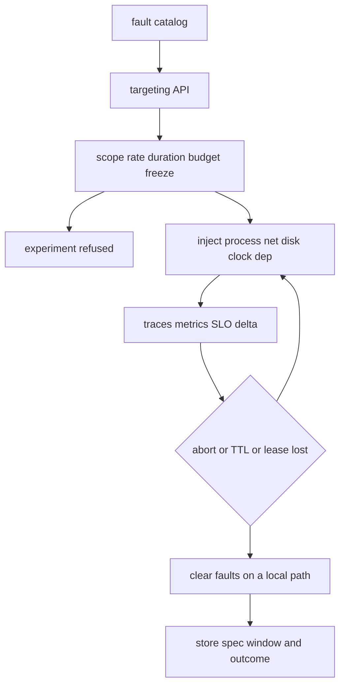

## Concept

### A program, with permission to refuse

Fault injection at scale means you can fail a dependency, a disk, a path, or a process in a running system on purpose, with a blast radius you can name, and with an abort that is faster than the incident you are trying to prevent. If the only way to "test failure" is to open a shell and send a signal, you have a ritual. A program has a catalog, a targeting API, safety rails, evidence that the fault happened, and permission for the rails to refuse the experiment.

I count a refused experiment as a success when the rails fire. An injector that cannot say no will be turned off after the first noisy page, and the team will be back to hoping the timeout code still exists.

### Rails that are the product

Production injection without rails is an outage generator. The minimum set I will ship is small and non-negotiable.

Scope names a cell, a shard, an availability zone, or a sticky slice of traffic. Fleet-wide is a deliberate choice with extra approval, never a default.

Rate starts at a small fraction of instances or requests and rises on a schedule that watches the service level. A jump from canary to fleet is how a latency injection becomes a regional event.

Duration is a hard wall-clock limit on the node, not only in the control plane. When the timer ends, the fault stops even if the injector process is dead.

Abort is one switch, on a path that does not depend on the system under test. If you are failing DNS, the abort must not require DNS. If you are partitioning the control plane, the abort must not live only there.

Budget means experiments spend error budget. An empty budget means no injection, including the one someone wants because a launch is tomorrow.

Freeze means no injection during an unrelated deploy, a known peak, or an open incident. The calendar is part of the API.

The abort path is itself a reliability problem. Intended fault state should be stored so that a dead injector means faults clear. I prefer a node agent that reconciles toward "no fault" unless it holds a fresh lease, and a local time-to-live that expires the traffic-control rule, the packet filter, or the process flag without a round trip.

### Layers, and what each one proves

Process and machine faults — kill, hang, CPU burn, memory pressure — catch the assumption that a process crashes clean and that a watchdog exists. A hang is usually the more honest fault, because production often wedges.

Network faults drop, delay, duplicate, refuse, reset, or partition in one direction. Blackhole one dependency name unless the experiment is the NIC. Partial partitions, where A sees B and B does not see A, are where quorum protocols lie to themselves.

Disk faults stall `fsync`, return an out-of-space error, tear the last write, or inject I/O errors. Databases and queues die here more often than they die on CPU. A delay on a socket will not find a checkpoint that blocks the world.

Clock faults jump forward, jump backward, or smear. Leases, certificate validity, and token expiry live on clocks. If you have never moved a clock in a non-production environment, you do not know which of those you implemented.

Dependency faults force one downstream to errors, to multi-second latency, or to a stale response. This matches how services fail in the wild: the mid-tier is sick and still answering.

Application flags that return a canned error are safer and less realistic. Infrastructure faults are realistic and easier to turn into an incident. I want both. Flags prove a fallback is still compiled in. Infrastructure faults prove the timeout, the retry budget, and the load shedder. A flag that returns an error in one millisecond does not exercise the client that gives up at two seconds and then retries.

### Continuous dose and scheduled exercises

Scheduled game days are announced and heavy. They train people and they find the gap between the diagram and the paging policy. They are too rare to keep a fault path from rotting. A fallback that last ran at last year's exercise is dead code with a story attached.

Continuous injection is small, automated, and dull. Every day, kill one replica in a cell that can lose one. Every hour, delay one dependency for a short window, inside a slice. A new retry loop that amplifies a delay shows up as a service-level dip on a Tuesday, with a diff you can bisect.

I reserve game days for faults I will not automate yet: a regional disconnect, an identity-provider outage, a control-plane permission failure that crosses teams. I use continuous injection for every failure the design review claims the system survives. If we will not inject it on a cadence, I stop letting the design claim it.

### Targeting and a record

Killing a random instance is a weak experiment once you already believe instances are replaceable. Target by role. Kill the leader. Stall the disk on the replica that holds the hot shard. Partition the control plane from the data plane. Combine the fault with a traffic slice: one tenant, one cell, the canary.

Evidence is part of the experiment. If you injected a dependency delay, client latency has to move, the fault has to show up on a span, and someone has to abort it once on purpose so the abort path is known to work. I store the spec, the window, the target labels, and the service-level delta next to the same template we use for incidents. Injected errors carry a label so the pager and the error budget can tell them from organic burn.

## Trade-offs

| Approach | When it wins | Cost / risk |
| -------- | ------------ | ----------- |
| Application fault flags | Safe exercise of fallbacks and degraded modes | Misses timeouts, kernels, and real networks; flags rot |
| Infrastructure injection in a staging cluster | Aggressive faults with no customer traffic | Misses production config, identity, data shape, and load |
| Continuous low-dose production injection | Keeps fault paths alive; finds retry amplification early | Rails, budget, and an abort that works while the injector is dead |
| Scheduled game days | Humans, cross-team faults, rare regional failures | Sparse; theater if nothing is automated afterward |
| Deterministic simulation | Searchable schedules of protocol code | Not real hardware, not real operators, not the mesh |

A staging-only program misses the first production-only identity policy. Production injection without a rehearsal can teach you that the abort switch depends on the dependency you just blackholed. The program needs an experiment identity, a deploy hook, and dashboards that separate injected errors from organic ones. If the pager cannot tell those apart, shut the program off until it can.

Check the protocol with a spec or a simulator, then inject to prove the mesh, the client library, and the shedder. Start below the client timeout, on a slice, and watch outbound request rate. Cross the timeout later, at a smaller rate, once retries are not multiplying.

## Diagram

A catalog proposes a fault. Rails accept or refuse it. Accepted faults are measured, and they clear on abort, on expiry, or when the lease dies. The record is what makes the next experiment a regression test.

## Failure modes

### Faults that stick after the injector dies

The control plane that installed a delay rule or a packet drop crashes, or loses its lease. The rule remains. Traffic stays blackholed after the experiment dashboard says stopped. I look for service-level burn that outlives the window, and for hosts whose desired fault is empty while the local rule is not.

Every local fault needs an expiry. A node agent reconciles toward no fault unless a live lease says otherwise. The abort path must not use the injured dependency. Faults that require a healthy control plane to undo are faults I will not ship. Expiration is the safety property. Remote cleanup is a convenience.

### A radius larger than the label

You targeted one cell. Service discovery, a shared cache, a global rate limiter, or a control plane with no cell boundary coupled the rest of the region. Error-budget burn shows up on labels you did not target, or a queue backs up into an untargeted shard.

Inject only where a wall already exists. Treat an escape as a finding about the wall. If a cell-local experiment is visible outside the cell, the architecture is not cell-local yet. I pause the program until the coupling is fixed or explicitly accepted. Discovering the coupling during a real partition costs more.

### A small delay that starts an amplifier

A few hundred milliseconds of injected latency crosses a client timeout. Clients retry, multiply load, and take the dependency down for traffic that was never in the experiment. Outbound request rate and client pools spike during an injection you described as tiny.

Retry budgets, adaptive concurrency, load shedding, and a hedge policy that refuses to run while the dependency is saturated belong in the client before the dose grows. Raise delay in steps. Confirm the amplifier is absent at the step below the timeout. Then cross the timeout with a fraction of traffic you can afford to lose.

### Runs with no evidence, and flags that have gone quiet

A game day ends. Nobody can show that the disk stall fired. A year later the fallback has been compiled out, or the flag defaults to the happy path and no alert watches it. An experiment is invalid unless the fault is visible on the data path: a span attribute, a metric, a log line with the experiment id. Continuous injection of each claimed fallback should alert when the fault is never observed.

Delete untested fallbacks. A flag that has not been true in production for two quarters is a branch, not a resilience feature.

## Real-world example

Netflix's Chaos Monkey, and the failure-injection work that followed it, is the public template for doing this on a fleet. Instance death was already an architectural assumption: stateless services, rapid replacement, health checks that mean something. The program made that assumption true on a cadence, which is a different activity from writing "we survive instance loss" on a slide.

The more useful evolution was the move from random instance death toward targeted injection of latency and errors on specific dependencies, with blast-radius controls. Random kill proves replacement. Targeted injection proves the timeout, retry, and fallback behavior a user sees when a mid-tier is slow and still alive. Scheduled exercises stayed in the program for faults that were hard to automate, and abort was treated as part of the product.

I copy the rails. If the system is unstable under the loss of one instance, a chaos daemon is an outage scheduler. If you cannot target a cell or a slice, you are not ready to inject in production. The program is a consequence of the architecture, and a forcing function when the architecture is softer than the review claimed.

## What to remember

- Fault injection at scale is a targeting API plus rails; abort, local expiry, and error-budget gates are the product.
- Flags prove a fallback is still compiled in; infrastructure faults prove timeouts, retries, and shedding around it.
- Continuous low-dose injection keeps paths from rotting; game days train people for faults you will not automate yet.
- An experiment that escapes its cell or sticks after abort is an architecture finding, and it should pause the program until the wall is real.
