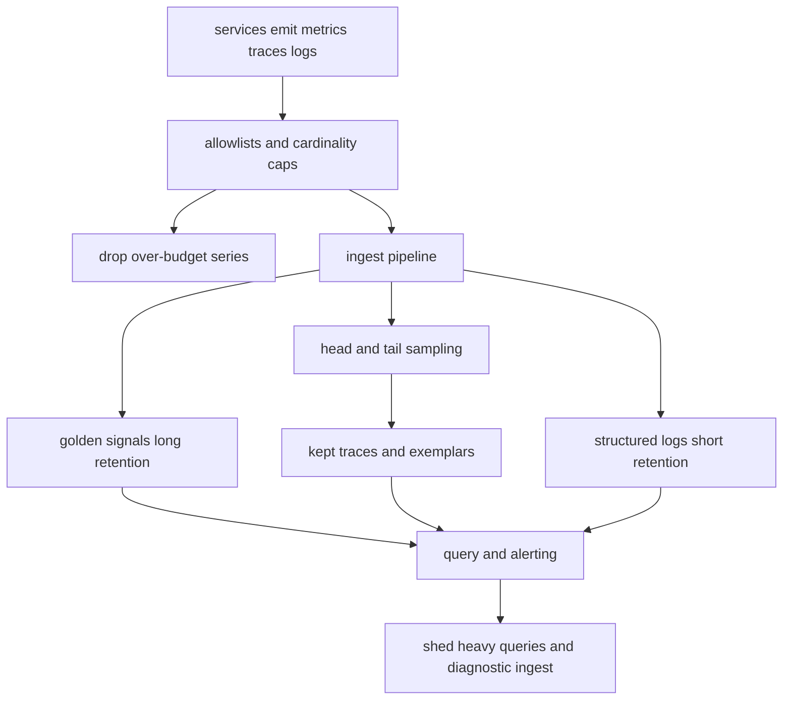

## Concept

### A series is a capacity object

A metric series is a name plus a label set. Cardinality is how many of those combinations you store and query. Ten request-rate series per service is cheap. Ten per service, times user, times URL, times pod, is a finance event and often an ingest outage. The series does not have to be mistaken to be unaffordable. It only has to be unbounded.

I own a cardinality budget the way I own a shard count. Every new label is a multiplier. A status code with a dozen values usually fits. A user identifier with millions of values is not a metric label. A pod name looks bounded until each rollout mints new series and the old ones live until retention expires. Cardinality is the product of dimensions. A quiet service with one bad label will hurt the pipeline more than a busy service with four golden signals.

Traces and logs have the same shape in different units. High-cardinality attributes on spans blow up indexes. Logs that embed unique bodies blow up storage and force scanners to read far more than the question required. The decision is which signal may carry identity, and which signal must stay small enough to alert on.

### Budgets with a refusal

Set a budget per telemetry type in units someone outside the observability team can check.

Metrics get a cap on active series per service, a cap on series created per deploy, and a cap on query fan-out for any dashboard that pages.

Traces get a target spans per second, a hard cap, and a shed order when the cap hits.

Logs get a volume per service per day, an allowlist of indexed fields, and a cold path for the rest.

When a service exceeds the series cap, the pipeline refuses the new combination. Quiet acceptance followed by a weekend page to the platform team is how budgets become fiction. A debug label that cannot ship without an exception should not ship. I would rather break a dashboard in CI than discover the series count on the invoice.

Rules that survive feature work are dull. Bound every label to an enum or a small set. Hash or drop identifiers. Keep golden signals tiny, always on, and retained long enough for a service-level objective. Keep diagnostic metrics on a shorter leash, with fewer labels and less retention. Attach exemplars: a low-cardinality latency histogram can point at a trace id, which is the pivot from a red graph to one real request.

Resource attributes — region, cell, service, version — are load-bearing and cheap when the sets are small. Per-request attributes belong on a sampled trace or a log line.

### Sampling that still leaves a picture of failure

Head-based sampling decides at the start of a trace, before you know the request was interesting. It caps cost when volume is huge. It also misses a rare path unless you force-keep the cases you already know you care about.

Tail-based sampling buffers until the trace finishes, then keeps errors, slow requests, and a fraction of the rest. The collector needs memory, and it still needs a cap. A flood of errors is as expensive as keeping everything. Tail sampling without a flood policy recreates the bill during the incident you most need to see.

The shape I ship is layered. Always keep errors, traces that burn an objective, canary traffic, and a small random baseline so success still has a picture. Sample the fast successful path at a rate that is a function of service traffic, so a huge service does not drown a small one in the same collector. Raise the keep rate on a service while its error budget is burning, and lower it when the budget recovers. Record a few high-value attributes on kept traces. Baggage is not a license to index every header.

Logs follow the same split. Sample successful health checks. Keep the first errors in a burst with enough body to act. Index an allowlist. Put the rest in cold storage with a retention you can afford.

### Cost next to the objective

Telemetry is a production dependency with its own failure domain. Ingest, index, retention, and query are different bills, and teams cut the wrong one. They shorten retention on golden signals to save a few percent and leave an unbounded URL label that doubles series every quarter.

Separate the levers. Keep many months of service-level rollups, days of raw diagnostic series, and hours or a few days of profiles and high-cardinality logs. Pre-aggregate as the data ages. A year-long board should read recording rules. A dashboard that fans out across a million series is an incident waiting for someone to open the tab, so budget query CPU. A noisy tenant of the observability system is shed. They do not get to blank the global alert path.

When ingest exceeds budget, drop diagnostic traffic first, keep golden signals, and emit a metric that the drop happened. Keep a thin out-of-band check that does not share the bursting pipeline, so a log flood cannot take the page with it.

### Enforce before the bytes leave the process

A backend limit helps, and it is late. The bad series are already on the wire, and the client library has already spent CPU building them. Libraries and collectors should enforce allowlists and caps as platform policy. A new service that copies a dashboard from a wiki should hit that policy in CI. Collectors are the place I put tail sampling, attribute filters, and cardinality limits so every team does not invent a weaker version.

Per-request debugging belongs on a sampled trace or a log. Metrics stay complete, cheap, and fast enough to page. A request for a customer identifier on a counter gets an exemplar, or a written exception with a bound you can say out loud.

## Trade-offs

| Approach | When it wins | Cost / risk |
| -------- | ------------ | ----------- |
| Low-cardinality golden signals | Objectives, paging, long retention, cheap queries | Cannot reconstruct one user or one URL |
| Head-based trace sampling | A hard cap on ingest at very high request rates | Misses rare failures unless errors are force-kept |
| Tail-based sampling | Keeps slow and failed traces after the fact | Collector memory; error floods; operational complexity |
| Wide events or high-cardinality logs | Forensic debug of a single request | Index cost, query latency, noisy neighbors |
| Exemplars linking a metric to a trace | A pivot from a red graph to a real request | Needs aligned ids and a trace store that kept the example |

The working split is a cheap, complete picture of health and a deliberately incomplete picture for debug. Asking metrics to do forensic work is how a user identifier becomes a label. The platform owns the pipeline, the refusal, and the shed order. Product teams own what they emit, inside the budget. A cost cut should delete unbounded dimensions first, then spend a fraction of the savings on tail sampling and profiles. Turning the pipeline off removes the instrument that would tell you the save was unsafe.

## Diagram

Services emit into a policy that can refuse. What passes splits into long-lived golden signals, sampled traces, and short-lived logs. Query and ingest both have a shed path so a dashboard or a label explosion cannot take the alerts with it.

## Failure modes

### Labels with no ceiling

Someone adds a customer identifier or a raw URL to a counter. Active series jump by orders of magnitude. Ingest lags. Dashboards time out. Alerts evaluate on stale data, which is worse than a loud page because the page never comes. I alert on the rate of change of series count per service, and I enforce a cap that rejects before the backend falls over.

Refusal belongs in the client library or the collector. If you need a sketch of hot customers, hash them into a fixed set of buckets and document the bound. Identity belongs on a log or a trace. Deleting the label is the remediation. Growing the cluster to hold the series is how the next label gets added.

### A sampler that hides the incident

Head sampling at a low rate, with no rule that always keeps errors, drops the small fraction of requests that failed a payment. The error-rate metric is red. The trace explorer is empty. I look for that mismatch on purpose: error ratio up, kept-error-trace count flat.

Force-keep errors and latency that violates the objective, independent of the random sampler. Test the policy. Inject a small error rate in a canary and confirm traces exist with the experiment attribute. Sampling rules are code. An untested sampler is an untested delete of your debug path.

### The pipeline dies in the same burst as the product

A retry storm, a cardinality spike, or a log flood saturates ingest. The product is sick and you cannot see it. Ingest lag, dropped spans, and an alert manager that cannot evaluate show up together. Isolate golden-signal ingest on a path that diagnostic logs cannot fill. Write the shed order. Run a synthetic check off that bus. A pipeline that will not throw debug data away will eventually throw the page away instead.

### Dashboards that pin the query tier

A shared dashboard groups by pod, URL, and user. One open tab pins the query tier. I attribute query CPU per dashboard and per team, and I treat shared dashboards as production code with review. Recording rules should exist for the views people actually open. Query limits should fail the tab, not the cluster. A dashboard is a standing load test against the observability system, and it runs whether or not anyone remembers who authored it.

## Real-world example

Google's Monarch is a geo-distributed metrics system built because fleet telemetry is itself a large distributed system. It stores time series at a scale where series count is a scarce resource, serves both alerting and interactive query, and isolates tenants so one bad label set does not take detection away from everyone else. The themes that transfer to a smaller company are economic and structural: keep the path from sensor to alert short, refuse unbounded dimensions, and accept that not every attribute of a request belongs in the metric store.

Putting every attribute of every request into metrics recreates the invoice without that isolation. Metrics stay the cheap health signal. Traces, logs, and events carry identity, and they are sampled. A collector that cannot refuse a label has no budget, whatever the dashboard promises.

## What to remember

- A cardinality budget is a capacity plan; an unbounded label is an incident, not a debug feature.
- Golden signals stay complete and cheap; traces and logs stay sampled and high-value.
- Force-keep errors and objective-burning traces, or sampling will hide the outage you are paying to see.
- Shed diagnostic ingest and heavy queries before the observability system dies in the same burst as the product.
