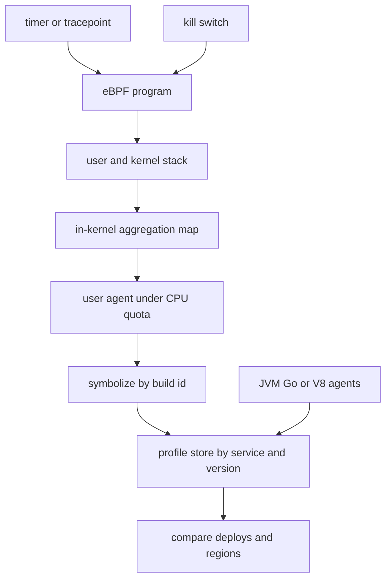

## Concept

### A profile that is already there

Continuous profiling samples stacks from production all the time, at a rate you have budgeted. CPU, wall clock, allocations, lock contention, and sometimes I/O. The product is a fleet answer to where the cycles went this hour, for this version, in this region. You do not wait for a page, attach a debugger, and hope the machine still exhibits the bug. The profile is already stored, labeled by service, build, and instance class.

This is a different system from a laptop profiler. Overhead has to be boring, typically around one percent of a core, with a hard cap that disables the agent rather than letting it become the incident. Symbolization has to survive container churn and just-in-time compilers. If a rolling deploy turns the profiles into unresolved addresses, you bought a viewer, not a signal. After a launch I read profiles the way I read golden signals: did this version move CPU into a new frame, and is that frame ours?

### What a verified probe changes

eBPF programs run in the kernel after a verifier rejects unbounded loops and illegal memory access. For profiling, a timer, a tracepoint, or a selected probe can capture a stack without a kernel module. The usual CPU profile is small. A timer fires, the program walks user and kernel frames, a map aggregates counts, and a user-space agent ships summaries on a quota.

A sampler that only sees its own process misses syscall time, networking, and page faults that sit beside application frames. A kernel probe sees those, and it sees sidecars that never linked your agent. The tax is operational. A program that loads on the kernel you develop on may fail on the older long-term kernel the node actually runs. Verifier limits change between versions. Privilege to load programs is a security review, not a flag hidden in a daemon set.

eBPF is also how many continuous profilers explain a service that is slow while CPU looks idle. Off-CPU stacks show time blocked on a futex, time inside the block layer, and time in the network stack. Those views stop a team from adding cores to a service that is waiting on a lock or a disk.

### Probes worth keeping on, and probes worth expiring

On-CPU samples are timer-driven stacks. They find hot functions, interpreter overhead, a parser that ate the budget, a surprise copy loop. This is the default fleet signal. It is coarse. A spike shorter than the sample period can hide, which is why request-latency histograms still sit beside it.

Off-CPU and wall-time views find lock convoys, synchronous name lookups, a disk stall, and an event loop that called a blocking client. If you only collect on-CPU, an idle-but-slow service looks healthy in the profiler and sick in the objective.

Allocation samples, from `malloc` or from the language runtime, find churn the collector will pay for later. On the JVM this is often a runtime agent. eBPF can still see mappings and cgroup growth, which is the coarse view when the language agent is absent.

I/O and network probes — block-layer latency, syscall duration, retransmit counts tied to a process — separate a noisy neighbor from a service that thought it was CPU-bound. I keep these available fleet-wide at a low rate and raise the rate on a canary when a launch smells like storage.

A uprobe on one function is a scalpel. A uprobe on every method is a production risk. I prefer sampled stacks over instrumenting every RPC in the kernel. A dashboard that lets anyone attach an arbitrary probe to production is a debugger with extra privilege.

The architecture decision is which probes are always on — CPU, and usually a cheap off-CPU view — and which expire. Always-on has a CPU quota. On demand has an expiry and an owner.

### Symbols, containers, and compilers that rewrite code

A stack of addresses is not a profile. You need symbols for the exact binary that was running, keyed by build id, including the frames you were tempted to strip from the image. Containers that delete debug information push that cost onto a symbol server. If the server cannot answer, the profile is a histogram of unknown frames.

Just-in-time runtimes rewrite code while the process runs. The profiler has to consume their symbol interfaces, or the only functions you care about show up unresolved. I also want the build id mapped to a revision. Otherwise a regression cannot be tied to a commit, a compiler flag, or a dependency bump.

Treat debug information as a deploy artifact. A version that emits metrics and cannot be symbolized is not fully rolled out. I gate it the way I would gate a service that forgot its health endpoint.

### Overhead, privilege, and what leaves the machine

eBPF is verified. It is not free. A high-frequency uprobe, a map that grows without a bound, or an agent that wakes too often will take more than one percent. Kernel panics from bad programs are rarer than they were with modules. A tracer that stalls, or that pins a core in the agent, can still hurt the node. Production rules I insist on: a global sample-rate cap, a per-node CPU quota with automatic unload, map size limits, a counter of drops when a map is full, a canary across the kernels you actually run, and a kill switch that unloads programs without a node rebuild.

Profiles are observability data, so they have cardinality too. One raw profile per process per second, labeled with high-cardinality attributes, recreates the metrics invoice. Aggregate in kernel maps. Ship summaries. Keep raw dumps for a short window around an incident. Stack-only samples are the default. Capturing function arguments in production is a privacy review, because arguments and paths leak customer data.

Privilege is the other budget. Loading programs wants capabilities security teams are right to dislike. Constrain them: signed programs, a narrow policy, no arbitrary probe list from a user dashboard, read-only maps for the agent that ships data. A profiler that can attach any probe is a production root shell with extra steps.

## Trade-offs

| Approach | When it wins | Cost / risk |
| -------- | ------------ | ----------- |
| Always-on sampled CPU profiles | Fleet regressions, comparing a deploy to the last one | Coarse; short spikes can hide; symbolization is mandatory |
| eBPF kernel and user stacks | Idle-but-slow services, syscall and network time, sidecars | Kernel skew, verifier limits, privilege |
| Language agents such as JFR or pprof | Allocations, locks, accurate frames inside one runtime | Per language; misses sidecars and most kernel time |
| On-demand perf or a debugger | A deep look at one sick machine | Absent when you need it; high overhead; a human in the loop |
| Heavy uprobes on many functions | A surgical trace of one known bug | Overhead, fragility across versions, production risk |

The platform move is fleet-wide cheap CPU and off-CPU profiles, plus a language agent where the kernel cannot see allocations and locks. Time in collector threads shows up only if those frames resolve. I raise the sample rate on a canary, or I attach a language agent for a day, and I turn it off. A profile that costs more than the optimization it enables trains the organization to distrust the signal.

## Diagram

A timer or tracepoint runs a verified program, which aggregates stacks in the kernel. An agent under a CPU quota symbolizes by build id and stores a summary. Language runtimes contribute the frames the kernel cannot name. A kill switch unloads the program.

## Failure modes

### Unresolved frames after a deploy

Profiles show addresses for most samples. Nobody can tell a library regression from business logic. I track the fraction of samples with resolved user frames, per language and per version. A drop in that fraction is a pipeline bug, even when the graph still renders.

Ship build ids. Keep a symbol store. Integrate runtime callbacks. Keep the frames you need to read. A version that is not profileable should be visible in the rollout, next to error rate. Guessing at unknown frames is how a capacity review blames the wrong commit.

### The profiler becomes the incident

A new probe, a raised sample rate, or a userspace spin when a map is full adds a large fraction of CPU during peak. I watch agent CPU and I compare service CPU before and after a profiler change. Drop counters tell you whether the map is keeping up.

Quota the agent. Default rates should be boring. Canary kernel and agent versions. Automatically disable the agent when it exceeds its CPU budget. A human kill switch is the backup, and it has to work when the control plane that shipped the probe is itself unhealthy.

### A program that loads on the build kernel and nowhere else

A program verified on your build kernel fails to load on the node's older kernel. A slice of the fleet goes silent, and a single health bit stays green because some nodes loaded. I want load-failure metrics by kernel version.

Test the matrix of kernels you run. Ship program variants when the verifier differs. Degrade to a user-space sampler rather than going dark. A missing profile should look like a missing profile, not like a service that suddenly became efficient.

### Stacks that contain customer data

Traces include paths, query fragments, or runtime arguments that identify a customer. Argument tracing makes this worse than a program-counter sample. I default to stack-only CPU and off-CPU profiles, with no argument capture in production, redaction where a runtime insists on printing values, and retention measured in days. Profiles are production data. Access follows the same review as access to logs.

## Real-world example

Google-Wide Profiling is the public story of continuous profiling as infrastructure. Google sampled production across a fleet, continuously, at low overhead, and used the data to find hotspots in applications and also in compilers, language runtimes, and kernels. The properties that mattered were always-on collection, a cost low enough to ignore, and the ability to compare profiles across time and binaries. A nicer graph on a laptop was not the product.

The same idea shows up in eBPF-based agents and in public production profilers from large fleets: kernel-assisted stacks, aggregation before the data leaves the machine, and a view of cycles per service per version. If you profile only after someone is paged, you are paying for CPUs you have not looked at, and you are debugging from a sample of one bad hour. Make the profile a deploy artifact. Read it in capacity reviews the way you read golden signals. Hold the budget: a small fraction of a core, symbols that resolve, and a kill switch.

## What to remember

- Continuous profiling is a budgeted always-on signal; attaching a debugger after the outage is not a strategy.
- eBPF adds kernel and off-CPU stacks, and it adds kernel skew, privilege, and verifier limits you have to operate.
- Symbolization and runtime symbol callbacks decide whether a profile is usable; unknown frames are a pipeline bug.
- Cap agent CPU, default to stack samples without arguments, and keep retention short because profiles are production data.
