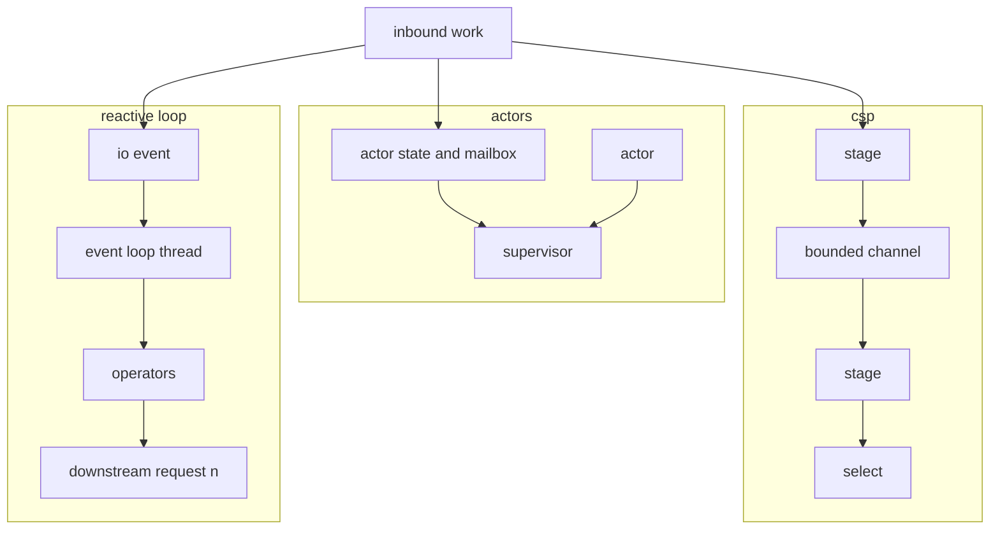

## Concept

### A default that should have to earn its place

Most services start as threads, mutexes, and a pool in front of blocking I/O. The model matches libraries and it matches how people were taught. It also produces the bugs that do not reproduce: lock-order inversions, races on counters that look benign, and tail latency when the pool was sized for yesterday's fan-out. I keep that model for a simple request path with a small critical section and a team that already operates it. I stop treating it as the unspoken default once the unit of failure, the unit of backpressure, or the unit of affinity has a name.

Actors, communicating sequential processes, and reactive event loops make concurrency explicit. They differ in who owns state, how overload moves upstream, and what a failure looks like. I pick from those mechanics. A framework's marketing is not a mechanic.

### Actors: private state, a mailbox, a supervisor

An actor is a sequential process with private state and a mailbox. Other actors send messages. They do not read fields. The runtime multiplexes many actors onto fewer threads. Failure is local: the actor stops, a supervisor restarts it or escalates, and neighbors keep their own inboxes unless you coupled their work.

This fits when you can name the unit of isolation. A session, a device, a shard, a workflow instance, a presence record. Erlang at chat scale, cluster sharding in actor toolkits, and virtual actors all bet that the map from domain entity to actor is stable enough to schedule and to restart.

The mechanics I write down before the code are mundane and load-bearing. The mailbox has a bound. Overflow has a policy: drop, shed at ingress, or slow the sender. An unbounded mailbox is a memory leak with a domain name. Local delivery is at-most-once unless you add idempotency in the receiver. At-least-once needs that idempotency. Exactly-once is a storage protocol, not a property of the mailbox. In-process actors are a concurrency model. Distributed actors are a network with membership, timeouts, and partial failure. Location transparency is a convenience inside one runtime and a trap across machines. A hot actor that never yields starves every other actor on that dispatcher thread. Fairness is a configuration, and it is an objective once you share a thread.

Supervision is the recovery story inside the process: who restarts whom, with what state, and which failures escalate. A supervisor that restarts an actor whose bug is poisoned input will spin. Restart policy includes the option to surface the error and stop.

### CSP: a channel you can read as a bound

Communicating sequential processes, in the form most teams meet as lightweight threads and channels, pass values rather than share them. A select waits on several channels. The discipline is that sending transfers the right to use the value. The language will not always enforce it. Go in particular still allows shared memory, and the race detector is part of the operating model.

This fits pipelines and protocol state machines inside one process. A reader, a parser, a writer. A fan-in of events. A worker pool fed by a bounded channel. The channel is the backpressure instrument. A send on a full channel that blocks, or that returns an error, is load shedding you can see in the type. An unbounded channel is the same leak as an unbounded mailbox.

There is no standard supervision tree. Cancellation is a context or a done signal. Actors have addresses. These threads do not, unless you build addresses. I use channels for a graph of stages in one binary, and actors when the unit of failure is a long-lived entity. Shared memory stays a small, documented mutex, with the race detector in CI.

### Reactive loops: demand, and a thread you must not block

Reactive streams and runtimes such as Netty, Vert.x, Node's loop, and shared-nothing server frameworks push events through operators on a small number of threads. Backpressure is a protocol: the downstream requests a number of items, and the upstream is supposed to honor that. Blocking on the loop stalls every connection pinned to that core. That stall is an incident.

This model fits high connection counts and data-path services where cache locality matters. It fails when blocking work lands on the loop. Async functions on a thread pool are still shared-memory concurrency. I call a design reactive when demand and the loop are explicit.

What I pin down in review is concrete. One loop per core is the data-path default. A separate, sized pool runs blocking APIs, with its own timeout. Work-stealing on the packet path is a different product. The demand signal is a bound. An operator that buffers without a limit hides overload until the heap is the pager. A failed inner stream that swallows the error is a silent drop. Loop lag — time until the next tick, or delay of a scheduled task — is the objective. CPU utilization will not show a blocked loop, because a blocked loop looks idle.

### One model per process, translation at the network

Production systems mix these across a fleet. A reactive gateway in front of actor-sharded business logic, with a channel-based service beside it, is reasonable when each binary has one native model and the network between them has timeouts, bounded queues, and an overflow policy. It is a poor system when three runtimes share a process and each assumes it owns the allocator, the signal handlers, and the thread pool.

I pick the model per binary to get a property I can name: mailbox isolation and supervision, channel backpressure, or loop affinity. Translation happens at the RPC boundary, where a deadline already has to exist.

## Trade-offs

| Approach | When it wins | Cost / risk |
| -------- | ------------ | ----------- |
| Threads and locks | Small critical sections, native libraries, a simple request path | Races, lock inversion, pool saturation, poor tails |
| Actors and supervision | Entity isolation, crash-only recovery, a clear unit of restart | Unbounded mailboxes; remote actors that pretend to be local calls |
| CSP channels | In-process pipelines and protocol machines; visible backpressure | Weak supervision; shared memory remains available in some languages |
| Reactive event loops | Many connections, low-overhead I/O, explicit demand | Blocking the loop; operator graphs that hide a buffer |
| One model per binary, mixed across the fleet | Each service uses the mechanic it needs | More operational surface; mismatched timeouts at a sloppy boundary |

A remote actor message is a serialized RPC. It needs a deadline, a retry budget, idempotency, and a way to shed load. Distribution protocols are networks, and I review them the way I review any RPC. Supervision does not cross that hop unless the cluster protocol is written down and has been tested under partition.

Event loops win on cost per connection and lose when a blocking call lands on the core. A database call on the loop stalls every tenant pinned there. Blocking APIs fail review, or they run on a pool whose queue is bounded. In an actor runtime the same bug is a long synchronous call on a shared dispatcher. Mailbox time and loop lag belong on the same dashboard as request latency. If a dependency brings its own runtime into the process, put a bounded queue in front of it. The queue is the architecture.

## Diagram

Three in-process shapes. Actors fail into a supervisor. Stages meet on a bounded channel. A reactive loop pulls with demand. Inbound work enters one of them inside a single binary. Crossing to another model is a network hop with a timeout.

## Failure modes

### Buffers with no ceiling

An actor, a channel, or a reactive operator buffers without a limit while a downstream slows. Memory grows. Collection thrashes. The process dies looking like a leak. CPU can look fine until the end. I watch mailbox depth, channel length, queue time, and heap. An actor system with no mailbox metric cannot be operated. The number has to be chosen. Overflow has to do something visible: fail the ingress, drop with a metric, or apply backpressure that reaches the socket.

### A blocking call on a shared core

A name lookup, a contended mutex, or a large parse runs on the event loop or on the actor dispatcher. Tail latency for unrelated work on that core jumps. The detection is loop lag or scheduler delay, not average CPU.

Dedicated pools for blocking calls, a CPU budget for parse work, and an alert on lag are the controls. A hot actor that runs for tens of milliseconds without yielding is the same bug. Split the work, or give that actor a dispatcher that cannot stall the others. The review question is what happens to everyone else on this thread while this call runs.

### A remote send with no deadline

The remote actor is gone. Senders block, or they retry into a black hole, or they leak futures waiting on a request that never returns. The local supervisor does not own the remote lifecycle. The chart is a pile of in-flight requests and a timeout storm.

Treat remote sends as RPCs. Watch membership. Time out every request. A retry needs a budget and an idempotency story. Delivery "eventually" is not a deadline.

### A bound that stops at the language boundary

A reactive ingress turns into unbounded actor sends. A channel send lands in a thread-pool queue with no capacity. The bound existed on one side and not on the other. The queue shows up in a heap dump, not on a dashboard.

The boundary is a bounded queue with an overflow policy written on the interface. I test the full queue in CI: fill it, confirm the ingress fails or slows, confirm the metric moves. A backpressure design you have never saturated is a slogan.

## Real-world example

WhatsApp's Erlang system is the public demonstration of actors at serious connection scale. Millions of lightweight processes, isolation around a session, and supervision as the recovery path. A connection process can die without taking the node with it. Operators can look at a mailbox and a process tree and form a theory. The win was a runtime that makes process death cheap and local.

That matches chat and presence: many independent sessions, local state, and failure that should stay inside one session. It is the wrong native model for a cache-hot packet loop or for a service built on blocking database drivers. I copy isolation and supervision. The design question at the edge is where the actor model stops and a timeout-bounded RPC begins. Inside that line, a process can restart locally. Outside it, the peer can be down, slow, or duplicated, and the actor needs a policy for each case.

## What to remember

- Actors isolate state and failure; channels make backpressure explicit; reactive systems make demand and loop affinity explicit.
- Unbounded mailboxes, channels, and operator buffers amplify overload; a bound and an overflow policy are part of the model.
- Loop lag and dispatcher delay are objectives; a blocking call on a shared core stalls everyone pinned to it.
- A remote actor is an RPC; supervision crosses the network only when you designed a cluster protocol and tested partitions.
