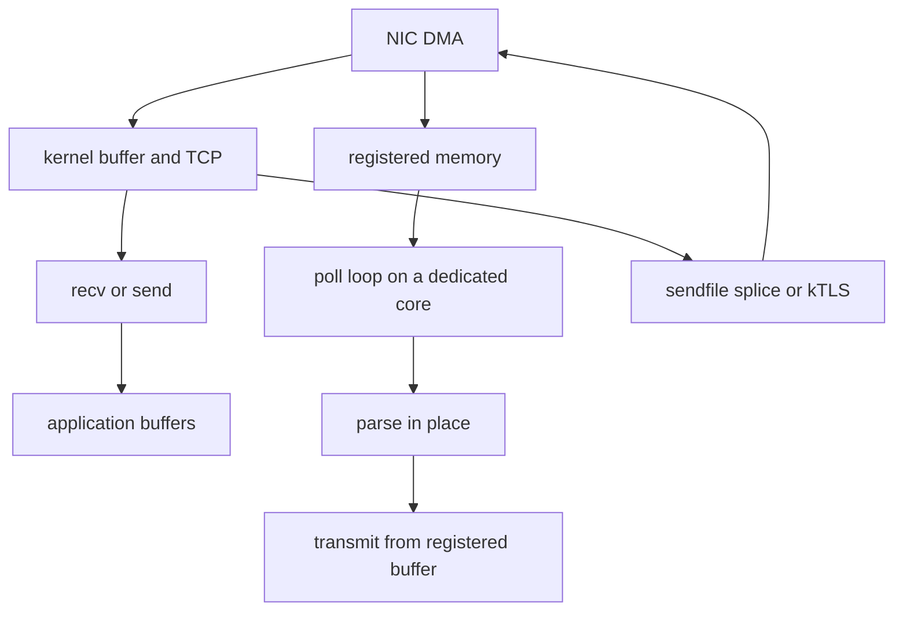

## Concept

### Two taxes, often confused

A traditional receive path copies more than once. The NIC writes into a kernel buffer. The kernel copies into a socket buffer. A read copies into a user buffer. A framework often copies again into an arena or a deserialized object. Each copy burns bandwidth and cache. Each syscall is a transition, a permission check, and a chance for the scheduler to park the thread.

Zero-copy and kernel bypass attack different parts of that tax. Zero-copy means the payload is not duplicated as it moves. Kernel bypass means the application talks to the NIC, or to a user-space driver, without the kernel on the per-packet path. You can remove copies and still use the kernel. You can bypass the kernel and still copy if the application is careless. I make teams name the copies they removed. A toolkit name is not that list.

### Stay on the kernel path until the numbers say otherwise

Before anyone adopts a bypass stack, I want the copies Linux will already remove.

`sendfile` and `splice` move file bytes to a socket without a user buffer. They win for static content and for proxies that do not inspect the body. `MSG_ZEROCOPY` and related send paths reduce copies on large transmits, with a completion notification so the buffer is not reused early. Completion is the safety story. A zero-copy send without a completion queue is a use-after-free. `io_uring` with registered buffers amortizes syscalls, keeps buffers pinned, and completes in batches. It keeps the kernel TCP stack, congestion control, firewalling, and the tools operators already know.

Recycled buffer pools, aligned so the remaining copies are friendly to the cache, are still worth doing on the ordinary path. Most RPC services should stop here. A kernel path measured in tens of microseconds is noise beside a database call measured in milliseconds. Bypass starts to matter at very high packet rates, or when the latency budget is tens of microseconds and the kernel is the budget.

### Bypass: poll-mode drivers, AF_XDP, and RDMA

Kernel bypass maps NIC queues into user space. A poll-mode driver spins on those queues instead of taking an interrupt per packet. The application loop is poll, parse, process, transmit. Affinity pins the loop to a core, the core to a queue, the queue to the NIC. There is no socket API unless you build one.

DPDK is the common user-space NIC toolkit. You bring a user-space TCP stack, which is a product of its own, or you stay at the packet layer and implement forwarding or connection state yourself. AF_XDP sits in between: a shared memory region and a socket-like interface, still in Linux, without rewriting TCP. It is the option I look at when the team wants faster packet I/O and still wants the kernel to exist.

RDMA, on a datacenter fabric, is a different bypass. The NIC reads and writes registered memory, and completions arrive on a queue. It fits storage and fabrics you control. It is an awkward fit for general TCP on the public internet. A lost completion or a protection-domain mistake is not a socket error your existing client understands.

Mechanics I will not leave implicit follow from the hardware. Hugepages or otherwise pinned regions hold the packets. A compacting collector must not move DMA memory. The packet arena is native memory with an explicit lifetime. Busy polling burns a core. That is the purchase. Sleeping saves power and wrecks the tail you bought the core to protect. Capacity metrics have to distinguish poll-busy from work-busy, or every autoscaler will lie. If you need the internet's congestion control and a normal socket, stay in the kernel, or accept that a user-space stack is now on the critical path, including its bugs. Packet captures, packet filters, and many mesh controls do not see bypassed packets unless you built a tap or enforced policy in the poll loop.

### The copy that still happens after the NIC

Removing the kernel copy is wasted work if the next layer copies into a serialization arena, or if a managed runtime copies off-heap bytes onto the heap before parsing. End-to-end zero-copy is a pipeline. The NIC writes a registered buffer. Headers are parsed in place. A slice is handed to logic that does not take ownership by copying. Transmit uses the same buffer, or a sibling from the same pool, after the completion rules say it is free.

Encryption, compression, and re-encoding are transforms. They allocate or they write into a second registered buffer. They are not free. TLS in user space can still avoid a trip through the kernel if crypto reads and writes registered buffers. Kernel TLS can make a send of encrypted file bytes possible for some proxy workloads. I pick one of those on purpose. I do not stack three TLS implementations and then call the path zero-copy.

### Machines that are allowed to spin

Bypass is a dedicated-machine technique. On a multi-tenant node, poll-mode cores and pinned huge pages fight the orchestrator. A bypass process that never yields starves neighbors by design. I put it in cells that exist for a data path: a proxy tier, a database, a matching engine. The control plane stays on ordinary sockets, where the tools and the security policy already work.

A user-space driver is a privileged component. A bug there sits in the same blast radius as a NIC driver bug. Limit which binaries may bind queues. Do not hand bypass to arbitrary tenant code. If the platform cannot enforce that, `io_uring` remains the default.

## Trade-offs

| Approach | When it wins | Cost / risk |
| -------- | ------------ | ----------- |
| POSIX sockets and buffer pools | Almost all RPC services | Syscall and copy cost at very high packet rates |
| Kernel zero-copy with sendfile, MSG_ZEROCOPY, or io_uring | File serving, proxies, large payloads, still with kernel TCP | Completion tracking; the kernel remains on the path |
| AF_XDP | Faster packet I/O while staying in Linux | Limited help for TCP; memory and wakeup tuning |
| DPDK and poll-mode bypass | Balancers, storage engines, exchanges on dedicated cores | Burns cores; blind spots for operations and security; TCP is yours |
| RDMA | Storage and intra-datacenter fabrics with registered memory | Specific NICs and fabrics; a different failure model |

Bypass is not a latency feature for an ordinary request API. It starts to pay when packet rate or a microsecond budget makes the kernel the dominant term. The operational cost is usually larger than the code. You rebuild observability with hardware timestamps and a user-space tap. You rebuild capacity planning around cores that sit at full utilization on purpose. You rewrite the failure playbook: a hung poller is a dead core, not a slow socket. If you cannot staff that, stay on `io_uring` and measure again later.

A garbage-collected language can participate with off-heap arenas and pinned buffers. A collector that moves packet memory is incompatible with DMA. I treat the arena as native memory. If the team cannot explain the lifetime, they copy. A copy is cheaper than silent corruption.

## Diagram

Two receive paths leave the NIC. The kernel path can still avoid a user copy. The bypass path writes into registered memory, and a poll loop parses in place and transmits from that memory.

## Failure modes

### Cores that look busy and do no useful work

A bypass process pins cores that sit at full utilization by design. An autoscaler that trusts CPU will throttle the node or pack more work onto it. Neighbors miss their latency budgets. I separate empty polls from useful work: cycles per packet, receive drops, and a count of polls that found nothing. Dedicated node pools keep this traffic away from ordinary services. Colocation turns a fast tier into a noisy neighbor.

### Reuse before the completion arrives

A zero-copy send or a DMA completion arrives after the buffer was returned to the pool, or the completion was ignored. Payloads corrupt. The failures are rare and they look like bit flips. Checksums, torn messages that customers see, and builds that poison a buffer on release are how I catch it. Completion is a state machine. If that state machine is too hard for the team, they copy. I would rather pay the bandwidth than ship corruption on a fraction of packets.

### Controls that no longer observe the traffic

Packet filters, mesh policy, and many detection paths do not observe bypassed packets. A deny rule does not deny. I test policy by sending traffic through the bypass path, not through a sidecar that still uses sockets and therefore flatters the test. Enforce the policy in the user-space path, or force that traffic through a kernel-visible hop and accept the cost. The blind spot belongs in the design. Assuming a sidecar sees what a poll-mode driver sees turns a security control into decoration.

### Drops, with no socket backlog left to absorb them

When the poller falls behind, the NIC drops. Retries amplify, and the poller falls further behind. There is no socket backlog applying backpressure. I watch receive and transmit drops and the rate of useful packets, not CPU alone. The poll loop needs its own admission control, before parse if possible, and a defined shed behavior. Pause frames and NIC queue depths are part of that design. Bypass removed the kernel queues. Something in the loop has to replace them, or the first overload is a cliff.

## Real-world example

ScyllaDB, built on the Seastar framework, is a public database data path that treats per-core loops and direct I/O as the architecture. A shard is pinned to a core. Cross-core sharing stays off the request path. A direct I/O path feeds the shard. The published payoff is predictable tail latency and high I/O rates on machines dedicated to that job.

The lesson I use in review is the packaging. They did not drop a poll-mode driver into a thread-per-request service and hope the copies would leave. Memory, scheduling, and I/O assumptions match DMA and polling. If you need that performance, you are adopting a runtime and an operating model, including how you debug and how you size machines. If you do not want that runtime, kernel zero-copy and `io_uring` will take an ordinary Linux service a long way, and packet capture will still work. I ask which of those two commitments the team is signing before anyone vendors a NIC toolkit.

## What to remember

- Name the copies you removed; bypass without in-place processing still burns cores and still copies.
- `sendfile`, `MSG_ZEROCOPY`, and `io_uring` are the default; poll-mode drivers and RDMA belong on dedicated data-path machines.
- DMA and zero-copy sends have lifetimes; reuse before completion is silent corruption.
- Bypass hides packets from kernel policy and packet tools unless you rebuild those controls on the poll path.
