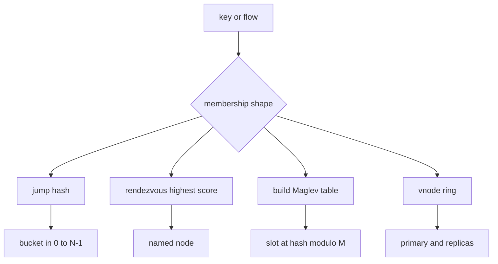

## Concept

### Assignment that survives a membership change

The job of these algorithms is to map a key to a node so that a membership change moves as little as possible, and so that load stays even enough to operate. Classic consistent hashing puts keys and nodes on a ring. Adding a node moves about one Nth of the keys. Virtual nodes smooth a small ring. That design is still the right partitioner for disks that need a replica walk and a stable owner for hours. It is the wrong shape for some other jobs: a lookup that must be an array index, buckets that are a dense range, or backends with arbitrary names and weights.

Jump consistent hashing, rendezvous hashing, and Maglev hashing share the goal of minimal disruption. They differ in lookup cost, memory, and what membership is allowed to look like. Picking one is a question about the node set.

### Jump: a dense range that grows at the end

Jump hashing maps a 64-bit key to a bucket in `0 .. N-1`. The expected cost is logarithmic in N. There is no ring and no per-node token list beside the call. The membership it understands is a contiguous set of buckets that grows or shrinks at the high end. Adding bucket N moves only the keys that now land on N. Removing an interior bucket means renumbering, which means a large move.

That constraint is the architecture. Jump fits a sharded cache or store whose shards are numbered and whose scale-out is "add the next shard." It is a poor fit for pods with random names, or for a fleet where you must drain whichever instance is sick. If the platform cannot promise append-only membership, jump will surprise you the first time a middle ordinal dies.

Jump has no native weights. Heterogeneous machines mean multiple buckets per heavy node, which reintroduces a table. I use jump when N is dense and the hardware is close enough to uniform. A numbered set of pods can look like jump's world until someone deletes an interior member. If that delete is a normal operation, jump is the wrong function, or the delete comes with an explicit data move you have rehearsed.

### Rendezvous: score every name, keep the best

Rendezvous hashing, also called highest random weight, scores a key against every node. Hash the key with the node id. Keep the node with the best score. Weights can be a repeated identity or a score adjustment. Lookup is linear in N unless you add a hierarchy or a cache. Removing any node moves only that node's keys, to whoever scores next. Adding a node steals keys from the others in proportion to its weight. The top distinct scores are a replica set, and you can filter that list so two replicas do not land in one rack.

Node identities are arbitrary strings. That is why rendezvous wins for cells, tenants, and named backends where N is modest — dozens, sometimes low hundreds — and any node must be removable. It loses when N is thousands and the lookup sits on the packet path. People then shard the node list, which is a second assignment problem. For a data-plane balancer I want a lookup table. For placing tenants onto a few dozen cells, rendezvous is the function I can explain in review.

Weights are capacity. A mis-weighted node starves or melts. I review weights the way I review shard counts, and I look at per-node load after every membership change. A perfect hash with a bad weight is an imbalance you will call a hotspot.

### Maglev: build a table, then index it

Maglev builds a lookup table of M slots, often far larger than the backend count, and fills it from per-backend permutations so each backend receives a nearly equal share. Lookup is the slot at the hash of the key modulo M. Membership change rebuilds the table. The rebuild is the cost. The data path is an array index, which is why the algorithm exists: packet rates where walking a ring is too expensive, and a modulo of a changing N would reshuffle almost every flow.

The fill is designed so that adding or removing a backend moves a near-minimal fraction of slots. Table size is a knob. Too small, and load is lumpy and disruption gets worse. Too large, and memory and rebuild time hurt. Every forwarder needs one view of the backend set. Two balancers that rebuild from different memberships split flows: the handshake lands on one backend, the rest of the connection on another.

Maglev is a balancer algorithm. It is a poor source of truth for which disk owns a key across a long compaction. A table rebuild is a control-plane event. A disk assignment wants a function you can recompute from the key and a slow-changing ring or rendezvous set, plus an explicit replica policy. Use the table in front of a pool. Use a ring or rendezvous inside the pool.

### Choose from the shape of the set

Three questions settle most reviews. Are identities dense integers that only grow or shrink at the end? Use jump. Are identities arbitrary, is N modest, and must any node be removable, perhaps with a weight? Use rendezvous. Is this a data path with a known backend set and a need for constant-time lookup? Build a Maglev table in the control plane and publish it.

A ring with virtual nodes remains the default for durable shards and replica walks. Bounded-load variants, which skip a backend already above a load factor, matter for request routing when uniformity under skew matters more than a pure hash. I keep the functions separate. A Maglev table that also tries to be the ring is two sources of truth, and clients will use the wrong one during an incident.

## Trade-offs

| Approach | When it wins | Cost / risk |
| -------- | ------------ | ----------- |
| Ring plus virtual nodes | Durable shards, replica walks, disk locality | Token maps, vnode tuning, a walk that is costly on a packet path |
| Jump consistent hashing | Dense buckets, append-only scale-out | Cannot drain an arbitrary middle node; no native weights |
| Rendezvous hashing | Arbitrary names, weights, small N, readable replica sets | Linear lookup; painful when N grows into the thousands |
| Maglev lookup table | Balancing, even load, array-index lookup | Rebuild on membership; a poor durable partitioner |
| Hash modulo N | A tiny pool that almost never changes size | A membership change remaps nearly every key |

Jump's append-only rule is easy to violate in an orchestrator. If a human can delete an interior member, you are on a ring or on rendezvous, or you have a renumbering plan with a data move. I would rather see that plan in the design than discover it during the delete.

Maglev rebuilds have to be paced. A flapping backend that rebuilds the table every second will move a slice of connections. Hold-down belongs in the control plane. The data path should swap in a finished table, not recompute it per packet.

Rendezvous at packet rate becomes a CPU problem as N grows. Hierarchical rendezvous, or a Maglev table, is the escape. A linear scan is fine while N is modest, and it should sit next to a metric of N so the day the set stops being modest someone sees the curve.

## Diagram

Membership shape picks the function. Jump returns a dense bucket. Rendezvous returns a named node. Maglev publishes a table and the data path indexes it. Durable disks stay on a ring with a replica walk.

## Failure modes

### Two views of the same set

A proxy and a client, or two proxies, disagree by one drained host. Caches split. A store sends writes to the wrong owner. Misses rise after a scale event, and a generation counter on the membership object disagrees across the fleet.

Version the backend set. Rebuild tables from one config that has a generation. Clients that hash locally must watch that same object. A stale jump parameter is as damaging as a stale ring. During rollout, pin the generation. Old and new code have to agree on who owns a key, or a forwarder has to heal mismatches for the length of the deploy.

### A balancer hash used as a disk map

Jump cannot remove an interior shard without a renumber. Maglev moves slots on rebuild and has no replica walk. Teams still reach for them because the lookup is short. The symptom is a reshard that moved far more data than one Nth, or a compaction storm after a balancer restart.

Storage gets a ring or rendezvous with an explicit replica placement policy. Balancers get Maglev. If you need both, they are two functions with two names. The cache key and the disk key can use different algorithms. Writing that down prevents the next engineer from collapsing them into one.

### Rebuilds driven by a health blip

A backend fails one health check, leaves the table, and returns. A slice of flows moves onto cold backends. Connection-setup rate and cache misses spike in time with the rebuild. I alert on rebuild rate and on the fraction of slots that changed.

Hold down before removal. Do not drop a backend on the first failed probe. Rebuild off to the side and swap the pointer. A flapping member spends a quarantine period out of the table only after it has earned it.

### Linear scoring on the packet path

N grew from a few dozen to a few thousand. Each request hashes against every backend. Proxy CPU scales with N while the backends look idle. Hierarchical rendezvous, a lookup table, or a partition of the backend set is the fix. Rendezvous is a clear algorithm for a modest set. When the set stops being modest, the algorithm has to change. CPU per request plotted against N is how you notice in time.

## Real-world example

Google's Maglev load balancer is the public existence proof for the table-driven variant. The machines had to assign packets to backends at a rate that made a virtual-node walk unattractive, keep that assignment stable when backends changed, and spread load evenly. They precomputed a lookup table from the backend set so each packet was an index, and they filled the table so a backend failure moved a near-minimal set of slots. The work is about a balancer in front of a pool.

That constraint is why the same idea later showed up in other data planes, including a Maglev mode in kube-proxy and a Maglev policy in Envoy: a known backend set, constant-time lookup, rebuild in the control plane. It did not replace rings inside distributed databases, which still need replica sets and an owner that stays put for the life of a compaction. Jump hashing, from a separate line of work, is the other published tool I reach for when the buckets really are a dense range and only the end of the range moves. I use it only when the platform can keep that shape.

## What to remember

- Jump wants dense append-only buckets; rendezvous wants modest N and arbitrary names; Maglev wants a rebuilt table and constant-time lookup.
- Durable storage still wants a ring or rendezvous with replica placement; a Maglev table is a balancer, not a partitioner.
- Version the membership every hasher sees; two lists are two assignments.
- Hold down health flaps before you rebuild a Maglev table, or you will reshuffle on a blip.
