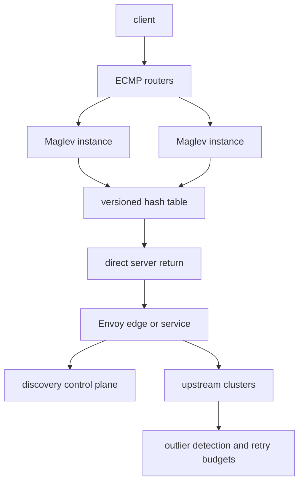

## Concept

### Packet rate and request rate are different hops

Maglev is a software layer-4 load balancer built to run near NIC speed. It assigns connections to backends with a consistent table, takes packets from routers over equal-cost multipath, and keeps almost no per-connection state on the balancer itself. Envoy is a programmable proxy. It terminates connections, routes HTTP and gRPC, retries, detects outliers, terminates TLS, and emits the RPC metrics teams page on. They solve different hops. Wanting Maglev's packet rate from a process that parses HTTP is a capacity plan, and it usually loses.

A coherent high-scale path is straightforward. Routers hash a flow onto a set of Maglev machines that announce a virtual address. Maglev forwards to a pool. That pool may be an Envoy edge fleet or a service that already carries sidecars. Maglev is the fabric. Envoy is the hop that understands the application. I size them separately, and I count the hops in review.

### Maglev: one assignment, many forwarders

Maglev machines advertise the address with BGP. Routers spray packets across those machines. Each instance must choose the same backend for a connection even though it does not share a connection table with its peers. That is why the hash table exists. A deterministic function of the flow — often the five-tuple, sometimes a connection identifier for protocols that would otherwise break — maps to a backend. The table is rebuilt when the backend set changes, from one versioned view. A split view splits the connection. The handshake lands on one backend and a later packet on another, and TCP dies.

This hop does not terminate the client session. Packets pass through. Direct server return is the high-bandwidth mode: the backend answers the client without sending the bytes back through Maglev. You win bandwidth and you take on a distributed configuration problem. Backends must accept traffic for the virtual address, address resolution must not fight, and segment size has to be sane. A mode that rewrites addresses is slower and easier when the platform cannot keep that configuration honest.

Health checking is part of assignment. An unhealthy backend leaves the table. All instances have to agree on that departure, which means a control plane or a local agent fed from the same membership. Hold-down matters. A single failed probe that rebuilds the world will move flows onto cold backends.

I use this class of balancer — Maglev, later variants in the same family, or a cloud network load balancer with the same shape — when the requirement is very high packet rates, when the balancer should not inspect HTTP, and when backends can own the TCP session. I do not ask it to retry a stream. It cannot see the stream.

### Envoy: policy at the cost of parsing

Envoy terminates the connection. It parses the protocol, applies listeners and routes, and picks an upstream cluster. Policies include round robin, least request, Maglev, and ring hash. Outlier detection, circuit breaking, retries, and timeouts are the features people turned the proxy on for. The unit of work is a stream. The cost is CPU and allocations per request, not an array index per packet.

Envoy's Maglev and ring-hash policies are in-process cousins of the Maglev paper. They keep a key — a header, a cookie, a source address — on a stable upstream while endpoints change as little as the algorithm allows. They do not turn the proxy into a packet-mode balancer. Parsing frames is still the tax, and you pay it because you wanted the policy.

Least-request often beats a hash for stateless RPC, because it reacts to outstanding work. A hash policy wins when you need affinity: a long stream, a websocket, a cache that is warm for a key. I pick the policy per cluster and I write down which key is hashed. Hashing the wrong header is a silent stickiness bug.

Sidecar versus edge is a placement decision. A sidecar gives per-service policy and mutual TLS, and in a chatty topology it puts two proxies on one call. An edge fleet centralizes layer 7 and can be sized like a data plane. Maglev in front of that edge fleet is a design I like. Maglev in front of every pod, plus a sidecar, plus another gateway, is three answers to one question. I count them before I add a fourth.

### Direct server return and the control planes

Direct server return is operationally sharp. Backend configuration, reverse-path filtering, and maximum segment size are part of the data plane. If the platform cannot own those, address translation or a cloud load balancer is the honest choice. You will spend the CPU. You will spend fewer weekends.

Maglev needs a backend inventory and health that every forwarder shares. Envoy needs a discovery API: listeners, routes, clusters, endpoints, and secrets. The failure I see most often is the control plane. Stale endpoints, a slow push, a config that flaps, a cluster that warms too late. Panic thresholds — refusing to eject every endpoint when too many look bad — are as important as the load-balancing policy. Discovery freshness is an objective. A fast layer-4 hop in front of a stale proxy is a fast path to a pod that is already gone.

Drain and warming belong in the same design as the hash table. A new endpoint should not receive traffic until it can serve. A removed endpoint should stop receiving new flows and finish the old ones. The layer-4 table and the endpoint list have to move together, or one hop has moved on while the other has not.

## Trade-offs

| Approach | When it wins | Cost / risk |
| -------- | ------------ | ----------- |
| Maglev-style layer 4 with direct server return | Highest packet rates, TCP passthrough, reply bandwidth off the balancer | Backend address configuration; little application policy; split tables break connections |
| Cloud network load balancer or a kernel balancer | Managed layer 4, less custom routing | Vendor limits; still blind to HTTP |
| Envoy as an edge fleet | Retries, routing, TLS, RPC metrics | CPU per request; you operate discovery and capacity |
| Envoy sidecars | Per-service policy and mesh identity | Extra hops and memory; a mesh outage is a fleet outage |
| Client-side or DNS balancing | No extra proxy hop | Stale membership, uneven clients, policy that is hard to change |

Retries in Envoy are a second load balancer you did not draw. A latency spike plus a default retry budget multiplies demand. Outlier ejection then removes backends until the panic threshold dumps everything onto whoever remains. I set retry budgets, caps on outstanding requests, and ejection limits, and I load-test them. The proxy's usefulness includes its ability to amplify a bad upstream.

A sidecar mesh plus an edge proxy plus Maglev can be justified. Each hop needs a reason: identity, routing, or packet rate. A platform standard is not a reason to put a proxy on a path whose budget is a millisecond. Put the mesh on the control and product paths. Keep the hottest data path as short as the security policy allows.

## Diagram

Routers spray packets across Maglev instances that share one table generation. Direct server return reaches an edge proxy or a service. The proxy applies discovery policy and talks to upstreams with its own limits.

## Failure modes

### Forwarders that disagree

Two forwarders disagree on the backend set or the table generation. Packets of one connection hit different backends. Resets rise in time with a config push, and a generation metric does not match across the tier. The fix is an atomic swap from a versioned list, hold-down on health flaps, and a behavior that keeps the last good backends rather than publishing an empty table. Every instance must hash the same inputs. A five-tuple on one machine and a three-tuple on another is a split even when the table bytes match. Encrypted flows that hide the ports need a connection identifier you actually have, or both the routers and the balancer will guess.

### Retries that shrink the survivor set

Defaults retry into a slow cluster. Outlier detection ejects hosts. The panic threshold finally stops ejecting, and the remaining hosts drown. I watch retry rate, ejection count, and the number of endpoints still receiving traffic. Retry budgets and concurrency limits, chosen in a load test, are the controls. I would rather fail a slice of requests than multiply the load on a dependency that is already the bottleneck.

### Return path configured on only half the fleet

Some backends answer for the virtual address. Some do not. A kernel update changes filtering or segment size. The handshake is visible on the balancer and the rest of the flow is not, or the reverse. I treat that configuration as a golden image with a data-plane test: a full handshake through direct server return, not a ping of the balancer. Sysctl changes go through the same review as a routing change. Direct server return is a distributed system. The balancer flag is one node of it.

### Discovery that lags the orchestrator

The orchestrator has deleted the pod. The proxy still has the endpoint. Or the pod is ready and discovery has not warmed it. Errors go to gone addresses, or a deploy looks healthy in the orchestrator and empty at the proxy. Endpoint version lag and time spent warming should be objectives. Drain before delete. Warm before traffic. When the control plane is slow, the data plane is wrong, and a faster layer-4 hop only delivers the wrongness sooner.

## Real-world example

Google's Maglev is the public layer-4 design: software on commodity servers, addresses announced with BGP, equal-cost multipath from the routers, a consistent hash so any forwarder assigns a flow to the same backend, and direct server return so reply bandwidth does not hairpin through the balancer. It moved a hardware function onto machines without giving up packet rate. Health, table consistency, and backend cooperation are the system, not an afterthought.

Envoy's public story is the other half. It became the data plane for meshes and gateways, with a discovery API as the contract between control and data. In a large edge you want both ideas: a cheap layer-4 assignment close to the NIC, and a smaller set of layer-7 cores where retries, authentication, and routing pay for their CPU. Google's edge has lived that split, with Maglev in front and HTTP proxies where the application policy lives.

If you only have Envoy, you still need a layer-4 story, whether that is a cloud load balancer or a Maglev-like address. If you only have Maglev, you still need a layer-7 story for anything that retries or routes on a header. Buy the hops you can justify. Size them apart. Do not make one process pretend it is the other, and do not let a sidecar appear on a path whose budget assumed a single packet forward.

## What to remember

- Maglev assigns flows at packet rate; Envoy applies policy at request rate; they stack, and they do not substitute for each other.
- Every Maglev forwarder has to share one versioned table and the same hash inputs, or connections split.
- Envoy retries, ejections, and panic thresholds need budgets, or they become the outage.
- Direct server return and endpoint discovery are operational contracts; a bad kernel setting and a stale endpoint list are data-plane bugs.
