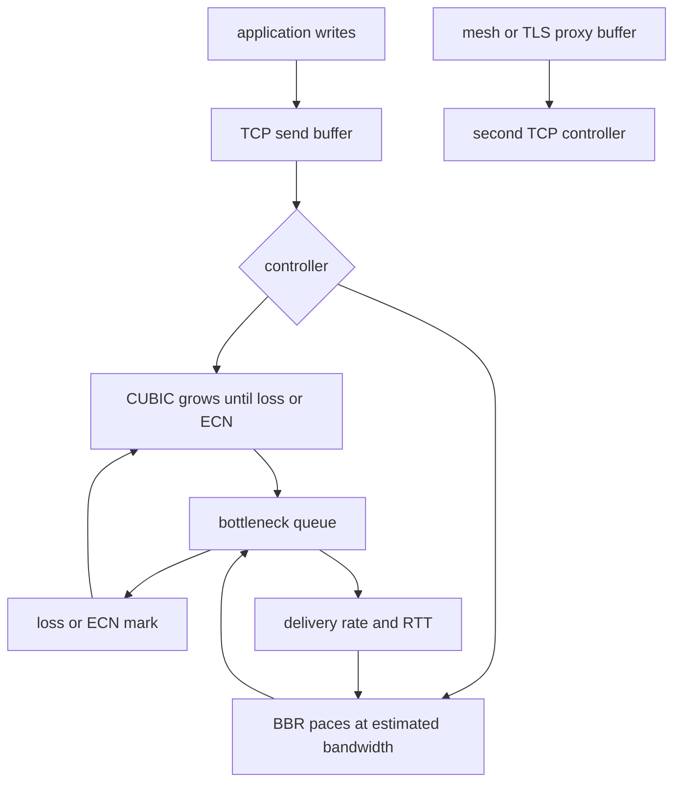

## Concept

### A sender sharing a path it cannot see

TCP senders share a path. Congestion control decides how fast to send so the path stays useful for everyone on it. Loss-based algorithms, Reno and CUBIC among them, treat loss as the signal that the network is full and they cut the rate. Model-based algorithms, BBR among them, try to sit near the start of queueing, using round-trip time and delivery rate, instead of waiting for a drop.

I do not implement BBR in the application. I choose kernels, queue disciplines, buffer sizes, and overlays that make the signal either honest or fictional. A default of CUBIC plus a deep buffer in a middlebox will dominate tail latency more than a retry policy written in the service. Architects own those choices even when the code lives in the kernel.

### Loss-based growth and the queue it will fill

CUBIC grows a window as a function of time since the last loss. On long, fat paths it fills pipes that older loss-based senders left underused. It also fills standing queues. If the bottleneck buffer is deep, CUBIC will fill it until something drops, then cut. The latency the application sees is propagation delay plus that queue. Bufferbloat is a loss-based sender doing what it was built to do, inside a buffer someone sized for bursts and then forgot.

Deep buffers at the edge — wireless, home gateways, some cloud interfaces — turn a throughput win into a latency problem. Shallow buffers in a datacenter drop early, and a loss-based sender then under-uses the link unless explicit congestion notification gives it a mark to react to before the drop. Application retries on a flow that is already backing off are a second control loop. They add load to a path that was trying to shed it.

ECN marks packets instead of dropping them. CUBIC and datacenter controllers can slow down on marks. If the path never carries the marks end to end, you have chosen drop as the only signal. I turn ECN on where I own the fabric and I can prove the marks survive. I do not assume every middlebox on the public internet will pass the bits.

### BBR: pace from bandwidth and a minimum delay

BBR estimates bottleneck bandwidth, the maximum delivery rate it has observed, and the minimum round-trip time. It paces sends near that bandwidth and keeps in-flight data near the bandwidth-delay product, trying to fill the pipe without a standing queue. It probes upward for more bandwidth, and it occasionally sends slower to remeasure the minimum delay, because a standing queue would otherwise hide the baseline.

BBR is strong on long fat pipes, and on paths where loss is corruption or a shallow drop rather than a full buffer. It is how you avoid the standing queue CUBIC will build on a deep buffer. It is not a promise of fairness against CUBIC in every buffer size, and it is not a substitute for application flow control. A proxy that has already buffered a huge body is a queue the next hop's controller cannot see.

Later revisions exist because early BBR could be aggressive next to loss-based neighbors and could cling to a stale bandwidth estimate after the path changed. Setting the algorithm across a fleet is a fairness experiment and a kernel-version decision. I canary it by path type.

### The knobs that are actually yours

The sender's kernel has to contain the algorithm you chose. The receiver still advertises a window, and a small window will dominate any controller. Pacing and the queue discipline matter for BBR on Linux. A broken discipline can undo the model. Interface offloads change what a capture shows and sometimes change timing.

Every overlay is a new sender. A sidecar that terminates TCP and opens a second connection has two controllers and a buffer between them. So does a TLS middlebox. So does a tunnel. Stream flow control and a proxy's read rate decide whether bytes sit in user space, where the estimate of the network is a fiction.

Short RPC connections spend their life in slow start. One long bulk flow does not. Multiplexing many requests on one connection changes how many congestion-control contexts you have and how a single loss affects unrelated calls. QUIC runs congestion control in user space, so a model-based controller for QUIC is a library choice even when kernel TCP stays loss-based. That mix should be written down. An accidental mix is how one path gets debugged with the wrong mental model.

### Datacenter marks and wide-area loss

Inside a datacenter with ECN and a mark-based controller, the goal is high utilization with a short queue. BBR is not automatically the winner there. A loss-based sender plus marks, or a datacenter-specific controller, often matches the fabric better. Across the public internet, loss is a messy signal, and a model of bandwidth and minimum delay is why BBR showed up on large video and web paths.

I measure incast, mark rate, and request completion time on the path I operate. A throughput test on a long link is a hint. The tail of the request is the decision.

## Trade-offs

| Approach | When it wins | Cost / risk |
| -------- | ------------ | ----------- |
| CUBIC and other loss-based controllers | The ubiquitous default; predictable when drop means congestion | Fills deep buffers; under-uses links where loss is not congestion |
| BBR | Wide-area bulk transfer, shallow buffers, loss that is not a full pipe | Fairness against CUBIC; needs pacing and a current implementation |
| Mark-based control in the datacenter | Low latency at high utilization on a fabric you operate | Marks must survive every hop; the fabric has to mark |
| Many short connections | Simple RPC, isolation between calls | Slow start and handshake cost; poor for bulk |
| QUIC with user-space congestion control | Edge HTTP, a controller choice independent of the kernel | Two stacks to debug; library maturity; middleboxes |

Turning BBR on at a proxy that already buffers request bodies hides congestion from the real path. The proxy's outbound controller looks healthy. Memory sits in the proxy. Congestion control does not compose through an unbounded buffer. Flow-control windows and proxy buffer caps are how backpressure reaches the application. A larger socket buffer is sometimes the opposite of a fix.

Fairness in a mixed crowd is an experiment. A few model-based flows beside many loss-based flows can take more than their share, or less, depending on version and buffer depth. Canary by path: wide-area bulk in one cohort, datacenter RPC in another. Pacing costs a little CPU. At very high connection counts the queue discipline shows up in a profile. That cost is usually smaller than a standing queue, and it is still a line item.

## Diagram

Application writes enter a socket buffer. A loss-based sender grows until loss or a mark. BBR paces from its bandwidth and minimum-delay model. Both meet a bottleneck queue. A proxy in the middle starts a second controller the first one cannot see.

## Failure modes

### A full queue blamed on the service

Tail latency is hundreds of milliseconds. CPU is idle. Goodput stays high. The bottleneck is a full buffer on the path, filled by a loss-based sender. I compare minimum delay with the standing delay, look at queue occupancy where I own the discipline, and treat a fat queue plus healthy throughput as bufferbloat until the evidence says otherwise.

Shallower buffers where you control them, fair queueing, active queue management, marks on a fabric you own, and BBR on the long flows are the levers. Application timeouts that retry into a bloated path without a budget make the queue worse. Fix the queue, then the retry policy.

### An estimate that outlived the path

A flow measured a high rate. The path then changed: a wireless roam, a migration, a noisy neighbor, a route update. The sender keeps the old estimate, the new path drops, and the application sees a burst of loss. Socket statistics show an estimate that did not fall when delay stepped up.

Newer revisions probe and decay more carefully. They still do not track a large path change in one round trip. Connection reuse across such events is useful and hazardous. For RPC, a pool that keeps a dead estimate alive looks like a random tail. Recycle connections when the path identity changes, and keep the kernel current on the senders that face that path.

### Two controllers and a buffer between them

A proxy terminates a client connection and opens an upstream connection, with a large buffer in the middle. The client looks content. Proxy memory grows. The upstream is paced by a different algorithm. Neither endpoint's statistics explain the outage. Proxy memory, buffer high-water marks, and stream flow-control stalls do.

Cap the proxy buffers. Let stream flow control carry backpressure. Match the algorithm to the hop that has the problem, often the wide-area hop and not the short hop behind it. A mesh that terminates every call has inserted itself into congestion control. The buffer size is part of that decision.

### Marks the path does not carry

You enable ECN. A middlebox clears the bits or drops marked packets. Connections stall or completion rate falls on the canary only. I compare canaries with marks on and off, per path, before a fleet change. Inside a fabric I operate, marks are part of the design and I test that they arrive. Toward the public internet I treat them as path-specific. A bit the path has never carried is not a free upgrade.

## Real-world example

Google's deployment of BBR for YouTube and for large web transfers is why most architects have heard the name. Those paths cross the public internet, where loss is often a shallow buffer or a dirty link, not a clean signal that the pipe is full. A loss-based sender left capacity unused or filled buffers that added large delay to video. A model of bottleneck bandwidth and minimum delay raised utilization and cut latency on those paths, which is why the algorithm landed in Linux and why many images offer it.

The measurement loop is the part I refuse to flatten. BBR was applied where the path looked like the problem it solves. Later revisions responded to fairness and estimation issues that showed up at scale. A datacenter RPC mesh with short delays, incast, and a mark-based controller can already be the local optimum. Measure completion time and neighbor fairness. Use BBR on long fat pipes and on bufferbloat you can see. Leave the setting alone on paths where a loss-based sender plus marks is already the fabric's design. A proxy is a new sender plus a queue, not a transparent pipe the algorithm can look through.

## What to remember

- Loss-based control fills buffers until a drop; BBR paces near estimated bandwidth and minimum delay.
- Kernels, queue disciplines, ECN, overlay hops, and proxy buffers dominate application retries.
- A mesh or TLS hop is a second congestion controller plus a queue the first controller cannot see.
- Canary BBR by path; mixed fairness and datacenter-versus-wide-area behavior are measurements, not a global default.
