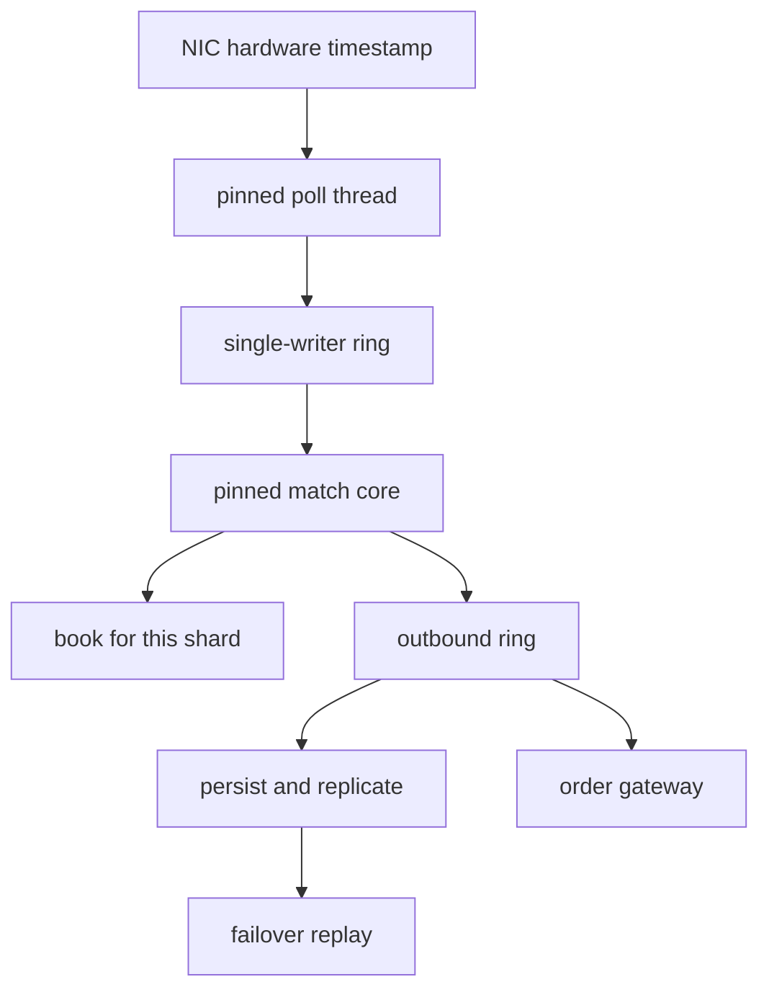

## Concept

### A ledger of microseconds

Ultra-low-latency trading systems — matching engines, market-data fans, order gateways, colocated strategies — treat microseconds as inventory. A latency budget is a ledger: fiber and switch, NIC, kernel or bypass, codec, business logic, output queue, and the durability hop if it sits on the critical path. If a line has no number, the design hopes the runtime will be fast enough. I start every review by asking for the ledger and for the histogram that will prove it.

Orders of magnitude place techniques. A well-predicted branch is nanoseconds. A cache-unfriendly structure is hundreds of nanoseconds to microseconds. A syscall, a context switch, or a garbage-collection pause is microseconds to milliseconds. A trip through an ordinary kernel stack, or through a service mesh, sits in a different column from a poll-mode NIC. The budget says which of those may appear on the hot path. Everything else is a defect, even when it is idiomatic in the rest of the company.

### One writer until the shard boundary

The shape that keeps jitter down is a thread pinned to a core, a loop that does not block, and data that stays hot in the cache. A single-producer ring passes events to that core. There is no pool and no work stealing on the match path, and no lock another core can bounce. When one core is not enough, you shard by instrument or by symbol range. Cross-shard work is a hop with its own line in the ledger. Matching engines that stay both correct and fast almost always make instrument affinity the scaling plan.

Other cores have jobs that must not leak onto the match core. One polls the NIC. One persists or replicates. One serves a slower downstream. The match core sequences events and publishes to a ring. A slower core serializes, logs, and talks to the outside world. Logging on the match core is how a disk hiccup becomes a gap in the market.

### Work the hot path is not allowed to do

No syscalls on the match core. No allocator trip into the kernel, no log write, no clock that traps if a cheap timestamp will do, no disk. Objects are preallocated and recycled. A garbage-collected language on this path is a separate design: off-heap arenas, a collector whose pauses sit inside the budget, and a histogram of those pauses. If you cannot show the histogram, you are outside the budget.

The ring has a fixed capacity and a policy when it fills: shed, or halt the venue. A trading system would rather stop than silently lag and keep accepting orders it cannot match fairly. Shared mutable structures across cores need a single-producer ring or an equivalent handoff. Cache-line bouncing is a latency bug a single-threaded benchmark will not show.

Abstractions that hide a copy or an allocation spend the budget in the parser. A per-order map keyed by a freshly built string, a JSON document, or a general-purpose schema on the match path is that bug. The wire codec is compact. Timestamps that matter for fairness come from the NIC, so the budget is about wire time and not about when a thread woke up.

### Sequencing, fairness, and a book you can replay

An exchange is a fairness and replay system that happens to be fast. A matcher that saves a few hundred nanoseconds by skipping persistence, or by iterating a structure whose order is unspecified, is a regulatory problem. The usual split is simple. The match core assigns a sequence. A persistence core records that sequence. Failover replays it. The latency cost of durability is either in line, because the rule says so, or on a parallel path with a lag objective you can halt on. I write that sentence in the design. "We replicate" is not a recovery point.

First-in at a price level is a specification. If two orders cannot be ordered, you will be asked to explain the trade. Sequence numbers and a deterministic matcher constrain the data structures: intrusive lists and arrays with predictable touches, not containers whose iteration or rehash depends on history the replay will not repeat. I run replay in CI against recorded input and demand the same book and the same fills.

### The machine and the building

Once the software is in the microseconds, distance dominates. Colocation, cross-connects, switch choice, and hardware timestamps exist because fiber has a number. Kernel bypass is normal on this path. Shared scheduling, noisy neighbors, frequency scaling, and deep idle states are not. These machines run with isolated CPUs, interrupts pinned away from the match core, and a firmware configuration chosen for jitter.

Virtual machines with device assignment can do well and still lose to bare metal on the tail. If the business is colocated and the product is the tail, I do not move the matcher onto a shared hypervisor because the rest of the firm standardized on a cluster scheduler. Risk checks that are allowed to be slower, drop copy, the UI, and clearing can live in ordinary infrastructure. The match path stays local and dull.

## Trade-offs

| Approach | When it wins | Cost / risk |
| -------- | ------------ | ----------- |
| Pinned single-thread match core and rings | Lowest jitter, a model you can replay | Finite symbols per core; scale by shard |
| Kernel-bypass NICs | Wire-to-loop measured in microseconds | Dedicated hardware, a thinner toolbox |
| FPGA or hardware timestamps | Nanosecond-class ingest or a pre-trade check | Long build cycle, specialist staff |
| A managed runtime with a tight pause goal | Faster iteration on business logic | Jitter if a pause exceeds the budget; off-heap discipline |
| Durability in line versus asynchronous replication | In line meets a zero-loss rule; async saves microseconds | Async lag is a loss window on failover |

A single-writer ring is the default I reach for, the idea a public exchange architecture made legible. Multiple writers onto the match core are a bug unless the merge is itself sequenced and you can replay it. A general-purpose mesh, mutual TLS, and a sidecar on the order path miss the budget by one or two orders of magnitude. Those tools belong on the control plane.

A hardware offload wins when the ledger says the CPU loop cannot make the number, and when you can staff the toolchain. It loses when the business logic changes weekly and the hardware image does not. I split the system. Stable ingress and sequencing stay in hardware or in a pinned loop. Strategy and risk live where a higher-level language can still meet a looser budget. One runtime covering both columns is how the tight column acquires a collector.

## Diagram

A hardware timestamp and a pinned poll thread feed a single-writer ring. The match core owns the book for its shard and emits to outbound rings. Persist and the gateway run off to the side. Syscalls, allocation, and logs stay off the match core.

## Failure modes

### Jitter the average hid

A pause of milliseconds inside a budget of tens of microseconds is a gap. I histogram loop-to-loop time on the match core with buckets that resolve microseconds, and I record steal time, interrupt time, and whether the core left its idle state. Isolation, a tickless configuration on that core, interrupt affinity, frequency scaling held off, and either no collector on the path or a collector whose measured pauses fit the ledger are the controls. Vendor slides do not count. If the histogram misses the budget, the system does not ship.

### Queue time behind a fast function

The match function is fast and the inbound ring is full. Customers experience queue time. The wire timestamp and the match timestamp diverge while the function's own timer looks fine. Publish occupancy and time-in-queue as primary metrics. Bound the ring. Shed or halt when it fills. Size the poller and the matcher so the producer cannot run ahead without a visible consequence. A benchmark that starts with an empty queue and a warm cache is not the production tail.

### A book that replays into a different trade

A hash iteration, a parallel shortcut, or a log that reorders on the way to disk produces a different trade in replay than in production. Determinism tests feed the recorded sequence and require the same book and the same fills. Sequenced input and data structures with a defined order are the design. I block a release that wins nanoseconds and fails replay. Fairness bugs take longer to explain than latency bugs, and they cost more.

### Replication lag reported as healthy

Asynchronous persistence sits tens of microseconds behind, then milliseconds behind, and failover loses the tail of the sequence. I want a lag histogram between match sequence and durable sequence, an objective on that lag, and a halt if it exceeds the loss window the business accepted. If the rule requires no loss, durability is on the critical path and the ledger includes it. A helper process that can stall is a second system with a failure mode you have not named.

## Real-world example

LMAX published the architecture of its exchange: a single-threaded business-logic core, ring buffers between stages, attention to cache behavior, and a split between the matcher and slower I/O. The ring-buffer library is the piece that escaped into open source. The discipline is the piece I care about. One writer. Preallocated events. No contention on the match path. Latency reported as a distribution, not as an average that hides the pause.

That remains the template for a software matching engine that is not ready to put the whole book in hardware. Firms that colocate strategies against an exchange protocol use the same ideas on the other side of the wall: pinned threads, kernel bypass, a compact codec, and a budget that starts at the NIC timestamp. The failure mode in both places is cultural. A mesh default, a logging library, or a collector setting arrives from the rest of the company, lands on the hot path, and the ledger is fiction by the next release.

If you are outside trading, the transferable piece is the ledger. Some bidding systems, game servers, and control loops have the same shape at gentler numbers. Pin the hot path. Measure queueing separately from compute. Keep general-purpose infrastructure off the path whose histogram you promised.

## What to remember

- Write a microsecond ledger for the hot path; unassigned time will be spent on pauses, syscalls, and copies.
- Pin one writer core per shard, pass events on bounded rings, and scale by instrument affinity.
- Histogram loop jitter and time from the wire timestamp; shed or halt when a ring fills.
- Deterministic replay and an explicit durability-lag objective are part of the latency design.
