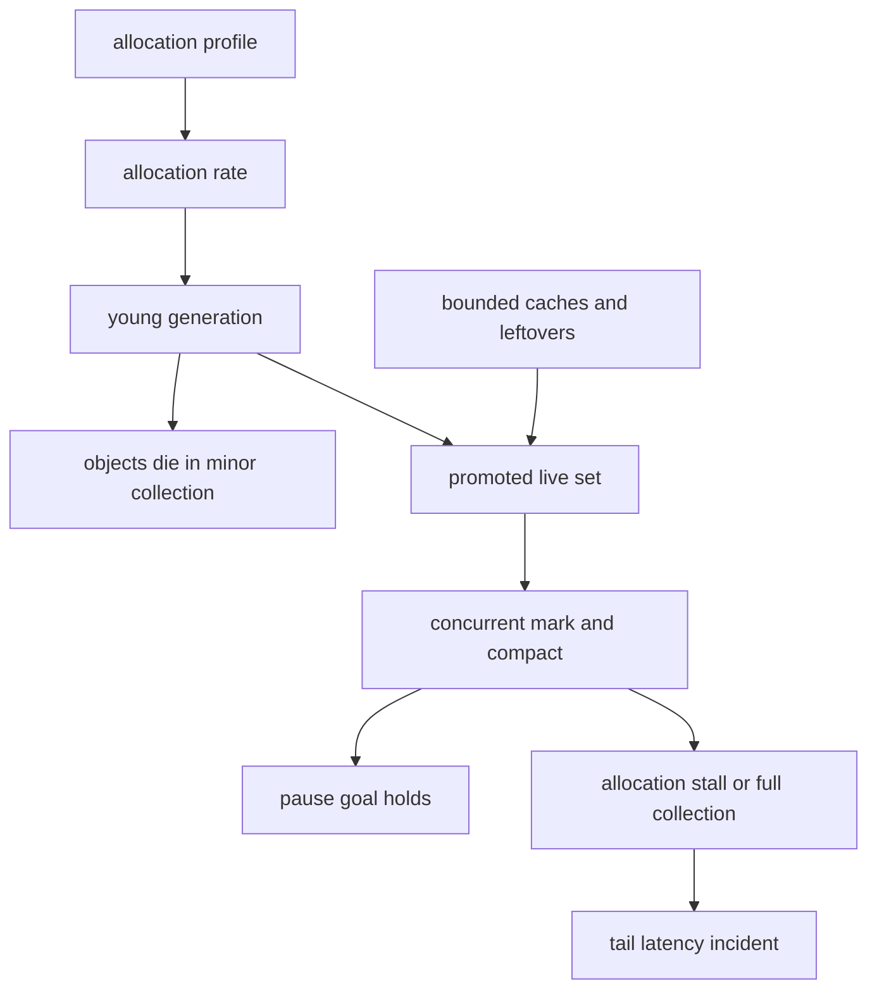

## Concept

### A pause is a tail budget

At fleet scale, garbage collection is a scheduler that can stop request threads, a consumer of memory bandwidth, and a source of correlated latency when every instance has the same heap shape and the same deploy clock. Leaving it to the platform still leaves you the allocation rate, the live set, and the pause objective. Those three numbers pick the collector. Flags copied from a blog do not.

Throughput collectors, such as the JVM's Parallel collector, maximize work done per unit of CPU and can pause for tens or hundreds of milliseconds on a large heap. Low-pause collectors — G1, ZGC, Shenandoah, and commercial cousins — spend extra CPU and RAM to keep stop-the-world windows small. I pick from the pause the objective allows and from the memory I will actually buy. A claim about sub-millisecond pauses is a hypothesis until the histogram on our heap agrees.

### How allocation becomes a stall

Generational collectors assume most objects die young. A request-scoped graph that actually lives — a cache, an interned string, an unbounded queue, a thread-local someone forgot — gets promoted. Promotion rate is the capacity plan. If survivors arrive faster than concurrent marking and relocation can reclaim space, the collector falls back to a full collection or stalls allocation. That fallback is the incident. The steady-state minor collections were never the risk.

Four mechanics decide the design. Bytes that belong to one request should die in the young generation. Caches are bounded in entries and in bytes, and they are a line item in the live-set budget. Parsers, builders, and per-request maps can allocate gigabytes a second on a hot node. The collector has to look at that garbage. CPU spent there is CPU the handler did not get. A profile that shows a large fraction of time in young collections is an application bug before it is a tuning opportunity. The heap needs the live data plus headroom so concurrent work has room to move objects. A heap sitting near full, with a concurrent collector, is a stall you have scheduled. Headroom of tens of percent is a starting point I adjust from occupancy after collection.

Large objects need their own rule. In G1, an allocation larger than half a region is humongous. Those objects fragment the heap and fail in ways that look like leaks while free space still exists. Chunk them, or take them off-heap. Off-heap buffers and arenas move pressure off the collector and onto lifetime bugs you must detect yourself. I use them for packet buffers, for caches with a real eviction policy, and for I/O. Direct memory has a limit. Exceeding it is a failure mode with a different name and the same page.

### Which collector, from which numbers

G1 fits general services on moderate heaps, with a pause goal in the tens of milliseconds and mixed collections that clean old regions incrementally. It still stops the world. It is the default I accept when allocation is sane and the objective can tolerate that pause.

ZGC and Shenandoah compact concurrently and keep pauses very small, in exchange for more RAM and more concurrent CPU. They win when the live set is large and the tail budget is tight. They lose when you will not buy the headroom, or when allocation is so fast that concurrent work cannot keep up and threads stall waiting for memory. A low-pause collector is not a license to allocate without a bound.

The concurrent mark-sweep collector is gone from modern JDKs. I do not design for it. Go's collector is concurrent and targets a portion of CPU; the usual failure is heap growth and CPU steal, until a bad pin changes the story. .NET and V8 differ in mechanism and match the same architecture: allocation rate, live set, pause goal. I ask for those three in every language.

### Tuning that is allowed to exist

Allowed moves are few. Heap size follows measured live set plus headroom. A pause-time goal has to be checkable. Region size changes only when you understand large allocations. Caches have hard bounds. Allocation profiles in CI fail a change that doubles garbage per request.

The folklore I reject is a pile of flags from an old post, disabling explicit collection without knowing who calls it, and shrinking the heap until the collector thrashes. The highest-leverage change is to allocate less. Then pick a collector that meets the remaining pause goal with headroom you can afford. If young-generation time dominates the CPU profile, I want the allocation site fixed before anyone edits collector ergonomics.

### Correlation across the fleet

A rolling deploy of a build that doubles allocation is a fleet latency event. Collector CPU rises together. Autoscaling adds nodes that allocate the same way, so the new capacity does not return the old tail. A cache stampede — every instance cold at once after a flush or a deploy — promotes together and pauses together. The load balancer sees one spike and may retry into it.

Pause percentiles, collector CPU fraction, allocation rate, promotion rate, and occupancy after collection are golden signals. Alert on promotion and occupancy so you see the full collection coming. Stagger warmups. Jitter cache fills. A deploy that is healthy on HTTP status and doubled in collector time is not healthy.

Multi-tenant processes make the collector a noisy-neighbor channel. One tenant allocates; every tenant pauses. If the pause objective is shared, isolate tenants by process. A bigger shared heap feels cheaper until the first neighbor proves otherwise.

## Trade-offs

| Approach | When it wins | Cost / risk |
| -------- | ------------ | ----------- |
| Throughput collection such as Parallel | Batch jobs and workers that can take long pauses | Pauses of tens or hundreds of milliseconds on large heaps |
| G1 with a pause goal | General online services, moderate heaps | Large-object fragmentation, residual stop-the-world time |
| ZGC or Shenandoah | Large live sets and a tight tail | Extra RAM and concurrent CPU; stalls if allocation outruns them |
| Arenas and off-heap buffers | Packet paths and lifetimes you can state | Leaks and use-after-free, weaker default tooling |
| A larger heap with no allocation work | Short-term relief while the live set is stable | Longer pauses for some collectors, RAM cost, worse locality |

Buying RAM to avoid allocation work is a valid trade until locality and collector work both scale with the live set. A very large heap on a low-pause collector is a product you operate on purpose. The same heap with unbounded caches is a pager with a delayed receipt. Language choice is a latency choice. A budget of tens of microseconds makes a compacting collector on the hot path a hard sell. A budget of tens of milliseconds makes G1 plus allocation hygiene cheaper than a rewrite. The budget has to be written down so that argument has a number.

Process-per-tenant costs more memory and more operational surface. It buys a pause domain that matches the blast radius you promised. I take that trade when one customer's import must not move another customer's tail.

## Diagram

Allocation hits the young generation. Most of it dies there. Survivors and unbounded caches become the old live set. Concurrent work keeps up and the pause goal holds, or it falls behind and allocation stalls. Profiles feed back into the allocation rate, which is the lever that moves.

## Failure modes

### Concurrent work that falls behind

Threads block waiting for memory. The tail jumps from a few milliseconds to hundreds. On ZGC I look for allocation stalls. On G1 I look for evacuation failure and exhausted destination space. Occupancy stays high and pause time steps up. The emergency move is to shed load. Afterward, lower the allocation rate, add heap only if the live set justifies it, or move to a collector that can keep up with the rate you measured. Promotion is the chart that would have warned you.

### A cache with no ceiling

A cache without eviction fills the old generation. Collection time grows with the cache that was supposed to make the service faster. Hit rate flattens while the live set does not. I graph cache bytes next to heap occupancy after collection, and I size every cache as a fraction of the heap in the capacity document. Bound entries and bytes. Evict. Include the warm cache in the headroom math, because a cold start that fills it will look like a different application.

### Large allocations and a fragmented heap

A large byte array for a payload fragments regions. Allocations fail while a naive reading of free heap says there is room. Large-allocation counters and region occupancy show it. Chunk large buffers, move giant payloads off-heap, or set region size with that workload in mind. Habitual megabyte objects in the managed heap are a design problem. The collector is telling you the object's lifetime belongs in a pool you control.

### Pauses that line up

Every instance collects after a deploy or a cache stampede. Client latency spikes as one event. Pause time aligns with the deploy clock, and cache-fill traffic shows the herd. Stagger warmups, add jitter, and bound how fast a cache may fill. Rolling deploys should stop on collector CPU and occupancy, not only on error rate. An autoscaler that adds clones of a sick allocation pattern will scale the pause, not the capacity.

## Real-world example

Twitter's JVM fleet, described across years of public engineering writing, is the canonical large-scale collection story: big heaps, high allocation from service stacks, and a long period in which concurrent mark-sweep tuning became a specialist craft. The moves that transferred were not secret flags. Pauses were treated as objective violations. Allocation reduction was real work. Collector choice followed the pause goal. Collection metrics sat next to request latency, so a regression in garbage was visible as a user-facing regression.

When that collector became untenable — concurrent-mode failures, operational complexity, and eventual removal from the JDK — the path the industry took was G1, and then low-pause collectors for heaps that still could not absorb a long stop-the-world pause. The collector is a dependency with a version and a failure mode. Allocation rate is a capacity number. A flag set copied from another firm, without their live-set shape, invents an outage that is uniquely yours.

A search cluster, a batch engine, a fat API process, or a multi-tenant JVM is in that world whether or not the logo matches. Budget the live set. Bound the caches. Profile allocation in CI. Choose G1 or a low-pause collector from the pause objective and from the RAM you will buy and leave free. Then watch promotion rate so the fallback does not introduce itself during a launch.

## What to remember

- Pause objective, live set, and allocation rate pick the collector; a flag cookbook does not.
- Promotion from unbounded caches and from objects that outlive the request is the usual road to a full collection.
- Low-pause collectors buy tail latency with RAM and CPU, and they still stall if concurrent work falls behind.
- Deploys and cache stampedes line pauses up across the fleet; collector CPU and occupancy are golden signals.
