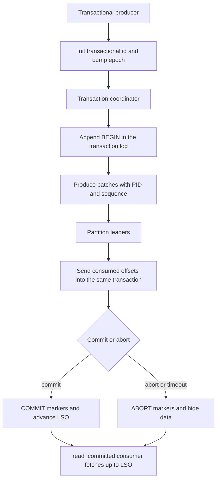

## Concept

Exactly-once semantics in Kafka is a contract on a closed consume-transform-produce loop. Output records and the input offsets that produced them become durable together, or neither becomes visible to a committed reader. The broker can drop a retried append on one partition. A transactional producer can publish a set of partitions, plus consumer offsets, as one outcome. A charge, an email, or a warehouse insert that leaves the cluster is still at-least-once and needs its own uniqueness key. In a design review I treat idempotent produce and a transactional id as two controls, and I ask which effects actually sit inside the log.

### The idempotent producer

A producer with idempotence enabled receives a producer id from the cluster and stamps every batch with a sequence number scoped to that id, epoch, and partition. The partition leader remembers the last sequence it accepted. A retry that repeats a sequence already in the log is acknowledged and left unappended. A gap in the sequence is rejected, because the leader cannot tell a lost batch from a batch still in flight. The timeout that caused the client to send the batch again becomes a single append, for that partition, for as long as the producer epoch stays valid.

The guarantee is per producer and per partition. Two partitions are two sequence spaces, so one business event written to both is two appends. A process that restarts without a stable transactional id receives a new producer id, and the old sequences no longer match the new process. Distinct business events keep distinct sequences and both land. The protocol deduplicates a transport retry. It does not invent an application unique key.

The settings around the producer id are part of the mechanism. Idempotence expects `acks=all`, so the leader advances the sequence after the in-sync replicas have the batch. Current clients allow more than one in-flight request because sequence numbers let the broker restore order inside the range the client supports. Treat producer-fenced and unknown-producer errors as fatal for that instance. A zombie with a stale epoch is trying to append after a newer epoch has taken the id.

### Transactions, the coordinator, and fencing

A transactional producer is named by `transactional.id`, a stable string the application owns. On init, the transaction coordinator — the broker that owns the relevant partition of the internal transaction-state topic — assigns or resumes a producer id and bumps the producer epoch. Any transaction still open under the previous epoch is aborted. Two processes that share one transactional id cannot both commit. The newer epoch wins and the older process is fenced. A restart, a duplicate deploy, or a split-brain job stops a zombie from committing a second copy of the same output.

The application begins a transaction, produces to one or more partitions, may send consumer offsets into the same transaction, then commits or aborts. The coordinator records the transaction as preparing, then complete, in the transaction log. Each participating partition leader writes a control record so a committed reader can separate committed data from aborted data. Until commit finishes, those records sit on disk and stay invisible to isolation-aware readers. After abort they remain until retention or compaction removes them. Abort rate is disk, scan cost, and coordinator load.

`transaction.timeout.ms` bounds how long the coordinator waits for a commit. If the producer stalls past that timeout — a long pause, a slow dependency, a blocked thread — the coordinator aborts, and a later commit from the application fails. Set the timeout above the longest legitimate batch and below the time you will let an open transaction pin the last stable offset. An open transaction on a hot partition delays every committed reader of that partition, including compacted changelog readers that other jobs treat as tables.

### Offsets inside the consume-transform-produce loop

Kafka's exactly-once stream processing is a specific loop. Read input. Write output and any changelog partitions. Include the consumed offsets in the same transaction. Commit. A crash before commit aborts the transaction, hides the output from committed readers, and leaves the input offsets uncommitted, so the group rewinds and the work runs again. A crash after commit leaves both the output and the offsets durable, so a restart does not emit a second copy. Kafka Streams with the exactly-once v2 processing guarantee is this protocol. A Flink Kafka sink that finishes its commit when the checkpoint completes is the same idea, with the checkpoint barrier as the external coordinator.

The offset send is the atomicity. Produce, then commit offsets with a separate consumer commit, and a crash between those steps duplicates output. Commit offsets first, and a crash skips input. The transaction exists to close that window for Kafka-to-Kafka graphs. Offsets written this way land in the consumer-offsets topic as part of the transaction, so the group and the data partitions agree on what finished.

Downstream readers use `isolation.level=read_committed`. A job left on the uncommitted isolation level observes aborted batches, treats them as facts, and pages on duplicates the writer believed it had suppressed. Isolation is part of the contract of a transactional topic. Platform defaults for those topics should set it. A note that exactly-once is enabled does not change a consumer cloned from a logging pipeline.

### Where the protocol stops

For each partition, the last stable offset is the first offset that still belongs to an open transaction, or the high watermark when none are open. Committed readers fetch only up to that offset. A long transaction on a busy partition stalls every isolation-aware consumer of that partition. You traded duplicate appends for head-of-line blocking on commit. Control records and aborted batches still occupy log segments, so retention, compaction, and disk alerts include them. Open-transaction age, abort rate, and the gap between last stable offset and high watermark belong next to produce latency.

A Kafka transaction does not enlist a cache, a database, a search index, or an HTTP call. A task that writes a changelog transactionally and then updates a profile service has exactly-once in the log and at-least-once at the profile. Put an idempotency key on the side effect, or write an outbox row inside the database transaction and let a relay publish. Name that key in the design review. The log can be a ledger. The world outside the log still needs its own.

## Trade-offs

| Approach | When it wins | Cost / risk |
| -------- | ------------ | ----------- |
| At-least-once produce, idempotent consumer | Side effects outside Kafka: payments, mail, HTTP | Application owns uniqueness; a missed key double-applies |
| Idempotent producer only | Single-partition retries without a coordinator | No atomicity across partitions or with offsets |
| Kafka transactions, read_committed | Kafka-to-Kafka graphs, changelogs, Streams exactly-once | Last-stable-offset stalls, abort I/O, fencing, timeout tuning |
| Flink checkpoint plus transactional sink | Shuffles that outgrow Kafka partition affinity | Two coordinators; the sink must finish the commit protocol |
| Outbox inside the OLTP transaction | Facts that originate in a database | Connector lag; the bus still needs consumer keys |

Idempotent produce is the control I want on every producer that retries. It is cheap next to a transaction coordinator, and it removes the timeout-duplicate that otherwise takes a week to explain. It is the retry protocol for one partition. Turn it on when you expect to add transactions later, because transactions sit on the same producer id and sequence machinery.

Transactions earn their cost when the output is another Kafka topic that downstream jobs treat as a ledger: counters, join results, compacted tables. They fit poorly when the effect that matters leaves the cluster, or when a bursty service cannot keep a stable transactional id per instance. Sharing one id across a replica set is a fencing fight. Minting a fresh id on every pod restart abandons the fencing the id existed to provide. One owner per id: a Streams instance, a Flink task, or a keyed worker.

Flink's two-phase commit is the right shape when the graph is a shuffle, a window, or a join that Kafka Streams would pin to source partitions. The sink still has to be transactional or idempotent. Pick the boundary first, then the Kafka feature that matches it. A team that enables transactions on every topic, including fire-and-forget logs, pays coordinator load and last-stable-offset lag for a guarantee nobody reads.

## Diagram

## Failure modes

### Transaction timeout and a commit that never lands

Detection is commit errors such as an invalid transaction state, a rising abort rate, and committed-reader lag that tracks the last stable offset while the high watermark has already moved. The producer paused longer than the transaction timeout: a stop-the-world pause, a downstream call inside the transaction, or a timeout copied from a tutorial.

Mitigation is a timeout matched to the real critical path, fail-fast when commit returns an error, and an application that treats abort as rewind. Do not begin a new transaction on a producer that still believes the previous one is open. Alert on open-transaction age. A transaction that lives for minutes on a user-facing topic is an availability incident for every isolation-aware reader of those partitions.

### Zombie producers and epoch fencing

Detection is a producer-fenced error and a second process using the same transactional id after a deploy, a dual-running job, or a restart that left the old process alive. The new epoch aborted the old transaction. The old process may still be calling downstream systems.

Mitigation is a single owner of each transactional id, and a rolling deploy that stops the previous process before the next one initializes, or a migration onto distinct ids. Catch fencing and exit the process. Retrying with the fenced id extends the outage and can duplicate any side effect that was outside the transaction.

### Downstream consumers left on the uncommitted isolation level

Detection is aborted records appearing in a sink, duplicate keys after a producer crash that the writer logged as a successful abort, and consumers whose fetch offset sits past the last stable offset. A cloned consumer config left the isolation default in place.

Mitigation is a platform contract: output topics of transactional jobs require committed reads in the client template for that class of topic. Audit consumer configs. Compacted topics used as tables pair transactional writers with committed readers. If a legacy reader cannot change, keep that topic on idempotent produce and an application inbox, and leave transactions off it.

### Coordinator or transaction-state stall

Detection is transaction init hanging, commits stuck, and the broker that hosts the relevant transaction-state partition showing replica shrinkage or disk saturation. Every transactional producer whose id hashes to that coordinator waits.

Mitigation is to run the transaction-state topic like the other internal topics: replication factor, minimum in-sync replicas, and disk alerts on the same footing as the consumer-offsets topic. Spread coordinator partitions. A transactional cluster without coordinator dashboards discovers the dependency during the first broker loss.

## Real-world example

LinkedIn built Kafka as the company log and then had to make stream processors safe to fail over. Member activity, derived tables, and the jobs that sat on Samza and later Kafka Streams could not treat a task crash as permission to double-count an action into an output topic the rest of the company read as fact. Idempotent produce closed the retry-append hole on a partition. Transactions closed the consume-transform-produce window so a restart would not emit a second increment into a changelog or an aggregate topic.

Operating that at large partition counts made the tax visible. Transaction markers, aborted segments, and last-stable-offset tracking showed up as disk, as consumer lag, and as a timeout that had to sit above garbage-collection pauses and below the stall users would feel. Isolation had to be a client default for those topics. Two live instances with one transactional id are two epochs in conflict.

Feeds that can be rebuilt stayed on cheaper delivery. Product facts that remain in Kafka and must survive a worker death use the transactional loop. Effects that leave the cluster still carry an idempotency key. The architecture worth copying is that split, plus dashboards for abort rate, open-transaction age, and last-stable-offset lag.

## What to remember

- Idempotent produce deduplicates retries on one partition; transactions commit output and offsets together across partitions.
- Committed reads and the last stable offset are part of the guarantee; uncommitted readers observe aborted data.
- A Kafka transaction stops at the cluster boundary; databases, caches, and HTTP need their own idempotency keys.
- One owner per transactional id; a fenced producer should exit rather than retry.
