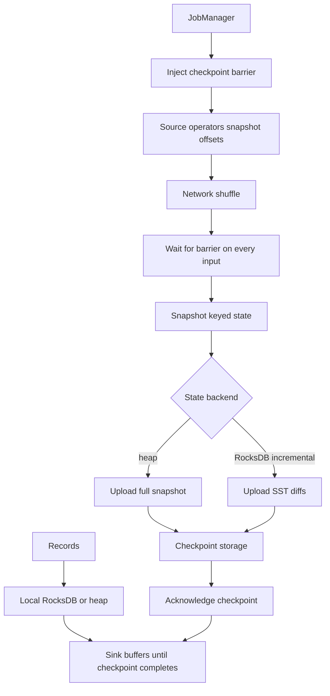

## Concept

A stream job is a function from an unbounded input and local state to an unbounded output. The state is the product: windows, joins, sessions, counts, last-seen profiles. Checkpointing is how that state and the input offsets become one consistent cut you can restore. A failover with a completed checkpoint is a rewind to a known snapshot. A failover without one is a replay from whatever the source still retains, or a silent restart from empty. Flink, Kafka Streams, and Spark Structured Streaming change the mechanism. The architecture stays the same: name what is in the snapshot, how often it is taken, how long it takes, and what the sink does with output that was not yet part of a completed cut.

### Keyed state, operator state, and the key as a capacity plan

Keyed state is partitioned by a key you declare: user id, trip id, merchant, device. Each parallel instance owns a slice of the key space. Operator state belongs to a parallel instance as a whole. Sources use it for Kafka offsets and file splits. Almost every aggregation and join you will ship is keyed, which means the keyspace is the shard map. A hot key pins one operator. A key that never expires pins disk for the life of the job.

Flink splits keyed state into key groups so a restore can remap groups onto a new parallelism. Kafka Streams binds state to the same partitions as the source topic, so changing the partition count is a migration, often a new application id and a rebuild. If compute must scale independently of the Kafka partition count, you are in Flink's model. If state naturally follows a topic key and the team already operates Kafka, a Streams changelog can be the whole durability story.

State time-to-live is a product decision recorded as an operations number. A thirty-day session store is thirty days of keys, plus allowed lateness, plus tombstones that compaction has not yet dropped. Write that number beside the window size before you approve the job. A pipeline that holds a user profile with no expiry will checkpoint until the snapshot no longer finishes inside the interval.

### Checkpoint barriers and alignment

Flink's checkpoint is a consistent cut. The JobManager injects a barrier into each source. Barriers travel with records. At a shuffle, an operator waits until every input channel has delivered that barrier, snapshots its state, and forwards the barrier. Sources include their offsets in the same checkpoint. When every operator has acknowledged, the checkpoint is complete and becomes a valid restore point.

Alignment is why one slow channel delays the snapshot of the whole job. Unaligned checkpoints let barriers overtake buffered records so backpressure does not freeze snapshotting. They change what recovery must replay, and they are a setting you enable after you have measured alignment time, with a reason written down. Incremental checkpoints then persist only what changed in the state backend. That is how RocksDB state measured in terabytes finishes inside an interval operators can use.

The interval is a recovery-point objective. A checkpoint every ten seconds that snapshots in two seconds is a different product from a checkpoint every five minutes that takes four minutes. When snapshot duration approaches the interval, checkpoints start failing or skipping, and you learn the size of the hole on the first kill. Last-successful-checkpoint age is a page, on the same severity as consumer lag.

### State backends: heap, RocksDB, and changelogs

Heap state — Flink's hashmap backend, or Streams held in memory — is fast and dies with the process. It fits small keyed state that the garbage collector can hold. RocksDB spills to local disk, serves point lookups, and checkpoints by uploading SST files or incremental diffs to durable storage: object storage, a distributed filesystem, or a blob store the platform owns. Local disk is a cache of the working set. Losing the worker without a completed remote checkpoint loses everything back to the previous completed checkpoint. Size the disk for the live state, and size the remote store for the retained checkpoints.

Kafka Streams uses Kafka itself as the durable changelog of local RocksDB. Every state update appends to a compacted changelog topic. Restore replays that changelog, and standby replicas keep a warm copy so a rebalance does not start from the earliest offset. The changelog is a capacity object: partitions, compaction, broker disk, and network. A Streams application that treats the changelog as an implementation detail can fill a cluster that was sized for the source topics alone.

Incremental RocksDB checkpoints need compaction on the local store. Too many small files slow upload and restore. Too little compaction slows point lookups. Record checkpoint duration and restore time as service levels beside end-to-end latency. A backend choice made in a prototype, with a handful of keys, is the choice you will inherit at the first traffic spike unless the job template forces a disk-backed default.

### Savepoints, sinks, and the meaning of exactly-once

A checkpoint is continuous and exists so failure recovery does not need a human. A savepoint is an operator-triggered snapshot, usually in a stable format, used to stop a job, change parallelism, migrate a graph, or upgrade the engine. Auto-recovery should come from checkpoints. A deploy that changes operator identity without a compatible savepoint will restore empty state and look like a clean start. Assign stable operator identifiers. Keep them across refactors. Test restore from a savepoint against production-sized state. The first time a serializer change proves unrestorable should be a staging job, on a weekday.

A completed checkpoint plus a rewindable source gives consistent state and at-least-once processing. End-to-end exactly-once also requires the sink to participate: a transactional Kafka producer, an idempotent upsert, or a two-phase commit that publishes only when the checkpoint completes. A sink that posts an HTTP call on every record will apply twice after restore. That behavior follows from the checkpoint protocol. Put the idempotency key in the design, or buffer the external write until the checkpoint barrier commits. State recovery and effect recovery are two contracts. Shipping the first and assuming the second is how a failover doubles a charge.

## Trade-offs

| Approach | When it wins | Cost / risk |
| -------- | ------------ | ----------- |
| Heap keyed state | Tiny windows, low cardinality, latency-sensitive lookups | Process death and garbage-collection collapse when cardinality surprises you |
| RocksDB plus incremental checkpoints | Large keyed state, Flink graphs, parallelism independent of Kafka | Checkpoint storage, SST tuning, restore time |
| Kafka Streams changelog | Per-key jobs that already live in Kafka, with standby replicas | Parallelism capped by partitions; changelog load on brokers |
| Spark micro-batch state | Minute-scale service levels in a lake-shaped organization | Latency floor of the batch interval; a different recovery model |
| External store instead of local state | Slowly changing dimensions and shared lookups | Extra hop; staleness relative to the stream is now yours to name |

Heap wins for control-plane jobs and for windows whose key count you have measured in the hundreds. It loses the week a join retains events. I default production aggregations to a disk-backed backend and require a measurement before anyone moves them to heap.

Kafka Streams wins when the changelog topic is an acceptable contract and the on-call rotation already pages on Kafka. It loses when you must rescale past the source partition count or align watermarks across sources that do not share a partition map. Flink wins those jobs, and you pay for a JobManager, remote checkpoint storage, and a platform skill that is larger than running a request-response service. Spark micro-batches win when the consumers of the result already wait minutes and the organization wants one engine next to the lake. They lose when a trip status or a fraud score has to move in seconds.

Looking up a dimension in an external store instead of joining it into keyed state removes that dimension from the snapshot. Write the allowed lag into the feature or the metric contract. A lookup that is "usually fresh" is a second clock the job does not checkpoint.

## Diagram

## Failure modes

### Checkpoint timeout and an alignment stall

Detection is checkpoint duration climbing toward the timeout, failed checkpoints in the JobManager, and operators blocked in a shuffle while one upstream channel is backpressured. A single slow source partition or a huge key group holds the barrier. Input lag may still look healthy on the other partitions.

Mitigation is to measure alignment wait before you enable unaligned checkpoints, to use incremental snapshots, and to split hot keys. Raise parallelism through a savepoint rather than killing a job that is mid-barrier. If the only lever you pull is a longer timeout, the state is too big for the interval. Page on the age of the last successful checkpoint.

### Restore longer than the outage budget

Detection is a failover that spends many minutes downloading state while input lag explodes, or a Streams rebalance that replays a changelog from the start because standbys were cold. The recovery-time number in the design doc assumed the snapshot was already local.

Mitigation is standby replicas, local recovery from retained worker disks when the engine supports it, incremental checkpoints that stay small, and a state-size objective. Practice kill-and-restore at production volume. If restore takes twenty minutes, the checkpoint interval is a poor description of the hole you will actually suffer: you will shed load, skip windows, or drop the job while state comes back.

### Operator identity change and empty state

Detection is a deploy after which windows start from zero, joins miss the build side, and output disagrees with yesterday, while the job status is running. A refactor assigned new operator identifiers, or a serializer change made the snapshot unreadable and the job was started empty.

Mitigation is explicit operator identifiers, a restore test in the release pipeline against a snapshot fixture, and a rule that topology changes go through a migration. Starting a stateful job from empty on a topic that already has checkpoint history is a reset. Do it only when you intend one, and say so in the change record.

### Checkpoint storage full or slow

Detection is upload failures after the local snapshot succeeded, object-storage throttling, or a filesystem metadata service that cannot list the checkpoint prefix. The durable store is on the critical path of every failover even though it is quiet during steady state.

Mitigation is a dedicated bucket or prefix, a lifecycle rule that matches the number of checkpoints you retain, and alarms on upload and list errors. Keeping every checkpoint forever is a storage bill and a listing problem. Keep a small number of completed checkpoints plus the savepoints you named for upgrades.

## Real-world example

Uber's marketplace runs on streams because the facts are stateful. A trip has a current status. A surge region has a recent demand window. A driver has a last location that must join a dispatch decision. Those jobs cannot reread a day of location pings on every worker death. The platform checkpoints keyed state and source offsets so a process loss is a restore. Kafka carries the log. Flink, and jobs in the same family, hold the windows.

State lives in RocksDB on the workers. Incremental checkpoints land in object storage. Savepoints gate engine upgrades and graph changes. Jobs that kept unbounded keys showed up as checkpoint timeouts and full disks, which is why time-to-live, key design, and checkpoint duration are part of how a job is allowed to ship.

Rebuildable topics stay on cheaper paths. The line is whether a failover must reproduce the same windows and joins without a full replay of the log. When it must, the checkpoint is the product and the SQL is the interface. A marketplace that treats checkpoint age as a vanity metric learns the recovery-time number during a regional incident, when the windows that price a trip are the windows that failed to restore.

## What to remember

- A checkpoint is a consistent cut of keyed state plus source offsets; local disk is a cache of that cut.
- Checkpoint duration and restore time are service levels; the first kill is a late time to discover them.
- Stable operator identities and tested savepoints are how deploys keep state.
- Exactly-once effects still need a transactional or idempotent sink; the checkpoint alone restores state.
