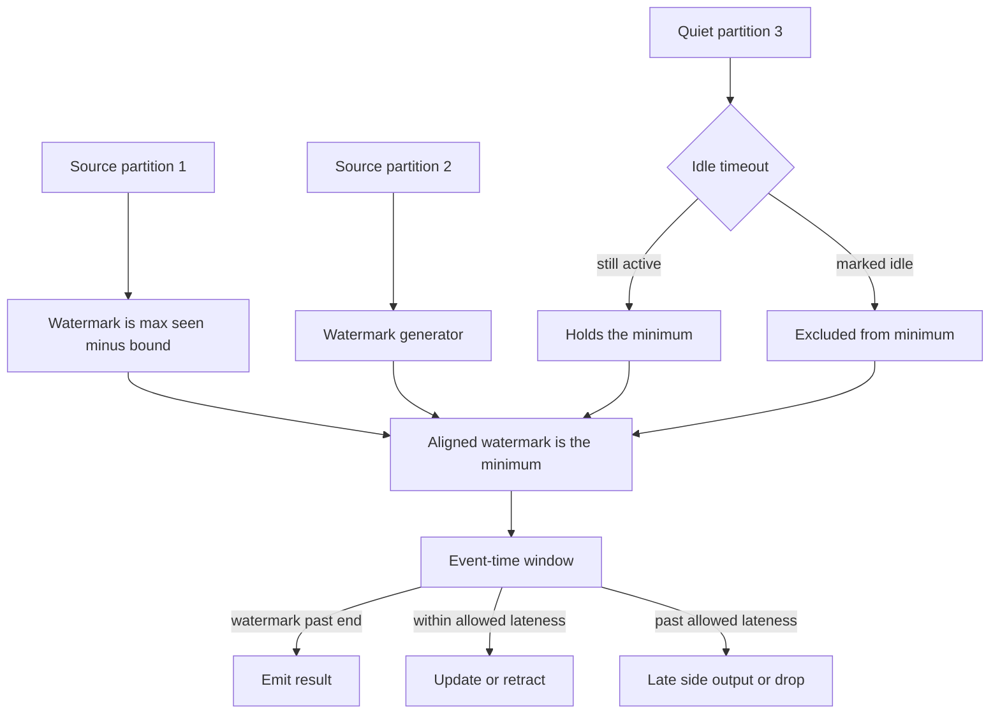

## Concept

Windows a business will defend are almost always in event time: when the click happened, when the location ping was stamped, when the payment authorized. Processing time is when the operator happened to see the record. Ingestion time is when the source admitted it. Those clocks diverge under lag, retries, device skew, and partitions that go quiet. A watermark is the engine's assertion about event time: records with timestamps earlier than the watermark are expected to have arrived, aside from a lateness policy you configured on purpose. Window firing, late drops, and state growth all hang on how you generate that watermark and how you combine watermarks across inputs.

### Event time, processing time, and ingestion time

Event time lives in the payload or in a header the producer set from a clock you trust enough to bill against. If producers leave it unset, the job does not have event time. It has a field you hope is a timestamp. Processing time is the wall clock on the worker. It is the right clock for an operator heartbeat and the wrong clock for hourly gross merchandise value. Ingestion time stamps the record as it enters the pipeline, which gives you a monotonic-enough time when device clocks are unreliable, and which still slides when the pipeline itself stalls.

Choose event time when the question is about the world. Choose processing time when the question is about the job: internal triggers, load, how many records this operator saw. Write the clock into the metric name so a billed window and an operator heartbeat cannot share a chart. A dashboard that mixes them will reconcile on a good day and diverge the hour Kafka lags, and the divergence will be blamed on the business logic.

### How a watermark is generated

A periodic watermark generator looks at event timestamps observed on a source split and emits the maximum event time seen, minus a bound. The bound is the out-of-order delay you are willing to absorb before a window may close. A punctuated generator emits a watermark when a special record arrives, which fits sources that already know a batch is complete. Periodic generation is the one operations can plot. The bound is a percentile of observed disorder on the real stream, plus a margin, revisited when producers, networks, or retry policies change. A default of a few seconds copied from a tutorial is a guess.

A bound that is too small closes windows while a large fraction of records are still in flight. Those records become late. A bound that is too large delays every firing, piles timers, and holds window state until the watermark finally passes the end. There is a completeness-versus-latency point, and it belongs next to the window size as a service level: fire five-minute windows within a stated delay of the watermark, and expect at most a stated percent of records to arrive late.

Watermarks are per source partition or per source split. A job with many Kafka partitions has that many watermark streams at the edge. Downstream operators combine them. They do not average them. Averaging would let a fast partition close a window the slow partition has not finished, which is a silent undercount.

### Alignment is a minimum, and idle inputs hold it

At a union, a join, or any operator with multiple inputs, the watermark that operator advertises is the minimum of its inputs. A window stays open until every upstream that still counts has a watermark at or past the window end. That rule keeps a slow partition from being dropped on the floor. It is also the outage mode. One idle partition, one stuck consumer, one source that stopped producing, and the minimum never moves. Windows do not fire. State grows. CPU can still look busy because records on the fast partitions are being buffered into windows that refuse to close.

Idle-source detection exists so a partition with no records for a configured interval drops out of the minimum. The interval has to be longer than legitimate quiet periods and shorter than the stall you refuse to absorb. Heartbeat records from producers on quiet keys are the cleaner fix when you own the producer: the partition keeps moving event time without inventing business events. You cannot timeout your way out of a partition that is slowly delivering old timestamps. That partition is correctly holding the watermark. Drain it, or route those records to the late path on purpose.

### Allowed lateness, retractions, and side outputs

When the watermark passes a window's end, the engine can still accept records for that window until the end plus allowed lateness. Late updates can retrigger the window function, which means sinks see revisions. After lateness expires, the record is dropped or routed to a late side output.

Allowed lateness is state. Every extra minute keeps window contents, timers, and accumulators. A five-minute window with two hours of lateness is a two-hour store, multiplied by key cardinality. Side outputs keep the hot path strict and still land stragglers on a repair topic for a batch correction. Pick a contract and write it down. Either the streaming sink accepts retractions, or late data is a separate pipeline with a documented merge. Running both, with no rule for which number wins, produces two revenues for the same hour.

### Timestamps that must not move the watermark

Device clocks jump. A producer stamps processing time by accident and then backfills event time later. A replay of last month injects timestamps that drag the watermark backward or, with one future timestamp, leap it forward and close every open window. Cap how far a single record may advance the watermark relative to a trusted clock. Side-output timestamps outside a plausible range. For historical replays, run a separate job whose watermark strategy matches the disorder in the replayed log. Replaying old timestamps into the live job will either stall it or mark the entire replay late. A generator that tracks a maximum without a cap will treat one corrupt client as the new present.

## Trade-offs

| Approach | When it wins | Cost / risk |
| -------- | ------------ | ----------- |
| Processing-time windows | Operator heartbeats and load metrics of the job itself | Real sessions split across lag; disagrees with the source of truth |
| Bounded-out-of-order watermarks | Event-time service levels you can measure on the live stream | Late fraction versus fire delay is a permanent trade |
| Idle timeouts or producer heartbeats | Sparse keys and partitions that legitimately go quiet | Too aggressive closes early; too slow stalls the job |
| Allowed lateness with retractions | A live view that must move when late location or clicks arrive | State size; every sink must apply updates |
| Late side output and strict windows | Sinks that cannot rewrite, with batch repair of stragglers | Two pipelines; the repair lag is part of the product |

Processing time fits a metric of how many records the job observed. A billed window stays on event time. Switching it to processing time to get past a watermark stall ships a number that will not match the log.

Bounded out-of-order delay is the workhorse. Measure the gap between processing time and event time, and the late-record rate per source. If those charts are missing, the job is hoping. Idle timeouts, or producer heartbeats, become mandatory the moment a partition can sit silent longer than the bound, which is every real topic with uneven keys.

Retractions are the live update, and they cost state. Use them when a dashboard must absorb a late ping. Use a side output when the sink is a ledger that must keep the first closed value. A day of allowed lateness turns the streaming job into a slow batch with timers attached. The batch job was the honest design for that completeness target.

## Diagram

## Failure modes

### Watermark stall on an idle or skewed partition

Detection is a watermark that stops advancing while other partitions still ingest, a window-fire rate that drops toward zero, and keyed state that climbs. The quiet input is often a shard whose producer died, a key range that went idle, or an idle timeout longer than anyone still remembers.

Mitigation is idle detection with an alert when it triggers too often, heartbeats on sparse streams, and a per-partition chart of event-time lag. Raising the out-of-order bound without a measured ceiling turns the stall into a memory leak. Find the partition and decide whether it is idle, slow, or wrong.

### A future timestamp leaping the watermark

Detection is a sudden jump in the watermark, a spike in late records, and windows that closed minutes or hours early. A client clock set years ahead, a test producer in production, or a timestamp in seconds interpreted as milliseconds is the usual cause.

Mitigation is a maximum drift relative to a trusted clock, a dead-letter for out-of-range events, and a generator that refuses pathological maxima. After a leap, restore from a checkpoint taken before the jump. Most engines will not rewind a watermark safely while the job keeps running.

### Late data lost after a backfill or an incident

Detection is a streaming aggregate that disagrees with a batch recompute of the same log, especially around partitions that lagged. The live watermark moved on. The backfill arrived after allowed lateness.

Mitigation is a written lateness objective, a side output into a repair topic, and a batch job that owns windows older than that objective. A true replay runs as its own job, with watermarks derived from the replayed timestamps. Feeding historical records into the live watermark strategy marks them late or freezes the live job.

### Allowed lateness inflating state

Detection is RocksDB or heap tracking window-plus-lateness rather than the window, checkpoint duration growing after a completeness change, and timers stacked for windows that should have closed.

Mitigation is to set lateness from the measured disorder percentile, move the long tail to a side output, and apply a state time-to-live that matches. Completeness past a point is a batch problem. Paying streaming prices for a full day of lateness is how an event-time job becomes a slow batch with extra moving parts.

## Real-world example

Uber's marketplace telemetry is event time or it misrepresents the trip. A pickup, a location ping, a surge window, and a payment authorization each carry a time that happened on a device or in a service. Mobile clients arrive out of order. Some partitions go quiet when a city sleeps. Windows closed on processing time would split trips across a Kafka lag spike and smear demand into the wrong interval. Pricing, arrival estimates, and the trip store would then disagree, and the disagreement would look like a product bug.

The practical architecture is a log in Kafka and jobs, largely on Flink, with a watermark generator per source partition. The out-of-order bound comes from observed disorder. Idle handling keeps a silent city from freezing a job that also serves cities that are awake. Allowed lateness matches how late a ping is still worth applying to the live view. Anything later is a correction path with an owner, which keeps state finite. Checkpoints snapshot those windows so a failover does not invent a second event-time universe.

When this is wrong, dashboards diverge from trips, surge fires late, and sessions never close. The cause is a bound that was a guess, an idle partition, or a timestamp that should have been rejected. Treat the watermark, the idle policy, and the lateness objective as a public contract of the job. The contract is what finance, pricing, and the stream team can argue about with the same numbers.

## What to remember

- A watermark is a per-source assertion; downstream event time is the minimum, so one partition can hold every window.
- The out-of-order bound is a measured service level, revisited when producers or lag change.
- Allowed lateness is extra state; the long tail belongs on a side output or in a batch correction.
- Cap timestamp drift, or one future event will close windows that are still in the world.
