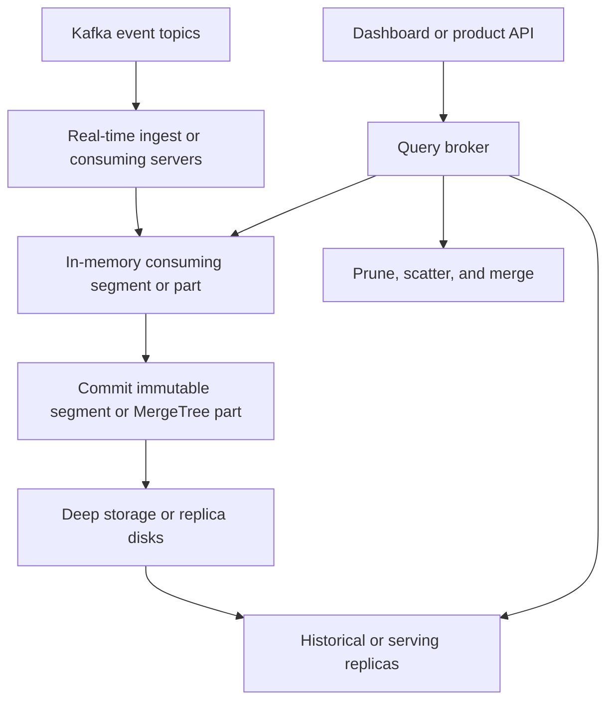

## Concept

Real-time OLAP is a serving system for high-cardinality event streams: filter, group, and aggregate from the last few minutes out to months, at a latency a dashboard or a product API will wait for. It is a columnar store with a mutable ingest tail and immutable historical files, plus brokers that scatter a query and merge partials. Apache Druid, Apache Pinot, and ClickHouse are the three engines you will be asked to choose among. They disagree on coordination, on how updates work, and on SQL surface. They agree that the unit of data you can name — a segment or a part — is the unit you will replicate, compact, reload, and blame when a query is slow.

### Segments, parts, and why time is the first prune

A segment is a chunk of rows for a time range and a partition, stored column by column, with dictionaries, bitmaps, or sparse indexes so a filter skips values. Druid and Pinot make the segment the unit of assignment, replication, and load. ClickHouse's MergeTree family uses parts: immutable sorted files that a background merge folds together. In all three, ingest appends to a recent structure, and compaction or merge turns many small files into fewer large ones. Query latency follows how many files you open and whether the hot columns sit in memory or on local fast disk.

Time is usually the first pruning axis. A query for the last fifteen minutes should touch real-time memory or a small set of recent segments. A query for ninety days by country should drop intervals first, then use dictionary-encoded dimensions. A workload that groups by user id over raw events, with no rollup and no selective filter, is a scan. Pre-aggregates, star-tree or skip indexes, projections, and a partition grain that matches real filters are how these systems stay interactive. If you cannot describe the prune, you do not yet have a table design. The partition key is a query plan you wrote in advance.

### Real-time ingest versus committed historical data

The ingest path is the seam between freshness and durability. Druid indexing tasks hold a recent interval in memory, persist on a cadence, and hand immutable segments to deep storage and historical nodes. Pinot consumes from Kafka into consuming servers, builds consuming segments, and commits them so servers that hold historical data can load them. ClickHouse inserts into a local MergeTree, often through a Kafka table engine or a writer service, and replicas fetch parts. A separate historical tier is a design you add. The open-source core will not invent one for you.

Until a segment or part is committed, a crash can lose or duplicate the in-memory tail. The honest durability story treats the source log as truth and replays it. Where exactly-once ingest exists, it means the segment and the source offset commit together. At-least-once ingest plus a rollup that is last-value, or a sum you can recompute from the log, is the default you can defend. Exact distinct counts across a replay will lie unless the table was designed for replay, with a sketch you can merge or a key you can deduplicate.

Deep storage — object storage or a distributed filesystem — is how Druid and Pinot keep immutable segments after a server disk dies. Historical nodes pull from it. A cluster that cannot reload from deep storage is a cache of its own disks. ClickHouse durability is replica disks plus the backups you actually restore, and object storage is increasingly a disk tier as well as a dump. Either way, name the restore drill. A segment you cannot reload is a gap in every dashboard that used that interval.

### Three engines, three ways to place data

Druid splits roles. A coordinator assigns segments. An overlord assigns ingest tasks. Brokers scatter and gather. Historical nodes serve immutable segments. Ingest runs on middle managers or their successors. Cluster metadata sits in a coordination service. Pinot uses a cluster manager on that same class of service to assign segments. Brokers route. A controller owns table config. Maintenance tasks run compaction and the work that makes upserts practical. ClickHouse has no global segment assigner in the open-source core. You declare shards and replicas, use ClickHouse Keeper or a coordination service for replicated tables, and put a proxy in front when you need admission control or a single SQL endpoint.

That split is the operations model. Druid and Pinot can move a segment when a server dies, if the assigner is healthy. ClickHouse serves the replicas you defined; adding a shard is a reshard, which you plan. Upserts are first-class in Pinot and in several ClickHouse table engines. Druid grew up on append-only rollup, and mutations are the path you budget for rather than the path you assume. If the entity changes — a trip's current status, a listing's price — a mutation-friendly table is the shorter design. If the table is append-only events rolled up by time bucket, all three can serve it, and the choice moves to SQL, to who operates the cluster, and to how you want ingest to fail.

### Query serving and the scatter tail

A broker takes SQL or a native query, prunes segments by time and partition, sends work to servers, and merges. Tail latency is the slowest server plus the merge. A hot segment on one disk, a pause, or a query that bypasses indexes becomes the high percentile for everyone sharing that broker. Quotas, query timeouts, and admission control are part of a multi-tenant cluster. Materialized views and pre-aggregates — ClickHouse projections, Druid rollup, Pinot star-trees — keep the scatter set small enough that merge time stays inside the product budget.

SQL coverage differs. ClickHouse is the widest analytical SQL surface of the three. Pinot and Druid have closed many gaps and still surprise teams on joins, subqueries, and functions a warehouse user assumes exist. A serving-time join against a huge dimension is where these systems stop behaving like OLAP and start behaving like a slower warehouse. Broadcast a small dimension, or denormalize it at ingest. Put the wide, governed join in the warehouse and keep the product query on a table that can prune. The broker is a scatter engine. It is a poor place to discover a join order.

## Trade-offs

| Approach | When it wins | Cost / risk |
| -------- | ------------ | ----------- |
| Apache Pinot | User-facing analytics, upserts, multi-tenant serving, Kafka-native ingest | Cluster-manager operations; joins remain a design hazard |
| Apache Druid | Time-series rollup, exploratory slice-and-dice, a mature deep-storage model | Mutations cost more; many node roles to staff |
| ClickHouse | SQL-heavy analytics, a team that will own shards, flexible MergeTree engines | You design sharding; merges and mutations need capacity |
| Warehouse plus a short cache | Ad-hoc analysis and freshness measured in minutes | A poor fit for a product API at high query rate and tens of milliseconds |
| Pre-aggregated values in a key-value store | One dashboard grain and modest query rate | Every new breakdown is a new pipeline |

Pinot wins when the query is a product feature: a seller dashboard, an ads console, site metrics that upsert the latest entity state. LinkedIn built it for that shape. Druid wins when the grain is time, ingest is append-mostly, and you already know how to operate its roles. ClickHouse wins when analysts live in SQL and a team can own shards the way they own a database, or when you want one engine for both heavy scans and a merged ingest path.

A warehouse remains the right system for governed, wide joins at latencies of seconds to minutes. Pointing every analysis question at Pinot because the phrase "real-time" tested well will melt brokers. A key-value pre-aggregate still wins for a single number on a home page. OLAP sits in the middle: many breakdowns, data that is seconds to a couple of minutes behind the log, and query times from tens of milliseconds to a few hundred. Choose from the mutation model and the operators you have, then from the brochure.

## Diagram

## Failure modes

### Hot segments and scatter-gather tail latency

Detection is the high percentile rising while the average stays calm, one server's CPU or disk pinned, and queries that all touch a popular time bucket or a skewed partition key. Extra replicas do nothing if every copy of the hot segment is equally hot, or if the broker always prefers the same replica.

Mitigation is a partition that spreads the hot interval, additional replicas with routing that actually balances, and rollup so the hot grain is smaller. Move elephant queries to the warehouse. Timeouts and per-tenant concurrency limits protect the rest of the cluster when one query would open half the table.

### Ingest lag and loss of the uncommitted tail

Detection is consumer lag on the ingest group, dashboards missing the last few minutes, and a restart that either double-counts a rollup window or leaves a hole. The consuming segment was the only copy of that tail.

Mitigation is to treat the log as the source of truth, to commit source offsets together with the segment, and to size ingest for peak. Alert on ingest lag as a product objective. Replay has to be idempotent at the rollup grain you promised. Distinct counts after replay need a sketch or a key, decided before the first backfill.

### Deep storage or replica restore failure

Detection is a historical server that cannot load a segment after disk loss, missing objects in the bucket, or a ClickHouse replica whose fetch queue disagrees with its coordination service. Queries fail on intervals that worked yesterday.

Mitigation is a drill: drop a serving node in a production-like environment and prove reload. Monitor deep-storage errors and, for ClickHouse, the replication queue the way you monitor a primary's disk. Retention in deep storage has to outlive the serving lifetime, or a reload asks for files you already expired.

### Compaction or merge falling behind

Detection is thousands of tiny parts or segments, ingest that still accepts writes, and queries that slow because they open too many files. Upsert compaction or background merges are the usual backlog. The table looks fresh and reads like a heap of logs.

Mitigation is dedicated compaction capacity, backpressure on ingest when the small-file count exceeds a budget, and a table design that does not upsert every row every second unless you paid for that write amplification. Compaction sits on the query path whether or not anyone scheduled it.

## Real-world example

LinkedIn built Apache Pinot because member-facing and internal analytics could not wait on a warehouse batch and could not be a hand-built cache per dashboard. Events already landed in Kafka. The serving problem was interactive aggregation at high cardinality, upserts for the latest state of an entity, and multi-tenant objectives so one team's query did not take the brokers from everyone else.

The architecture is Kafka in, consuming servers building segments, a cluster manager assigning those segments, brokers scatter-gathering queries, and deep storage so a lost disk is a reload. The operational work is segment balance, ingest lag, compaction, and broker admission control. Using the cluster as a product surface — a person waiting on the query — is the requirement that should drive your choice. Timeouts, quotas, and a table that prunes are part of that surface. Analysts who can wait ten seconds are often cheaper on a warehouse than on a cluster you will page.

Copy the table contract. A denormalized event with a time column, a primary key when you upsert, and a partition that matches the filters people actually send is the design. A dump of every field with a group-by on raw user id is a scan, and no broker will turn it into an index. Druid and ClickHouse can host the same contract when their mutation model and your operators fit. The segment, the commit, and the scatter budget are the architecture. The engine name is the implementation.

## What to remember

- Real-time OLAP serves columnar segments or parts; latency is prune plus scatter-gather.
- Durability is a committed segment or part tied to the source offset; the memory tail is freshness.
- Pinot, Druid, and ClickHouse differ on placement, upserts, and SQL; choose from the query and the mutation.
- Compaction, hot segments, and broker quotas are the production system around the SQL.
