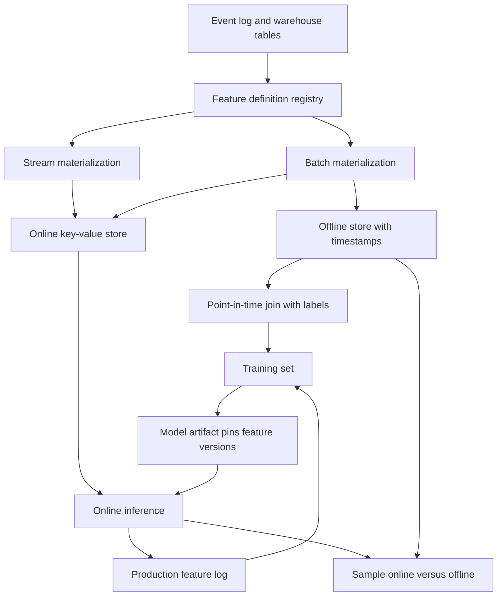

## Concept

A feature store is a contract. A feature is a named, versioned transform with an entity key, a timestamp, and two materializations that must agree. The offline path builds training rows with point-in-time correctness. The online path returns the same numbers, at serving latency, for a live model. Most failures that get blamed on the model are two definitions of a count such as trips in the last seven days, or a training join that could see the future. The pipeline is the product. A cache, a warehouse table, and a vendor online store are implementations of that contract.

### Features as versioned transforms

A feature is a function of entity keys and a time: the count of trips for a driver in a window ending at the decision, computed from events whose event time falls in that window. The name, owner, value type, aggregation, source, and freshness objective belong in a registry. Training jobs and serving fetch by name and version. If serving can silently pick a new transform while a model was trained on an older version, you shipped a different function under the old name.

Share one artifact. A declarative spec, a shared library, or a compiled plan should generate both the batch job and the stream job. Two SQL files that a human promises are equivalent will drift the first time one side handles late data, nulls, or time zones differently. The registry entry is what a design review approves. The notebook that computed the column once is a prototype, and it should not be the production definition. A feature without an owner is a column that will be "fixed" by whoever is on call for the model.

### The offline store and point-in-time joins

The offline store is a warehouse or lakehouse table: entity, timestamp, feature values, and enough metadata to know which definition produced the row. Training is a point-in-time join of labels to features as they would have been knowable at label time. Joining today's user row to a conversion that happened last Tuesday trains on the future. The user who already converted looks, in the training set, like a user who was always going to convert. That leak is often a join on entity id with no predicate that the feature time is earlier than the label time.

As-of joins are expensive, which is why a platform exists instead of a query copied per model. You need a history of feature values, because training samples span months. A daily snapshot is valid when the grain matches the decision. Reconstructing from the event log is more accurate and costs more. Choose per feature.

Slowly changing dimensions that were overwritten in place cannot be joined honestly. If the warehouse mutates history, keep a history of versions or a log of changes, or accept that you cannot reproduce last quarter's feature vector. Leakage reviews should ask, for every column, the earliest time that value was knowable. A feature without that time is a candidate for a leak. The review is a join predicate, written down, that a new model cannot skip.

### The online store and freshness

The online store is a low-latency key-value system. Keys are entities. Values are the latest feature vector, or a short window when the model needs one. Writes come from a streaming job or from a scheduled batch that is only as fresh as the schedule. Mixing them is normal. Demographics can be daily. Demand in the last fifteen minutes cannot.

Freshness is an objective of the feature. A short-window count fed by a two-hour batch is a different feature from the one the name claims. An attribute that changes yearly, computed in a stream, is spend without a benefit. Publish the freshness target next to the name, and alert when the online watermark lags it. Serving should fail closed, or fall back to a named default model, when the vector is older than the threshold. Scoring on yesterday's demand during a surge looks like a model regression and is a pipeline incident.

### Online and offline skew

Skew is any difference between the number the trainer saw and the number the live model sees for the same entity at the same logical time. Causes are concrete: different SQL, different window alignment, different late-data rules, different clocks, a stream on processing time while batch uses event time, a batch job that included today's incomplete partition, a key-value writer that shipped a bug the warehouse job did not.

The mitigation is one definition, two materializations, and a job that samples entities, compares the offline value as of now with the online value, and pages when the distributions diverge. Unit tests on a handful of keys catch typos. They do not catch watermark bugs or partition-completeness bugs. Block a model launch on a skew objective for the features that model pins. Freeze those feature versions inside the model artifact so a registry publish cannot change the live vector under a running model.

### Labels, decision logs, and training sets

Labels have their own leaks. A fraud label that arrives thirty days later must not be joined to features computed from the thirty days after the decision. A recommendation click must not be joined to an embedding that was updated after the impression. The strongest training row is a snapshot of the vector the server actually fetched at decision time, written to a log with the model version and the feature versions. Recomputing features later is the right tool for a new feature and a dangerous default for an old one. Production feature logs are the gold set when retention, privacy, and cost allow them. Recompute from the event log is the backfill path, and it has to use the same point-in-time rules as training.

## Trade-offs

| Approach | When it wins | Cost / risk |
| -------- | ------------ | ----------- |
| One definition, dual materialization | Many models, shared features, a skew objective | Platform cost; two jobs to operate per feature |
| Log the vector that serving fetched | Highest fidelity between train and live | Storage; a brand-new feature has no history in the log |
| Batch-only features | Slow attributes and daily models | Stale if you also serve those features inside the day |
| Stream-only features | Last-N and session signals | Historical backfill is hard; watermark bugs become training bugs |
| Ad-hoc SQL per model | The first model on one team | Skew is likely as soon as a second consumer appears |

A dual store with a single spec is what I want once a second team asks for the same feature. Before that, a logged serving path and a warehouse table can be enough. Standing up a feature platform for one model, so the architecture diagram looks complete, spends the quarter on plumbing.

Logging the served vector wins for ranking and fraud, where any recompute drifts. It loses when you invent a feature and want years of it; then you need an event log you can replay. Stream features win for marketplace freshness and lose when you cannot replay them with the same watermarks. Ad-hoc SQL shows up later as a silent gap that everyone will call model decay. The decay chart is a pipeline chart until you prove otherwise.

## Diagram

## Failure modes

### Training-serving skew

Detection is a live metric that diverges from offline evaluation on the same period, feature-distribution charts that disagree between train and production, or a canary that loses while offline scores still look strong. Two implementations of one name are the usual cause. A stream null and a batch zero are enough.

Mitigation is one spec, a continuous comparison on overlapping keys, and a launch gate on skew. Pin feature versions in the artifact. Retraining on production logs that you still cannot reproduce moves the bug into the next model. Fix the definition, then retrain.

### Point-in-time leakage

Detection is offline metrics that are implausibly good, followed by a launch that fails, plus a query that joins a current dimension to historical labels. Overwritten history in a slowly changing dimension is a frequent source. The value at training time includes the outcome.

Mitigation is as-of joins, history tables that keep prior versions, and a checklist: every feature column has a time it was knowable. A test fixture should include a feature that changes after label time and must not appear in the training row. If the warehouse mutates history in place, you need a log before you can train honestly.

### Staleness mistaken for model decay

Detection is a drop in online performance while the model file did not change, lined up with stream lag, a paused job, or a batch partition that never landed. Freshness charts were absent, or they were owned by a team the model owner does not page.

Mitigation is a watermark per feature, a staleness flag that serving can turn into a fallback, and alerts that reach the people who own the product metric. Roll back the pipeline when the vector moved. Rolling back the model leaves the stale features in place and burns a rollback you may need later.

### Vector schema drift

Detection is serving exceptions, silent fills, or a new feature appended at an index the trainer did not use. A registry that is a spreadsheet, with a positional array on the wire, will eventually shift.

Mitigation is a schema attached to the model and to the online payload, defaults that training also used, and a compatibility check before a feature version is marked servable. Fill a missing feature with zero only when zero was a value the model was trained to see. Named fields survive human edits better than positional arrays.

## Real-world example

Uber's Michelangelo is the public shape of this problem at marketplace scale. Arrival-time, fraud, and dispatch models need features that are both reconstructable for training and available live: trip counts, location aggregates, device signals. A warehouse path builds training rows. Streaming and batch jobs fill an online store the prediction service reads. The architecture is a feature with an owner, a definition, a freshness target, and a join time. Training is a point-in-time construction. A dump of the current dimension is a prototype that has not launched.

At that volume, skew and leakage are incidents. A dispatch model trained on a dimension that already included the outcome will look strong offline and ordinary in the city. A feature job that falls behind during a surge will look like the model broke, because the scores moved and the file did not. The platform work that pays off is the registry, the two materializations from one definition, the decision-time log, and the comparison between online and offline. Those are cheaper than another year of per-model SQL that nobody can diff.

You can adopt the contract without the full platform. Start with a registry, point-in-time joins, an online store for features whose freshness is inside a day, and a log of the vectors you actually scored. Add a second materialization when two models share a name and disagree. The disagreement is the moment the notebook stops being the system of record.

## What to remember

- A feature is a versioned transform of an entity at a time; two SQL files are two features that share a nickname.
- Training joins features as of label time; a join to the current dimension leaks the future.
- Online and offline skew is a pipeline defect until a comparison job says otherwise.
- Freshness is per feature; a stale vector looks like model decay and should page as data lag.
