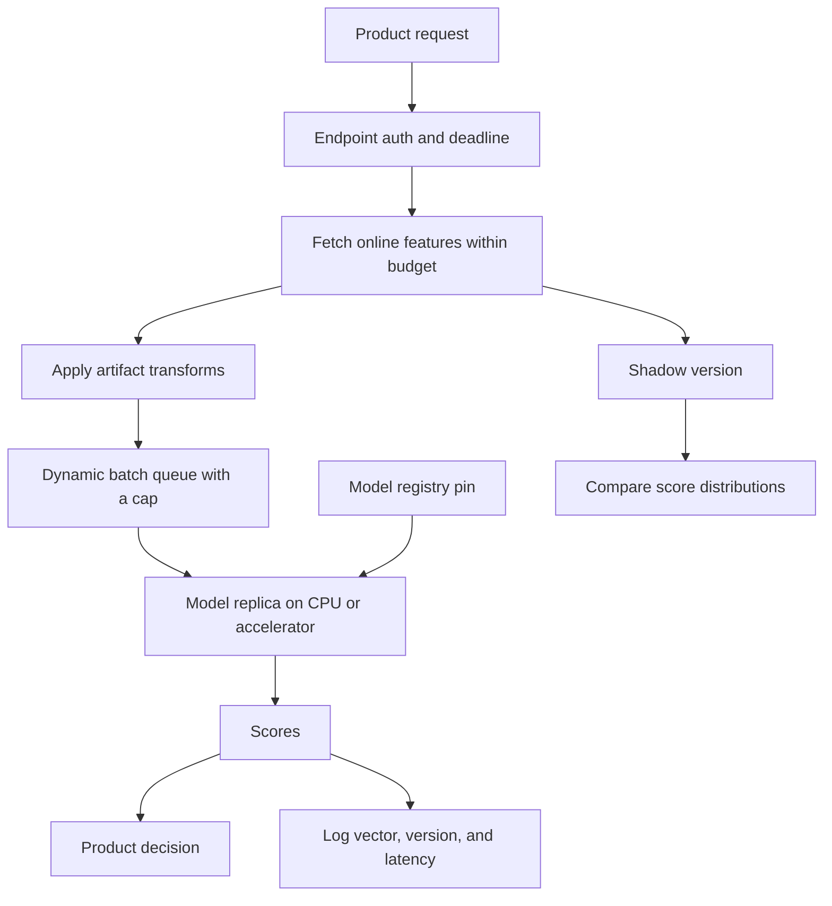

## Concept

Serving a model is a latency budget, a version pin, and a fan-out. The artifact is a bundle: weights or a graph, the preprocessing that is part of the model, and schemas for inputs and outputs. The service fetches features, packs tensors, runs inference, and returns scores before the product timeout. Dynamic batching and accelerators exist to keep expensive hardware busy while the tail latency stays inside that timeout. A registry, shadow traffic, and canaries exist so a worse file can be removed by moving a pointer. If feature fetch takes most of the budget and the forward pass takes almost none, the incident you are staffing is a data-path incident with an accelerator bill attached.

### What a version actually contains

A deployable model is the weights, the preprocessing that does not already live in the feature store, the input schema, the output schema, and the feature names and versions it expects. Put that bundle behind an immutable version. A training job id plus a content hash is a version. The string `latest` is a moving pointer, and it is a poor pin for a rollback. Serving binds an endpoint to a version. Rollback points the endpoint at the previous version. It does not start a training job.

Preprocessing that ran in the trainer and does not run in the server is skew, even when the feature store is correct. Compile the transforms into the artifact, or ship the same library at the same version in training and serving. Tokenizers, category encodings, and default fills belong in the bundle. Mapping code in the service, maintained by a different team from the trainer, will diverge on the first new categorical value. The divergence shows up as a score shift, and the model file's hash has not changed.

### The online path and the budgets on it

A request arrives with entity ids and a context the product just computed: the query text, the candidate set, the session. The server loads features, applies the bundle's transforms, infers, and logs the vector, the version, and the scores. Split the timeout into feature fetch, queue wait, inference, and anything you still do after the score. If feature fetch can exceed its slice, choose a fail-open path you can name — default features, a smaller fallback model — or fail closed. A vector of silent zeros is a third path, and it will score a population toward whatever class zero meant in training.

Synchronous scoring on the user path needs a hard tail latency. Asynchronous scoring, where a consumer writes scores that a later read picks up, hides model cost from the click and accepts staleness. Rankers that must see the current query often cannot be fully asynchronous. Batch scoring overnight, for every user, is a throughput system with a write to a store the product reads. Forcing every model through the online accelerator pool because that is what the platform built will waste the pool and miss the latency budget. Classify the model by the freshness and the deadline before you place it.

### Dynamic batching

Accelerators want large matrix multiplies. Users want a response inside tens of milliseconds. Dynamic batching holds requests for a few milliseconds, or until a maximum batch size, and runs one forward pass. The wait is added latency. The win is throughput and a lower cost per score. Tune the maximum wait against the tail, and measure it under a peak, because a window that is harmless at noon becomes queueing delay when arrivals bunch. A batch queue without a cap grows until the wait dominates the trace. At that point you are running a stall with good average utilization.

Sharing one device across models needs a scheduler: concurrent model execution, hardware partitions, or separate pools. Head-of-line blocking is the failure mode. A huge batch, or a cold load of a large artifact, stalls endpoints that did not ask for that model. Isolate by service level. A checkout ranker and a back-office classifier can share a cluster and should not share an ungoverned queue.

CPU inference still batches, and the economics differ. Many ranking models are small enough that feature fetch dominates the timeline. Profile before you buy accelerators. Profile again after the model grows, because a larger network that replaced a linear ranker changes which span is the budget. Hardware purchased against last quarter's trace is a sunk cost the next architecture may not use.

### Rollout, capacity, and rollback

Shadow traffic sends live requests to the new version, discards the response from the product path, and compares scores and latency. A canary lets a fraction of live decisions use the new version. Both need the same features and a way to attribute downstream outcomes — plays, clicks, fraud catches, cancellations — to a version. Assignment that sticks to a user or a session beats a coin flip per request when the experiment has memory.

Rollback is a registry pointer and a drain of instances that only have the bad version loaded. Keep the previous artifact warm, on disk or in an image cache, so rollback does not pull a cold multi-gigabyte file from a registry during the incident. A version that changes the schema needs a new endpoint or an explicit dual-read period. Swapping it under the same route will fail requests or, worse, fill defaults and return a score that looks successful.

Scale on batch-queue depth, accelerator utilization, and tail latency. Autoscaling that reacts only after latency has already blown the interval will add replicas that are still loading weights. Pre-warm, keep a minimum replica count for the diurnal shape, and keep experiment traffic off the production pool when the service level differs. A multi-model server reduces replica count and increases the blast radius of one bad load. Take that trade per service level, and write down which models may share a device.

## Trade-offs

| Approach | When it wins | Cost / risk |
| -------- | ------------ | ----------- |
| Model embedded in the product service | Tiny models, no accelerator, one team owns both sides | Preprocess skew; deploys couple the app and the weights |
| Dedicated model server | Shared accelerators, many models, batching, a registry | An extra hop; the platform team owns the tail latency |
| Async or offline scoring | Freshness of minutes is acceptable | Stale scores; unfit for a ranker conditioned on this request |
| Accelerator with dynamic batching | Large models and high request rate | Tail latency versus throughput; head-of-line blocking |
| One replica pool for every model | Small fleets and low operational surface | Noisy neighbors and mixed service levels |

Embedding wins for a small model in a service that already holds the features in process. The moment two languages or two teams touch the artifact, move it behind a server and a registry. A dedicated server wins on hardware utilization and on rollout. It loses when the extra network hop consumes a budget you could have kept in-process, which you will only know from a trace.

Asynchronous scoring wins for a banner that can be a few minutes old. It loses for ranking a set of listings against the query just typed. Accelerators win when the forward pass is the cost. They sit idle, expensively, when feature I/O is the cost and the batcher is waiting on a key-value store. Mixed pools are how a research canary perturbs checkout ranking. Split queues even when the machines are in one cluster.

## Diagram

## Failure modes

### The batching window becomes the tail latency

Detection is the high percentile rising with request rate while the median stays flat, batch size sitting at the cap, and queue wait as the dominant span. The configured maximum wait is the delay only while the queue is empty. Under backlog the wait is the backlog.

Mitigation is a hard queue cap with fail-fast or load shed, separate pools per service level, and scaling on queue depth before latency is already late. Load-test the diurnal peak. A batcher you cannot shed will protect utilization and miss the product timeout.

### Feature-fetch timeout and silent defaults

Detection is a rise in default-filled features, a score distribution that collapses toward one class, and traces whose slow span is the online store. The model file's hash has not changed.

Mitigation is a budgeted timeout, an explicit fallback model, and a fill-rate metric per feature. The online store is part of the serving objective. Hiding store failures inside zero vectors ships a prediction. It does not ship an error the product can route around.

### Version skew between training and the server

Detection is invalid numeric values, schema errors at load, or a canary whose score distribution cannot be compared to the champion because the tokenizer or the category map differs. The training job and the serving image pinned different libraries.

Mitigation is the immutable bundle, a schema check when the model loads, and images that pin the same preprocessing library the trainer used. Compare a canary on the divergence of score distributions in shadow, and treat a successful HTTP status as necessary and insufficient.

### Accelerator memory and noisy neighbors

Detection is replica restarts, out-of-memory errors on the device, and latency spikes on models that did not change, sharing a device with one that did. A larger batch size or a second model loaded for an experiment is the usual trigger.

Mitigation is memory accounting per model, maximum batch sizes that were measured, hardware or process isolation, and a scheduler that refuses a load that does not fit. The drain runbook has to move a critical model before it drops the last replica. A node that is full is an availability event for every endpoint on it.

## Real-world example

Netflix-scale recommendation serving is this budget in production. A request for a row of titles does not run a warehouse query. It assembles precomputed and session features, scores a candidate set with a pinned model version, and has to finish inside a product deadline. Batching exists because many requests can share a forward pass if the server waits a few milliseconds. That wait is acceptable only while it stays inside the tail. When the queue grows, batching stops being an optimization and becomes the outage.

The operational pattern to copy is the registry and the rollout, at whatever cluster size you actually have. New rankers run in shadow on live traffic, get compared on later engagement, and roll back by pointer when latency or downstream outcomes move the wrong way. The feature set and the model file are versioned together, because a new architecture scored on yesterday's feature definitions is a different product from the one offline evaluation described. Candidate generation can stay a cheaper retrieval plus a light model. The largest network does not have to sit on every stage.

If the ranker is a small model on a short feature vector, embed it, log the vector, and keep the registry anyway so rollback is a pin. When the artifact and the fan-out justify accelerators, add a server with a capped queue. The failure modes stay the same at every scale: stale or defaulted features, a preprocess that drifted, and a batcher tuned for average utilization.

## What to remember

- Pin an immutable bundle: weights, preprocessing, feature versions, and schemas.
- Budget the path; feature fetch often dominates the forward pass, so timeout and fallback are explicit.
- Dynamic batching trades tail latency for throughput, and the queue needs a cap.
- Rollback moves a registry pointer onto a warm previous artifact.
