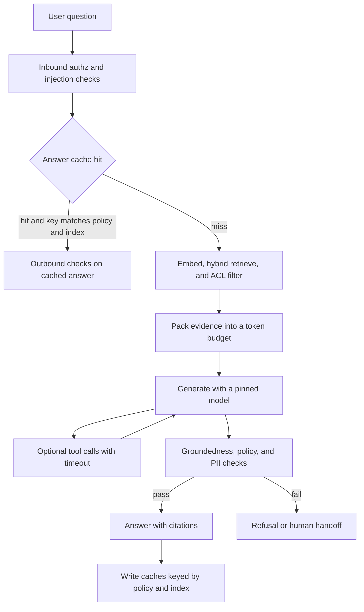

## Concept

An LLM application is a pipeline around a stateless model: retrieve evidence, pack a prompt, generate, and check the result. The model is a function of the tokens you send. What makes an answer true enough to show a customer, cheap enough to run, and safe enough to leave on overnight lives in the steps around that function. Retrieval-augmented generation is a contract that claims are grounded in evidence you can cite, with a defined behavior when the evidence is missing. Caching is how token cost and latency stay inside a budget. Guardrails are checks with a deny path. A system prompt that asks the model to be careful is a hint. It is not the control.

### Retrieval, chunking, and packing

Documents are split into chunks, embedded, and stored with metadata a filter can use: tenant, locale, product, document version, and an access list. A query may be rewritten, embedded, mixed with a lexical search so identifiers and policy codes match exactly, and then reranked. The packer fits evidence into a token budget: policy instructions, the user question, the chosen chunks, and a requirement that claims cite those chunks. Retrieving a large set into a small window throws away the retrieval you paid for. Retrieving a handful of chunks from a heterogeneous corpus guesses.

Chunk size is an architecture choice. Large chunks carry neighboring noise and blow the window. Tiny chunks drop the sentence that was the answer when it straddled a split. Overlap, splits that respect headings, and metadata on each chunk — source, updated time, access list — are how you debug a wrong answer later. Re-embed the corpus when the embedding model changes. Vectors from two models in one index are a silent failure: neighbors look plausible and answer the wrong neighborhood.

Packing should be deterministic for a given retrieved set, model, and policy version. Log a hash of the packed prompt, the chunk ids, and the model version. That triple is how you reproduce a bad answer. If a generation cannot be replayed from logs, you cannot operate the application past a demo. The log is the incident timeline. The chat transcript the user saw is a rendering of it.

### Caches: exact, semantic, and retrieval

An exact cache returns a stored answer when tenant, question text, index build, policy version, and model id all match. It is cheap and brittle, which is a good trade for repeated help-center questions. A semantic cache embeds the question and returns a prior answer when similarity crosses a threshold. It raises hit rate and it collides: a refund question and a warranty question can sit near each other in embedding space and must not share an answer. A retrieval cache stores the chunk list for a query so repeated questions skip the nearest-neighbor search, and then either regenerates or reuses the answer under an explicit policy.

Cache keys include tenant, policy version, index build id, and model id. A cache that survives a policy publish will serve a forbidden answer at excellent latency. Time-to-live should follow document freshness. A catalog price cached for a day is a pricing defect. Invalidation on document update is the design, and it is the design teams skip because the vector index itself is eventually consistent. The full path invalidates the index entry and the answer cache from the same publish event.

For money, eligibility, and policy, prefer the exact cache and the retrieval cache. Measure collision rate before you turn a semantic cache on for those intents. A high hit rate with a wrong policy sentence is a successful outage. Hit rate without a groundedness check is a vanity metric.

### Guardrails on the way in and the way out

Inbound checks cover authorization, prompt-injection filters, minimization of personal data, and a classifier for intents you will not answer. Retrieval enforces access lists at chunk level. A nearest neighbor is not an authorization decision. If a reseller must not see wholesale cost, those chunks stay out of the packer even when they are the closest vectors. Cross-tenant retrieval is a data leak with a similarity score attached.

Outbound checks cover groundedness — each claim should appear in a cited chunk — a policy classifier, a scan for secrets and personal data, and schema validation when you asked for structured output. The check is code that can fail the request. When it fails, the product path is a refusal or a handoff to a person. A retry that asks the model to be more careful, with no budget and no new evidence, spends tokens and often repeats the failure. Record which check fired. A single blocked counter hides whether you have an injection problem, a retrieval miss, or a policy change.

### Tools, generation, and evaluation

Temperature, tool use, and the model id belong in the same log as the chunk ids. If the application may call a price or inventory API, that call is a tool with authorization, a timeout, and an idempotency story. It is not a paragraph of yesterday's prices stuffed into the index. Evaluation is a pipeline of its own: a labeled question set owned with support and legal, retrieval recall on that set, a groundedness score, and online signals when you change chunking, the embedder, or the model. Ship retrieval changes the way you ship model changes. A better embedding that drops recall on the ten questions that drive tickets is a regression, even if average recall rose.

The generation step is the cheapest place to be wrong and the most visible. Keep it swappable. Pin the model id in the same place you pin the index build, so a provider default cannot move under a cache key you thought was stable. A model upgrade that changes citation style will fail the groundedness check until the checker and the prompt move together. That coupling is a release, and it belongs on the same train as the index.

## Trade-offs

| Approach | When it wins | Cost / risk |
| -------- | ------------ | ----------- |
| Closed-book generation, no retrieval | Rewriting and tasks with no corpus of record | Unsupported factual claims and no citation |
| Retrieve, then generate | Policies, catalogs, and help content that are the source of truth | Misses, stale indexes, packing bugs |
| Multi-hop retrieval with tools | Questions that need several lookups | Cost, loops, and a larger guardrail surface |
| Aggressive semantic cache | High repeat traffic on a stable corpus | Wrong reuse across nearby intents |
| Refuse unless claims are cited | Domains where a wrong sentence is worse than no answer | Lower answer rate; the refusal rate needs a product owner |

Closed-book generation is a fit for editing prose the user already supplied. A help center needs the corpus. Classic retrieval-then-generation is the default I ship when the documents are the source of truth. Multi-hop retrieval wins for a question that compares a return rule for a specific item in a specific country, and it loses when the loop has no step cap and no spend cap. Put the hop budget in the design, beside the token budget.

Semantic cache wins on frequently repeated, low-stakes questions. It loses on account-specific questions that embed near each other. Strict groundedness wins wherever a wrong sentence creates a commitment the company did not intend. Product teams will argue with the refusal rate. Put that rate on the same dashboard as satisfaction, and decide the threshold in the open. A hidden refusal that still shows a fluent sentence is the failure mode the dashboard was meant to catch.

## Diagram

## Failure modes

### A retrieval miss presented as a confident answer

Detection is fluent answers with negative feedback, citation links that do not contain the claim, and evaluation recall dropping after a chunking or embedding change. The model filled a hole the retriever left.

Mitigation is a groundedness check, required citations, a refusal when top scores fall under a threshold, and hybrid search so product identifiers and policy codes do not depend on embedding luck alone. Log chunk ids with every answer so the miss is reproducible.

### A stale cache after a policy or price change

Detection is a debug retrieval that looks correct and a production answer that quotes the previous policy, or two users seeing different rules after a publish. The cache key omitted the index build or the policy id.

Mitigation is to key on index build, document version, tenant, and model, and to invalidate on publish. A short time-to-live reduces the window and still serves the old answer inside that window. For prices and policy, skip the semantic cache and invalidate explicitly.

### Prompt injection through retrieved text or the user

Detection is the model ignoring the application policy, leaking another tenant, or following instructions that arrived inside a review, a ticket, or a product description. Retrieval put an untrusted document in the packer with the same privileges as the system prompt.

Mitigation is to treat retrieved text as data: delimit it, strip instruction-shaped control, and keep access checks at retrieval time. Inbound classifiers and outbound policy checks both run. Exercise the system with poisoned chunks in the corpus, not only with chat prompts. Never retrieve across tenants to see whether the model behaves.

### Token cost and latency without a budget

Detection is spend per session climbing, tail latency tracking prompt size, and provider rate-limit errors. The packer stuffed a large result set, or a tool loop retried with no cap.

Mitigation is a token budget in the packer, a maximum number of tool hops, a fallback model or a refusal when the provider is limiting you, and caches whose keys actually hit. Admit load at the application. Track cost per successful grounded answer, because a cheap ungrounded answer is the expensive outcome.

## Real-world example

Consider a marketplace assistant as an architecture, without claiming a particular product behaves this way. A shopper asks whether a sofa can be returned in a given country, and what the wattage of a lamp is. The sources of truth are policy documents, product attributes, and seller listings. Each chunk carries an access scope: shopper, seller, or internal. The pipeline embeds with tenant and locale, retrieves with hybrid search so product identifiers match literally, packs citations inside a token budget, and generates with a pinned model. Live price and inventory are tool calls with timeouts and authorization. They are not paragraphs copied into the index yesterday and cached as if they were policy.

The answer cache keys on catalog version and policy version, so a legal publish does not keep serving last week's return window. Guardrails refuse when no policy chunk supports the claim, and retrieval drops other sellers' wholesale fields before packing. Evaluation uses questions that support and legal already know the answers to, plus disagreement between answers and later tickets. The model can be replaced. The index, the access lists, the cache keys, and the logs of chunk ids are the system you will debug in the middle of the night.

## What to remember

- Retrieval-augmented generation is retrieve, filter by access list, pack, generate, and check grounding.
- Cache keys include tenant, policy, index build, and model; a semantic cache can collide across intents.
- Guardrails are deny paths in code, with a recorded reason, and a system prompt is only a hint.
- Log the prompt hash, chunk ids, and model version so an answer can be replayed.
