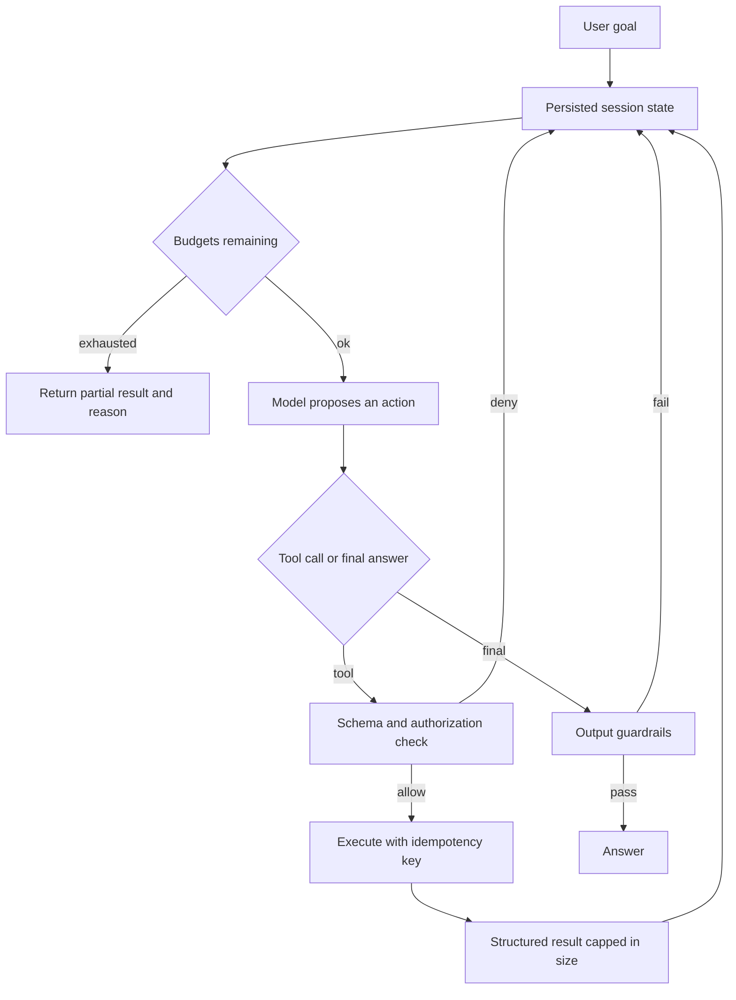

## Concept

An agent is a loop. It observes state, proposes an action, executes a tool, observes the result, and repeats until a stop condition. The model proposes. The architecture is what makes the loop bounded, authorized, and recoverable: tool contracts, budgets, memory you treat as untrusted, and a workflow that is allowed to be more rigid than the demo. A loop with production credentials and no cap is an incident with a natural-language interface. Design it as a state machine you can checkpoint. A chat transcript that happens to call functions will not survive a process death, an audit, or a retry.

### The observe, propose, and act loop

Each turn, the runtime serializes a view: the user goal, retrieved context, tool results so far, constraints, and the budgets still remaining. The model returns a structured tool call or a final answer. The runtime validates the call against a schema, checks authorization, executes, and appends a structured result. That shape is enough for many products when the tool set is small and the stop conditions are real: a final answer, a budget hit, a denied tool, or a step cap.

Planning a graph up front wins when the work is known. Refunding an order is a policy check, a payments call, and a notification. Letting the model invent that graph on every request is how a policy check gets skipped because the model went straight to the payment tool. Use a planner when the graph varies with the request. Use a compiled workflow when it does not. A hybrid is normal: a workflow with one agent node in the ambiguous middle, and ordinary service calls everywhere money moves.

Keep the loop out of a single HTTP request that runs for minutes. Persist turn state. Let the client poll or subscribe. A timeout at the load balancer is a client-side failure. The worker can still be calling the order API. The stop condition has to live in the runtime, and it has to be visible in the stored session. A session row that only exists inside a provider's chat object is a session you cannot resume, audit, or kill from your own control plane.

### Tool contracts

A tool is a remote call with a schema, an idempotency key, a timeout, a side-effect class, and an access check. The model sees a description. The runtime sees a capability tied to the session: this shopper may read their orders and may not issue a refund without a confirmation step. A broad tool — arbitrary queries, a browse of the internal network — moves authorization into the model's judgment. A narrow tool moves it into code you can review.

Writes are idempotent under a key the runtime mints for the intended action. The model will call twice. The user will click twice. The runtime will retry after a timeout. If creating a ticket ignores the key, you will create three tickets and then discuss hallucinations. Timeouts must reuse the same key. A new key is a new intent, and it should be an explicit choice.

Return errors the next turn can use: not found, denied, retryable, with a short code. A raw stack trace or an HTML error page in the context teaches the model to flail and spends the token budget on garbage. Cap the result size. A tool that returns an entire catalog will blow the following prompt and the bill for that session. The cap is a product decision: enough for the next decision, and small enough that one tool cannot dominate the context window.

### Budgets on tokens, time, money, and steps

Every session gets a budget: maximum model tokens, wall clock, tool calls, spend, and write tools. When a budget hits, the runtime stops and returns a partial result with a reason. That stop is the difference between an agent and a process that runs until a quota somewhere else fails. Budgets stack: a session cap, a tenant daily cap, and a global provider cap. Shed at the edge when the provider is rate-limiting you, before every session retries in parallel.

Retries consume a budget that is separate from the happy path, and still finite. Back off on tools. A failed groundedness check may allow one repair pass. Ten repair passes are a cost incident that looks like quality work. Record remaining budget in the trace. Otherwise the session dies and the timeline shows only that the model stopped. The reason code — step cap, token cap, spend cap, denied tool — is what the product shows the user and what finance reconciles at the end of the month.

### Memory, scratchpads, and durable execution

Short-term memory is the turn log, truncated or summarized when it exceeds a token cap. Long-term memory is a store keyed by user and task: preferences, prior orders, embeddings of past sessions. Treat it as untrusted retrieved text, the same way you treat chunks in a retrieval pipeline. A sentence planted in memory — an instruction to email every contact — is prompt injection with durability. Scratchpads should be structured: the current plan, completed steps, pending writes. A free-form chain of thought copied into logs will include secrets that tools returned. Redact before you persist. Leave raw payment payloads out of the agent log.

High-impact writes go through a tool that pauses for a person. Durable execution — a workflow engine or a job that checkpoints — is how the loop survives a process death in the middle. The session row holds the step, the budgets left, and the idempotency keys already used. Rebuild the next prompt from that row. A vendor chat session is a convenience. It is a weak audit log if you need to show which tool moved money and under which key. The ledger of tool calls is the record. The prose is commentary on that ledger.

## Trade-offs

| Approach | When it wins | Cost / risk |
| -------- | ------------ | ----------- |
| Single-shot retrieval and generation | One-hop questions with no side effects | Cannot sequence tools or confirm a write |
| Bounded tool loop | Lookup then a small, known set of actions | Loops, cost, and harder evaluation |
| Compiled workflow with an optional agent node | Known business processes and regulated writes | Less flexibility; more engineering up front |
| Several specialist agents | Heterogeneous tools that one prompt cannot hold | Coordination bugs and duplicated spend |
| An unbounded autonomous loop | A demo | Production incidents and unbounded spend |

Single-shot retrieval still wins for help-center answers. Add a loop when you can name the tools and the stop. Compiled workflows win for refunds, identity checks, and anything a regulator will ask you to replay step by step. Put the model in nodes that classify or draft. Keep it out of the node that moves money, unless that node is a paused approval.

Several specialist agents split a tool catalog that no longer fits one prompt, and they spend tokens until a budget dies. Start with one agent and a dispatcher. Hours of work belong in a job with checkpoints. A swarm that negotiates in natural language is a distributed system whose messages you cannot schema-check. If you need more than one proposer, give them a typed handoff and a shared budget, and keep the write tools behind the same gateway.

## Diagram

## Failure modes

### Loops that repeat the same call

Detection is the step counter at its cap, identical tool calls with the same arguments, and token spend that tracks wall time while session state does not change. The model is retrying a failure by asking again.

Mitigation is a maximum step count, detection of duplicate calls inside the session, structured errors, and a stop the user can see. Cache tool results by arguments for the life of the session. A pass that tries another approach has to consume a distinct, smaller budget.

### Writes applied more than once

Detection is duplicate orders, duplicate emails, or a refund that ran twice after a timeout. The runtime retried. The tool treated the retry as a new request.

Mitigation is an idempotency key minted by the runtime for each intended write, tools that honor it, and a ledger of keys already committed. A timeout reuses the key. A human retry is either the same key or a new intent, chosen explicitly and stored.

### Budgets that do not cover the tenant

Detection is one tenant consuming a month of model quota in an afternoon, or a tool result so large that the next prompt dominates spend. Caps existed per HTTP request and reset every call.

Mitigation is hierarchical budgets, payload caps, and admission control at the runtime. Alert on spend per session while the session is open. Keep a kill switch on the provider credential and on the agent entrypoint. A dashboard the next morning is a postmortem, not a control.

### Poisoned memory and tools that trust the model

Detection is the agent following instructions that arrived in an earlier page, a retrieved ticket, or a stored preference, or a user reaching another tenant's data through a tool whose only check was a parameter the model supplied.

Mitigation is an access check inside the tool, using the session identity, and ignoring identifiers the model invented when they fail that check. Memory is untrusted text. High-privilege tools require a person or a second factor. Audit every write with the session id and the idempotency key so the action can be traced without replaying the prose.

## Real-world example

A marketplace support agent, described as an architecture, shows the loop with real side effects. The shopper asks for a lamp under a price that ships to them by a date, and asks to start a return if the previous order is still eligible. That request is search, inventory, a shipping estimate, a policy lookup, and maybe a write. The runtime exposes narrow tools: search the catalog, read inventory, read policy, create a return. The return tool pauses for confirmation. Each tool scopes data to the shopper's identity. A model-supplied customer id that does not match the session fails closed.

Budgets cap tool hops so a confused plan cannot fan out unbounded searches. The idempotency key on create-return survives a timeout and a second click. Catalog and policy reads use the same access-aware retrieval as a non-agent assistant. Session state lives in the marketplace's store, so a killed worker resumes a half-finished return instead of starting another. Evaluation is task success — one eligible return, filed once — and cost per completed task. Fluency is a weak proxy for either number.

The systems that operate this without drama look like workflow engines, a tool gateway, and spend alerts. The model proposes the next step. Payments, inventory, and policy already had owners and idempotent APIs. The agent architecture is the leash between those APIs and a proposer that will retry, wander, and occasionally follow a sentence it should have treated as data.

## What to remember

- Persist the loop and its stop conditions; a long request that dies at the proxy leaves a live worker.
- Tools are calls plus authorization plus idempotency; the model does not decide access.
- Budgets on tokens, time, money, and steps are part of the product contract.
- Use a compiled workflow for known writes, and a bounded loop only where the graph has to vary.
