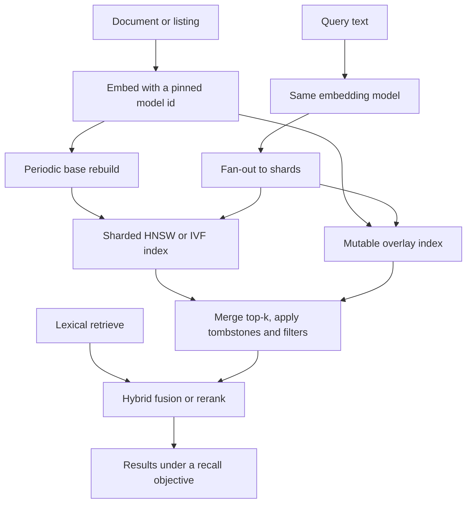

## Concept

Vector search at scale is approximate nearest-neighbor serving with an embedding contract and a freshness pipeline. You encode entities into vectors, index them so a query vector can find neighbors without scanning the corpus, and you keep that index close enough to the source of truth that a deleted or sold-out entity does not stay at the top. Recall at the result size the product uses, latency, memory, and update rate are the four numbers you will trade. Exact nearest neighbor is the baseline you use to measure recall. Past a few million vectors it is rarely the serving path, unless you have a scan budget and a reason to spend it.

### Embeddings as a versioned schema

An embedding model plus its preprocessing is a schema. Mixing spaces — documents on one model, queries on another, or a migration that re-embedded only half the corpus — produces neighbors that look sorted and are wrong. Pin the model id on every stored vector and on every query. A new encoder is a migration: build a second index, shift query traffic, then drop the old index. There is no in-place rewrite that keeps a graph index consistent while vectors change meaning.

Dimension, distance — cosine, Euclidean, or inner product — and whether vectors are normalized have to match how the encoder was trained. Serving a distance the encoder was not trained for is a recall drop with no exception in the logs. Write the metric into the index configuration and into the client that queries it. Title, body, and image embeddings are separate spaces, or a weighted combination you version as its own model. Treating them as interchangeable columns in one graph is how a title match loses to an unrelated image neighbor.

### Indexes and what recall actually measures

A hierarchical navigable small-world graph, HNSW, is a layered graph. Search is a greedy walk plus a candidate heap. Raising the search-time candidate limit raises recall and latency. Raising the graph degree raises memory and build time. It is the default for many low-latency systems in the tens of millions of vectors, and it is hungry for RAM.

An inverted-file index, IVF, partitions the space with a coarse quantizer. Search probes a configured number of lists. Product quantization compresses vectors into short codes so billions of them fit in RAM or on fast disk, at a recall cost you must measure. IVF with product quantization is the scale path when a full-precision graph will not fit. Disk-based graph indexes and GPU indexes extend the same trade: more vectors, a different place where you pay in latency or in recall.

Recall at k is the fraction of true nearest neighbors, from an exact scan, that appear in the approximate top k, on a held-out query set. Publish it at the k the product uses. Recall at a large k for a reranker is a different objective from recall at ten for a carousel that shows ten items and stops. Tune the search parameters per objective. A single setting that made a demo look good will either miss the latency budget or miss the item a seller paid to have found. The nightly exact-neighbor job is part of the service. Eyeballing ten queries is not.

### Shards, filters, and the query path

Shard by a hash of id, by tenant, or by a category that matches filters. Each shard holds an index. A query fans out, each shard returns a local top k, and a merger computes a global top k. Fan-out latency is the slowest shard plus the merge. Too many shards turn a fast local search into a straggler problem. Too few shards turn a popular tenant or category into a hot shard that dominates the tail.

Filtered search is where approximate indexes get awkward. Restricting the candidate set before the graph walk can break the connectivity the walk assumes. Searching first and dropping ineligible neighbors afterward spends the result budget on rows the user cannot see, and the result looks like a recall bug. The designs that work are metadata-aware indexes, filtered lists in an IVF layout, or a two-stage retrieve that mixes lexical and vector hits. If most queries are "this tenant, in stock," a per-tenant index often beats one global graph with a boolean applied at the end.

Replicas exist for throughput and for surviving a node loss. Builds and compactions should run off the replica that is serving the tight objective, or on a replica you can remove from rotation. A build that shares the only hot replica will show up as latency, and the index parameters will be blamed. The parameters may be fine. The replica was busy building.

### Freshness: overlays, tombstones, and rebuilds

Graph indexes dislike a high rate of point updates. The usual pattern is a small mutable overlay — recent upserts in an exact structure or a small graph — merged at query time with a base index that you rebuild on a schedule. Deletes are tombstones applied in that merge until the next rebuild drops the node. Some engines support incremental inserts with their own compaction. A listing that sold out has to disappear from results on a product objective even if the base graph still contains the vector. The merge applies the tombstone. Hoping the next nightly build is soon enough is a freshness objective you should write down only if product agreed to it.

Rebuilds dump vectors, build, and swap an alias. During the swap, serve one index version per query. If a rebuild takes twelve hours and the catalog changes by a large fraction in that window, the overlay is carrying freshness and the base is carrying recall and cost. Measure two lags: time until a new id is retrievable, and time until a delete stops appearing. Both are service levels.

Hybrid retrieval with a lexical index is how product codes, proper names, and rare tokens survive an embedding that never saw them. Fusing the lists — reciprocal rank fusion or a learned reranker — is a second stage with its own latency budget. Pure vector search will miss a model number. Pure lexical search will miss a paraphrase. The product query is often both, and the fusion weights are a versioned artifact the same way the embedding model is.

## Trade-offs

| Approach | When it wins | Cost / risk |
| -------- | ------------ | ----------- |
| Exact nearest neighbor | Evaluation, small corpora, a scan you can afford | Does not fit memory or latency as the corpus grows |
| HNSW in memory | Tens of millions of vectors and a tight latency objective | RAM cost and expensive full rebuilds |
| IVF with product quantization, or disk graphs | Hundreds of millions to billions of vectors | Recall versus compression; more parameters to gate |
| An index per tenant | Strong tenant filters and isolation | Many small indexes and more operational surface |
| Hybrid lexical plus vector | Names, identifiers, and mixed intent | Two systems and a fusion stage that can regress |
| One global index and a post-filter | Weak filters and a simple deployment | Effective recall collapses when most neighbors are ineligible |

HNSW is where I start for product search in the tens of millions when RAM is acceptable. IVF with compression is where I go when that line item is the problem. Exact search stays in the recall job. Per-tenant indexes win when filters reject most of a global neighbor list, and they lose when you would operate a herd of empty graphs. Hybrid search wins as soon as users type identifiers. Post-filtering a small result set is the failure I see most often: most neighbors fail the filter, and the user sees a short list of weak matches.

## Diagram

## Failure modes

### A recall drop after a parameter or model change

Detection is offline recall falling while latency improved, or exact titles disappearing from the top of results. Someone lowered the probe count or the search candidate limit to hit the latency objective, or two embedding versions landed in one index.

Mitigation is a recall gate on a labeled query set before a parameter change ships, model ids pinned on vectors and queries, and index parameters versioned with the index. Shadow the new index. Tuning recall from a handful of hand-picked queries in production will optimize those queries and little else.

### Filters that empty the result

Detection is empty or junk results on in-stock or in-tenant queries, while an unfiltered neighbor search looks fine. The post-filter consumed the result budget.

Mitigation is a bounded over-fetch, an index that knows the filter, or shards that match the filter. Measure recall after filters, because that is the list the user sees. Alert on result size after the filter, not only on neighbor-search latency.

### Hot shards and rebuilds that never catch up

Detection is one shard's latency dominating the fan-out, or a rebuild that never swaps because ingest outruns it. A shard key correlated with popularity — a category prefix, a tenant that is half the traffic — is a common cause.

Mitigation is a hash that spreads hot ids, isolation for the heavy tenant, replicas on the hot shard, and an overlay so a multi-hour rebuild does not freeze freshness. Build away from the serving replica that owns the latency objective.

### Stale neighbors after deletes or a partial re-embed

Detection is sold-out or removed entities still ranking, or a migration where half the corpus and all the queries briefly disagree. Deletes landed in the source database and missed the overlay. Or queries moved to the new model while the base index was still on the old one.

Mitigation is a delete pipeline with its own objective, and, for lists where a stale hit is expensive, a check of the top results against the source of truth before display. Migrate with two indexes and a rule that a query uses one model id end to end. Serving two embedding versions in one graph fails quietly.

## Real-world example

LinkedIn's retrieval for people and jobs is vector search under marketplace constraints: very large entity counts, visibility rules, and queries that are both keywords and intent. Embeddings of members and jobs sit beside lexical search. An approximate index returns a candidate set. Filters for network, location, and permissions apply in the retrieve design rather than as a hope after a tiny result set. A ranker spends the remaining latency budget on that set. The split is the architecture: wide, cheap candidate generation, then a narrower rank.

At that scale the operational problems are memory, shard fan-out, and how fast a changed profile becomes retrievable. A global graph that ignored visibility would leak. A post-filter that dropped most neighbors would look like search was broken. Profile edits cannot all wait for a next-day rebuild if a member just changed jobs, so incremental updates or an overlay carry the fresh tail. A pinned embedding version across query and document is what prevents a mixed-space outage when a new encoder ships.

Copy the candidate-generation split, the filter-aware retrieve, and the recall evaluation. You do not need that corpus size to need the same contracts: a model pin, recall at the product's result size, a delete objective, and hybrid search for identifiers the embedder will miss.

## What to remember

- Measure recall at the result size the product shows, against exact neighbors; index parameters are part of that objective.
- The embedding model id is a schema; mixed vector spaces fail without an error.
- Put selective filters in the retrieve design; post-filtering a small result set throws away the hits.
- Freshness is an overlay, a rebuild, and tombstones, with a lag objective for inserts and for deletes.
