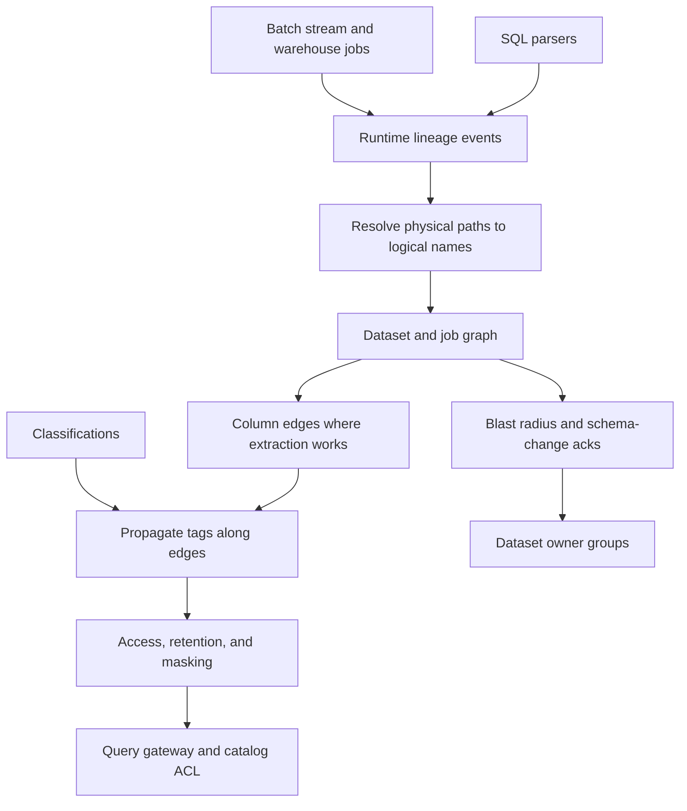

## Concept

Governance that cannot see lineage is a policy document. Lineage that nobody can act on is a graph you admire during an incident. The architecture is a catalog of datasets and jobs, a lineage graph of how data moved and at what grain, and policies that use that graph to restrict access, expire data, and notify owners. When a column of email addresses lands in a new mart, you need the jobs that read it, the dashboards that hang off it, and whether the classification followed the column. When a pipeline breaks, you need the downstream service levels in the blast radius. Those questions are the same graph, queried two ways.

### The lineage graph

Nodes are datasets — tables, topics, feature definitions, reports, files with a stable name — and processes — batch jobs, stream graphs, warehouse tasks, a report extract. Edges are reads and writes. Column grain is the useful edge for personal data: an email on an orders table flows into an email on a support mart. A job run adds time: this edge held for the run at a specific instant. A graph of intended edges with no runs misses what a conditional branch skipped. A graph of runs alone, with no declared intent, loses a dependency the moment an optional input is absent for a day.

Column lineage answers where a sensitive field went and what breaks if you drop it. Table lineage answers which jobs read a schema and which dashboards go dark if the job fails. You want both, and you want an honest gap. Column lineage breaks on user-defined functions, a select of every column, and SQL assembled at runtime. Table lineage is the floor. If the extractor stops at a function, show the gap. A complete-looking column graph that silently dropped those edges will send an auditor to the wrong table.

### How edges arrive, and how names stay stable

Parse-time extraction reads SQL and query plans and emits edges before the job runs. It is cheap, it misses branches taken only at runtime, and generated SQL defeats it. Runtime extraction emits events as the job runs: inputs, outputs, and facets such as schema, row counts, and owner. Run-level lineage events are the shape. They are accurate for that run, they require the engine to emit, and they will not see a laptop notebook unless that path is forced through a gateway. The architecture that holds up is hybrid: parsers for warehouse SQL, listeners for batch and stream engines, and an explicit override for systems that will never emit.

Identity is the part that fails quietly. A table needs a stable name across engines. A warehouse identifier, an object-storage path, and a catalog entry for the same bytes have to resolve to one node. Topics, feature names, and report ids need the same treatment. If a batch job emits a path and the warehouse emits a schema-qualified table, you have two nodes and a missing edge, and blast radius lies. A mapping from physical location to logical dataset is platform code. A cleanup script run after the incident is how you discover the split.

### Policy on top of the graph

Classifications — personal data, financial, tenant-confidential — attach to columns and propagate along outgoing edges unless a process is certified as a transform that removes the classification: an approved hash, an aggregation that cannot be reversed. Propagation is how a new downstream table does not start life untagged because its owner forgot a checkbox. Access policy then reads tags and lineage. A principal who may not see personal data should not query a mart that inherited it, even when the mart's page in the catalog was never edited.

Retention and deletion walk the graph the other way. A deletion request is not finished at the source row. It is a fan-out to every derived store the lineage knows, plus a list of stores the lineage does not know. That unknown list is the risk register. Masking and tokenization should appear as process nodes so an audit sees a break in the sensitive chain. A column that stopped being personal data with no process node is a story, and stories do not survive the next review.

### Ownership, impact, and the catalog you operate

Every dataset has an owner that maps to a living group, a service level if something user-facing reads it, and a freshness signal. Lineage turns a failed job into a list of downstream objectives rather than a picture of hundreds of nodes. Notifications go to those owners. A schema drop proposes the downstream list from the graph and waits for acknowledgement from the groups that still exist. If the graph is stale, that workflow is ceremony. Coverage — the fraction of scheduled production jobs that emitted a run — is the metric that tells you whether the ceremony is real.

Catalog products differ in interface. They share the need for stable identifiers, run-level edges, and a hook a policy engine can call. Instrument the engines you actually run. A search box over a wiki of table descriptions will not answer blast radius in the middle of the night, and it will not propagate a classification you attached on Friday. The graph is an operational dependency. Fund the emission path the way you fund the scheduler, or the catalog becomes a brochure.

## Trade-offs

| Approach | When it wins | Cost / risk |
| -------- | ------------ | ----------- |
| A manual catalog and no lineage | A tiny estate and few jobs | Rot; blast radius lives in chat history |
| Parse-time SQL lineage | Warehouses whose SQL is stable and reviewable | Misses notebooks, functions, and dynamic SQL |
| Runtime lineage events | Batch, stream, and warehouses that emit | Coverage and identity mapping become the project |
| Table-level edges only | Fast blast radius for jobs and dashboards | Weak answers for column drops and personal data |
| Column-level edges everywhere | Regulated fields and self-serve access decisions | Extractor gaps look like safety if you hide them |

Manual catalogs stall at the second team. Parse-time lineage is a sound start for reviewed SQL and a false comfort for a function that decrypts a column the parser never opened. Runtime events are what I want on every scheduled production job. Notebooks and ad-hoc queries stay a hole until they pass a gateway that emits.

Table-level lineage is mandatory for impact analysis. Column-level lineage is a program: start with classified columns and the jobs that touch them. A promise to map every expression will slip, and a policy that blocks all jobs when the graph is partial will stop the company. A policy that never blocks will never change behavior. Gate the paths you have classified, measure coverage, and treat unknown on a path that should be certified as a ticket with an owner.

## Diagram

## Failure modes

### Missing edges and a false sense of coverage

Detection is an incident whose real downstream was absent from the graph, or personal data that showed up in an export nobody emitted. The coverage dashboard counted tables with owners and ignored jobs that never sent an event.

Mitigation is to measure emission against the scheduler's production job list, to treat a non-emitting production job as a defect, and to keep an explicit register of stores outside the graph. Report coverage as a number. A claim that the graph is complete will be used in a place where it is not.

### One dataset, several names

Detection is duplicate nodes, edges that die at an engine boundary, and search that cannot find a single orders dataset. An object path, a metastore name, and a warehouse name drifted apart.

Mitigation is a naming service and ingestion that resolves aliases before insert. A recurring job can cluster likely duplicates for a human merge. Raw paths are locations. They are poor primary keys for a catalog that more than one engine writes.

### Owners who no longer exist

Detection is pages to a team that disbanded, or no page because the owner field names a person who left. Metadata rots on the same schedule as org charts.

Mitigation is ownership stored as a group in the identity provider, recertification on a cadence, and a rule that a new production dataset has an owner group before it is scheduled. Impact notifications read that group. A free-text name will not be paged by your incident tool.

### Policy that over-blocks a partial graph

Detection is legitimate jobs failing access checks because tag propagation assumed a sensitive path through a function the extractor did not understand — or the reverse, a function that dropped a tag and leaked. The policy was binary on a graph with holes.

Mitigation is three states: known sensitive, unknown, and certified clear. Unknown on a path that should be certified opens a ticket. It does not silently allow, and it does not fail every job in the company. Transforms that claim to remove personal data get a human review and a process node. Propagation then stops at that node on purpose.

## Real-world example

LinkedIn built DataHub because a large estate of datasets, topics, and jobs could not be governed from memory and chat. Finding a dataset, its owners, its schema, its upstream and downstream, and the jobs that failed needed to be one system. Ingestion from the engines they already ran — warehouse, batch jobs, the log — plus a graph teams could annotate is the architecture. The interface matters for adoption. The graph is what on-call uses.

The lesson that transfers is identity and coverage. A topic and a table that represent the same logical event have to meet at one name, or the graph splits and blast radius is wrong. Emission has to be the default for scheduled jobs, or the graph becomes a museum of the teams that integrated early. Questions about who can see member data, and which dashboards inherited a column, sit on those edges. A catalog that is only documentation cannot answer them when a job is down.

A thinner version is the same design: lineage events into a catalog, stable names, owner groups, classification with propagation on the SQL you can parse, and a schema-change check that lists downstream datasets. The public system is evidence that the graph is an operational dependency. It is funded and paged like one, or it rots. A search box over descriptions will not replace the edges the night a column of member data shows up in an export.

## What to remember

- Lineage is a graph of stable names and runs; two names for one dataset are a missing edge.
- Table-level blast radius is the floor; column-level lineage is a coverage program, especially for sensitive fields.
- Access, retention, and deletion policies read that graph; a catalog with no job emission is a wiki.
- Owners are living groups in the identity provider, or incident routing dies with the org chart.
