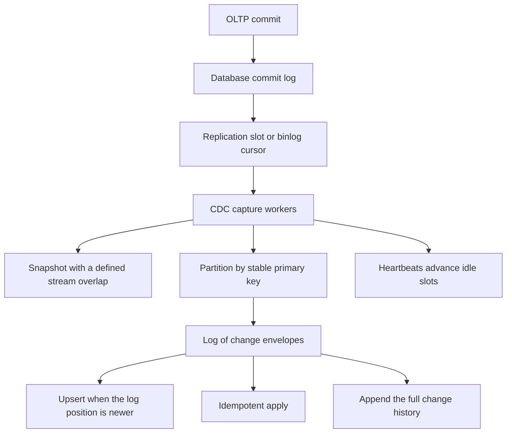

## Concept

Change data capture at scale is log mining, ordering, and fan-out. The primary's commit log already contains the committed facts. A capture process tails that log, emits an envelope per change, and consumers build search indexes, caches, warehouses, and further streams. Completeness is the reason to prefer the log over application dual-writes: scripts and forgotten code paths still commit, and the log still sees them. Ordering is the hard part. Updates to one row have to land downstream in commit order, or a tombstone comes back to life. At large table counts and large log volume, the capture process is a production client of the database. It has disk, lag, and a blast radius on the primary.

### Cursors, slots, and the cost of falling behind

PostgreSQL logical decoding retains write-ahead log until the consumer acknowledges a replication slot. MySQL's cursor is a binlog file and position, or a global transaction id. Other engines — change streams, a database's own change feed — each have a cursor you persist with the same care as a backup. Lose it and you snapshot again, or you guess and punch a hole. The capture cluster, whether a connector framework or a purpose-built system in the line of Databus and Brooklin, is a client of the primary. It lags. It holds disk on the primary. If it stops acknowledging, it can fill that disk and push the primary toward read-only.

Slot lag and log-disk headroom are paging conditions. Heartbeats exist so a publication that filters to a subset of tables still advances the slot when those tables are idle. If you capture only busy tables and leave the slot responsible for the whole log, an idle filtered set will pin unrelated log until a heartbeat or a captured write arrives. Initial load is a snapshot plus a stream from a position taken around that snapshot, with a defined overlap so you do not miss the rows that changed during the copy. Incremental snapshot adds a table without freezing the primary. At scale, the snapshot is a capacity event: you scan a primary or a replica. Prefer a replica when the engine can give you a consistent view, and mark snapshot rows with an operation the sink can tell apart from the live tail.

### Ordering: one row, one table, one transaction

A transaction that updates an order and then its line items has one commit order in the log. A downstream that must show a consistent order — items that match the parent — either receives transaction metadata and buffers until the transaction ends, or accepts that it will upsert to a latest state and may observe a partial moment. Most pipelines guarantee order per primary key on a single table. All changes to one key appear in commit order on one log partition, because the capture process partitioned by that key.

Cross-table transaction order costs extra protocol. Partitioning by table puts parent and child on different partitions. Partitioning by a business column that is not stable, or by a column the update itself changes, reorders a row relative to the log. A search document that joins parent and child should state whether it waits for transaction boundaries or upserts eventually. Eventual upsert, applying a change only when its log position is newer than the position already stored, is the usual search and cache path. A replica that must hide partial transactions needs a stronger contract and a slower apply.

A single log sequence fanned out by hashing a mutable column, or by a round-robin partitioner, reorders a row's updates. The symptom is a search index that flickers old values. The cause is the partitioner. Load-balance the capture workers. Do not load-balance a single key across partitions. The key's history is a sequence. The partition is how you keep that sequence intact.

### Envelopes, schema, and fan-out

The envelope carries the before image, the after image, the operation, the source position, and a transaction id when the capture process has one. Schema changes travel as versions in a registry. Consumers have to be compatible with the next version before the database migration lands. A dropped column or a tightened type is a release of every downstream, and the capture process will emit it as soon as the log contains it.

Fan-out is a log with many consumer groups: search, cache, a warehouse loader, stream jobs. Compaction on a keyed topic yields latest-per-key, which fits a cache. A warehouse loader often wants every change, which compaction will destroy. Two topics, or two retention policies, are cheaper than one topic that satisfies neither reader. Quotas and a dedicated replay path exist so a snapshot backfill does not stall the live tail for every other group. The capture process publishes once. Consumers lag on their own clocks.

### Idempotent apply

Capture is at-least-once. Duplicates happen on restart, on rebalance, and across the snapshot overlap. Downstream apply is an upsert by primary key gated by source position: apply the envelope only when its log position is newer than the position stored with the row. Without that check, a delayed duplicate overwrites a newer row. Deletes are tombstones with a position, so an older update cannot resurrect a row that a later delete removed. Out-of-order apply with no position is how a delete loses.

Schema evolution on the sink follows expand and contract. Add a nullable column downstream, then let capture emit it, then backfill. The capture process will happily emit a type the sink cannot store. That failure belongs in the migration review for every captured table, because those tables are a public API whether or not anyone filed them as one. The registry compatibility check is the gate. A database ticket that skips it is an outage with a schema diff attached.

## Trade-offs

| Approach | When it wins | Cost / risk |
| -------- | ------------ | ----------- |
| Log-based capture | Completeness and low coupling to application code | Primary log disk, ordering rules, and schema operations |
| An outbox table, then capture | Domain events other services should understand | The application must write the outbox in the same transaction |
| Polling for changes | Small tables and no access to the log | Missed updates, extra load, weak ordering |
| Dual-write from the application | No capture cluster to run | Missed code paths; the bus commit is a second transaction |
| A batch dump | A daily warehouse that can be hours behind | Too stale for caches and search |

Log-based capture is the default I want for search, cache, and lake ingest from an OLTP database. An outbox plus capture is the default for domain events, because the event is designed and the row image is an accident of the schema. Polling is a last resort when you cannot read the log. Dual-write is how two stores drift. Batch dumps still win for a reconcile that is allowed to be late, and they make a good checksum against the live pipeline.

At scale the other choice is the capture runtime. A connector cluster is enough until coordinator restarts, heap, and task placement become the weekly incident. A capture service that shards by table, isolates a noisy database, and pages on slot lag is what large estates build or buy when one shared connector cluster is the wrong failure domain. The log in the middle still lets consumers lag and replay independently. Capture does not replace that log. It feeds it.

## Diagram

## Failure modes

### The slot or binlog fills the primary

Detection is log disk climbing, replication slot lag, and a primary that is hours from refusing writes. The capture job paused, a consumer stopped acknowledging, or a snapshot held the cursor while the log kept growing.

Mitigation is paging on slot lag and on log disk, heartbeats for filtered publications, and a kill policy that drops a slot only with a rehearsed resnapshot. A forgotten connector task should not own a slot on the database that takes payments. Capture from a dedicated replica when the engine allows it, and treat replica lag as extra delay in the freshness objective.

### Reordering across partitions

Detection is a row that flickers an old value, a delete that reappears, or a child row that shows up before its parent in a consumer that assumed one global order. The topic was partitioned on a key that changes, or round-robin, or by table while the consumer wanted cross-table order it was not given.

Mitigation is a stable primary-key partition for per-row order, transaction metadata when cross-table atomicity matters, and apply logic that stores the log position. Do not rebalance a capture topic with a random partitioner to spread load. Spread it by key, and add partitions with a plan for the keys that move.

### Snapshot holes and a duplicate storm

Detection is missing rows after a connector is created, or a warehouse job that violates a unique key during the snapshot. The overlap between snapshot and stream was wrong, or the sink treated snapshot records as inserts on top of live upserts.

Mitigation is a written snapshot procedure, sinks that upsert, and a checksum against the primary — counts and hashes per table — after cutover. Incremental snapshot exists because copying a large table under a lock does not fit the primary's budget. Use it, and still verify.

### A schema change that breaks every sink

Detection is sink crashes, capture-task failures, and a registry compatibility error after a type change. The captured table was absent from the service's migration review.

Mitigation is to treat captured tables as a public interface, to expand before you contract, and to put a compatibility check on the migration path. Consumers pin a schema version. A type change is a versioned event. An in-place surprise is an outage with a database ticket attached.

## Real-world example

LinkedIn's Databus, and later Brooklin, exist because a social graph and the indexes derived from it cannot be dual-written from every application path. The source of truth commits in OLTP and other stores. Capture tails the change stream, keeps enough order to apply, and fans out to search, caches, and secondary stores. At that volume a casual connector fails on slot lag, on snapshot size, and on isolation: one noisy database must not stall capture for the rest of the estate.

The design to copy is a cursor you back up, partitioning that preserves per-key order, idempotent apply gated by log position, and capture operated as a client of the primary with a disk objective. A dedicated transport, rather than one undifferentiated connector cluster for every use case, is how they kept failure domains separate. A log still sits in the middle so consumers lag and replay on their own.

At a smaller scale, a log-based connector, a bus, and upsert sinks are the same design with less isolation machinery. The day log disk pages, the failure mode is the same one, and the same charts — slot lag, cursor age, apply position, schema compatibility — are what keep the primary writable. Those charts belong on the database on-call rotation, because the capture client can take the primary down by doing nothing.

## What to remember

- Capture tails a commit log; the cursor and the primary's retained log are production dependencies.
- Per-key order needs a stable partition key; cross-table transaction order is additional protocol.
- Apply is an idempotent upsert gated by log position, or an old duplicate will overwrite a newer row.
- Snapshots, heartbeats, and schema-as-interface are what let the pipeline survive growth.
