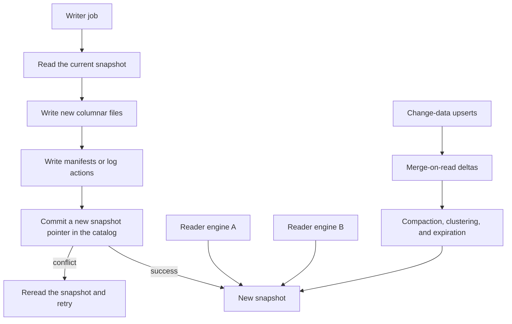

## Concept

A lakehouse table format turns a directory of files into a table with snapshots. Apache Iceberg, Delta Lake, and Apache Hudi each put a metadata log in front of columnar files so readers see one consistent file set, writers commit atomically, and you can read an older snapshot or abandon a bad one. The files are the bytes. The snapshot pointer is the table. Compaction, snapshot expiration, and a catalog are the operations that keep that pointer honest. A directory of partitions named by date is a pile of files. A snapshot that lists the files for that date is a table you can query, roll back, and share across engines.

### Snapshots, manifests, and the commit

A writer reads the current snapshot, plans which data files to add or remove, writes those files, and then publishes a new snapshot. The new files are invisible until the publish succeeds. Optimistic concurrency covers the race: if another writer committed first, this writer rereads the snapshot and retries. Iceberg stores a tree of manifest files so a commit rewrites a slice of metadata rather than one giant list. Delta stores a transaction log of actions, with checkpoints, under the table. Hudi records a timeline of instants, with different instant types for ingest and for compaction.

A reader opens a snapshot — usually the current one — and reads only the files that snapshot lists. A reader that started earlier keeps the old snapshot. That is the isolation. It is also why deleting objects by hand is not a delete. The current snapshot may still name them, and an older snapshot you promised for time travel certainly does. A logical delete is a new snapshot that omits files or that adds delete files or deletion vectors. Garbage collection is a separate job. It drops files no retained snapshot still references, and it is the only job that should have permission to remove them.

The commit is small on purpose. Data files land first, often in a staging prefix, and the metadata publish is the moment they become part of the table. A failed writer leaves orphans. Orphan cleanup, run by the format's rules, is how those files go away. A lifecycle policy on the bucket that deletes "old" objects by age will delete files a long-running snapshot still names. The bucket policy and the snapshot retention have to be the same policy, owned by the same team.

### Copy-on-write, merge-on-read, and file layout

Copy-on-write rewrites the data files an update touches. Readers stay simple: each snapshot is a set of base files. A point update inside a large file rewrites a large file. Merge-on-read writes deltas — delete files, log blocks, deletion vectors — and pays at read time until compaction folds them back into base files. A streaming upsert workload wants merge-on-read and a compaction schedule that actually runs. Hudi grew up on that path, with incremental pulls of changes between instants. Iceberg and Delta added deletion vectors and related mechanisms so the same workload does not require a full rewrite on every change-data batch.

Ingesting change data into a lakehouse table means you have a primary key, a merge plan, and compaction. Partitioning and clustering decide how much each merge rewrites. Iceberg hidden partitioning — identity, a day transform, a bucket — lets writers and readers share a layout without every query naming the partition column correctly. A grain that produces a million tiny files an hour taxes both planning and commit. Compaction, clustering, and sort-order rewrites are maintenance. They belong on the same on-call surface as ingest lag. They are not a quarterly cleanup.

### Three logs, one operational idea

Iceberg is an open specification with partition evolution and a snapshot model that many engines implement: Spark, Flink, Trino, and warehouses that now read the same metadata. Catalogs include a Hive-style metastore, cloud metastores, a REST catalog, and branching catalogs. Delta's center of gravity is Spark and the platform that grew up around that log. The transaction log is straightforward to reason about, and compatibility layers exist so other engines can read tables that also expose an Iceberg-shaped view. Hudi's strength is incremental consumption and the upsert, merge-on-read heritage, which fits a near-real-time change-data sink whose downstream jobs want changes since the last instant.

A feature is real only where your query engine implements it. Row-level deletes, time travel, and branches on a slide are promises. The intersection of the engines you run is the contract you can offer. Pick the format your primary engine and your catalog already operate, then require the incremental or multi-engine story you actually have a consumer for. Running three formats because three teams started three proofs will cost you three compaction stacks and three ways to expire a snapshot.

### Time travel, branches, expiration, and the catalog

Time travel reads a numbered snapshot, or the snapshot current at a timestamp. It is how you debug a bad job and how a training run pins the bytes it saw. It is a backup only if you still have the data files and you have tested a restore of the catalog pointer. Snapshot expiration and orphan-file cleanup reclaim object storage. If you never expire, every upsert keeps a museum of files and metadata planning slows down. If you expire too aggressively, long-running queries and the time-travel window you promised to training both break. Write the retention next to the service level.

Branches, where the catalog supports them, let a job write an experimental line of snapshots without moving the main pointer. Merging back is a catalog operation with conflict rules. That is useful for a training cut and for a blue-green swap of a table. It does not replace a catalog that stays available. The catalog is the name service: a table name resolves to a location and a current snapshot. Two writers with two catalogs pointed at one directory will split. One catalog, writers that commit through the table protocol, and credentials that deny raw deletion of the data prefix except to the maintenance role, are the access model. Object storage is not the API.

## Trade-offs

| Approach | When it wins | Cost / risk |
| -------- | ------------ | ----------- |
| Apache Iceberg | Several engines on one copy, partition evolution, an open catalog | Each engine lags some features; you staff compaction |
| Delta Lake | A Spark-centered platform with mature job operations | Other engines depend on a compatibility layer |
| Apache Hudi | Change-data upserts and incremental readers of those changes | More table modes to teach; check engine coverage |
| Hive-style directories | Legacy append-only dumps | No atomic snapshot; readers list and hope |
| Warehouse-native tables | Governed SQL and less file-level operations | A second engine on the same bytes means an export |

Iceberg is the default I reach for when several query engines must share one copy of the bytes. Delta is the default when the platform is already centered on that transaction log and other engines can wait on a published compatibility view. Hudi is the default when the table is an upsert sink and downstream jobs consume increments, and that team already operates the timeline. Hive directories still exist in estates. They do not give you a snapshot. A warehouse-native table still wins when you have one engine and no need for a second reader on the same files. The lakehouse claim is one copy, many readers, and a commit. If you have one reader, you may not need the claim.

## Diagram

## Failure modes

### Too many files, and planning that never finishes

Detection is millions of small files, commits that take minutes, and query planning dominated by metadata. Streaming ingest without compaction, or a partition grain finer than the queries, produces the pile. The table still accepts writes and gets slower every day.

Mitigation is a compaction objective, target file sizes large enough to plan quickly, and snapshot expiration on a schedule that matches the time-travel promise. Alert on files per partition and on commit duration. Maintenance is on-call work, staffed like ingest.

### Commit conflicts that stall writers

Detection is jobs retrying commits, a streaming writer falling behind, and two maintenance merges fighting each other. Isolation is doing what it should. Throughput is not.

Mitigation is fewer writers per table, partition-scoped writes where the format isolates them, and maintenance scheduled away from peak ingest. Several concurrent merge jobs against one change-data table are several writers in conflict. Serialize them.

### Read amplification after compaction stops

Detection is query time rising while data volume is flat, and a merge-on-read table with a long tail of uncompacted deltas. Compaction was paused to save cost, and every read now replays the tail.

Mitigation is compaction lag as a paging metric. Run compactors as their own capacity, separate from ingest. On copy-on-write tables, watch rewrite volume after a wide update, because the cost moved from read time to write time and can still miss the window.

### Catalog split and deletes that skip the snapshot

Detection is engines that disagree on the current snapshot, or reads that fail because objects were removed while a snapshot still named them. Someone treated the bucket as the API, or two catalogs published two pointers.

Mitigation is one catalog, credentials that deny raw deletes of the table prefix except for the maintenance role, and orphan cleanup that follows the format's rules. Restore rolls the snapshot pointer to a retained snapshot. Practice that roll. Copying files back into the bucket and hoping a reader lists them is the directory-of-files failure mode the format was adopted to leave behind.

## Real-world example

Netflix's warehouse on object storage is the public pressure that made a snapshot format the default outside a single vendor. Petabyte tables had to be readable by Spark and by other engines on the same bytes. Schema and partition layout had to evolve without rewriting every historical file. A commit could not depend on renaming a directory while a reader listed it halfway through. Iceberg snapshots and manifests are that protocol. Maintenance jobs compact files and expire snapshots. A catalog tells every reader which snapshot is current.

The operational fact that transferred to everyone else is that the format is a product you staff. Compaction lag, metadata size, and commit conflicts show up as incidents. Time travel is useful because a bad job publishes a snapshot you can abandon by moving the pointer. It becomes expensive when expiration never runs and every historical file stays reachable. Multi-engine reads work for the features each engine's reader actually implements. A gap in one engine is a product gap for the people on that engine, and it should be known when you choose a feature in another engine.

Copy the catalog and the maintenance objective. A Delta deployment can run the same architecture on its transaction log. A Hudi deployment can run it on a timeline of instants. The architecture is snapshot isolation on object storage, writers that commit through the catalog, and jobs that keep file counts inside a budget. The format name is how you get there with the engines you have.

## What to remember

- The table is the snapshot pointer and its metadata; deleting objects by hand breaks readers and time travel.
- Upserts need merge-on-read or a costly rewrite, and compaction is part of ingest capacity.
- Choose Iceberg, Delta, or Hudi from the engines you run and the incremental or upsert workload you have.
- Expire snapshots and compact files to an objective, or metadata and small files become the outage.
