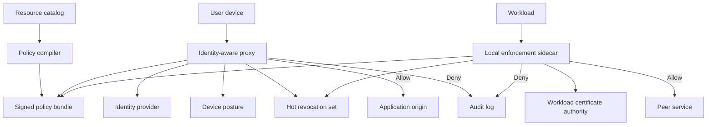

## Concept

Zero trust at fleet scale is an access-control plane with three budgets: latency, staleness, and error. A request from a person, a laptop, or a job stays untrusted until an enforcement point has evaluated identity, device or workload posture, the resource, and a small set of context. At tens of thousands of humans and hundreds of thousands of workloads, that evaluation has to be local, fresh, and closed when the evidence is missing. A round trip to a central brain on every RPC will miss the tail. A credential that lives for months will outlive the incident response you can staff.

The program is the set of paths that carry traffic, the lifetime of the credentials on those paths, and the time between "this principal is bad" and "this principal can no longer call anything." A proxy in front of a handful of applications, with the rest of the estate still flat, is a new front door on an open floor. Continuous verification is the machinery that keeps the snapshot honest.

### Continuous verification at fleet scale

A login is a sample. Continuous verification is the loop that refreshes the sample on a cadence you chose, and that refuses to mint a new sample when posture has gone stale. For a person, the artifact is a short-lived assertion bound to a device that is still enrolled. An identity-aware proxy evaluates the assertion on north-south requests. A posture agent reports disk encryption, patch level, screen lock, and enrollment on a heartbeat measured in minutes. A device that misses check-in loses the ability to mint the next assertion. Sessions already in flight die when the assertion expires, which is why lifetime is a security parameter with an owner, a metric, and a review.

For a workload, the artifact is a certificate or token whose lifetime is shorter than the window in which you can detect and contain a stolen identity. The certificate authority issues it after an attestation of the process, the binary digest, and the node. A restart gets a new identity. A node that fails attestation gets none. Issuance at this rate is a capacity plan: millions of certificates a day, a storm after a mass restart, and clock skew that makes a healthy fleet look expired. Time-to-expiry histograms, issuance error rate, and the age of the last successful attestation belong on the same dashboard as error budgets. The fleet shares a time source and a documented skew tolerance, because an access incident caused by clocks is still an access incident.

Calling a policy service on every microservice hop builds a thundering herd and a single point of total failure. Enforcement points decide locally. The control plane pushes a compiled, signed bundle — policy, trust anchors, and a compact revocation set — and the data plane evaluates it. A few signals cannot wait for the next bundle: a disabled account, a laptop reported stolen, a region placed under a step-up rule. Those ride a small, signed, pushable deny channel. An enforcement point without a fresh bundle refuses new sessions. Sessions already evaluated may keep a positive cache, and that cache carries an explicit TTL you can defend in an incident review.

Spend the remote round trip where a human is in the loop. A workforce proxy can use tens of milliseconds on identity and posture. A sidecar on an internal RPC cannot. Humans pass the proxy. Machines use local mutual TLS and a cached authorization map, plus the deny channel for emergencies. One vocabulary of principals covers both. An email at the proxy, a SPIFFE identifier in the mesh, and a cloud role at the database are three spellings of what must resolve to one person or one job. The compiler reads a single directory that maps humans to groups, groups to roles, and roles to workload identities. When someone leaves a group, one map changes, and every enforcement point sees it on the next bundle or the next deny push.

### Compiled policy and the resource catalog

Request-time interpretation of a large policy document will not hold across thousands of resources. Compile. The source reviewers read still says who may do what, on which resource, under which context. The artifact that ships is a versioned, signed bundle or a decision graph. Canary it the way you canary a binary. Roll back by selecting the previous version. A bundle that grants every engineer a data-export API is an incident with a version number, which is a recoverable incident.

Default deny is the default that survives a growing catalog. A new internal hostname with no attached policy is unreachable until an owner attaches one. The platform metric product teams feel is time-to-policy for a new resource. If that wait is measured in days, they will publish a second hostname. Staff the compiler and the catalog so the honest path is the fast path. Alert when a grant covers a sensitive action and a population larger than the owning team. Tests that only check a successful login will miss the grant that opens every tool after one phish.

### Revocation, degraded mode, and workload identity

The difficult interval is the one after you know a principal is bad and before every enforcement point has heard. Pair short lifetimes with the deny channel so a known-bad principal stops before natural expiry. Keep the deny set tiny, sharded by trust domain, and signed. A certificate revocation list fetched on a slow poll is the wrong shape for this path. A missing fresh deny set fails closed for new sessions. The positive-cache TTL is the remaining window, and it is short on purpose.

Inventory, group membership, posture, the certificate authority, and the identity provider sit on the access path or on the path that refreshes it. Write the degraded mode before cutover and practice it. Cached allows expire. First-time access denies. Break-glass is a named principal, stepped up, ticketed, and time-boxed. An access outage during an inventory failure is the failure mode the error budget already accepted. Inventing a fail-open rule in the incident channel is how the perimeter comes back.

The employee proxy leaves jobs, pods, CI runners, and admin automation uncovered. A stolen workload identity is a common path from one phish or one malicious dependency to production data. Attest the process, mint a short-lived identity, authorize the method, and encrypt the hop. Binary authorization — only images with signed provenance may be scheduled — is posture for machines. A runner that can mint production credentials without attestation is a standing exception. Address is a location. Identity is the credential. Review workforce access and workload access as one program with two data planes. A cutover that removes the VPN and postpones attestation has moved the perimeter onto CI.

## Trade-offs

| Approach | When it wins | Cost / risk |
| -------- | ------------ | ----------- |
| Central policy engine on every request | Small estates, strong consistency, low request rate | Control-plane outage is a total access outage; tail latency follows a remote call |
| Compiled bundles at every enforcement point | Large meshes and a global workforce | Stale allows until the next push; the compiler and the distribution path become a platform |
| Short-lived certificates, no deny list | Workload identity with lifetimes of minutes | Issuance load; a stolen certificate works until expiry |
| Short lifetimes plus a compact deny list | Human sessions and high-value workload identities | A hot revocation path and an explicit fail-closed rule when the set is stale |
| VPN as the only gate | A tiny, static office with little change | A stolen credential is campus-wide access |
| Identity-aware proxy for people, mesh for jobs, named break-glass | Companies leaving a private network | Two planes to operate; a forgotten bypass becomes the real perimeter |

Operational coupling is the cost that lands in the error budget. Identity, inventory, issuance, and bundle distribution need load tests that include a restart storm, and a written partition story. Cryptography is the smaller piece. Clock sync, bundle age, and the degraded mode are what page people.

Friction is the cost that lands in product behavior. Constant re-authentication, a slow proxy, or a long wait for policy on a new service teaches teams to open a second path. Track p99 of evaluation and time-to-policy as product metrics. A control plane people will not wait for is a diagram.

Consistency can vary by action. A short maximum bundle age is enough for ordinary RPC. A synchronous check is worth the latency for a small set of irreversible actions: key export, payment reversal, a production data dump. Keep that set small so the synchronous path stays fast, audited, and rare.

## Diagram

The review picture is a data plane that decides locally, a control plane that may lag by seconds, and a thin deny channel that does not.

## Failure modes

### Stale allow after a revoke

**Detection.** Access logs show a disabled user or a stolen device succeeding after inventory flipped. Bundle age exceeds the SLO. Deny-channel lag is measured in minutes. The timeline has a gap between account disable and the last successful request.

**Mitigation.** Cap positive-cache TTL below the response time you will actually use. Push a compact deny for high-value principals ahead of the next full bundle. Page on bundle age and on deny-channel lag. Rehearse the stolen-laptop path against the inventory the proxy reads.

### Control-plane outage answered by failing open

**Detection.** The identity provider, inventory, or bundle distribution is down and proxy errors jump. The incident channel proposes keeping existing sessions forever, or skipping posture until inventory returns. New hostnames appear that never consulted policy.

**Mitigation.** The degraded mode is written and practiced. Cached allows expire. New authentications deny. Break-glass is named, ticketed, time-boxed, and logged. The runbook states the access outage before the incident starts.

### Paths that skip every enforcement point

**Detection.** Direct peering, routine port-forwards, a database security group that still contains an office range, or a CI runner holding a long-lived cloud key. Flow logs on those paths stay non-zero after the announced cutover.

**Mitigation.** Origins accept traffic only from enforcement points. Remaining paths are break-glass with an expiry. Admission refuses listeners that lack a policy annotation. The inventory of paths is part of the control, because verification applies to traffic you can see.

### A compiled policy that is a second campus

**Detection.** A few groups appear on almost every allow. New resources copy an all-engineers grant. After a phishing report, one session reaches unrelated tools. Tests cover the happy login and skip the negative cases.

**Mitigation.** Default deny, an owner, and a named group on each resource. Alert on broad grants to sensitive actions. Treat coarse policy as a migration with an end date. At fleet scale an all-engineers allow is the VPN with extra logs.

## Real-world example

Google BeyondCorp is the public system that showed a large workforce could leave VPN trust behind. Internal applications became reachable because a request passed a frontend Google controlled. That frontend established who the user was, from the corporate identity system, and what the device was, from an inventory of managed, encrypted, patched machines. Policy combined user, device, and resource. The origin saw the request after that decision. A laptop that fell out of patch policy lost access without a human revoking a VPN account.

The scale lessons are about exclusivity of the path and grain of the decision. The enforcement point had to be the only door, because a second door recreates the campus. The allow was specific: this person, this device, this application. Phishing still succeeds against a person. The blast radius shrinks to that person's policy on that device, which is a smaller incident than a credential that opens the building.

Google described the production companion as BeyondProd: mutual authentication between services, workload identity, and admission of known binaries. I review a fleet as one program with those two data planes. Programs that stall buy the proxy and postpone attestation, issuance, and east-west policy until the VPN is gone. The quarter after that cutover is when a compromised runner becomes the incident, because the interior doors were left open.

## What to remember

- Continuous verification at fleet scale is a control plane: compiled policy, short-lived identities, and a hot revocation path with a freshness SLO.
- Enforcement points decide locally. Spend remote round trips on human gates and on emergency denies.
- A missing bundle or a missing signal fails closed for new sessions. Cached allows carry an explicit TTL, and break-glass has a name and an expiry.
- Identity-aware access for people and workload identity for jobs are one rule on two kinds of principal. Ship both, or the remaining door is the perimeter.
