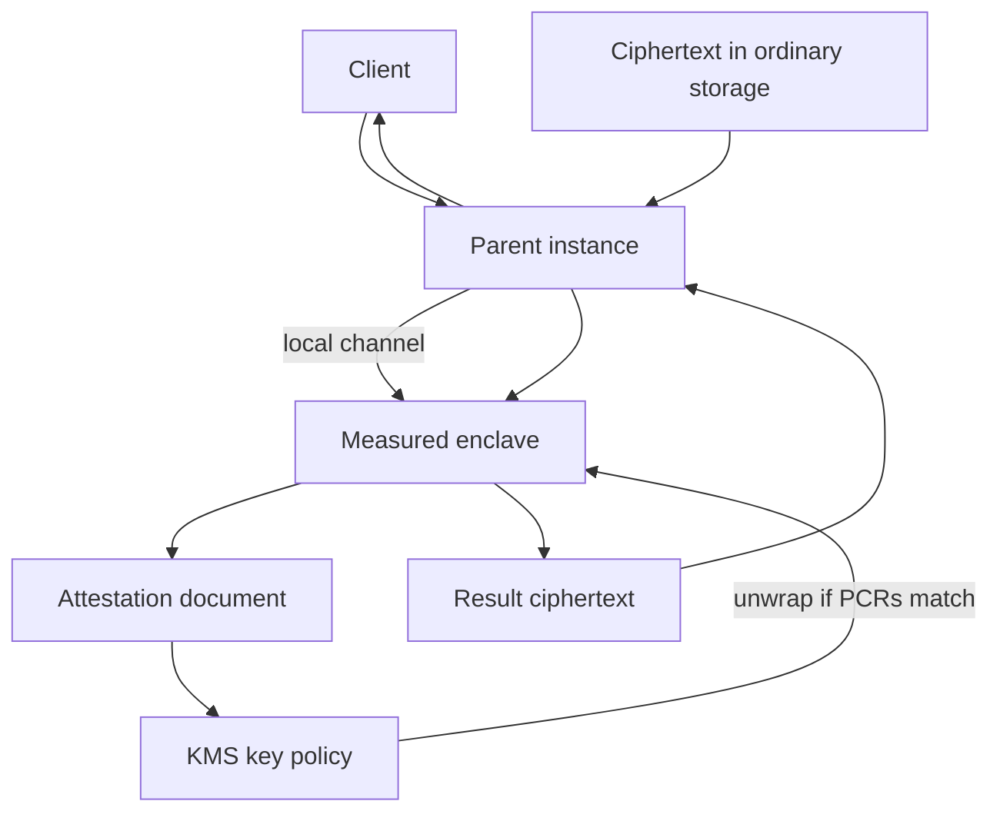

## Concept

Confidential computing is the claim that a workload can run on a machine whose operator you do not fully trust, and that the operator still cannot read the workload's memory in a useful way. The mechanism is an enclave: a region of CPU and memory that a processor or a small monitor protects from the host operating system, the hypervisor administrator, and a neighboring tenant. Encryption at rest and TLS on the wire leave the running process exposed to anyone who can dump it. An enclave closes that exposure only when you can prove which code is inside before a secret is released.

I treat the enclave as a narrow isolation primitive. It sits beside identity, disk encryption, and application authorization. The first design sentence names the principal you refuse to trust. The second sentence picks the enclave shape that excludes that principal. A design that cannot name the principal is asking for a smaller blast radius and a tighter key policy, and an enclave will not supply the missing sentence.

### What the boundary actually excludes

Product names hide different trust cuts. Intel SGX carves a user-mode enclave inside a process. Pages are encrypted, the trusted computing base is small, and the host operating system is outside the cut. AMD SEV-SNP and Intel TDX encrypt a whole virtual machine so the hypervisor cannot read guest memory. You then trust the guest kernel more and the cloud operator less. AWS Nitro Enclaves split CPU and memory away from a parent instance into an isolated virtual machine with no durable disk, no interactive shell, and no network except a local channel back to the parent. Confidential VMs on the major clouds sit in the SEV-SNP and TDX family.

The isolation claim is always "this memory is unreadable by that principal." A Nitro-style enclave excludes the parent Linux, the team that operates the parent, and the cloud operator's view of enclave RAM. The parent still feeds work in and takes results out. An SGX-style enclave excludes the operating system of a machine you otherwise run, which fits a compromised kernel on hardware you own. A confidential VM excludes the provider from the guest, which fits an operator or a compelled-access story against the cloud, and still trusts everything you installed inside that guest.

Write the sentence before you buy the product. "Protect a handful of keys and a decryption routine from the host OS" points at a small enclave. "Protect a whole application from the hypervisor" points at a confidential VM. "Protect a signing or tokenization service from the team that owns the parent instance" points at a Nitro Enclave. Those sentences are different procurements. Using one product to satisfy another sentence pays the operational tax and misses the principal you meant to exclude.

### Enclave attestation

Attestation is the control that makes the rest worth running. An enclave that cannot prove its contents is a dark virtual machine with a better brochure. The platform measures the code and configuration that were loaded — image digests, and often PCR-style registers that accumulate those measurements — and produces a document signed by a key that stays inside the trusted hardware or the cloud's enclave monitor. A relying party, usually your key management service or a peer, checks that signature against a vendor or platform root, compares the measurements to an allowlist you publish as code, and only then releases a secret or accepts a result.

On Nitro Enclaves the hypervisor produces the attestation document. PCR values are derived from the enclave image file. A KMS key policy can require those values, so an unwrap succeeds only when the document matches. The parent instance cannot mint a convincing substitute, because the signature comes from the Nitro platform, outside the parent's control. On SGX, a quote is checked through the vendor attestation service or a data-center equivalent you operate. On SEV-SNP, the guest presents a report bound to the VM measurement and a platform endorsement.

Treat the allowlist as a release artifact. A measurement that "looks right" in a wiki drifts the first time the toolchain, the kernel, or a linked library changes. Pin the image digest, the PCR set, and the platform version you accept. Deploying a new enclave binary rotates a trust root for every secret bound to the old measurements. Stage the change. Keep the previous measurement valid until the new fleet is serving, then retire it. A silent rebuild that changes a hash is an outage of every attested key, and it looks like a KMS denial rather than a bad deploy until someone compares PCRs.

Freshness is part of the proof. A document from last week does not describe the process running now. Bind secrets to a session: the enclave attests, receives a wrapped data key for this instance, and drops that key when the enclave exits. Long-lived application secrets baked into the image will be copied with the image, cached by the build system, and snapshotted by someone helpful.

### Sealed state, the parent, and a small trusted base

Enclaves in this pattern are usually ephemeral. Nitro Enclaves have no durable disk by design, which removes a class of residual-state bugs and forces every secret through attestation. SGX sealing can bind ciphertext to a measurement so only the same enclave identity can unseal it. That binding is useful on hardware you operate, and it breaks the moment every compile changes the measurement you sealed against. I prefer wrapping data keys in KMS under an attestation condition, and keeping durable ciphertext in ordinary storage the parent can hold and cannot interpret.

The remaining trust is easy to skip on a slide. You still trust the CPU vendor and the cloud's enclave monitor. You still trust the code you measured. A memory-unsafe parser inside an enclave is still a memory-unsafe parser, with a cleaner story about the host. You still trust the inputs. The parent can send malicious work, starve the enclave of CPU, drop results, or replay messages unless the enclave authenticates them. Side channels — cache timing, page-fault behavior, interrupt patterns — have a research literature. I do not promise they are absent. I promise they are a different attacker than someone who can read process memory on the host.

Keep the trusted computing base small. Key use, tokenization, or a narrow policy check belongs inside. HTTP stacks, verbose loggers, and business workflow stay on the parent. Every extra library you attest is attack surface you have signed and will have to rotate when it changes.

### Where the enclave sits in the service

The parent is the untrusted I/O plane. It accepts the request, passes ciphertext and a session into the enclave over the local channel, and returns a result it should be unable to interpret. KMS sits on the far side of attestation: the enclave presents the document, KMS unwraps a data key only when policy matches, and the enclave decrypts, computes, and re-encrypts. The path from enclave to KMS has to preserve that binding. Nitro's integration is built so the parent cannot substitute a different document on the KMS call. A home-grown quote parser has to treat the parent as on-path and authenticate the channel.

A monolith wrapped because a questionnaire asked about confidential computing will disappoint. Measured images, attestation debugging, dual grants during PCR changes, and the absence of a shell inside the enclave are justified for a small, stable core of secrets. They are a poor fit for a service whose binary changes every week. If the image changes weekly, you will either freeze features or live in a permanent dual-grant window, and the dual-grant window is where a stale measurement keeps decrypting.

## Trade-offs

| Approach | When it wins | Cost / risk |
| -------- | ------------ | ----------- |
| IAM, disk encryption, and mutual TLS, with no enclave | You trust the cloud account and the workload operating system | A host or hypervisor compromise reads RAM |
| Process enclave, SGX-style | A tiny trusted base on hardware you run, with an untrusted OS | A difficult programming model, side channels, and a dependency on vendor attestation |
| Confidential VM, SEV-SNP or TDX | Lift an existing guest while excluding the hypervisor operator | The guest kernel and its agents stay inside the trust cut; a larger base |
| Nitro Enclave beside a parent | Isolate key use from the application team and from operators of the guest | The parent remains the I/O plane; density and debug cost; PCR-bound keys change with the image |
| Homomorphic encryption or multi-party computation | The computing platform itself cannot be trusted with plaintext | Latency and engineering cost that few product paths survive |

The development loop surprises application teams. There is no shell inside the enclave. A conventional profiler does not attach. Logs that leave the enclave are a leak when they carry plaintext. Build a replay harness on the parent that uses a fake attestation in test, and a production path that accepts only platform documents. A test bypass that ships is the failure mode with the best uptime and the worst confidentiality.

Key policy surprises security teams in the other direction. Attestation-based grants are precise and brittle. A PCR change presents as a fleet-wide decrypt outage. Version the measurements, run two grants during rollout, and keep an emergency unwrap that is dual-controlled, logged, and slower than the attested path. An emergency path that is easy becomes the path.

A confidential VM is the default when the goal is "the provider should not read this guest." A small enclave is the default when the goal is "this binary, and only this binary, may see this key," including against the team that runs the parent.

## Diagram

Attestation precedes secrets. The parent carries bytes and is absent from the set of principals who may see the key.

## Failure modes

### Measurement drift that locks every key

**Detection.** Decrypt errors jump after an image deploy. KMS denies with a policy mismatch. PCRs in the new document differ from the key policy. Rolling the previous image back restores service.

**Mitigation.** Treat a PCR update as a migration with two grants live. Build images reproducibly so an incidental rebuild does not move measurements. Canary the new enclave and the new grant together. Keep the allowlist versioned beside the image promotion pipeline.

### The parent as a confused deputy

**Detection.** The enclave returns a form the parent can read. Parent logs contain payloads that were supposed to stay inside. Replaying an old message on the local channel yields the same sensitive result.

**Mitigation.** Authenticate requests inside the enclave with keys the parent does not hold. Return ciphertext or tokens. Bind attestation to a session key. Sequence or nonce the channel. Treat parent logs as untrusted I/O, which means they receive identifiers and status, and they do not receive plaintext.

### Attestation or vendor-root outage

**Detection.** New enclaves cannot obtain documents, or KMS cannot verify quotes. Existing instances keep working until in-memory keys expire. Compute and key-management on-call page at the same time.

**Mitigation.** Cache unwrapped data keys only inside enclave memory, with a short TTL. Do not cache an attestation bypass on the parent. Prefer the platform's native check, such as Nitro with KMS, over a home-grown quote parser. Keep a dual-control emergency unwrap that is slower and louder than attestation.

### A trusted base that grew a parser

**Detection.** The measured image now includes an HTTP framework, a codec, and a verbose logger. CVEs land in those libraries. Enclave crashes are filed only as availability.

**Mitigation.** Keep the enclave on key use and a tight interface. Parse untrusted bytes on the parent, or in a small memory-safe routine whose measurement you can explain. Leave document and media codecs outside the measured set. Restarting the enclave restores availability and does not restore a secret that already left in a log line.

## Real-world example

AWS Nitro Enclaves is the public system I point at when a team needs confidential computing without a rewrite onto a process-enclave SDK. Nitro already separates a class of operator access: the hypervisor is off the instance, storage and networking are separate cards, and there is no operator shell on the host in the way classic clouds offered one. Enclaves go further for application secrets. You carve vCPU and memory from a parent EC2 instance into an isolated virtual machine. That VM loads a measured image, has no persistent storage and no external network, and talks to the parent over a local channel called vsock. The Nitro hypervisor produces an attestation document whose PCRs reflect the image. KMS key policy can require that document, so decrypt succeeds for that image running as an enclave and fails for the parent role alone.

The production shape is a split service. The parent terminates TLS, checks identity, reads queues, and fetches ciphertext from ordinary storage. The enclave holds key use or a tokenization routine. On a request the parent passes ciphertext in. The enclave attests if it does not already hold a session key, unwraps a data key under the PCR policy, decrypts, computes, and returns ciphertext. Card tokenization, wallet-key operations, and narrow aggregations justify the tax. Placing the entire API inside the enclave bloats the measurement and turns every library upgrade into a trust-root rotation.

Two choices decide whether the design holds. Bind KMS to the attestation, because the parent instance role is the principal you are excluding. Make image builds reproducible and promotion explicit, because a silent rebuild that changes a hash takes every attested key down at once. Nitro will not repair a loose pipeline. It makes that pipeline part of the trust root, which is the point of measuring it.

## What to remember

- An enclave excludes a named principal from RAM. Choose the threat, then choose SGX, a confidential VM, or a Nitro-style enclave.
- Attestation is the product: measure the image, verify a platform-signed document, and only then release a secret.
- Keep the trusted base small and ephemeral. Wrap data keys under a measurement policy instead of baking secrets into the image.
- The parent is untrusted I/O. If it can log plaintext, or if an easy emergency path skips attestation, the enclave is a brochure.
