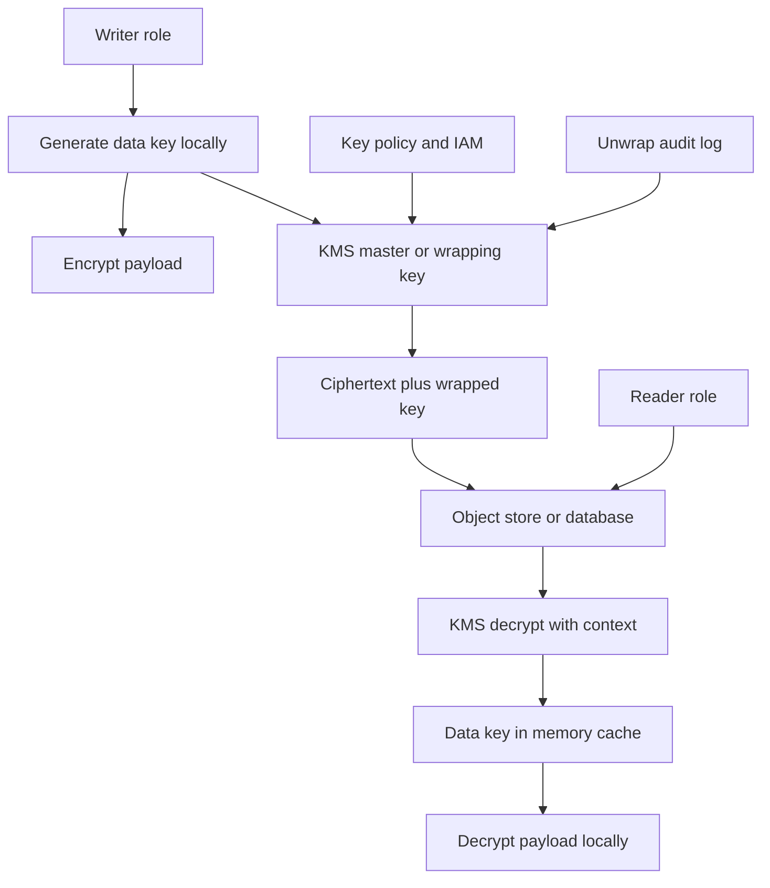

## Concept

A data key that lives beside the ciphertext, in application config, or in a secret every pod mounts is a password with extra ceremony. Key management is a hierarchy. A small set of master keys never leaves a hardened service. Wrapping keys sit under those masters. A large set of data keys encrypts the bytes. Envelope encryption is the pattern that makes the hierarchy usable at the rate of object stores and databases. Without it you either encrypt a fleet under one key you cannot rotate, or you send every block to a hardware module and watch latency die.

I design keys as blast radius. The question is who can unwrap, how fast you can stop them, and how much ciphertext you must rewrite when a key is done.

### Envelope encryption

Generate a data encryption key locally. Encrypt the payload with that key. Encrypt the data key with a key-encryption key that lives in a KMS. Store the ciphertext and the wrapped data key together. To read, ask KMS to unwrap the data key, then decrypt locally. The bulk cipher stays in the application or the storage client. KMS sees a small wrapped blob, not the object.

That split is the point. A KMS or an HSM is good at access control, audit, and holding a few keys in tamper-resistant hardware. It is a poor disk. Local authenticated encryption on a data key is fast. Wrapping is a permissioned RPC. Calling KMS to encrypt every page builds a distributed disk out of a security appliance and couples every read to a quota.

Choose data-key granularity to match the unit you will revoke. A key per customer is a common SaaS shape: legal deletion or compromise of one tenant is an unwrap deny, plus an optional rewrite, not a fleet re-encrypt. A single key for a whole bucket is simpler, and every process that unwraps it can read every object once the key is in memory. Match the grain to the tenant and to the rewrite you are willing to run.

Use an authenticated cipher for the payload and for the wrap. Put key identifiers in the envelope so rotation jobs can find ciphertext. Use the provider's wrapping format. A custom envelope is a future incident.

### The KMS hierarchy

Name the layers. A customer master key, or whatever the provider calls the root you schedule and policy, lives in KMS. Identity policy targets it: who may wrap, who may unwrap, who may administer. Under it you may keep wrapping keys per application, region, or tenant, themselves protected by the master. Data keys sit at the bottom, wrapped, stored beside the data.

The master key is the kill switch. Disable it and every envelope that depends on it stops opening, even if an attacker still holds disks and snapshots. It is also the outage switch. Treat enable, disable, and policy edits as dual-control changes. A master key per environment is mandatory. A master key per tenant blows quotas and operational sanity once tenant count grows. A wrapping key per tenant, protected by a shared production master, with encryption context that binds tenant identity, is the usual compromise.

Encryption context is additional authenticated data on the wrap. Bind tenant, purpose, and region. KMS refuses to unwrap when the context does not match. A role allowed to decrypt avatars cannot decrypt tax documents, even under the same master, if you set context and check it. Empty context throws that control away.

Region is part of the hierarchy. A master key does not silently work in another region. If you replicate ciphertext, replicate wraps: multi-region keys the vendor supports, a double wrap under two regional masters, or a re-wrap on replicate. Test failover, including the case where the failed component is KMS in the primary region.

### Rotation without rewriting the world

Rotating a master key in KMS usually means a new backing version, with old versions still able to decrypt. New wraps use the new version. That is cheap. It does not rotate data keys. Anyone who stole an unwrapped data key last quarter still has it. Anyone who stole wrapped keys and still holds decrypt on the master still has the data.

Two clocks run. The master and wrapping-key clock is versioning plus a policy that retires old versions after a grace window. The data-key clock is re-encrypt: unwrap, generate a new data key, rewrite ciphertext, write a new envelope. You cannot do that to a cold petabyte as a surprise. Do it lazily on read, or in a batch with a deadline, and track bytes still under keys older than your policy.

Re-wrap is cheaper than re-encrypt. KMS decrypts the data key and encrypts it under a new wrapping version without touching the payload. Use re-wrap when the data key is still trusted and you are moving control. Re-encrypt when the data key may have leaked, when a tenant leaves, or when a cipher is retired. Copying a plaintext key into a new secret store temporarily is how envelopes die.

### Access control on keys is the perimeter

Disk encryption with a platform-managed key protects a stolen disk. It does not protect you from the application role. If the instance can unwrap, a process on that instance can unwrap. Envelope encryption plus identity on the master key is how you separate the database role that may unwrap row keys from CI that may not. Split roles. The writer that encrypts need not decrypt. The backup job that copies envelopes need not hold decrypt. Break-glass is a separate principal, ticketed and time-bounded.

Audit every unwrap. KMS access logs are the record of who saw a data key. Alert on decrypt from unexpected principals, odd hours, or a rate that does not match application traffic. Encryption without an investigation path is storage with extra CPU.

Client-side envelopes, server-side encryption in the object store, and database transparent encryption exclude different principals when their unwrap roles differ. Three layers that all unwrap with the same instance role are one layer. Stack them when the principals differ.

## Trade-offs

| Approach | When it wins | Cost / risk |
| -------- | ------------ | ----------- |
| Provider-managed server-side encryption only | Stolen media and a simple compliance check | Any principal who can read the object can read plaintext; no per-tenant kill switch |
| Envelope with one master key per environment | Most application data, KMS only on the wrap | Coarse blast radius; an identity mistake grants the environment |
| Envelope with a per-tenant wrapping key and encryption context | Multi-tenant SaaS, legal deletion, tenant crypto boundaries | More key metadata, more unwraps, harder operations |
| KMS encrypts every payload | Tiny secrets, low QPS | Latency, quotas, and availability tied to KMS |
| Customer-held master key | Tenants who must own the kill switch | Your availability includes their policy and their disable accidents |
| Keys in application config | Not a production design | Theft of config is theft of data, with no rotation story |

Availability is the cost people undercount. KMS is on the read path of every cold miss of a data-key cache. Cache unwrapped keys in process memory, with a TTL, never on disk. Size the cache to key granularity. A per-object cache of millions of keys is a memory incident. A per-tenant wrapping key unwrapped once per process is usually fine.

Encryption-context discipline is the cost security undercounts. If every wrap uses empty context, the confused-deputy control is gone. If every service shares one policy with a wildcard decrypt, the envelope is a library, not a perimeter.

Customer-held keys win procurement. They lose when a customer disables the master during a payment incident, or when their region fails and yours cannot unwrap. Contract for that behavior. Detect unwraps failing because the customer policy changed as a different signal from your own KMS outage, and surface it as a product state.

## Diagram

The review picture is a master key in KMS, a wrapped data key in the envelope, bulk crypto in the client, and identity on the unwrap.

## Failure modes

### The data-key cache becomes a key dump

**Detection.** Core dumps, debug logs, or a heap snapshot contain raw data keys. A sidecar writes memory to disk on out-of-memory. Cache TTL is unbounded and processes live for days. An incident review cannot say which keys were resident.

**Mitigation.** Cache in process memory only, with a short TTL and a hard cap. Disable core dumps on crypto hosts, or lock pages where the OS allows it. Do not log envelopes next to keys. After a dump, rotate the data keys that may have been resident. Treat that leak as key compromise.

### A master-key change that is either an outage or a missed kill

**Detection.** Decrypt fails across services at once, or the inverse: a compromised role still unwraps after the intended disable. Key-policy history is empty because a wildcard was used. Dual control did not apply.

**Mitigation.** Separate disable, the incident kill, from delete, which is rare and scheduled. Require two-party approval for policy edits. Alert on disable and on policy changes. Test the kill switch in a non-production account. Document which data depends on which master so a single-tenant incident does not disable a shared key.

### Encryption context omitted or copied

**Detection.** A service unwraps another tenant's key in a test. Production unwraps succeed with empty context. Audit logs show decrypts with no bound tenant.

**Mitigation.** The library takes a context structure callers cannot skip. Bind tenant and purpose. Tests fail closed on mismatch. Where the provider allows it, deny decrypt that arrives without context.

### Rotation that only turns a flag

**Detection.** Master-key auto-rotation is on. Data-key age is unmeasured. A stolen data key from last year still opens yesterday's objects. Re-encrypt jobs have no owner. Envelope key versions never change.

**Mitigation.** Measure data-key age and bytes under old ciphers. Re-wrap when control moves. Re-encrypt on suspected data-key compromise and on tenant offboarding. Give the job a deadline and an owner. Auto-rotation of the master is necessary and not sufficient.

## Real-world example

AWS KMS with envelope encryption, in S3 and in application code, is the public system most fleets actually run. S3 server-side encryption with KMS wraps a per-object data key under a master key you name. On a read, S3 asks KMS to unwrap, and the grant is the intersection of bucket identity and key policy. That is envelope encryption with S3 as the client. You get an audit of unwraps, a kill switch on the master, and encryption context S3 binds to the object.

Application-side envelopes show up when a database or a queue should not see plaintext, or when a tenant master must wrap data the platform stores. Libraries such as the AWS Encryption SDK generate data keys, wrap them with KMS, and persist a message that includes key identifiers. The same key policy can require a Nitro attestation document, so unwrap works only for a measured binary. That is the companion control when the threat includes the team that runs the instance.

The design I copy is the policy split. The key policy names which roles may encrypt, which may decrypt, and which may administer. A bucket policy cannot override a KMS deny. Encryption context distinguishes objects. The decrypt trail is the investigation path. A tight key policy with a via-service condition is a perimeter. A node role with a wildcard on KMS is slower plaintext.

Customer-managed keys for SaaS tenants follow the same hierarchy. The tenant's master wraps a per-tenant key you hold envelopes for. When they disable their key, reads fail. That is the feature. Build the failure as a product state: a clear error, a runbook, and a way to tell their outage from yours.

## What to remember

- Envelope encryption keeps bulk crypto local. Data keys encrypt bytes, wrapping keys wrap data keys, and the master key is the identity kill switch.
- Bind encryption context for tenant, purpose, and region, and split roles so backup and CI cannot decrypt.
- Version the master cheaply, re-wrap when control moves, and re-encrypt data keys when a key may have leaked.
- Cache unwrapped keys in memory with a TTL, audit every decrypt, and treat KMS availability and dual control as part of the data plane.
