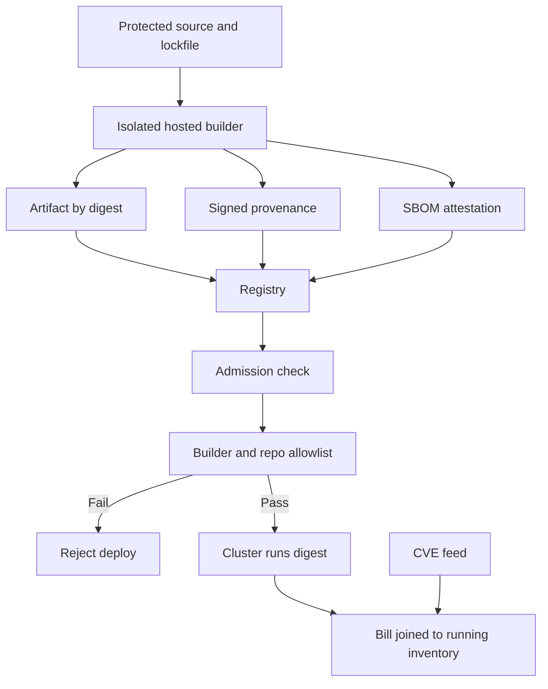

## Concept

A compromised build is more powerful than a compromised production host. The host is one environment. The build is a signing oracle for every environment that trusts the artifact. Supply chain security makes "what ran" and "how it was produced" the same kind of question as "who called this API." Two artifacts carry the answer. A software bill of materials lists what you shipped. Provenance that meets a bar such as SLSA, the Supply-chain Levels for Software Artifacts, says how it was built and by which builder.

I treat the bill of materials as data on the deploy path. If the cluster cannot name the dependencies and cannot verify provenance, it does not run the image. That rule is harsher than a scanner dashboard. It is also the rule that still works on the evening a dependency CVE lands and nobody can say whether you shipped it.

### The SBOM as an index, not a file

A bill of materials is a graph of components, versions, licenses, and hashes. SPDX and CycloneDX are the formats tools emit. The properties that matter are completeness for the ecosystems you use, a stable identity for each component, and a store the deploy system and the incident tools can query. A JSON file in a ticket is not queryable when you need to know which services include a vulnerable package.

Generate the bill from the build, not from a laptop checkout. The build sees the resolved lockfile, the container layers, and the compiler. A developer's local listing does not. Emit one bill per artifact: the binary, the image, the function package. Attach it as a signed attestation beside the artifact, indexed by digest. When production runs a digest, you look up that digest. A moving tag is not an identity.

Completeness is partial by ecosystem. A source bill from the manifest misses vendored code. An image bill from layer scanning misses packages installed at runtime. I want the lockfile bill and the image bill, and on a few fleets a runtime check that a process loaded a file the image bill did not name. Measure coverage by ecosystem. A single green check hides the gap.

The consumer that justifies the program is incident response. A new CVE has a package name and a version range. The question is which running services include it. That is a join of the bill index to deploy inventory. If the join takes a week of email, the program failed even if every repository contains a file named for the bill.

### SLSA levels as an integrity ladder

SLSA describes how much you can believe the provenance of an artifact. You climb. You do not skip to the top and print a badge.

The first level is a scripted build and provenance that names the source and the command. It stops "we do not know how this was built." A developer can still run that script on a workstation and ship the output.

The second level is hosted build history. The provenance is generated by a build service, signed by that service, and identifies the source. Tampering after the build is harder. Tampering of the build environment remains in play if the job is a wide-credential script.

The third level is where I start calling a pipeline trustworthy for production images. The build is isolated. Provenance is produced by the platform, not by the untrusted build steps, so the job cannot quietly rewrite its own pedigree. The source checkout is protected from replacement by the job. Isolated means the build cannot reach production credentials or another build's cache in a way that injects. A hardened hosted builder, configured honestly, sits here. A stored signing key in the repository secrets does not.

The fourth level adds two-party review and a hermetic, reproducible build: the same inputs yield the same outputs, often from a second independent builder. Few product teams live here. Signing keys, firmware, and a small set of root images might. A linter is not this level.

Map levels to artifact risk. A static asset is not a key-management signer. The signer wants the fourth level or an equivalent air gap. The microservice image wants the third level plus admission that rejects missing provenance. Internal dashboards can sit lower while you climb, with the gap tracked.

### Provenance, identity of the builder, and admission

Provenance is a statement: this digest was built from this commit, by this builder identity, with these parameters. in-toto attestations, and Sigstore's short-lived certificates, transparency log, and signing tools, are the public plumbing. The builder mints the statement. If the same token that writes source can also forge provenance, you have a paper trail an attacker can write.

Admission is the enforcement point. A cluster policy or a deploy check verifies the signature, the expected builder identity, an allowlisted source repository, the presence of a bill of materials, and a base image that is not denied. Tags are not identities. Digests are. Changing a tag after admission is a bypass. Pin the digest in the manifest the cluster stores.

Source protection is half of the ladder and easy to skip. Protected branches, required review, no self-approval, no force-push, and federation from the builder so long-lived cloud keys do not sit in the pipeline. A hermetic build that runs with a stolen personal access token is still that stolen token. Provenance does not replace repository identity.

### Dependencies are a graph

Most of the code you ship you did not write. Transitive dependencies are the blast radius. A bill that stops at direct dependencies is a customer-facing gap. Pin with lockfiles. Prefer content hashes over floating ranges. Vendor when the registry's availability is part of your incident plan.

Typosquatting, compromised maintainer accounts, and install scripts are the practical attacks. Deny install scripts in CI where the ecosystem allows it. Review a new direct dependency as a change with an owner. Proxy registries so production builds do not fetch the public internet at the moment of a hotfix. Watch small packages that suddenly gain a post-install step.

When a dependency is compromised, provenance tells you whether the artifact is a faithful build of your source. It does not tell you the source was wise. The bill plus deploy inventory tells you where the package landed. Rebuild from a patched lockfile, re-attest, roll the digest. The speed of that loop is the program. Measure it. A hotfix path that skips the bill is the path an attacker hopes you keep.

## Trade-offs

| Approach | When it wins | Cost / risk |
| -------- | ------------ | ----------- |
| Scanner dashboards, no admission | Early visibility, low friction | Known-bad images still run; the bill is a report |
| Bill generated at build, indexed by digest | CVE response and license questions | Incomplete graphs; you must operate the join to production |
| Provenance at the lower SLSA levels | A paper trail quickly | Forgable if laptops can mint it |
| Isolated builds and cluster admission | Production services on a shared platform | CI redesign, slower deploys, false denies when attestations are missing |
| Reproducible two-party builds | Keys, firmware, roots of trust | Cost few product binaries justify |
| Floating tags and long-lived pipeline keys | Not a production design | Tag mutation and stolen CI credentials skip the ladder |

The platform cost is builder identity. Federation from the CI system to cloud identity, short-lived signing certificates, and a builder subject that policy can name are the work. A signing key stored in repository secrets is a step backward: whoever can run the workflow can sign anything.

The developer cost is the first blocked deploy. A missing attestation should fail with a link to the pipeline. An opaque denial produces a request for a break-glass tag, and that tag stays. Break-glass for production images is ticketed, time-boxed, and itself an attested exception. Otherwise it becomes the supply chain.

Completeness versus speed is the bill's trade. Deep graphs and layer scans add minutes. Cache generation on the lockfile hash. Do not skip the bill on the hotfix path.

## Diagram

Deploy joins artifact digest to provenance, to the bill of materials, to what the cluster is running.

## Failure modes

### Provenance minted by the identity that writes source

**Detection.** Developers can sign from a laptop. The workflow uses a stored private key and can write attestations. Admission checks that a signature exists, not which identity produced it.

**Mitigation.** Only the builder signs, through federation and short-lived certificates. Admission pins issuer and subject: repository, workflow, and ref. Alert on signatures from outside the builder pool.

### A bill that does not match what runs

**Detection.** A CVE hunt misses a service because the bill came from a different commit than the image. Runtime package directories contain versions the file does not list. A tag moved after the bill was attached.

**Mitigation.** Bind the bill and the provenance to the digest in one build. Admit by digest only. Generate image bills from the final layers. Re-run the join of bills to running workloads on a schedule and on every deploy.

### Admission bypasses and hotfix tags

**Detection.** A namespace exception, a privileged deployer, or a tag that skips the policy. Unsigned images still have running replicas. The exception list has no expiry.

**Mitigation.** Default deny for unsigned digests. Time-box exceptions and log each bypass as a security event. The hotfix pipeline is the same builder and the same attestations, faster, not weaker.

### Registry and cache poisoning

**Detection.** Builds pull base images by floating tag. A package version changed under the same number because the lockfile hash was ignored. CI flags disabled verification.

**Mitigation.** Pin bases by digest. Verify lockfile hashes. The cluster pulls only from an internal registry. Promote artifacts through environments by digest. Do not rebuild to "promote."

## Real-world example

Google's SLSA work, and the provenance hosted builders can emit, turned a secure software factory from a slogan into a ladder you can score. After incidents where attackers injected at source and at build, the levels separated a scripted build from hosted, isolated provenance the platform produces and deployment checks. Internally, builds that reach production run in a defined factory. The factory emits provenance. Deployment trusts the provenance, not a tag a person pushed.

The public tooling around the same idea — Sigstore, in-toto, artifact attestations from hosted CI, and cluster admission that verifies signatures — is how the rest of us implement a slice of that factory. A shape I have shipped: a protected branch, federation into cloud identity, one builder allowed to write the production repository, provenance plus a CycloneDX bill attached to the image digest, and a policy that rejects an image whose attestation subject is not the expected repository and release workflow. CVE response is a query: this package, this version range, which digests, which workloads.

Two choices matter. The builder identity is the principal. A signature from a laptop does not count. The bill is indexed to what runs, not to what was tagged last month. A larger company can run a tighter factory than you can. You can still refuse an unattested digest. That refusal is the control.

## What to remember

- A bill of materials is a digest-indexed graph on the incident path. A file that cannot join to running services is documentation.
- SLSA is a ladder. Isolated builds with platform-minted provenance are the bar for production images. Two-party reproducible builds are for roots of trust.
- Verify attestations at admission by builder identity and digest. Tags and laptop signatures are not a supply chain.
- Pin lockfiles and base images by hash, and measure the rebuild-and-redeploy loop after a dependency CVE.
