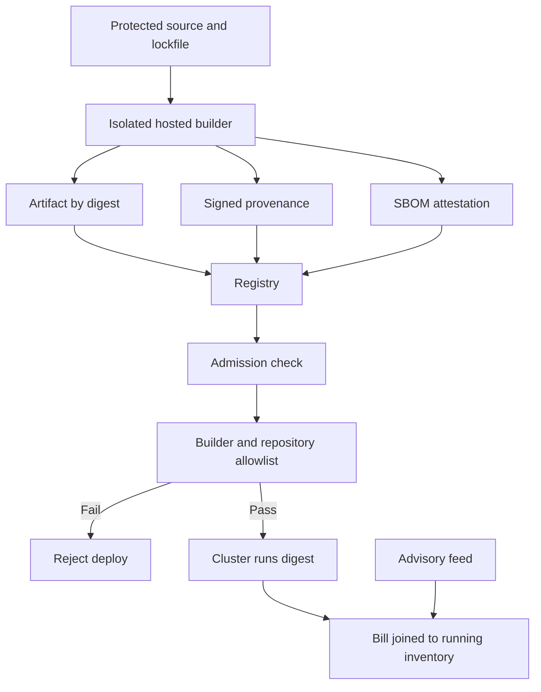

## Concept

A compromised build is a stronger position than a compromised production host. The host is one environment. The build is a signing oracle for every environment that trusts the artifact. Supply-chain security makes "what is running" and "how it was produced" the same kind of question as "who called this API." Two artifacts carry the answer. A software bill of materials lists the components you shipped. Provenance that meets a stated level of SLSA, the Supply-chain Levels for Software Artifacts, says which builder produced the artifact from which source. I put both on the deploy path. If the cluster cannot name the dependencies and cannot verify the builder, it does not run the digest.

A scanner dashboard that nobody gates on is a report. The control is admission: an unsigned or unindexed digest stays out. That rule feels harsh the first week. It is the rule that still works on the evening a dependency advisory lands and someone asks which services include the package.

### The SBOM as an index

A bill of materials is a graph of components, versions, licenses, and hashes. SPDX and CycloneDX are the formats generators emit. The properties that matter in production are completeness for the ecosystems you actually ship, a stable identity for each component, and a store the deploy system and the incident tools can query by digest. A JSON file attached to a ticket is not queryable when the question is which running services include a vulnerable version.

Generate the bill from the build, because the build sees the resolved lockfile, the container layers, and the compiler invocation. A developer's laptop listing sees a checkout that may not match what was packaged. Emit one bill per artifact — binary, image, function package — and attach it as a signed attestation next to the artifact, indexed by digest. When production runs a digest, you look up that digest. A moving tag is a pointer, and pointers are how an old bill gets paired with a new image.

Completeness is partial, and it is partial in known ways. A source bill from the manifest misses vendored trees and generated code. An image bill from layer scanning misses packages a process fetches after start. I want the lockfile bill and the image bill, and on a few sensitive fleets a runtime observation that a loaded file was absent from the image bill. Measure coverage by ecosystem — language packages, OS packages, base-image digests — because a single green check hides the gap you will be asked about. The consumer that justifies the storage cost is incident response. A new advisory has a package name and a version range. The question is which running workloads include it. That is a join of the bill index to deploy inventory. If the join takes a week of email, the program has failed even though every repository contains a file with the right extension.

### SLSA levels as a build-integrity ladder

SLSA is a ladder for how much you can believe the provenance of an artifact. The current specification organizes that claim as tracks. The Build track is the one that changes a production cluster. You climb it. A badge printed from a laptop signature is a lower rung than the document claims.

Build Level 1 means provenance exists and describes the build: source, entry point, and materials, produced by a scripted build. It ends the state "we do not know how this digest was made." It does not stop a developer, or an attacker on a developer machine, from running the script and emitting a plausible document. Mistakes and tampering are still in scope.

Build Level 2 means the provenance is generated by a hosted build service and signed so that consumers can check the signature. Tampering after the build, by someone who is not the build service, is what this level resists. The build environment itself can still be influenced if the job is a wide-open script with production credentials and a writable cache shared with other tenants.

Build Level 3 is where I start calling a pipeline fit for production images. The build platform is hardened and isolated. Provenance is produced by the platform, outside the untrusted build steps, so the job cannot quietly rewrite its own pedigree. The source checkout cannot be swapped by the job after the platform has recorded it. Isolation means the build cannot reach production secrets or another build's cache in a way that injects bytes into the output. A hardened hosted builder, configured so the tenant of the build is not the signer, sits here. A long-lived signing key stored in repository secrets does not, because whoever can edit the workflow can sign anything the workflow emits.

Hermetic, reproducible builds and two-party review of the change that produced the artifact used to be discussed as a further level in early SLSA drafts. They remain the right additional bar for signing keys, firmware, and the small set of root images everything else trusts. They are a poor default for every microservice. Map the Build level, plus those extras, to artifact risk. A static asset can sit lower while you climb, with the gap visible. A production service image wants Level 3 and an admission policy that rejects a missing attestation. A key-management signer wants the hermetic extra, or an equivalent separation, and a human review that the build job cannot satisfy by approving its own change.

### Provenance, builder identity, and admission

Provenance is a signed statement: this digest was produced from this source revision, by this builder identity, with these parameters. in-toto statements, and Sigstore's short-lived certificates bound to a workload identity plus a public transparency log, are the plumbing most new pipelines use. The builder mints the statement. If the same token that can push to the source repository can also forge provenance, you have a paper trail the attacker writes after the fact.

Admission is the enforcement point, in the cluster or in the deploy service. It verifies the signature, the expected builder identity, an allowlisted source repository and workflow, the presence of a bill of materials, and a base image that is not on a deny list. Tags are not identities. Digests are. Pin the digest in the manifest the cluster stores. A tag that moves after admission is a bypass you already accepted if policy evaluates names.

Source protection is the other half of the ladder and the half teams postpone. Protected branches, required review, a rule against self-approval, a rule against force-push, and federation so the builder receives a short-lived cloud identity instead of a stored key. A hermetic build that runs with a stolen personal access token is still that token. Provenance records a faithful build of whatever source the builder was given. It does not make the source wise.

### Dependencies are the graph you ship

Most of the code in the artifact was written by someone else's maintainers. A bill that stops at direct dependencies hides the package that actually contained the payload. Pin with lockfiles. Prefer content hashes over floating version ranges. Vendor, or proxy through a registry you control, when the public registry's availability and integrity are part of the incident plan. Production builds should not fetch the public internet at the moment of a hotfix.

Typosquatting, a compromised maintainer account, and an install script that runs on resolve are the attacks that show up in practice. Deny install scripts in CI where the ecosystem allows a flag for it. Review a new direct dependency as a change with an owner, the way you would review a new SaaS login. Watch a small package that gains a post-install step between the lockfile you reviewed and the one a bot opened.

When a dependency is compromised, provenance answers whether the artifact is a faithful build of your source at a known revision. The bill joined to running inventory answers where the package landed. The response is a patched lockfile, a new attested digest, and a rollout. Measure that loop in hours. A hotfix path that skips the bill and the admission check is the path you will use under pressure, which means it is the path to design first, at the same level, only faster.

## Trade-offs

| Approach | When it wins | Cost / risk |
| -------- | ------------ | ----------- |
| Scanner dashboards, with no admission gate | Early visibility and low friction | Known-bad images still run; the bill is a report |
| Bill generated in the build and indexed by digest | Advisory response and license questions | Incomplete graphs unless you measure coverage; you operate the join to production |
| Provenance at Build Level 1 | A description of the build, quickly | Forgable by anyone who can run the script, including a laptop |
| Isolated builds at Build Level 3 plus cluster admission | Production services on a shared platform | A CI redesign, slower first deploys, and false denies while attestations are missing |
| Hermetic, two-party reproducible builds | Keys, firmware, and roots of trust | Cost and latency few product binaries justify |
| Floating tags and long-lived keys in the pipeline | A prototype that has not met production | Tag mutation and a stolen workflow secret skip the ladder |

The platform cost is builder identity. Federation from the CI system into cloud identity, short-lived signing certificates, and a builder subject that policy can name are the work. A signing key in repository secrets moves you backward: the workflow author and the signer are the same principal.

The developer cost is the first blocked deploy. A missing attestation should fail with a link to the pipeline run and the expected subject. An opaque denial produces a ticket for a break-glass tag, and that tag remains. Break-glass for production images is ticketed, time-boxed, and itself recorded as an exception with an owner. Otherwise the exception list becomes the supply chain.

Completeness versus speed is the bill's own trade. Deep graphs and image-layer scans add minutes. Cache generation keyed by the lockfile hash and the base digest. Keep generation on the hotfix path. Skipping it there trains the organization to skip it everywhere else within a quarter.

## Diagram

Deploy joins artifact digest to signed provenance, to the bill of materials, and to the set of workloads actually running.

## Failure modes

### Provenance minted by the identity that writes source

**Detection.** A developer can sign from a laptop. The workflow holds a stored private key and can write attestations. Admission checks that a signature exists and does not check which identity produced it.

**Mitigation.** Only the hosted builder signs, through federation and short-lived certificates. Admission pins issuer and subject: repository, workflow, and ref. Alert on signatures whose subject is outside the builder pool. Rotate away any long-lived key that ever lived in repository secrets, and assume it was copied.

### A bill that describes a different artifact than the one running

**Detection.** An advisory hunt misses a service because the bill came from a different commit than the image. A runtime package directory contains versions the bill omits. A tag moved after the bill was attached to an older digest.

**Mitigation.** Bind the bill and the provenance to the digest in the same build. Admit by digest only. Generate the image bill from the final layers, after the last package install. Re-run the join of bills to running workloads on a schedule and on every deploy, and page when a running digest has no bill.

### Admission bypasses that outlive the incident

**Detection.** A namespace annotation, a privileged deployer, or a tag prefix skips policy. Unsigned digests still have running replicas. The exception list has no expiry field, or the expiry is a year away.

**Mitigation.** Default deny for digests without a valid attestation. Time-box every exception and log each bypass as a security event with an owner. The hotfix pipeline is the same builder and the same attestations, with more capacity, not a weaker policy.

### Registry and cache poisoning

**Detection.** Builds pull base images by floating tag. A package version changed bytes under the same version number because the lockfile hash was ignored. A CI flag disabled signature verification "temporarily."

**Mitigation.** Pin bases by digest. Verify lockfile integrity hashes. The cluster pulls only from an internal registry that stores promoted digests. Promote across environments by copying the digest and its attestations. Rebuilding in the next environment to "promote" creates a second artifact and a second opportunity to inject.

## Real-world example

The SLSA specification, written up from Google's internal experience of build integrity after source and build compromises, turned "secure software factory" into a ladder a second team can score. The useful internal pattern is a defined factory for artifacts that reach production. The factory records provenance the platform produces. Deployment trusts that provenance and the builder identity, rather than a tag a person pushed to a registry. Early public descriptions used a four-step intuition — scripted, hosted, isolated, then hermetic with review. The maintained Build track compresses the integrity claim into levels a policy engine can check, and leaves hermetic reproduction and two-party review as additional controls for the artifacts that justify them.

The public tooling around the same idea is how the rest of us implement a slice of that factory. Sigstore issues short-lived certificates to a builder identity and records them in a transparency log. in-toto carries the statement of materials and builder. Hosted CI can emit those attestations. A cluster admission controller verifies them. A shape I have shipped: protected branches, federation into cloud identity, one builder allowed to push the production registry, a provenance statement plus a CycloneDX bill attached to the image digest, and a policy that rejects an image whose attestation subject is not the expected repository and release workflow. Advisory response is a query over the index: this package, this version range, these digests, these workloads.

Two choices carry the design. The builder identity is the principal, so a signature from a laptop does not count even when the bytes happen to match. The bill is indexed to what runs, not to what a tag pointed at last month. A larger company can run a tighter factory than a smaller one. Both can refuse an unattested digest. That refusal is the control, and everything else is how you make the refusal survivable for the people who ship.

## What to remember

- A bill of materials is a digest-indexed graph on the incident path. A file that cannot join to running services is documentation.
- SLSA Build levels climb from "provenance exists" to "a hosted builder signed it" to "the platform, not the job, produced a non-falsifiable statement." Hermetic two-party builds are an extra bar for roots of trust.
- Verify attestations at admission by builder identity and digest. Tags and laptop signatures are outside that control.
- Pin lockfiles and base images by hash, keep the hotfix path on the same builder, and measure hours from advisory to redeployed digest.
