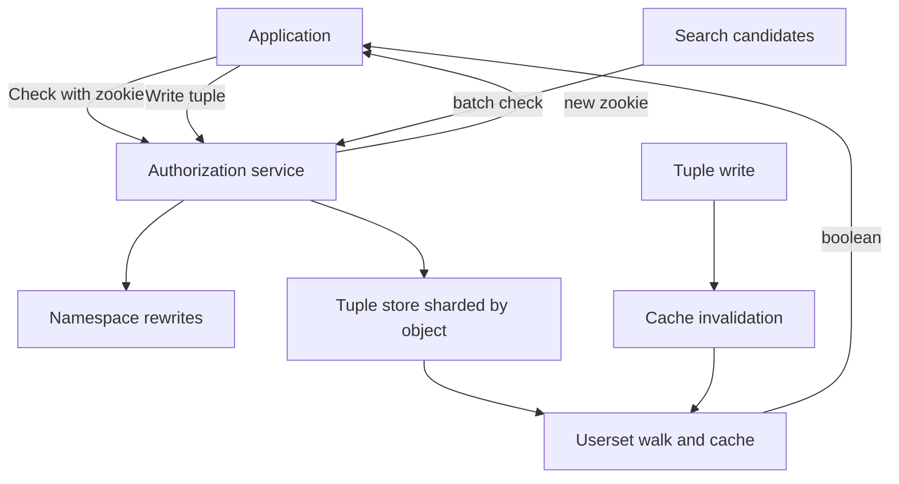

## Concept

Role checks answer whether a principal sits in a role an endpoint allows. Relationship-based access control answers whether this principal has this relation on this object. Permissions are walks on a graph of users and objects, not a column on a user row. Google Zanzibar is the public design that made that graph work at the scale of Drive, YouTube, and Calendar: a tuple store, a configuration language for computed relations, and a client token — the zookie — so a read does not see a grant you already revoked.

Once two products share groups, inherit from folders, and check permission on a search path, a JSON array of user ids on a document row becomes a distributed-systems problem with worse tools. Put tuples in a purpose-built service. Keep application databases as the source of objects, not as the source of truth for who may see them.

### Tuples are the data model

A Zanzibar tuple is object, relation, and user. The object is a type and an identifier, such as a document. The relation is a name from the namespace config: viewer, editor, owner, parent. The user is a user id, or a userset: another object plus a relation, meaning whoever has that relation on that object. A tuple that names a group’s members as viewers of a document does not copy those members onto the document. A tuple that names a folder as parent does not copy the folder’s access list. Config says that viewers of the folder are viewers of documents whose parent is that folder.

Writes are tuple changes, and writes are authorized. Otherwise anyone who can insert an owner tuple owns the object. The authorization service checks that the caller holds a relation the namespace allows to grant the target relation. That check is why one system should own the graph. A pile of SQL updates in each product will drift.

Shard tuples by object id. A check that starts at an object stays on one shard until it walks to a userset, which is another object. Hot objects — a company-wide group, a root folder — need cache, fanout control, or a relation that does not rewrite a million document tuples when membership changes. Usersets exist so you write one membership and a million checks walk to it.

Materialize every viewer of every document only after you have measured the walk. Materialization speeds checks and punishes writes. Walks speed writes and punish check latency when the graph is deep. Most products need both: walk for groups and folders, materialize an access filter for the search index.

### Usersets and computed relations

The namespace config is the schema of the graph. For each relation you declare rewrites: union, intersection, exclusion, or a walk from this object’s parent to that object’s viewer. This is where relationship-based access earns its keep. "Editor implies viewer" is a rewrite, not a second tuple on every write. "Member of a team that can view a folder that parents this document" is a walk the check engine performs.

Keep configs small and reviewed. A rewrite that unions viewer with owner of a sibling type is a leak the application tests will not see, because the application never evaluated the bug. Version configs. Canary a namespace change. Diff who would newly be allowed on a sample of objects before the change is global.

Cycles happen. A group contains a group that contains the first. The engine needs a visited set and a depth limit. Make that limit a product decision, such as a maximum sharing depth, rather than an accidental stack overflow. Exclusion, viewers minus banned, implements a denylist without deleting the underlying grant. Design the check so a missing denylist shard fails closed if that is the policy you want.

### Zookies and what the client must carry

A check reads a distributed graph. If Alice revokes Bob and Bob’s next request hits a replica that has not seen the revoke, Bob still reads the document. Users notice. So do lawyers. Zanzibar’s answer is a zookie: an opaque token the client sends with later checks. After a write, the client receives a token that means "at least this snapshot." A check that carries the token will not answer from an earlier snapshot.

This is application-level causality. The share dialog that performed the write must pass the token to the next request that should observe the grant, through a header, a cookie, or a short-lived session store. A search index that checks access with no token may show a document the user just lost, or hide one they just gained. Search is often allowed to lag. Opening the document is not. Split the consistency class per call.

A linearizable check on every thumbnail will miss a global latency budget. Evaluate most checks at a snapshot with bounded staleness, and honor a zookie when the client asks. Default to fast. Opt in to "see my own write." Document which actions require the token. Watch the rate of checks that arrive without one. If a backend drops the token because it is awkward to thread through, you paid for a consistency mechanism you do not have.

### Serving checks

The hot path is a boolean check of object, relation, and user, at high rate, with a tail of a few milliseconds. That implies cached subtree results, batched checks from list endpoints, and a plan for fanout. Listing every object a user can see is a harder API. Often the application already has candidate ids from search or a directory, and authorization filters the set with a batch check. Prefer that shape until you have measured a true list.

Leases and invalidation are the heart of the cache. A write to a group’s membership must invalidate answers that depended on that userset. A miss leaves a stale allow. Over-invalidation creates a stampede. Zanzibar combined cache, reverse indexes, and consistency tokens. A smaller deployment still needs an explicit invalidation story.

Put the check on the data path. A failed authorization service is a failed read, aside from a documented cache of recent answers whose TTL is shorter than your revoke objective. Treating a timeout as allow turns the store into a pastebin.

## Trade-offs

| Approach | When it wins | Cost / risk |
| -------- | ------------ | ----------- |
| Roles on the endpoint | Coarse internal tools, few resources | Cannot express "this user may see this document"; roles multiply |
| Access lists on the object row | Simple sharing, one product, one database | Groups, folders, and cross-product sharing become write fanout |
| Relationship tuples in a Zanzibar-style store | Sharing graphs, nested groups, many object types | A serving stack, a config language, and hot groups |
| Policy-as-code on request attributes | Region, time, network, and request fields | A poor store for "who shared this file with whom" at large scale |
| Tuples for sharing, policy-as-code for context | Consumer products plus compliance constraints | Two systems that must not disagree |

Modeling is the cost that surprises product teams. Getting parent, owner, and viewer rewrites right takes design time. Getting them wrong is a silent leak or a queue of people who cannot open their own folder. Settle a handful of object types before you ingest a large tuple set.

Hot usersets surprise platform teams. A company group used as viewer on every document is a celebrity key. Watch check fanout and invalidation on those objects. An "organization public" relation that does not walk a million-member group on every check is often the better model. Load-test membership churn.

Policy engines and relationship stores solve different problems. A policy engine is a strong fit for "this service account may call this method in this region during an on-call window." It is a clumsy access-list store. A tuple store is a clumsy evaluator of request context. Use both when you have both problems. Do not encode group nesting for a large object set inside a general policy language.

## Diagram

The check is a walk. The zookie pins a snapshot. The namespace config is the schema.

## Failure modes

### Stale allow after revoke

**Detection.** A user still opens a document after removal. Checks on that path sent no zookie. Cache hit rate is high and invalidation lag matches the incident window. Search still lists the document.

**Mitigation.** Thread the zookie from the write that changed sharing into the next user-visible read. Invalidate caches on the userset that changed, not only on the leaf. Treat open as a strong check. Let search lag inside a bound, and filter again on open.

### A config rewrite that widens access

**Detection.** A namespace change ships and reviews show new viewers on objects nobody shared. Application tests still pass. Check volume on a relation spikes.

**Mitigation.** Version configs. Diff allow-sets on a sample. Canary the namespace. Require review from the team that owns the object type. Treat config as production code with the blast radius of a leak.

### A hot group or root folder

**Detection.** Check latency tracks a single object id. A membership change on that group causes a cache storm. One shard sits at CPU limit.

**Mitigation.** Cache the computed members of huge groups on a dedicated invalidation path. Avoid walking a million-member group for every document. Replica the celebrity object. Load-test churn.

### A new path that fails open

**Detection.** A list endpoint returns objects without a batch check. An export job uses an account that skips the authorization service. Timeouts are handled as allow.

**Mitigation.** Default deny on authorization errors. Libraries that require a check on load. An inventory of export jobs. Tests that new endpoints include the filter. No exemption for an "internal" network.

## Real-world example

Google Zanzibar is the public system behind authorization for products that share the way people actually share: files in folders, calendars with groups, photos with circles, videos with roles that are not Unix modes. The design stores relation tuples, computes relations from configuration, answers checks with a short tail, and issues zookies so a client can demand a snapshot at least as new as a recent write. Products write tuples and call check. They do not each invent an access-list column.

The modeling choices are what I still copy. Usersets let a group membership change flow to every object that referenced the group, without rewriting those objects. Folder inheritance is a parent relation plus a rewrite, not a stored copy of every ancestor’s list on every file. Consistency is a protocol the client joins: drop the zookie and you opted into bounded staleness. Scale is a serving problem — caches, sharding by object, care for hot groups — not a reason to collapse the model into a boolean on the row.

A smaller relationship store does not need every Zanzibar subsystem. It needs the tuple, the userset rewrite, and the consistency token. OpenFGA, SpiceDB, and similar systems implement that core. The application still threads the token, still batch-checks search hits, and still fails closed. The lesson is not a particular database. Authorization is a graph with a snapshot, and the graph deserves a service.

## What to remember

- Store object, relation, and user. Permission is a walk. Usersets make group and folder inheritance one edge, not a million copies.
- Namespace config is the schema. Review it as production code, because a rewrite bug is a leak the application never sees.
- Zookies pin a check to a snapshot at least as new as a write. If clients drop them, revokes lag on the paths people notice.
- Serve checks on the data path, fail closed, batch-filter search candidates, and treat hot groups as capacity.
