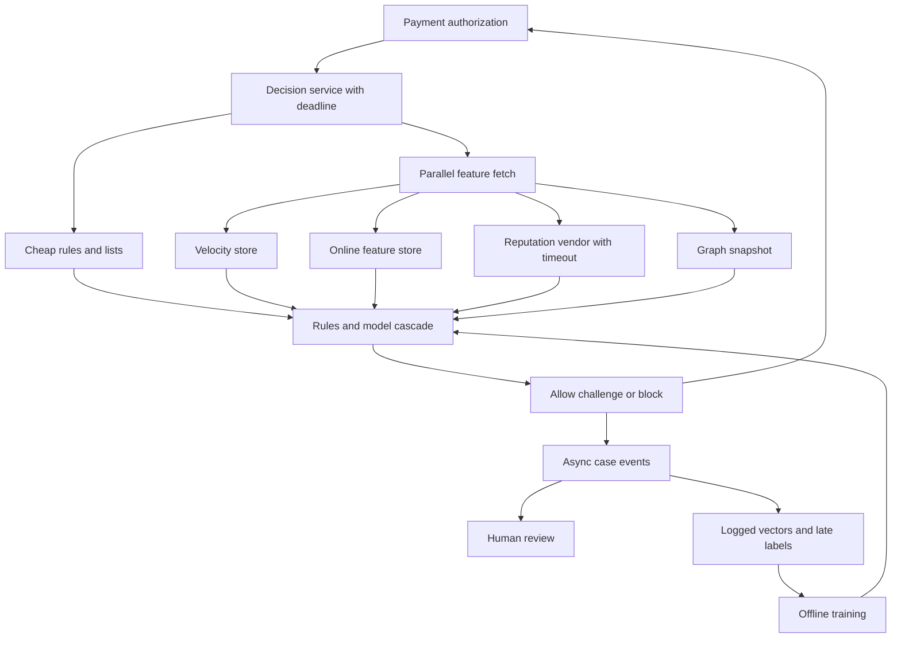

## Concept

Fraud detection is a decision under a latency budget. On a payment authorization you have tens to a few hundred milliseconds to allow, step up, or block. The attacker has hours to iterate. The architecture is a path: collect features, score, apply policy, act, then learn from outcomes that arrive late — chargebacks, disputes, confirmed good — without letting that loop poison you. A notebook does not belong on the authorization RPC. Budget each hop, name the features that may be stale, and treat fail-open versus fail-closed as a loss function you chose in advance.

The product constraint is asymmetric. A false block is a lost sale and a support ticket. A false allow is stolen funds, a chargeback fee, and sometimes a network penalty. Thresholds are business knobs. Risk must move them without a deploy. Engineering must change feature computation without a silent skew between training and serving.

### The fraud decision path

An authorization arrives at an edge: payment API, checkout, or a card-network interface. Before you talk to the issuer, or in parallel when the product allows, a decision service runs.

Hygiene comes first. Is this a replay, a malformed token, a device fingerprint already on a deny list? Cheap rules and local data, measured in microseconds to a few milliseconds.

Feature assembly is where the budget goes. Device and network reputation, account age, velocity of attempts per card, email, and shipping address, graph features such as how many accounts share a device, amount, merchant category, and historical labels. Some live in memory. Some come from a feature store. Some need a graph hop.

Scoring is a ruleset, a gradient-boosted model, a small network, or a cascade. A cascade runs a cheap model first and an expensive one only in a gray band. Most traffic is obviously good or obviously bad. Paying for a slow model on every small, obviously good charge misses the deadline, and the retry then skips fraud.

Policy maps score plus hard rules to allow, a challenge such as 3-D Secure or a one-time password, manual review, or decline. Policy is not the model. The model does not know that this merchant cannot challenge, or that this corridor requires a step-up. Keep policy as data with a version.

Action returns the decision to the authorization flow, emits an event for case management, and updates velocity counters. The authorization does not wait for the case write. A block still needs an idempotent record so a retry does not become an allow because a counter failed.

Labels arrive late: chargebacks in days to months, user disputes, operations confirmations. Training joins those labels to the features as they were at decision time. Recomputing features from current state trains on the future.

### Feature latency

Split features by freshness and source. Point-in-time attributes such as account creation and verification level can sit on the account record. Velocity counters belong in a memory store with windows that match the rules: a minute, an hour, a day. Graph features are expensive. Precompute them or maintain them incrementally, and accept that they are seconds to minutes old. Third-party reputation is an RPC with a timeout, a cache, and a default when the vendor is down.

A store that cannot serve online, or that serves a different aggregation than the offline job, produces a strong notebook metric and a useless production score. Train-serve skew is the default failure. One definition should produce the online value and the training value. Log the vector you actually used, keyed by decision id and time. When the warehouse and the log disagree, train from the log.

Set a deadline for the whole decision, then back-allocate: hygiene, parallel feature fetch, model, policy. A slice that misses its budget is dropped or replaced with a default, and the score carries a missing-features flag that policy can treat as risk. Omitting velocity because a cache was slow, and saying nothing, is how a coordinated attack rides your incident.

Fetch in parallel. Do not chain account, then device, then graph. The graph hop is the one I skip first under budget. Vendor calls get a tight timeout. A vendor’s tail must not become the authorization tail.

### Rules, models, and review

Rules catch the obvious and the new. Models catch the statistical. Humans catch the strange and label the next model. Rules alone are brittle and get gamed once they leak. A model alone is opaque and slow to encode a typology operations saw this morning. Run hard blocks first — stolen-instrument lists, prohibited categories — then a model, then rules that interpret the score, such as a challenge above a threshold unless the merchant is exempt.

Rules live in a config service with versions, simulation on historical traffic, and a shadow mode that logs the decision without enforcing it. A rule that matches a large share of good traffic is an incident that looks like an outage. Simulate before you enforce.

Human review is a queue with a capacity, not a hope. If you send a few percent of volume to review and review can handle a fraction of that, you built a delay fraudsters will notice. Cap the queue. Define overflow as challenge or decline. Feed reviewer labels back on the same decision id. Reviewer drift is real; sample and audit it.

Adversaries test small amounts, rotate devices, and farm genuine-looking accounts. Features that are public, such as amount and country, are easy to game. Features that are costly to fake, such as a long-lived device reputation or isolation in the graph, last longer. Expect decay. Retrain on a cadence. Watch score distributions for shifts that are not seasonality.

### Labels, poisoning, and the outage policy

The learning loop can be attacked. A flood of small transactions from mule accounts poisons velocity, and it poisons labels if you treat "not yet charged back" as good. Delayed labels overfit last month’s attack. Use time-based splits. Down-weight unlabeled traffic. Do not auto-label an allow as good after a day on a high-risk rail.

Failing closed — decline when the decision service is down — protects loss and destroys conversion. Failing open protects conversion and is what an attacker will try to induce by loading your feature store. The workable answer is a degraded policy written in advance: cached outcomes for known-good repeat customers, conservative rules, a tighter amount cap, and an alert that you are degraded. Practice it. A catch that returns allow is a vulnerability.

## Trade-offs

| Approach | When it wins | Cost / risk |
| -------- | ------------ | ----------- |
| Rules only | New products, sparse labels, a need to explain every decline | Brittle, expensive to maintain, easy to game once known |
| An online model on every authorization | Stable, high-volume rails with labels | Latency, skew, opacity, slow reaction to a new typology |
| Cascade of rules, a cheap model, then an expensive model | Mixed obvious and gray traffic | More stages to monitor |
| Always challenge | High-risk corridors and some regulatory paths | Conversion loss; unavailable on some rails |
| Fail open when the detector is down | Low ticket amounts where conversion dominates | Attackers will cause the outage |
| Fail closed or a degraded cap | High ticket, card-not-present, regulated flows | Looks like an outage; needs a practiced mode |

Feature freshness versus completeness is the engineering trade. A precise graph feature that is fifteen minutes old misses a botnet that formed in three. A real-time graph that adds most of the deadline gets skipped under load. Keep a few velocities non-negotiable. Let richer features be best-effort, with an explicit missing flag.

Label delay is the risk trade. Chargebacks teach slowly. Faster labels — issuer declines, challenge failures, user reports — are biased. Use them with that bias written down. Vendor features concentrate risk. If most of the score is a third-party device id, their outage is your degraded mode. Keep a first-party velocity core that still runs.

## Diagram

The authorization call sees a deadline. Learning stays off that call.

## Failure modes

### Train-serve skew

**Detection.** Offline metrics look strong and production loss rises. Feature histograms at serve time do not match training. A warehouse job rebuilds features for old decisions from current velocity.

**Mitigation.** Log the served vector with the decision id. Train from the log. Share definitions between online and offline. Alert on distribution drift. Do not recompute time-sensitive features after the fact.

### A timeout that silently drops signal

**Detection.** Decision latency stays inside the SLO while the missing-features flag spikes. Loss rises during an infrastructure incident. Authorization retries succeed as allow because counters never updated.

**Mitigation.** Missing features are visible to policy. Degraded mode tightens caps. Velocity increments are idempotent and tied to the decision, with a documented compensation if they fail. Time vendors out inside their slice.

### A rule shipped without a replay

**Detection.** Conversion falls after a config change. Support volume of false declines rises. A rule matches a popular network or a corporate address range.

**Mitigation.** Shadow mode and replay against recent traffic. Canary a slice of merchants. Keep a kill switch for the last rule version. Deploy policy separately from the model.

### Poisoned labels and an adaptive attacker

**Detection.** Score distributions shift. Small-ticket approvals rise, then chargebacks cluster. A mule population is labeled good because chargebacks have not landed.

**Mitigation.** Respect label delay. Validate on time-based splits. Down-weight unlabeled high-risk cohorts. Watch coordinated velocity across accounts. Retrain on a schedule. Keep hard lists for confirmed-bad instruments even when the model is confident.

## Real-world example

Stripe Radar is the public payments fraud stack I use when a team plans to "just add a model." Radar sits on the card authorization path. It combines signals a processor can see — device and network, historical outcomes across many merchants, velocity, reuse of instruments — with machine learning and with rules a merchant can add. The decision is allow, block, or review, inside the authorization window. Merchant rules run with the model rather than replacing it. Disputes and early fraud warnings feed later scores.

The lessons travel. The detector lives on the payment hop, with a budget, not in a morning batch. Network-scale features, such as a card that failed at many other merchants in the last hour, beat a single-shop heuristic. A store with only its own orders will not reproduce that graph, and should not pretend to. Merchant rules exist because a model does not know that this shop ships to two countries. The product still needs an investigation view: why this payment was blocked, which rule, which score.

An in-house stack at a smaller payments company keeps that shape and drops the fantasy. A decision service on the authorization path, a velocity core you own, a model a hard rule can override, logged features for training, and a degraded policy when the expensive parts die. Cross-merchant features you do not have are not part of the design. The deadline is.

## What to remember

- Fraud is a deadline-bounded path: hygiene, parallel features, a cascade, policy, then action. Learning uses logged vectors and late labels, off the RPC.
- Feature latency is the architecture. Real-time velocities are non-negotiable, vendors time out, and a missing feature changes policy.
- Rules, models, and reviewers each have a job. Simulate rules, cap the review queue, and expect attackers to adapt.
- Degrade to a written policy with tighter caps. Train from served logs so the model sees what production saw.
