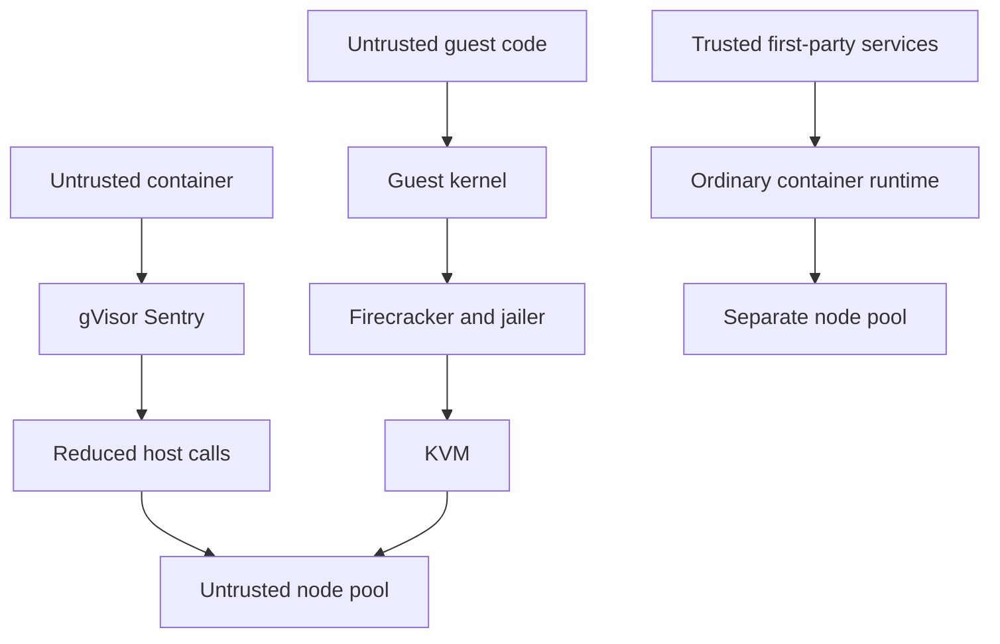

## Concept

Multi-tenant compute is a threat model with a density budget. If two customers share a kernel, a kernel exploit is a tenant escape. If they share a hypervisor, the exploit has to leave the virtual machine. If they share only a rack, you bought isolation with idle machines. gVisor and Firecracker exist because a container on a shared kernel is too weak for untrusted code, and a general-purpose virtual machine per request is too slow and too large for serverless and multi-tenant platforms. They are not aliases. They intercept different layers and exclude different attackers.

Name the tenant before you pick the sandbox. A first-party service in a namespace you control is not the same tenant as a customer’s uploaded function, a CI job that runs a Dockerfile from the internet, or a preview that executes customer code. Those last three are hostile. Treat them as hostile even when the contract says partner.

### Isolation is a boundary you can draw

Write down who is trying to do what. The usual goals are reading another tenant’s memory, stealing a cloud credential from the host, or holding a resource that starves neighbors. Controls stack: user namespaces, seccomp, cgroups, a mandatory access module, a userspace kernel, a microVM, a separate host, a confidential VM. Each layer moves the trusted computing base. None of them replace identity on the data plane. Isolation is the compute boundary. The bucket policy is still required.

Containers share a kernel. That is why they start fast and pack densely, and why a kernel vulnerability is an escape. A hypervisor shares a host and presents a device interface smaller and older than the Linux system-call table. gVisor sits between those: the workload still looks like a container, and system calls are implemented in a userspace kernel instead of the host’s full interface. Firecracker sits closer to the virtual machine: a stripped KVM guest with a tiny device model.

A scheduler does not define the hardware boundary. Kubernetes places pods. GKE Sandbox, Lambda, and Fargate’s use of Firecracker are isolation choices on top of scheduling. "We use containers" is not a threat model.

### gVisor and the system-call boundary

gVisor runs Sentry, a userspace kernel that implements Linux system calls, and a file proxy that mediates filesystem access. The sandboxed process is intercepted so those calls do not enter the host kernel’s full API. The host kernel still exists. The attack surface is Sentry plus the smaller set of host calls Sentry itself needs.

The threat model is an untrusted container on a shared kernel you do not want to expose. A bug in an obscure Linux call is no longer an automatic escape if Sentry does not implement that call, or implements it without passing it through. A bug in Sentry is an escape or a crash of the sandbox. You traded a very large C kernel for a large Go trusted base. That trade is often worth making. It is not the absence of a trusted base.

Compatibility is the tax. Not every call, ioctl, or proc shape exists. Databases that lean on proc, nested containers, and some language runtimes misbehave. You will keep a compatibility list per runtime. Performance is the other tax: extra switches, extra copies, and a network stack in userspace. Request-shaped work — HTTP functions, build steps — often fits. A high-IOPS datastore often does not.

gVisor fits when you want the Kubernetes object model and a stronger system-call boundary, without asking every tenant to boot a virtual-machine image. GKE Sandbox is that shape: some pods run under gVisor, others do not. Mix them carefully. A privileged pod beside a sandboxed pod on the same node reopens the kernel.

### Firecracker and the microVM boundary

Firecracker is a virtual machine monitor for multi-tenant serverless. It uses KVM. Each guest is a microVM with a minimal device model: virtio network, virtio block, a serial console, and little else. A jailer restricts the monitor itself with a chroot, cgroups, and seccomp, so a bug in the monitor is still boxed. With a prepared kernel and a slim root filesystem, boot is tens to a few hundred milliseconds. Memory overhead is small next to a general-purpose emulator and a BIOS.

The threat model is an untrusted guest and workload on a shared host, with the hypervisor as the boundary. The guest may have a full Linux system-call table. That does not help the tenant reach the host. The remaining surface is KVM, Firecracker’s device emulation, and the host’s hypervisor interface. That surface has been a better bet than the whole Linux call table for hostile tenants. It is still software. You patch hosts. A virtual machine is not a reason to skip patches.

Density comes from the stripped devices and from packing many microVMs on one host, with CPU oversubscription and honest memory accounting. Cold start is a product feature. A full virtual machine with a general boot path is too slow for an interactive function. A pre-warmed pool, or restore from a snapshot of a microVM, is how this class of platform hits interactive latency.

Firecracker is the wrong tool when you need a rich emulated bus, nested virtualization for customers, or a distribution that assumes a general emulator. It is the right tool when you control the guest kernel and root filesystem and you run many small, hostile, short-lived tenants.

### Density, credentials, and node pools

The design conversation is three numbers: escape risk, cold-start latency, and tenants per core. Shared-kernel containers win density and start time, and lose on escape. gVisor sits in the middle: slower than a normal container runtime on system calls, smaller host surface, and still a host kernel under Sentry. Firecracker spends some density on per-guest kernels and page tables, draws a cleaner boundary, and can still start quickly if you invest in snapshots and pools.

A production mix I trust: first-party services on ordinary containers with mutual TLS and tight roles; untrusted user code on Firecracker or gVisor; a third tier for sensitive cryptography on a dedicated host or an enclave. Do not place the untrusted interpreter on the same node class as the first-party database to save money. The polite failure is a noisy neighbor. The impolite failure is a kernel bug.

cgroups and CPU credits remain mandatory inside microVMs. Confidentiality isolation is not capacity isolation. A tenant that busy-loops should not spend the neighbor’s tail. Set the limits. Memory confidentiality also does not include the last-level cache. When that class of leak matters, you need dedicated cores or hosts.

Strip the obvious prizes from the host. Untrusted guests do not receive the instance metadata service. Credentials are injected for the one role that tenant may use, and that role cannot read other tenants’ storage. A host profile that can read every bucket makes the sandbox a speed bump.

## Trade-offs

| Approach | When it wins | Cost / risk |
| -------- | ------------ | ----------- |
| Ordinary containers on a shared kernel | First-party services and trusted images | A kernel vulnerability is a tenant escape; noisy neighbors |
| gVisor | Untrusted pods that must remain pods | System-call compatibility, performance, Sentry bugs, host kernel still present |
| Firecracker microVMs | Hostile short-lived functions and multi-tenant serverless | You own the guest kernel and root filesystem, KVM hosts, and snapshot hygiene |
| General-purpose virtual machines | Arbitrary guest operating systems and rich devices | Slow start, low density, a large device trusted base |
| Process isolation with no sandbox | Not for untrusted code | A short path to host credentials |
| A dedicated host per tenant | Highest isolation, regulated workloads | Cost that removes the product for small tenants |

gVisor hides an operational debugging cost. A call that works on Linux fails in Sentry. On-call learns to ask whether the pod landed on a sandboxed pool. Keep an unsandboxed environment that is not production, and a compatibility matrix per language runtime.

Firecracker hides an image pipeline. You are a distribution: guest kernel, root filesystem, agents, time sync, and a patch cadence. Snapshot restore is fast and is a confidentiality question. A snapshot that contains another tenant’s residual memory or environment is a bug. Snapshot only golden images. Wipe disks. Never restore a post-tenant snapshot onto another tenant.

Mixing isolation classes on one node is a false saving. If any workload on the node has host privileges, the node has those privileges. Sandboxes live on their own pools.

## Diagram

The two boundaries sit at different layers. Draw them as different cuts, not as two names for one box.

## Failure modes

### Escape through the surface you kept

**Detection.** A vulnerability in KVM, a virtio device, the intercept path, or Sentry. Workloads on the node reach the metadata service. A tenant process reads another control group’s files.

**Mitigation.** Patch hosts on a short cadence. Block instance metadata from tenants and inject credentials explicitly. Untrusted pools do not carry cluster-admin host credentials. Assume escape is possible and limit the blast: no long-lived keys on the host, and instance roles that cannot read other tenants’ data.

### Unsandboxing to chase performance

**Detection.** A team sets the runtime back to an ordinary container to make a database work. Pools meant for sandboxes fill with privileged pods. Tail latency jumps and someone disables seccomp.

**Mitigation.** The sandboxed runtime is the default for untrusted work. Privileged mode and host networking are forbidden on those pools. Performance work happens inside the sandbox, or the workload moves to another isolation class with review. A silent annotation is a security change.

### Snapshot and pool contamination

**Detection.** MicroVM snapshots are reused across tenants. A volume keeps residual disk. A warm pool serves one tenant with another’s environment variables.

**Mitigation.** Snapshot only golden images, never a state after a tenant ran. Wipe disks. If any state remains, pools are not shared. Test restore with a canary secret that must not appear for the next tenant.

### A noisy neighbor the sandbox does not stop

**Detection.** CPU steal, cache contention, or disk bandwidth from one microVM ruins another. Alerts look like application latency. Limits are missing or set to the whole host.

**Mitigation.** Hard CPU and I/O caps, and placement that spreads heavy tenants. Isolation of memory contents does not include shared caches. That threat needs dedicated cores or hosts.

## Real-world example

AWS Lambda’s move onto Firecracker is the public system that showed microVMs could be the multi-tenant unit for untrusted functions. Lambda had to run customer code with strong isolation, a fast start, and high density. A traditional virtual machine per invoke was too slow and too heavy. A container on a shared kernel was the wrong threat model for arbitrary uploads. Firecracker gave a KVM guest with a tiny device model, a jailer around the monitor, and boot times compatible with interactive invokes, later improved with pooling and snapshot restore. The same monitor appears in the isolation story for container tasks that should not share a kernel with neighbors.

The lessons are about the split. The guest is hostile: no metadata credentials by default, no host filesystem, a network that goes only where the product allows. The monitor is treated as hostile to the host: jailer, seccomp, and cgroups, so a monitor bug is not automatically root. The platform owns the guest kernel and patches it. Customers do not bring a random kernel. Density is a first-class objective beside isolation. If isolation makes cold start unusable, product teams will demand a weaker runtime, and they will get it unless the platform holds the line.

gVisor in GKE Sandbox is the sibling example when the unit must remain a pod. The idea is the same and the layer is different: intercept system calls, keep the Kubernetes API. I use Firecracker when I control the image and the threat is an untrusted program. I use gVisor when the threat is an untrusted container that must still be a pod. I use neither as a substitute for keeping every tenant’s cloud keys off the host.

## What to remember

- Name the tenant and the boundary: shared kernel, userspace kernel, microVM, or dedicated host.
- gVisor intercepts system calls so untrusted pods do not speak the full host kernel, at a compatibility and performance cost.
- Firecracker shrinks KVM guests for hostile, short-lived tenants. You own the guest kernel, the jailer, and snapshot hygiene.
- Keep untrusted pools off privileged nodes, strip metadata credentials, and treat removing the sandbox to fix latency as a security change.
