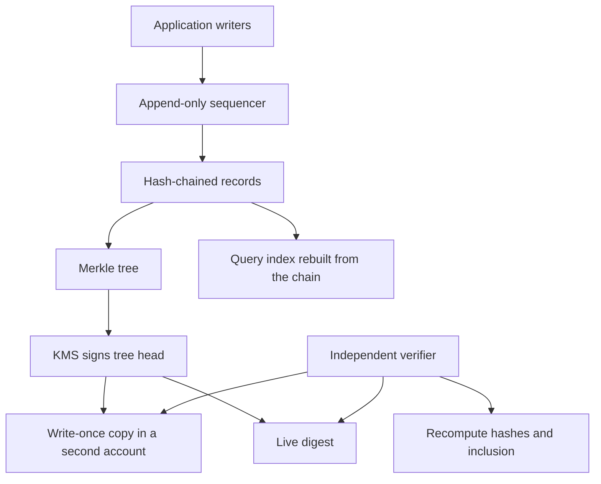

## Concept

An audit log a privileged operator can update is a diary. An immutable ledger is the set of choices that make "this event happened, in this order, and nobody quietly rewrote it" a property you can show to someone who does not trust your admin role. Hash chains, Merkle trees, write-once storage, and a signing key the application cannot use for arbitrary rewrites are the mechanics. A public blockchain slide is not. Business records do not need a public chain to be tamper-evident. They need a narrow append path, hashes that link, and a verifier a party without delete rights can run.

Audit and ledger are related and distinct. Audit is who did what to which system. A ledger is which business facts are now true: balances, transfers, grants. Both want tamper evidence. Ledgers often want stronger ordering and application invariants, such as no double spend. A log topic can be the transport. It is not the proof.

### Hash-chained audit

A hash chain is the minimum design that is interesting. Each record stores a payload, a time, a writer identity, and a hash of the previous hash together with the canonical payload and metadata. The first record uses a genesis value you publish. Anyone with the sequence can recompute and see a break. Changing an amount, or deleting a middle record, forces a recompute of every later hash. If those later hashes have been published outside the writer’s reach, the change is evident.

This is tamper evidence, not a physical lock. An operator who controls the chain, every replica, and every published checkpoint can rewrite history and recompute. The defenses are append-only storage the application operator cannot update, periodic roots stored where that operator is not the sole controller, and a signing key for the head that lives in a KMS the application role cannot use to sign an arbitrary rewrite.

A component that serializes writes per chain assigns sequence numbers and hashes. A single-partition log, a managed journal, or a table whose engine rejects updates is the usual sequencer. Hashing on two producers and hoping they did not fork will fork. Two records with the same previous hash are an incident, not a merge.

Store the bytes the application emitted, under a canonicalization rule you freeze. Reordering object keys and re-hashing will break verification. Hash the canonical bytes. Do not pretty-print and hash again.

### Merkle inclusion and published roots

A chain proves a linear history if you have the history. A Merkle tree proves inclusion without shipping every record. Leaves are record hashes. Interior nodes hash their children. The root is a small value you can publish every minute, every batch, or every N records. A verifier with the root and a sibling path checks that a record was in the tree. Certificate Transparency is this pattern at internet scale: logs, signed tree heads, and monitors that watch for roots that disagree.

Use Merkle roots when an external party must verify one event — this admin action was in the day’s log — without receiving the day’s events. Store leaves. Build the tree in batches. Sign the root with a key that is not the application writer. Publish the signed root to object storage with a retention lock, to a second account, or to a transparency log.

Consistency across time is the subtle property. A later signed root must include the earlier tree. Inconsistent roots mean a split or a rewrite. Detecting that requires someone who fetches roots from two places. If both places are the same account, you have one story, not a proof.

### Write-once storage and the signing key

Write-once object storage, such as a compliance retention lock that even the root account cannot delete during the window, is a legal and operational control. Combine it with the chain. Dump signed batches and the Merkle root to a locked prefix. The live database can remain the query path. The locked prefix is the evidence path. If they diverge, believe the locked prefix and open an incident on the database.

Retention is not eternity. Set it to what the regulator or the contract requires, and test that year-six code can still verify a chain from year one. Frozen formats beat clever ones.

The key that signs tree heads lives in KMS or an HSM. Dual control covers any use except the automated signer. That role can sign a root the sequencer produced. It cannot sign a hash a person pasted into a console. Rotate with versioned keys and keep the old verify keys. A ceremony that exists only in a wiki will be skipped.

A database trigger that rejects updates is necessary and insufficient. A restored backup, a migration tool, and a superuser can bypass it. Assume they will. The out-of-band root is the control that still speaks.

### Query, redaction, and time

People will query the audit by user, object, and day. An append-only hash chain is a poor query store. Split the products. The chain is the system of record for integrity. A search index or a warehouse table is derived. Rebuild the index from the chain. If a support tool edits the index, it has corrupted a cache. Make that sentence true in the code, and mark the index as derived in the product so a legal response does not cite it.

Redaction will arrive: a privacy request, a secret pasted into a log. Deleting the row breaks the chain. A defined process replaces the payload with a tombstone that still hashes, records the reason and the authorized actor, and leaves the links intact. Turning verification off to close a ticket is not a redaction process.

The clock is part of integrity. A trusted time source can stamp the record you hash. Logical sequence is the order you can defend. Wall-clock order is a hint. Two regions appending to one logical ledger need a sequencer, or a consensus log, not two clocks. A failover fences the old writer so it cannot append after it has lost the right.

## Trade-offs

| Approach | When it wins | Cost / risk |
| -------- | ------------ | ----------- |
| A table the application refuses to update | Low-stakes product logs | Admins, migrations, and restores rewrite history; no external proof |
| A hash chain in your database | Internal tamper evidence inside one team | An operator with database access can recompute if no root is published elsewhere |
| A hash chain plus signed Merkle roots in write-once storage | Audit that must survive your own admins | Two paths to operate; the query store can drift |
| A managed journal with an exportable digest | A team that wants a vendor-backed chain | Vendor trust, query limits, and you still need a second copy of the digest |
| A public chain as the log | Rare multi-party settlement with no shared operator | Latency, cost, privacy, and a governance problem |
| A search index as the system of record | Not an integrity design | Convenient queries and no proof |

Verification is the cost teams skip. If nobody runs the verifier except in a tabletop, the hashes are decoration. Schedule a job that recomputes the chain, checks root signatures, and compares the write-once dump to the live head. Page on mismatch. That job is the control.

A managed ledger does not remove the second copy. A journal, a hash chain, and an exportable digest still have to land somewhere the application administrators cannot overwrite without leaving a trail in another account.

A public chain buys independent observers at the price of metadata leakage, fees, and finality delay. For enterprise audit I rarely want that. For settlement among companies that share no operator, it can be the right awkward tool. It is a poor way to decorate a compliance screenshot.

## Diagram

Integrity lives on the append path. Queries are a projection. Roots leave the account that runs the application.

## Failure modes

### A rewrite through backup, migration, or a superuser

**Detection.** The verifier fails after a restore. Sequence numbers gap in a way the runbook did not expect. An admin corrected a historical amount. The write-once dump and the live head disagree.

**Mitigation.** Runbooks, including restore, forbid in-place edits. Restore forward into a new chain, or replay. Dual-control the roles that can bypass triggers. Run the verifier on a schedule. Treat a mismatch as a security incident.

### A forked chain

**Detection.** Two records share a previous hash. Two regions both appended. A clock step duplicated a batch. Clients see different heads.

**Mitigation.** One sequencer per chain. Multi-region means a consensus log, or a single writer with failover that fences the old writer. The verifier detects forks. Do not merge by keeping the longer chain without an incident review.

### The query index treated as history

**Detection.** Support tools show a state the chain does not contain. A redaction ran only in the search index. A dashboard drives a legal response.

**Mitigation.** Legal and security reads come from the chain or from a rebuild whose input is the chain. Mark indexes as derived. Rebuild on a cadence and after every redaction.

### Redaction that breaks the hashes

**Detection.** A delete job removes payloads and verification starts failing. Or verification still passes because payloads are no longer covered by the hash.

**Mitigation.** Tombstone records with a reserved payload, a reason, and an authorized actor. Hashes cover the tombstone. Document the process with counsel. Do not disable the chain to satisfy a ticket.

## Real-world example

Amazon QLDB is the managed ledger I send teams to when they need hash-chained records without operating a blockchain. The journal is the system of record. Blocks contain entries and a hash that includes the previous block. You can request a digest of the journal tip and verify a document against that digest with a proof. The query view is derived from the journal. That split is the architecture: append for integrity, materialize for reads.

The design I copy, including when I do not buy the service, is that split plus an exported digest. Periodic digests go to object storage with a retention lock, in a logging account application admins do not own. Certificate Transparency is the sibling public system at another layer: Merkle trees, signed tree heads, and independent monitors, used for certificates rather than business rows. The shared idea is to publish a small root and let someone who is not you recompute.

Banks and payment firms often pair a business ledger — double entry, invariants — with an audit chain of who approved the posting. Do not make the audit chain carry balances unless the sequencer enforces those invariants. A journal will not repair a poorly modeled money movement. It will make that movement tamper-evident.

When I review an "immutable audit log" that is a table with a deleted-at column, I ask for the hash, the published root, the write-once copy, and the verifier job. Missing any one of those, the system is a log. It is not a ledger architecture.

## What to remember

- A hash chain is tamper evidence when a sequencer assigns order and a root lives where application admins cannot quietly recompute history.
- Merkle trees turn a batch into an inclusion proof. Sign tree heads in KMS and copy them to write-once storage in another account.
- Query indexes are derived. Rebuild them from the chain, and redact with tombstones that keep the hashes intact.
- Run a verifier on a schedule. A mismatch between the live head and the write-once copy is an incident.
