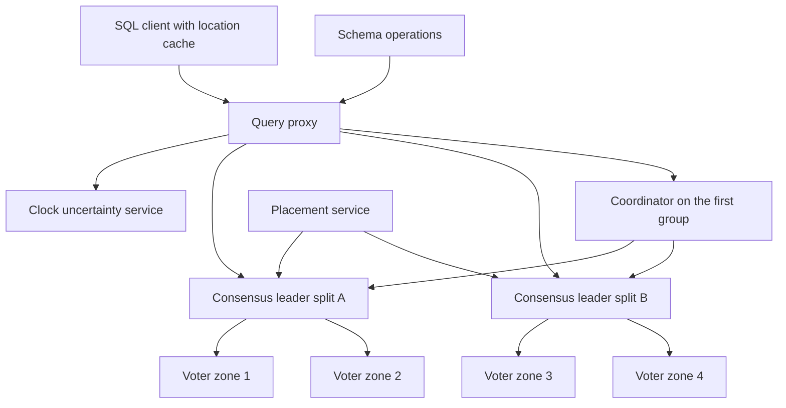

## Concept

I would build this database when the product needs SQL, multi-region read-write transactions, and a commit order that agrees with real time. The property that pays for the machinery is external consistency: if transaction T1 commits before T2 starts, every replica in every region observes T1 before T2, and the commit timestamps form a total order a downstream consumer can treat as a log. Snapshot isolation inside one cell does not give that property. A single-region primary with asynchronous replicas does not give it either. If the product can live with one writer region and a disaster-recovery replica, this design is the wrong cost.

The unit I would ship is a directory: a contiguous span of row keys owned by one consensus group. Transactions that stay inside a directory never leave that group. Two-phase commit runs only when a transaction touches more than one group. Commit timestamps come from a clock-uncertainty interval. The leader picks a timestamp and waits until that timestamp is guaranteed to be in the past everywhere the clock service is trusted. Snapshot reads that name a timestamp, or a staleness bound, go to any replica whose safe time has passed that bound. Schema changes are themselves timestamped transactions against a versioned catalog. They are a future-effective write, and they are not a cluster-wide lock.

### Requirements

Functionally the system offers relational tables, primary keys, secondary indexes, and interleaved child tables so a parent and its children share a key prefix and, while that prefix still fits, one consensus group. SQL includes multi-row read-write transactions, lock-free snapshot reads at a chosen timestamp, and strong reads that observe every commit that happened before the read begins. Administrators create an instance, create a database, apply DDL, change which zones vote, and split or merge ranges without freezing the key space. Point-in-time restore inside a declared window, and a change stream ordered by commit timestamp, are part of the product, because downstream systems will treat the database as a log.

Non-functionally, external consistency on read-write transactions is the contract. Losing a zone must not lose a committed write. Losing a region must not lose a committed write if placement put a quorum of voters outside that region. I would budget same-region consensus plus the clock wait for a local transaction, and one extra wide-area round trip plus two-phase commit when the transaction spans directories. Those are budgets, not measured service levels. The placement service stays off the read path: a tablet with a live quorum serves even if placement is degraded. If clock uncertainty grows, commit latency grows with it. Shrinking the wait to protect a latency graph is a correctness bug.

Out of scope for the first system: a last-writer-wins multi-master key-value store, stored procedures as an application platform, and any claim that ordinary NTP is a TrueTime-class service. Also out of scope is two-phase commit that reaches outside this database into a payment network or another vendor’s store. Analytical scans that need locks are out of scope; they use snapshot reads.

### Capacity sketch

These are sizing assumptions for a design review, not measurements of a running fleet. Assume about 80 TB of user data, on the order of 20 billion rows, a peak near 15 thousand read-write transactions per second and 250 thousand reads, and that roughly 80 percent of transactions stay inside one directory. Assume an average transaction reads a handful of rows and writes fewer. Assume about 36 zones across a dozen regions, three voting replicas per directory, and optional read-only replicas in zones that want local stale reads. Target a tablet in the low gigabytes so a split is a metadata move plus a bounded copy, not a multi-hour rewrite of a hot range.

That sketch implies tens of thousands of consensus groups, not millions. The control plane places, watches, and moves that many groups, and it stays off the data path. Commit wait tracks clock uncertainty. With GPS receivers, atomic clocks, and a disciplined time daemon I would plan for a few milliseconds of wait. With NTP alone I would plan for tens of milliseconds, and I would not call the result externally consistent in the Spanner sense. A hot directory — a celebrity key, or a monotonically increasing timestamp used as a primary key — will not be fixed by adding zones. The leader still serializes the log. Key design is capacity. I would also assume the change-stream consumers can fall behind for minutes without stalling commits; the stream is a subscriber, not a participant in the lock table.

### API or control-plane shape

Clients hold sessions, not a connection per statement. `CreateSession` returns a session id. `ExecuteSql` takes a session, SQL, parameters, and a transaction mode: read-write, strong read-only, or stale read-only with an exact staleness bound. `Commit` returns a commit timestamp. `Rollback` abandons the transaction. Read-only transactions pick a timestamp once, from the clock service, and then read any replica that has applied through that timestamp. They do not take locks and they do not run two-phase commit.

The admin plane is asynchronous and returns operation ids: create instance, create database with an initial DDL list, update DDL, and update replica placement as voter, witness, or read-only per zone. Tablets speak an internal protocol the client never addresses directly: read, prepare, commit, abort, split, merge, change leader. A location cache in the client maps key ranges to groups and drops entries when a tablet returns a moved error. That cache is how the placement service stays off the request path. A client that treats a moved error as a hard failure will retry against a dead leader and turn a split into an outage.

### Core data model

An instance has a placement config and a node count. A database belongs to an instance and has a schema version. A table has a primary key and an optional parent for interleaving, so a customer and that customer’s orders share a key prefix and therefore a directory when the prefix still fits in one group.

A directory is a root-key prefix plus a placement. A split is a key range inside a directory, bound to a consensus group and a leader zone. A group lists voters, witnesses, read-only members, a leader lease, and an epoch. Each replica records its log and its applied index. The leader holds a lock table: key, mode, transaction, and expiry. Deadlock handling is wound-wait: an older transaction may abort a younger one that holds a lock it needs. The younger one retries. The rule is deterministic given commit timestamps, which is why the clock service is part of concurrency control and not only part of the timestamp printed on a receipt.

A transaction record names a coordinator group, the participant groups, an optional commit timestamp, and a state of open, prepared, committed, or aborted. That record lives in the coordinator’s log. It does not live in the memory of a stateless proxy. Schema changes are rows: operation id, target version, statements, and state, effective at a future timestamp so reads at older timestamps still see the old catalog. Secondary indexes are tables with their own splits. Updating a row and an index that lives in another group is a distributed transaction. A bad primary key shows up as commit latency on one leader, and the schema review is the place to catch it.

## Trade-offs

| Approach | When it wins | Cost / risk |
| -------- | ------------ | ----------- |
| Uncertainty interval plus commit-wait | Commit order must match real time across regions | A trusted clock fleet; uncertainty spikes stall commits |
| Hybrid logical clocks | Serializability without atomic-clock hardware | Wall-clock order across regions is a weaker claim |
| Single-region primary, async replicas | One region plus disaster recovery | No multi-region writes and no global commit order |
| Consensus group per split | Failure and load stay inside a key range | Tens of thousands of groups to place and move |
| One global consensus group | A tiny dataset or a teaching cluster | Throughput and latency stop at one leader |
| Two-phase commit across groups | SQL that touches more than one directory | Coordinator failure and lock hold time |
| Deterministic ordering of declared write sets | High throughput when keys are known up front | Unfriendly to ad hoc SQL |
| Interleaved parent and child tables | Access is colocated on a parent key | A hot parent cannot be split away from its children |
| Snapshot isolation without external consistency | More concurrency and fewer aborts | Write skew, and commit timestamps are not a global order |

I would take per-split consensus and commit-wait, and I would refuse transactions that fan out across a large number of groups. A transaction that names dozens of directories is an application bug wearing a SQL statement.

## Diagram

## Failure modes

### Clock uncertainty blows out

A jammed antenna, a bad NIC clock, or a dead time daemon pushes the uncertainty interval from milliseconds into hundreds of milliseconds. Commit-wait stretches. Clients time out and retry, which piles more read-write transactions onto leaders that are already waiting. The database waits. It does not invent a tighter bound. Shed new read-write work, fail a zone whose clocks are untrusted, and alert on the uncertainty interval itself. Falling back to the local wall clock to protect latency removes external consistency while the dashboards still show commits. The page that matters is the width of the interval, not the commit-rate chart.

### Coordinator dies during two-phase commit

Participants hold prepared locks. If coordinator state lived only in a proxy, those locks leak until a human intervenes. The coordinator is the consensus group that recorded the transaction, so a new leader finishes commit or abort from the log. Participants that time out ask that group. They do not guess. There is no operation that means “forget this transaction.” A participant whose own leader moved re-reads the prepare record under the new epoch before it applies a commit. An operator tool that deletes prepared records to “clear locks” is how you lose a committed write that a client already observed.

### Split or leader move races a live transaction

A range splits, or leadership moves, while a transaction has already read the old range. The old leader must not apply a commit after its lease has expired. Leases are bounded by the same clock uncertainty that bounds commit timestamps, so a deposed leader’s writes are fenced before a new leader commits. Splits drain in-flight prepares or abort them with a retryable moved error. The client refreshes its location cache and replans. A silent success on the deposed leader is corruption, and it will show up as a row that exists on one replica and not on another after the next snapshot read.

### Deadlock and idle transactions

Two transactions lock keys in opposite orders. Wound-wait aborts the younger one. The client retries with backoff. Long-running read-write transactions are banned: idle-in-transaction holds locks the rest of the cell pays for. Analytical scans use snapshot reads at a timestamp. They do not sit on the lock table. A connection pool that leaves a transaction open between HTTP requests will look like a database outage and will be an application bug.

### A directory that cannot split

One primary key, or a parent row with a huge interleaved child set, concentrates writes on a single consensus group. Extra zones add voters. They do not add throughput, because the leader still orders the log. Hash-prefix keys where range scans are not required, refuse pathological interleaving, and give the hot key its own placement with extra read-only replicas for readers. A global sequence number as a primary key is an incident you can schedule by schema review. The symptom is one leader’s log latency while every other group is idle.

### The leader sits far from the writers

A directory serving one continent keeps its leader in another because placement ran once. Every commit pays a transoceanic round trip before the clock wait even starts. Leader preference follows the writers, and leadership moves when they diverge. A placement policy that optimizes replica count and ignores writer locality will meet its durability diagram and miss its latency budget every day.

## Real-world example

Google Spanner is the system this design copies, and Cloud Spanner is the public API shape of that idea: directories, a consensus group per split, TrueTime, commit-wait, interleaved tables, and non-blocking schema changes. CockroachDB is the honest alternative when you do not own atomic clocks: hybrid logical clocks, an uncertainty interval, serializability, and a weaker claim about wall-clock order across regions.

Copy the directory as the unit of placement, consensus per split, an explicit uncertainty interval, commit-wait, two-phase commit only across groups, interleaved tables for locality, leader leases tied to the clock, and a client-side location cache. Leave the global GPS and atomic-clock fleet out of a product that is still one region. Leave the consensus protocol off the application API. Bound multi-group transactions. If you do not have a TrueTime-class service, say so and adopt the hybrid-logical-clock model. Claiming external consistency you did not implement will show up the first time two regions disagree about which write committed first.

## What to remember

- External consistency is a commit timestamp plus a wait until clock uncertainty has passed, backed by leader leases from the same clock.
- Directories and interleaved keys are the performance model. Two-phase commit is the escape hatch for transactions that span them.
- A spike in clock uncertainty is a latency and availability incident. The wait stays honest.
- A hot parent key that cannot split will beat any number of new zones.
