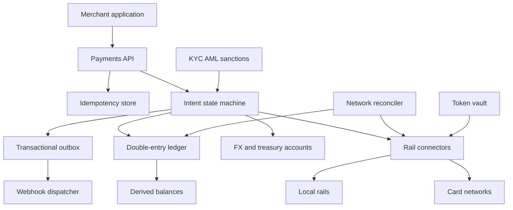

## Concept

A global payment system moves value under regulation. The customer-visible verbs are authorize, capture, refund, and payout. The system-visible verbs are narrower: post an immutable journal entry, keep every debit paired with a credit, and apply a network message once. Card networks and local rails are counterparties with their own clocks. They are not the database. Our ledger is the source of truth for what we owe, what we are owed, and what we have already attempted.

I would ship a double-entry ledger partitioned by account, a payment-intent state machine keyed by an idempotency key, and a connector per rail — cards, bank transfers, instant local schemes, wallets — that speaks that rail’s protocol. Foreign exchange and treasury post through accounts. They do not adjust a balance by mutating a float. Merchant webhooks leave through a transactional outbox. Authorization places a hold. Capture posts the transfer. Settlement with the network is a slower cycle that reconciles against the journal. Every mutating API is idempotent, and every retry uses the network key we already sent.

### Requirements

The product accepts a payment from a customer to a merchant in a supported currency and country, either authorize-then-capture or sale in one step. Refunds are full or partial and never exceed the captured amount that has not already been refunded. Payouts to merchant bank accounts run on a schedule the risk policy allows. Multi-currency uses an explicit quote snapshotted onto the journal. Payment methods are tokens. Primary account numbers stay in a vault. Strong customer authentication runs where the jurisdiction requires it. Marketplace splits are journal lines. Reconciliation reports match the ledger. A dashboard that disagrees with the journal is wrong.

Non-functionally, delivery to a rail is at least once, and the effect is once, because the idempotency key and the network key do not change on retry. An accepted intent is durable before we return success to the caller. I would budget our own authorize path in the low hundreds of milliseconds and expect the network to dominate the tail. I would not publish a latency number I have not measured on our connectors. If one card network is dark in one region, that method fails closed for new authorizations. Payouts in another country continue. The ledger is strongly consistent per account. A posting that touches several accounts is one serialized journal transaction. PCI scope stays inside the vault. KYC, AML, and sanctions screening sit on onboarding and on payout, including beneficiary changes. You can reconstruct a payment from the journal without the original HTTP body.

Out of scope: becoming a card scheme, an issuing-bank core, or an on-chain settlement network. Also out of scope is treating the merchant’s order row as the ledger. Lending, stored-value wallets that are themselves a regulated product, and real-time gross settlement membership are later companies, not features of this ledger.

### Capacity sketch

Assumptions for a first global cell design, stated so they can be attacked. On the order of eight thousand merchants, a global peak around fifteen hundred authorizations per second, a bit more than one capture per successful authorization because some auths expire and some are captured in parts, refunds in the low tens per thousand captures, about forty currencies actually live, and a few million payout rows per day. Journal growth at that peak is on the order of tens of millions of lines per day, bursty around holidays and a handful of large merchants. Card-network round trips are typically hundreds of milliseconds to a couple of seconds. Our budget is whatever remains after that. These figures are a sizing target, not a measured production peak.

Journal lines are small. Years of them fit if we partition by time and by account. The hot path is the merchant’s available-balance row and the intent row, not the bytes. Idempotency records live as long as a client or a network will retry, which is days to weeks, and then they expire only after settlement has matched the attempt. The PCI vault is tiny and high-value. I would run regional cells for latency and for data residency. A routing layer pins a payment to a cell by merchant and by the country of the payment method. Money that must cross cells moves through treasury accounts. It does not move through a chatty two-phase commit between cell databases. A merchant whose volume is a large fraction of a cell gets its own partition of the journal before it gets a special code path.

### API or control-plane shape

Public mutations all take an idempotency key. `POST /v1/payment_intents` carries amount, currency, merchant, optional customer, method, capture method, and metadata. It returns an intent id, a status, and a client secret when the client must complete authentication. Confirm, capture, and refund are separate posts. Capture and refund take their own idempotency keys and an optional amount. Payouts name a merchant, an amount, a currency, and a destination. Balance transactions are a read model over the journal for that merchant.

Connectors, internal only, expose authorize, capture, refund, and payout. Each attempt stores the network idempotency key and the network reference once the rail returns one. A timeout retry reuses that key. It does not mint a new one. If the client resubmits the same idempotency key with a different body, we return a conflict. We do not apply the second body. The conflict is a client bug, and silently accepting the second body would make the key meaningless.

Webhooks — intent succeeded, refund, payout paid, payout failed, dispute opened — are at least once, signed, and logged. Merchants must treat them as idempotent. We will still send duplicates. Admin operations cover onboarding, KYC state, rail credentials, FX spreads, reserves, and holds. None of those are “update the balance column.” A hold is a journal entry into a reserve account. Releasing it is another entry.

### Core data model

A merchant has a country, a default currency, a KYC status, a reserve policy, and a statement descriptor. Every party has accounts: available, pending, reserve, transit, and external. External accounts represent rails and banks. A journal entry has lines. The signed amounts of the lines sum to zero in each currency. Entries are inserted. They are not updated and they are not deleted. A correction is a new entry that names the entry it corrects.

A payment intent has an amount, a currency, a status, a capture method, a cell, and a unique idempotency key. Status moves through requires-action, processing, authorized, captured, or to canceled or failed. An explicit unknown state exists for attempts whose rail outcome we have not yet learned. Refunds are children, each with their own idempotency key, and they cannot sum past the captured remainder. An attempt records the rail, the network key, the network reference, the raw code, and the status. A payout records destination, status, and the rail reference. A dispute records the network case, the amount, and the journal entries that moved funds into reserve or back out. An FX quote has a pair, a rate, an expiry, and a rounding rule. The trade posts through treasury accounts at the snapshotted rate.

An idempotency record stores the key, a hash of the request, the response, and an expiry. An outbox row is written in the same database transaction as the journal post and is published after commit. Balances shown to merchants are a cache updated in that same transaction. The cache can be rebuilt from the journal. If the cache and the journal disagree, the journal wins and the cache is a bug. I would rather show a delayed balance than a balance that cannot be explained from lines.

## Trade-offs

| Approach | When it wins | Cost / risk |
| -------- | ------------ | ----------- |
| Double-entry journal as source of truth | Any real movement of money | Every feature must post; the discipline is the product |
| A single balance column | Toys and internal points | You cannot reconstruct a day or reconcile a rail |
| Authorize, then capture | Cards, authentication, delayed fulfillment | More states, auth expiry, unused holds |
| Sale in one call | Low-risk, immediate fulfillment | Voids get harder; some rails still split underneath |
| Regional cells plus treasury accounts | Latency, residency, blast radius | Cross-border bookkeeping and FX |
| One global ledger database | Tiny volume and one regulator | Residency, blast radius, write latency |
| The rail connector owns the balances | A demo | Drift you cannot explain after a timeout |
| Webhooks as the only state machine | It looks event-driven | Duplicates; you still need a ledger |
| Synchronous rail call on the request thread | A simple mental model | Rail outages become user-facing outages |
| Intent recorded, rail called by a worker | Short rail blips stay recoverable | The client must handle pending and requires-action |

I would record the intent, call the rail, then post the result as new lines. A timeout stays unknown until a query on the original network key resolves it. Unknown is a state with an owner and a query job, not a log line someone greps during an incident.

## Diagram

## Failure modes

### Double capture or double refund

The client times out and retries. The rail captured the first call. We start a second if we treat the retry as a new intent. The mitigation is one idempotency key on the intent, another on capture, another on refund, plus a stable network key on the attempt. Attempts are append-only. Settlement files are matched to the journal every cycle. A code path that creates a new intent because the first response was slow is a defect, and the defect looks like revenue until the merchant’s customer calls.

### The ledger and the rail disagree

We return accepted and crash before the connector runs, or the rail succeeds and we crash before we post. Intent states include unknown. The reconciler lists open attempts by network key and queries the rail. Money in pending is not available for payout. A second authorization creates the double charge the ledger exists to prevent. The reconciler has a deadline: an unknown that sits for days is an incident, not a queue depth we accept.

### A retry lands in a different cell

A payment is created in one region and retried in another because a load balancer failed over. Two intents, one card. Routing sticks to merchant and idempotency key. A homing record rejects a replay of the same key in a different cell. Cells do not share the hot ledger. Cross-cell money is a treasury transfer with journal entries on both sides and a shared transfer id, posted independently, then matched. It is not a distributed transaction across cell databases. If the two sides disagree, the transfer stays in transit until a human or a matching job closes it. Transit that grows without bound is the page.

### Foreign exchange that does not close

Capture in one currency, payout in another, a stale quote, and a different rounding rule on each hop. The books do not zero. Quotes expire. The posted rate and the rounding rule are stored on the lines. A nightly trial balance is zero per currency, including transit and treasury accounts. Spreads are posted as their own lines. A quote used after expiry is rejected. Rounding that lives in application code and not on the line will drift by a cent per payment and will not be a cent at the end of the month.

### Chargeback after the merchant has been paid

The network reverses a capture after payout. If available balance was treated as cleared cash, we have funded the loss. Rolling reserves, delayed availability, a dispute state machine, and clawback entries exist for this. Paying out on authorization, before capture and before the scheme’s dispute window, is how you discover that an authorization is not settled funds. The journal makes the timing visible. A balance column does not. A merchant with a thin reserve and a spike of disputes will go negative in available, and payouts stop until the reserve covers the open cases.

### Sanctions and card data leaving the vault

A primary account number lands in an application log, or a payout goes to a beneficiary whose screening is still pending. Tokens are the only identifier outside the cardholder-data environment. Logs are redacted at the vault boundary. Payouts are blocked while KYC or sanctions state is not approved, and screening runs again when the beneficiary changes. This is a structural constraint. An audit finding later means the boundary was already wrong. A debug flag that logs the raw connector payload in production is the incident, even if the flag was meant to last an hour.

## Real-world example

Visa and Mastercard are the networks: authorization, clearing, settlement, chargebacks, and message formats that run on different clocks. Stripe is the platform shape most product teams will actually copy: PaymentIntents, idempotency keys, attempts against a rail, marketplace splits, webhooks, and balance transactions as the merchant-visible projection of a ledger. Adyen sits in the same product space with a different rail footprint.

Copy intents as the object the merchant holds, attempts as the object the rail holds, idempotency keys on every mutation, balance transactions derived from a journal, webhooks as a projection, and a vault so card numbers never enter the application tier. Copy from the networks the fact that authorize, clear, and settle are different cycles. Leave a global acquiring license, card issuing, and lending out of a first version. An authorization is not cash. You are a ledger and a set of connectors. A service that stores a status string on an order row and calls a processor with no journal of its own will not survive the first timeout.

## What to remember

- The journal is the product. Rails are counterparties that run on their own clocks.
- Idempotency keys stay stable on our API and on the network. A timeout creates an unknown attempt.
- Authorize, capture, settle, payout, and dispute are separate machines posting into one ledger.
- Regional cells plus treasury accounts are how residency and blast radius stay bounded.
