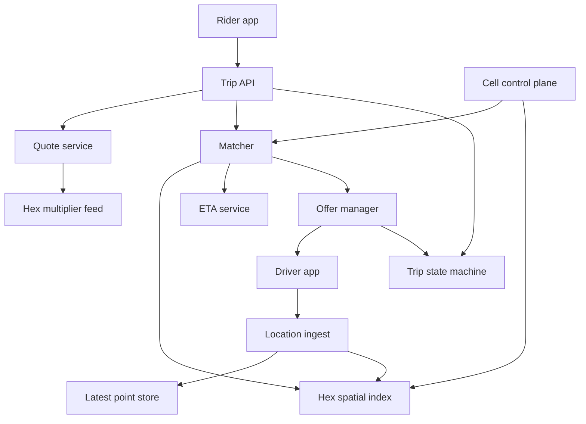

## Concept

Dispatch matches moving supply to a demand that has a place and a time. The version of the problem that says “find the nearest driver” fails as soon as a city has one-way streets, an airport queue, or two matchers that both read the same driver as idle. The system that works is a location stream that stays fresh, a spatial index that answers who is free near this pickup, a ranker that uses travel time, and a trip state machine that survives a double accept and a phone that reports a teleport.

I would treat the city as the cell. Maps, pricing, and dispatch cooperate through a trip id. They are not one process. Inside the cell, drivers stream locations into a latest-point store and a hexagonal index, H3 or S2. A request lands in the cell that owns its pickup. The matcher reads nearby free supply, ranks by estimated time of arrival and by product constraints, offers one driver or a small batch, and commits the trip only with a compare-and-set on driver state. Points older than a declared time-to-live are not candidates. A trip that crosses a cell boundary stays owned by the origin cell until a handoff is an explicit write.

### Requirements

A rider requests a trip with pickup and dropoff, sees a price and an ETA, gets matched, and is tracked until the trip ends. Either side can cancel under a written fee policy. Drivers go online, go offline, accept, and reject. Products filter supply: pooled rides, larger vehicles, accessibility. Drivers can see a demand signal. Pricing may publish a multiplier per area. Delivery adds time windows and multiple stops, which changes ranking and does not change the compare-and-set. Operations need geofences and airport queues, because a terminal does not behave like a street corner.

Matching, once the request is inside the cell, should complete in a small number of seconds at the tail I would design toward. That is a budget, not a measured service level from someone else’s city. Location ingest of many updates per driver per minute must not block dispatch reads. Two riders must not be assigned the same driver, and one driver must not hold two live trips. A cell outage is a city outage unless a warm sibling can take the geofence. Another continent’s failure does not take this city down. Live location is sensitive. Live points are retained briefly. Full autonomy stacks, a planet-wide multi-modal router used as the matcher, and chat used as dispatch are out of scope. Map tiles can be a vendor. The ETA service must be replaceable without a rewrite of the trip state machine.

### Capacity sketch

Assumptions, so the index and the router can be sized against them. About forty cities as cells. A large city with on the order of thirty thousand drivers online at peak and about eight thousand concurrent trips. About one thousand trip requests per minute in that city at a busy hour. Each driver sends a point every few seconds, which lands in the low tens of thousands of location updates per second for that city alone. Hex resolution should put tens to low hundreds of drivers in a downtown hex, not tens of thousands. A location payload is an id, a point, a heading, a speed, a timestamp, an accuracy, and a cell. The index is memory. Historical traces for fraud review and analytics go to a cold store on a path that cannot stall matching. These numbers are a sizing target. They are not a claim about a particular city’s measured peak.

If every match scores twenty candidates and each candidate calls a full router, the router becomes the outage. I would keep a coarse travel-time table between neighboring hexes for the first pass and call the expensive router only for the short list. That assumption dominates matcher CPU more than the spatial lookup. Latest location is one row per driver. The spatial index is a map from hex to the set of idle driver ids, rebuilt from the latest-point store when the process starts. It is not the system of record. Trip rows are durable. Weeks of raw GPS at city scale are a warehouse problem, and the warehouse is allowed to lag.

### API or control-plane shape

Riders post a trip with pickup, dropoff, product, and an idempotency key, and receive a trip id, a quote, an ETA, and a price. Cancel is a post on that trip. Reading a trip returns a projection: status, assigned driver if any, and a coarsened live position. It is not a scan of the spatial index. A rider client that polls the index directly will both leak other riders’ supply and fall over when the index is rebuilt.

Drivers set presence to online, offline, or on-trip. Locations arrive as an authenticated batch. Offers are accepted or rejected by offer id before a deadline. The matcher asks the index for candidates in a set of hexes, ranks them, creates an offer with a time-to-live, and commits the assignment by compare-and-set from idle to on-trip, conditioned on the driver version and on a fresh location. If the compare fails, the driver was taken and the trip returns to matching. If the offer expires, the driver returns to idle only when the current offer id still matches.

The cell control plane can rehome a driver, change a geofence, drain a cell, and publish airport-queue policy. Pricing publishes a multiplier per hex on its own cadence. The quote service and the matcher subscribe. They do not recompute surge inside the match critical section. A drain is a written state: new trips stop, in-flight trips finish or hand off, and the sibling does not accept the geofence until its index has a fresh point for the drivers it will own.

### Core data model

A cell has a city, a geofence, and an optional sibling used at the border. A driver has a cell, product eligibility, a status of offline, idle, offered, or on-trip, and a version used for the compare-and-set. Latest location stores the point, heading, speed, accuracy, time, and hex. The hex index maps a hex to idle driver ids. The index entry expires with the point. A driver with no fresh point is absent, which is the safe direction: we would rather miss a supply candidate than dispatch a ghost.

A trip has rider, optional driver, product, pickup, dropoff, status, quote id, cell, and a unique idempotency key. Status runs from quoting to matching to offered to en route to on trip, and ends completed or canceled. An offer has a driver, a trip, an expiry, and a state. A quote has a price, a multiplier, an ETA, and an expiry. Geofences and airport queues are first-class rows with their own admission rules. A durable log of GPS points is optional and asynchronous. It does not share a thread with the index update that matching reads. Handoff between cells is a row: trip, from cell, to cell, and a state that is pending until the destination cell accepts ownership. Until that accept is written, the origin cell still owns cancel, reassignment, and the fee.

## Trade-offs

| Approach | When it wins | Cost / risk |
| -------- | ------------ | ----------- |
| City as a cell | Failure and supply stay local | Borders and cross-city trips need an explicit handoff |
| One global spatial index | A tiny fleet or a demo | Latency and one blast radius for the planet |
| Hex index in memory | High location update rates | Rebuild after a crash; resolution is a per-city choice |
| An R-tree in a spatial database | Low update rates and simple operations | Unlikely to hold a large city’s location rate |
| Rank by straight-line distance | Sparse supply and open terrain | Worse ETAs once the street network matters |
| Rank by ETA with a cheap first pass | Dense cities | Router load if the cheap pass is skipped |
| Broadcast the offer to many drivers | Thin supply and a hungry marketplace | Stacked offers and cancel storms |
| One offer at a time with a short deadline | Fairness and less stacking | Match time grows when drivers decline |
| Consistent-hash ownership of hexes inside a cell | One city no longer fits one process | Rebalance moves index affinity |
| Persist every GPS point on the hot path | Forensics | Cost, and a dispatch path that falls behind the city |

I would offer one driver at a time in dense markets and a small batch where supply is thin. Each offer still commits through the same version check. The batch is a product choice. The compare-and-set is not optional in either market.

## Diagram

## Failure modes

### Two trips, one driver

Two matchers, or a retried request, both observe the driver as idle and both assign. Commit is a compare-and-set on driver version and status. The loser returns the trip to matching. An expired offer returns the driver to idle only if that offer id is still current. The detection query is a driver with two trips in an active state. If that query does not exist, the state machine is unfinished. A retry of the rider’s create call must return the original trip id. A second trip for the same idempotency key is the same bug as a double assign, seen from the demand side.

### Stale points and impossible jumps

The phone buffers a point and then reports a position the vehicle could not have reached. The matcher treats the driver as next to the pickup. Accuracy, speed, and a maximum plausible velocity drop the jump from the candidate set. Index membership expires with the time-to-live. Commit requires a point inside that window. Keep the raw point available to the filter. A snapped point is a display aid. Snapping before the filter hides the jump and dispatches a driver who is still on the other side of the river.

### Borders and airport queues

The pickup sits just inside one cell and the nearest legal driver is in the sibling. Or every idle driver nearest-matches the terminal door and the airport queue collapses into a crowd at the curb. The matcher queries hexes that overlap the sibling, and a handoff is a write, not an accident of GPS noise. An airport is a queue with admission, staging, and a dispatch order. Geofences override the index. A design whose only spatial primitive is nearest hex will be wrong at the airport on the first holiday, and the wrongness will look like a ranking bug.

### A multiplier that chases itself

Prices rise, riders cancel, drivers reposition into a hex that is no longer short of supply, the hex looks empty again, and prices rise. The multiplier is a damped input to the quote, computed off the match lock, with a cap and a floor. A bug in pricing must not be able to stop assignment. The matcher can run with the last published multiplier. It does not call the pricing service while it holds a driver version. If the feed is stale, the quote says so by using the last good value and a short expiry, and the trip can still be matched.

### Ingest that starves matching

A client bug sends locations many times a second. Index CPU saturates and match latency follows, even though trip volume did not change. Rate-limit per driver, coarsen to a maximum frequency, and drop the excess. Ingest and the matcher do not share a thread pool. When the system is behind, drop locations. Do not delay trip creation to preserve a perfect trace. A missing point expires the driver out of the index, which is the safe direction. A backlog of points applied in order after the fact will teleport drivers through the index and create a burst of bad offers.

### A cell returns to a waiting crowd

The cell was down. A large set of riders is waiting. Every matcher queries the same downtown hex at once. Admit trip creation with a cap, queue matching with a declared wait, and cache a short answer when a hex has no eligible supply so the matcher does not spin. Bring drivers back before opening demand all the way. A sibling accepts a geofence only after its index is warm. Opening the gate on an empty index produces a wave of “no drivers” that is an outage of our own making.

## Real-world example

Uber’s public writing on marketplace matching and on H3 is the map I would use, along with similar writing from other large dispatch marketplaces. H3 is the hex system I would start from. S2 is a sound alternative if the team already operates it. The useful lesson from large-scale dispatch writeups is city-scoped ownership, a fresh location index, and a marketplace that ranks by travel time. A blog’s request-rate figure is not a capacity plan, and I would not copy a city’s peak into our config because it appeared in a talk.

Copy city cells, a hex index of latest points, ETA-aware ranking with a cheap first pass, sequential or small-batch offers, compare-and-set on driver state, airports as their own product, and a time-to-live on locations. Build the state machine before any ranking model. Keep the full GPS history out of the database that serves dispatch. Resolution is a per-city test, not a constant. If the fleet is a few dozen vehicles, a spatial database and a single matcher loop is the design. This cell architecture is for the moment when update rate, double-assign, and street-network ETAs show up together.

## What to remember

- Dispatch is a city cell, a latest-point index, and a compare-and-set on driver state.
- Rank with a cheap hex-to-hex pass first. A router call per candidate will not survive a dense city.
- Stale GPS and double accept are ordinary failures. Time-to-live and compare-and-set are the response.
- Airports and cell borders need their own rules. Nearest-hex is wrong in both places.
