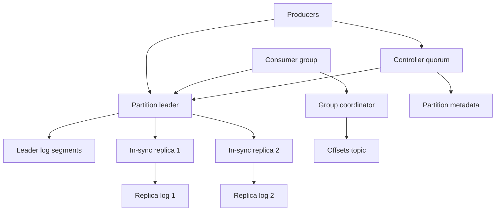

## Concept

A distributed message queue is a durability and fan-out contract. Producers need an acknowledgement that still means something after a broker crash. Consumers need a cursor that does not silently skip when membership changes. The product decision is log versus queue. A partitioned replicated log lets many consumer groups read the same records on their own cursors and rewind. A competing-consumer queue hides or deletes a message once one worker acknowledges it. I would ship the log unless the product is strictly task dispatch, with short payloads and no need to replay an earlier day.

The design is topics split into partitions. Each partition is a totally ordered log with one leader and an in-sync replica set. Producers append to the leader at a chosen acknowledgement level. Consumers in a group divide the partitions among themselves. Committed offsets live in an internal compacted topic so the cursor has the same failure mode as the data. Retention is by time and by size. An idempotent producer suppresses the duplicate a timed-out retry would otherwise append. Order across partitions is not a promise. Effects that happen once, between this log and a database, need a transactional producer and an idempotent consumer. They are not a property of the broker alone.

### Requirements

Operators create and delete topics with a partition count, a replication factor, retention, and a cleanup policy. Producers send records with key, value, headers, and an optional partition. Consumers read from a group or from an explicit offset. Seek and reset are first-class. Lag is visible in time as well as in records. A changelog topic can be compacted so the latest value per key survives. Administrators reassign partitions, run preferred-leader election, and set client quotas. Transactions that publish atomically to several partitions exist and are used rarely, because they add a coordinator and a longer failure story.

A record acknowledged at the strongest level stays durable as long as the in-sync set that acknowledged it remains the source of the log. Losing a broker elects a new leader from that set and continues. Throughput comes from sequential disk, batching, compression, and sending bytes without an extra copy where the operating system allows it. I would expect in-region produce latency of a small number of milliseconds when the leader acknowledges alone, and more when every in-sync replica must answer. I would not promise sub-millisecond delivery. That is a different system. Ordering is per partition. Delivery to consumers is at least once by default. At most once is what you get if a consumer commits its offset before it finishes the work. Effects that must happen once require the extra protocol on both sides.

Using the log as a general database is out of scope unless a compacted changelog is an explicit design. Phone push and a persistent session protocol for devices are out of scope. A setting named exactly-once, with no idempotent consumer, is out of scope. Cross-region active-active produce on the same partition is out of scope; a follower region replicates, and writes stay with the leader.

### Capacity sketch

Assumptions for one region, not a benchmark. On the order of eight hundred topics, about twelve thousand partitions, replication factor three, aggregate produce around one hundred fifty megabytes per second at peak, average record near a kilobyte, and a handful of consumer groups on the hottest topics with a long tail of quieter ones. Retention of a few days for most topics, longer for a few audit topics that have an owner and a budget. Brokers with local solid-state disks. These are planning numbers. A measured cluster will move them, and the design has to say which knob moves with them.

Twelve thousand partitions means twelve thousand leaders to spread across brokers. Too few partitions and a hot topic cannot add consumers. Too many and file handles, recovery time, and controller load dominate. Disk is retention times produce rate times replication, plus headroom so a slow consumer does not push the cluster into a full disk. Memory is mostly page cache. The hot tail of each partition should fit. Replica traffic is roughly produce times one less than the replication factor. Size the hottest partition, not the average. A key that always hashes to one partition is one disk and one consumer, however many brokers you add. Metadata is a small, replicated, strongly consistent store. A controller failover that takes minutes is a fleet incident even when the bytes of metadata are tiny.

### API or control-plane shape

Produce takes a topic, an optional partition or a key, a batch of records, an acknowledgement mode, and a timeout, and returns a base offset or an error. Transactional producers have an initialization and an end-transaction call that commits or aborts. The hot path is a binary protocol on a persistent connection. The client batches. I would not put a request-per-record HTTP API on that path. The HTTP facade, if a team needs one, sits in front and batches, and it is not how the brokers talk to each other.

Consumers find a coordinator, join a group, receive an assignment, heartbeat, and leave. Fetch names a topic, a partition, an offset, and a maximum byte count. Offset commit writes the group’s cursors. Admin creates topics, alters reassignment, describes the in-sync set, and lists offsets. A controller elected from the brokers, or a dedicated metadata quorum, publishes the map of partition to leader, epoch, and in-sync replicas. Brokers watch it. Clients cache it and refresh when a broker tells them they are not the leader. The leader’s epoch fences a deposed leader so a zombie cannot append after failover. The high watermark advances only over records replicated to the in-sync set. Consumers at the strongest read isolation do not read past it.

### Core data model

A topic has a name, a partition count, a replication factor, retention, and a cleanup policy of delete or compact. A partition has a leader, an epoch, an in-sync set, a replica set, a log start offset, and a high watermark. On disk a partition is a sequence of segments plus sparse offset and time indexes. A record has an offset, a timestamp, a key, a value, headers, and optionally a producer id, an epoch, and a sequence for idempotence.

A consumer group has a generation, a protocol, members, an assignment, and a coordinator. Committed offsets are keyed by group, topic, and partition. Producer state on the leader remembers the epoch and the last sequence per partition so a retry is not a second record. A transactional marker in the log tells consumers whether a batch committed. Consumers that have not opted into reading committed transactions only must not treat an open transaction’s records as visible.

Compaction rewrites segments and keeps the latest value per key, plus a tombstone for a bounded time so readers observe the delete. The in-sync set shrinks when a replica falls behind a lag deadline. The leader refuses the strongest acknowledgement if the in-sync set is below the configured minimum. That refusal is the durability feature. Electing a replica that was not in sync, and letting offsets move backwards, is data loss. The page for that refusal is “partition unavailable,” and it is preferable to a page that says “offsets went backwards” after consumers have already acted.

## Trade-offs

| Approach | When it wins | Cost / risk |
| -------- | ------------ | ----------- |
| Partitioned replicated log | Replay and many independent consumer groups | No cross-partition order; you operate a log |
| Competing-consumer queue | Task dispatch with ack and delete | Weak replay; fan-out means copies of the message |
| A managed cloud queue | Bursty workers and no broker fleet | Ordering, throughput, and replay limits |
| Acknowledge all in-sync replicas, minimum two of three | Durability you can explain | Higher latency; unavailable if the minimum is not met |
| Acknowledge the leader only | Throughput and a firehose you can lose | Records vanish if the leader crashes before replicate |
| Leader plus in-sync replicas, unclean election off | Sequential disk and a clear loss story | A partition can be unavailable rather than silently short |
| Quorum append on every produce | A simpler durability story on paper | A different performance envelope than a log-shaped broker |
| An external coordination service for metadata | A well-understood historical split | A second system on the election path |
| Metadata quorum inside the brokers | One system to run | You still rehearse metadata failover |
| Compacted changelog | Materialized state and upserts | Compaction lag; readers tolerate a dirty window |

I would acknowledge the full in-sync set, require two of three replicas, and leave unclean leader election off. A team that turns unclean election on during an incident to “restore produce” has chosen data loss, and the choice should be an explicit, logged operation.

## Diagram

## Failure modes

### Unclean election truncates the log

The in-sync set shrinks to one broker, that broker dies, and a lagging replica is elected. High offsets disappear. Consumers skip or duplicate depending on where their cursor sat. Forbid unclean election. Prefer an under-replicated, unavailable partition over a silent loss. Alert when the in-sync set shrinks, and alert if an offset moves backwards. The leader epoch fences a zombie append. It does not stop an operator from electing a stale replica. The runbook for a dead in-sync set is “restore a replica or accept downtime,” and the runbook is written before the page.

### Rebalance that stops the world

A consumer misses heartbeats because it paused inside a handler. The group revokes every partition, processing stops, lag grows, and the pause gets worse. Use cooperative assignment so only moved partitions pause. Keep work off the heartbeat thread. Static membership helps when a restart should not look like a new member. Keep unrelated topics out of one giant group, so a deploy of one service does not rebalance another. A rebalance storm during an incident is often the incident. The metric is time spent in rebalance, not only records behind.

### A retry that appends twice

The producer times out after the leader has already committed, and the retry writes a second record. Idempotent produce uses a producer id, an epoch, and a sequence. Upsert-shaped data can also use a key and a compacted topic, if the consumer’s effect is “latest value wins.” Consumers that need once-effects store a record identity and ignore a duplicate. Multi-partition transactions exist for atomic publish. They add a coordinator and a longer failure story, so they stay off the default path. A consumer that commits its offset and then crashes before the side effect has chosen at-least-once delivery of a gap. The offset commit belongs after the effect, or inside the same transaction as the effect.

### One key, one partition

Every event for one account, or every event with an empty key, lands on one leader, one disk, and one consumer. Adding brokers does nothing until the keyspace changes or partitions are added and data is redistributed. Choose keys that match the order you actually need. When order is not required, spread the key. Quota the producer that can fill a partition alone. Increasing the partition count is a planned migration. New partitions do not rewrite old keys. A dashboard that shows cluster-average disk and hides the hottest partition will stay green through the outage.

### Retention deletes what a slow consumer still needs

A consumer sits at an old offset. Retention advances. The next fetch fails because the log start offset has moved past the cursor. Lag alerts are in time-until-retention, not only in record count. State that must survive belongs in a compacted topic or in a snapshot the consumer owns. A slow consumer does not pin the log forever. Filling the disk and refusing produce is clearer than wrapping the log. An audit topic with a seven-year requirement is a different retention class, with an owner and a budget, and it does not inherit the firehose default.

### Metadata quorum is down

You cannot create topics or elect new leaders. Leaders that already have an in-sync set may still serve produce and fetch. That split — data plane up, control plane down — is survivable only if you have practiced it. Run a three-member metadata quorum, persist its log, and fail it over on purpose. A design that serializes elections through one process will do that during an incident, usually while someone is also trying to add capacity. Adding brokers while the controller is down does not add capacity. It adds machines the cluster cannot see.

## Real-world example

Apache Kafka is the system this design copies: topics, partitions, the in-sync replica set, consumer groups, the offsets topic, idempotent producers, transactions, and the move from an external coordinator to a metadata quorum inside the cluster. Amazon SQS is the competing-consumer alternative, with visibility timeouts and dead-letter queues. RabbitMQ is the broker with exchanges and per-message acknowledgements. Pulsar separates serving from a bookkeeper-style storage layer. Copy that split only if you need it and can operate the storage layer.

Copy the log as the API, the partition as the unit of order and of parallelism, the in-sync set as the durability boundary, consumer groups as independent cursors, compacted topics for state, and idempotent producers. Leave thousands of tiny topics out of the design if what you wanted was a service mesh. Leave a transaction off the default write. Leave unclean election off when a page is noisy. If the problem is a work queue with no replay, copy visibility timeouts and dead-letter queues from a queue product. If consumers need last Tuesday, you wanted a log, and retention has to cover last Tuesday on purpose.

## What to remember

- The default contract is per-partition order and at-least-once delivery. Once-effects are extra protocol on both sides.
- Acknowledging the full in-sync set, with unclean election disabled, is the durability design. In-sync set size is a page.
- Consumer groups fail by rebalancing. Keep processing off the heartbeat path.
- Hot keys and partition count are the capacity plan. New brokers without a new key or a reassignment do not add throughput.
