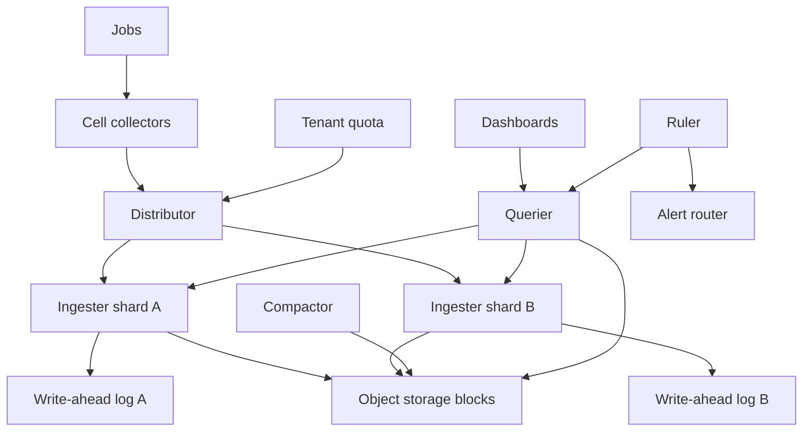

## Concept

A metrics platform is a time-series system whose limiting resource is cardinality: the product of metric name, tenant, and label set. Monitoring is the query, recording-rule, and alert layer on top of that store. A label that carries a user id does not make a richer dashboard. It makes an ingest outage and a bill. I would split ingest, storage, query, and alerting so a dashboard refresh cannot stall the write path, and I would enforce a series budget per tenant at the edge, before a sample is acknowledged.

The wire format I would accept is Prometheus remote-write and a PromQL-like language, because that is the contract most instrumentation already speaks. The storage shape is the sharded one associated with M3, Cortex, and Mimir. A distributor hashes a series onto ingesters. Ingesters hold a recent window in memory plus a write-ahead log. A compactor writes immutable blocks to object storage and downsamples them as they age. Queriers fan out across the in-memory head and the blocks. Rules evaluate on a recorded subset when the raw expression would scan the estate. Routing, grouping, and inhibition of alerts happen after evaluation, in a component that is not the database.

### Requirements

The system ingests gauges, counters, and histograms, either as native histograms or as pre-bucketed series, with labels. Instant and range queries use a PromQL-like language. Recording rules and alerting rules are configuration. Dashboards are clients. They are not the schema. Tenants cannot create an unbounded number of series. Both pull, through a collector inside the cell, and push, through remote-write, are supported. Retention keeps raw resolution for a short window and coarser series for a longer one. Exemplars may point at a trace id. They are a link, not a second copy of the span.

Ingest availability outranks query availability. A hole in the scrape cannot be reconstructed later. A slow panel can be retried. Range queries against the working set should return in seconds under the concurrency cap I would set. That is a design budget, not a vendor service level. Acknowledged samples are durable according to an explicit write-ahead and replication policy. Counters reset when a process restarts. The query language must account for that reset. Noisy neighbors are the default, so fairness is a quota. Object storage holds the long blocks. Memory holds the head. Logs and traces are not stored here. Correlation is an exemplar or a link. Keeping every series at one-second resolution, with a large label set, for years, is out of scope. So is using this store as an event log for high-cardinality request ids.

### Capacity sketch

Assumptions I would size against, and revisit when a tenant proves them wrong. On the order of eighty tenants, on the order of eight million active series at peak, most scrapes at a fifteen-second interval, a minority of series faster than that, and a small number of low-cardinality labels beyond the metric name. The dangerous label is the high-cardinality one, not the presence of environment or status. Raw retention around fifteen to thirty days at the scrape interval, then five-minute rollups for about ninety days, then hourly rollups for a year or two. These are planning assumptions, not a measured bill.

Eight million series, held in a replicated head, is a memory problem before it is a disk problem. A query that does not hit an index prefix of tenant plus metric name is a scan, and a scan of millions of series is a latency problem. Index memory is a separate budget from sample memory. A few thousand alert rules is a plausible estate, and each rule is a query. Run them on a ruler that does not share a thread pool with the dashboard querier. Prefer a recording rule over re-evaluating a heavy expression against every series on every evaluation interval. Block size in object storage dominates long-term bytes. The ingest head must fit in RAM, with the log on disk beside it. I would also assume a churn budget: series that appear for one scrape and vanish still cost index memory until they age out, so a deploy that stamps a new id on every process is a capacity event even if the “active” count looks stable an hour later.

### API or control-plane shape

Ingest is Prometheus remote-write, compressed, with a tenant header. Jobs that we pull expose a metrics endpoint, and a collector inside the cell scrapes locally and remote-writes centrally. The central system does not open a connection to every process. That choice keeps the ingest edge inside the cell, where a network partition is local, and it keeps the central distributor from becoming a scraper of the world.

Query is the instant and range endpoints, tenant-scoped, plus label lookups that refuse an unbounded result. The control plane stores recording rules and alert rules: expression, evaluation interval, for-duration, labels, and routing. A tenant quota names a maximum series count, a maximum ingest rate, a maximum query concurrency, and a maximum samples per query. An emergency control can drop series matching a matcher without a deploy. Internally the distributor hashes tenant, metric, and labels onto an ingester shard and replicates the write to a second shard. The querier deduplicates replica samples. The compactor merges blocks, downsamples, and deletes what has aged out. It does not serve interactive queries. A sample is acknowledged when the write-ahead log is durable on the replication set we promised, and the acknowledgement says so.

### Core data model

A tenant has series, sample-rate, query, and retention limits. A series is an identifier, a tenant, a metric name, a hash of the labels, and the labels themselves. Identity is the full label set. Changing a label creates a new series. Samples are timestamp and value, stored in compressed chunks rather than as a row per point. An ingester’s head is in-memory chunks plus a write-ahead log, and a series is owned by a replication set of ingesters. A block in object storage has a time range, a series index, chunk files, and an identifier. It is immutable. A correction is a new block, not an update in place.

Recording rules name an output series, an expression, and an interval. An alert rule has an expression, a for-duration, labels, annotations, and a routing key. An alert instance is a fingerprint of the firing labels, a state of pending, firing, or resolved, and a since-timestamp. The index is inverted, from label pair to series, with tenant as the first key. Without it, every query is a scan and the platform will not survive the series count in the capacity sketch. Exemplars, if you keep them, are a small side structure pointing at a trace id. They are not a second copy of the span. A type change on an existing metric name is a new series or a rejection, because a counter and a gauge with the same name will make every rate function lie.

## Trade-offs

| Approach | When it wins | Cost / risk |
| -------- | ------------ | ----------- |
| One Prometheus per cluster, pull only | A single team and a single cluster | No durable long range and a painful global view |
| Remote-write into sharded ingesters and object storage | Many tenants and long retention | More moving parts; the head is ahead of compacted blocks |
| Sidecars that upload local Prometheus blocks | You want to keep pull and add history | Sidecar operations and query cost at the store gateway |
| A highly available pair with no sharding | A modest series count | The pair dies at the series count in this design |
| Native histograms | Quantiles that survive aggregation | More ingest bytes and more query CPU |
| Fixed histogram buckets | Cheap and familiar | A bad boundary stays wrong for the life of the series |
| Full resolution forever | A retention story someone wishes were cheap | Cost, and queries that do not return |
| Downsample as data ages | Dashboards and burn rates over months | A short blip disappears from the coarse rollup |
| Evaluate alerts on raw series | The expression matches what you typed | The ruler becomes your largest querier |
| Evaluate alerts on recording rules | Stable and cheaper | Extra delay; a wrong recording rule hides the incident |

I would push from cell collectors, shard and replicate the head, write blocks to object storage, and require a recording rule before an alert matches an unbounded label set. The recording rule is also the contract: if the rule is wrong, the page is wrong, and that is easier to review than a dashboard expression copied into an alert.

## Diagram

## Failure modes

### Cardinality explosion

A deploy adds a user id, a request id, or a unique process-start id to every sample. Series count jumps by orders of magnitude. Ingesters run out of memory. Queries time out. Alerts stop because the ruler cannot evaluate. Cap series per tenant and reject the overflow on the write path. Drop the bad labels at the collector. Publish which metric is creating series the fastest. The detection signal is series created per minute, not disk used. Disk fills later, after the head is already dead. A limit that only pages a human, and still accepts the samples, is a suggestion. The collector should be able to enforce the same matcher the distributor enforces, so the bad label dies before it crosses the wide area.

### Head lost before flush

The recent window is in memory. The write-ahead log is on a local disk. The disk dies with the process. Replicate the head, and define when a sample is acknowledged: after the write-ahead log is durable on the replication set you promised, not after a single process has seen it. Queriers merge replicas and must tolerate a replica label so a sum does not double-count. Acknowledging a sample that existed only in one process is how a gap appears in the next incident review, exactly when the missing minutes mattered. The merge rule is part of the data model. A querier that sums both replicas and a querier that picks one will disagree, and the disagreement will be paged as an application bug.

### Dashboards as a load generator

Many panels, each a heavy regular expression, refresh every few seconds, and a crowd opens the board during an incident. Queriers and object-storage reads spike together. Cap query concurrency and samples per tenant. Cache results by query, step, and time alignment. Put the expensive panels on recording rules. An incident mode that freezes auto-refresh is a feature. A dashboard client will take the platform down if the quota lets it. The ruler stays on its own pool so pages still evaluate while humans refresh graphs. A cache key that ignores step alignment will store a near-duplicate for every refresh and will not save you.

### Counter resets that look like traffic

A process restarts, the counter drops, and a naive rate spikes or goes negative. Use the query functions that handle resets. Do not alert on a raw rate of a rarely incremented counter. A gauge is not a counter, and a client that resets a counter without a process restart will page you for a fiction. Document the type on the metric, and reject a remote-write that changes type for an existing name. A recording rule that hides the reset will also hide a real drop to zero, so the rule and the alert are reviewed together.

### Thousands of pages for one cell

The cell dies. Every series that mentioned it fires. On-call receives a flood and misses the notification that named the cell. Group by alert name and cell. Inhibit children when a parent “cell unavailable” is firing. Require a for-duration so a single scrape gap does not page. Prefer symptom and burn-rate alerts over a CPU threshold on every host. A store that notifies thousands of times has failed as a monitoring system. The router is part of the product. Inhibition that depends on a label the child alert does not carry will never fire, and you will learn that during the outage.

### Samples from a clock that jumped

A host steps backwards or far forwards. Samples are dropped as out of order, or they land in a future bucket and distort a rate. Allow a bounded out-of-order window, reject timestamps far in the future, and run a real time source on collectors. For scraped metrics, use scrape time consistently. Mixing the target’s clock and the collector’s clock in one series produces holes that look like missing traffic. The ingester’s policy has to be the same on every replica or the merge will disagree about which point survived. A host whose clock is hours ahead will look like a future series until the reject rule exists.

## Real-world example

Prometheus is the local scrape model, the name-plus-labels data model, and the query and rule language I would copy. M3, as used at Uber, and Cortex and its Mimir descendant are the sharded remote-write backends. Thanos is the path that keeps Prometheus and adds object storage beside it. Borgmon and Monarch are the historical gravity at Google. You will not build Monarch as a first platform, and the attempt will not be cheaper than running the open-source shape well.

Copy from Prometheus the data model, pull where a cell collector can do it, the query language, recording and alerting rules, and histograms as a type. Leave a single Prometheus process behind once series leave one cluster, and leave free-form labels behind as a growth strategy. Copy from M3 and Cortex the tenant header, the split among distributor, ingester, compactor, and querier, blocks in object storage, and series limits. Leave the full catalog of aggregation knobs for later. Start with caps, a fifteen-second scrape, head replication, and recording rules for anything that pages a person. A vendor meters the same cardinality. The invoice arrives after the head has already fallen over, so the cap still belongs on the write path.

## What to remember

- Cardinality is the capacity plan. Series caps belong on the write path, before acknowledgement.
- Ingest, compaction, query, and rule evaluation do not share fate with a dashboard refresh.
- Downsampling is how a year of data stays affordable, and it is how a short blip leaves the long-term series.
- Page on symptoms, grouped and inhibited. A correct store that fires thousands of times has failed as monitoring.
