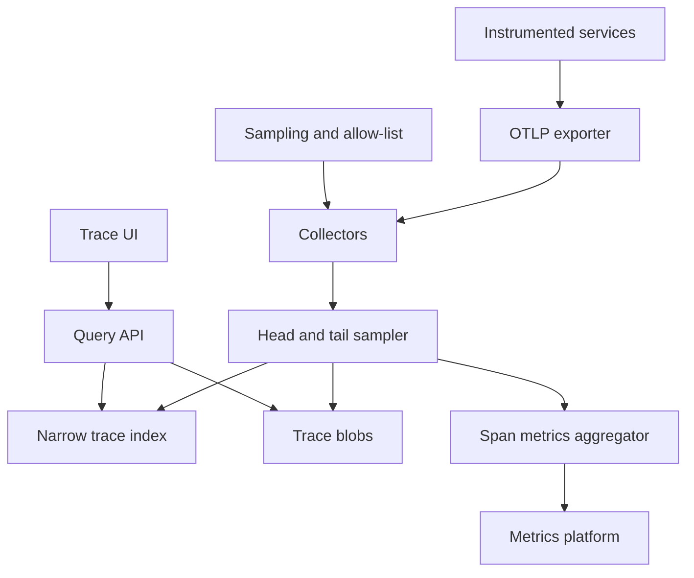

## Concept

A tracing backend stores causal trees of spans so an engineer can explain one request. A trace has an id. A span is one timed operation: parent, service, status, attributes, and events. Almost every span is never opened. The reads that matter are “show me this trace id” and “show me slow or failed traces of this operation in a recent window.” I would not store every span at the volume this design assumes. I would sample on a hash of the trace id so a tree is kept or dropped as a whole, accept spans over OpenTelemetry, write a hot narrow index for recent search, write the payload as a blob addressed by trace id, and derive service-graph edges and request metrics on a side path. Those metrics belong in the metrics platform. The span store is not a query engine for rates.

The shape is the one Jaeger established and that later object-storage backends such as Tempo pushed further. Agents or collectors export OTLP. Collectors batch and sample. A query service fetches by id. Tail sampling is optional and quota’d, for errors and for slow traces, and only if the buffer has a hard cap. Search attributes are an allow-list. Retention of raw traces is days. Anything you need for a quarter belongs in a metric, or in a log with a different contract.

### Requirements

Ingest is OTLP over HTTP and gRPC. We preserve trace id, span id, parent, timestamps, status, a bounded attribute map, events, and links. A kept tree is retrievable by trace id. Search of recent traces filters on service, operation, duration, status, and a small set of indexed attributes. Service-graph edges and operation latency are derived products. They are not computed by scanning raw spans when someone opens a page. Head sampling is required. Tail sampling is optional. Tenants are isolated by id on every write and every read.

The exporter inside the application already has a budget. If the backend is slow, the application drops spans. It does not block the user request on export. Durability is best-effort relative to a ledger: losing a short window during an outage is acceptable, and losing a window every day is not. Fetching a known id should return quickly, on the order of a user waiting on a page. That is a budget, not a measured service level. Search may take longer and may be incomplete by design, because unindexed attributes are absent. Raw traces live for days. Derived metrics follow the metrics platform’s retention. Attributes will contain personal data if a service is careless. The collector strips or hashes them. Using traces as an audit log, storing log bodies here, and indexing every attribute are out of scope. So is using a one-percent sample as the source of a service-level objective.

### Capacity sketch

Assumptions to size ingest, not a claim about a particular fleet. On the order of two thousand services, on the order of eighty thousand spans per second before sampling at peak, because one user request can emit many spans. Head-sample healthy traffic at about one percent, using a hash of the trace id so the decision is the same in every service. Keep errors when volume allows, under a hard cap, because an outage can turn errors into the traffic. An average span of a few hundred bytes to a couple of kilobytes once attributes are disciplined, and raw retention of several days. Sloppy attributes and a policy that keeps every error will still be a large amount of data, and that data arrives during the incident. I am not quoting a measured terabyte figure. I am saying the sampler has to assume the bad day is the peak.

Indexing a raw URL with its query string recreates the cardinality failure of a metrics system. Index service, operation, status, a duration bucket, and a route template if one exists. Search traffic is small. Ingest is the system. A blocking exporter shows up as application latency, so export is batched, asynchronous, and lossy when the collector sheds. The loss is counted. An uncounted drop is an outage you cannot see. I would also assume that a small number of traces are huge — a fan-out or a batch that reused one id — and that the store rejects or truncates them rather than letting one blob dominate a querier.

### API or control-plane shape

The ingest contract is OTLP export. I would not invent a custom span document for the first version. Query fetches a trace by tenant and trace id and returns the spans. The tree can be assembled on either side of the API. Find-traces takes service, optional operation, a minimum duration, status, a time range, and a limit, and returns ids. The UI then fetches. Service and operation lists exist so the UI does not scan blobs. Pagination is mandatory on both the id list and the span list inside a trace.

Sampling policy is configuration per tenant and service: a probability, rate limits, and optional tail rules such as “keep if status is error” or “keep if duration exceeds a threshold,” each with a byte budget. An attribute allow-list names the keys that may be stored or indexed. Everything else is dropped or hashed. An ingest quota is visible to the collector so it can shed before the process runs out of memory. The write path appends spans into a blob for that trace id and time bucket, and writes a narrow index row. Tail sampling holds spans for a trace for a few seconds, keyed by trace id, then keeps or drops. That hold is memory. It has a byte cap per tenant and a span cap per trace. When the cap is hit, the policy falls back to the head-sample decision. The collector reports which policy version it applied, so a bad rollout is visible as a version, not as a mysterious change in volume.

### Core data model

A tenant has an ingest rate, a daily byte budget, the indexed keys, and a retention. A span has trace id, span id, parent span id, name, service, start and end, status, attributes, events, links, and a resource that names the process: service, version, cell. A trace blob is the bytes for one trace id in a time bucket, in object storage or in a wide row. The index row is tenant, time bucket, service, operation, duration bucket, status, and trace id, with a time-to-live. It does not contain the attribute map. Two blobs for the same trace in adjacent buckets are concatenated at read time, with a grace window so a late span still lands in an open bucket.

Sampling policy is a row per tenant and service, versioned so a collector can report which policy it applied. Service-graph edges — caller, callee, count, error count, window — are a rollup written by an aggregator. They are not computed by scanning blobs when someone opens a graph. A span link is a reference to another trace, stored on the span, and it does not pull that other trace into this blob. Profiles and log lines do not live in this store. A span event is a small annotation. It is not a place to hide a log body. If a service needs the log, the log system stores it and the span carries an id.

## Trade-offs

| Approach | When it wins | Cost / risk |
| -------- | ------------ | ----------- |
| Head sampling on a hash of the trace id | Predictable cost and complete trees | A rare bug that did not fall in the sample stays invisible |
| Tail sampling under a quota | You keep errors and slow traces you can afford | Buffer memory, late spans, and cost during an outage |
| Keep every span | A tiny fleet with a known ceiling | You will turn it off during the incident you needed |
| Blob by trace id plus a narrow index | Fetch by id stays cheap | Search is only as good as the columns you indexed |
| A search cluster over every attribute | Rich ad hoc queries in a demo | Mapping growth, cost, and another cluster to operate |
| A column store for analytical search | Filtered scans and duration histograms | You still need an ingest buffer and a schema for attributes |
| A wide-row store keyed only by trace id | The classic primary path for get-by-id | Search still needs a second index |
| Derive request metrics only from spans | One instrumentation path | Double-counting if another system also emits them |
| A separate metrics path, with exemplars back to traces | Independent failure domains | Two signals, joined by the exemplar rather than by a scan |

I would head-sample by default, tail-keep errors and slow traces under a quota, and index only a handful of fields. Request rates stay in the metrics platform. An objective computed from sampled spans will move when the sample rate moves, and that movement will be mistaken for a regression.

## Diagram

## Failure modes

### The collector pushes back into the process

The backend slows, the exporter queue grows, and the application either blocks on export or allocates without a bound. Bound the queue, drop spans, and keep export off the request thread. The collector sheds and counts what it dropped. A trace of a request is not worth failing the request. If product latency moves when the tracing backend moves, the exporter is coupled to the request path and the coupling is the defect. The drop counter is a metric in the metrics platform, because the tracing backend cannot be the only witness of its own loss.

### The tail buffer fills with the outage

Errors become most of the traffic. The tail sampler tries to keep all of them. The window holds a large volume of spans for traces that are also unusually deep. Cap bytes per tenant, cap spans per trace, fall back to head sampling, and disable unconditional error-keep when the error rate is the traffic. The incident is the moment this control matters. A sampler that only stays within budget when the system is healthy will be off when you open the UI. The fallback is automatic. A human toggling a flag during the incident will be late.

### Trees that do not connect

A child service samples on its own coin flip instead of honoring the decision implied by the trace id, or a span arrives after the blob for that bucket was sealed. Propagate one decision with the trace context. Late spans append while the bucket is open, and a short grace period accepts stragglers. The UI shows a missing parent rather than inventing one. Judge the pipeline by complete traces, not by spans accepted per second. A dashboard of spans per second will look healthy while every tree is a single orphan span.

### Attributes that are a data breach

Email addresses, raw URLs, and authorization material land in attributes, get indexed, and sit in object storage for the retention window. Allow-list keys at the collector, hash or drop the rest, and alert on key names that should never appear. Keep retention short. Query by id is authorized like access to the services the trace describes. A trace that crosses a service the caller may not see is filtered at query time, not only at ingest, because the blob may contain spans the caller should not open.

### One trace that is a batch

A health check or a fan-out reuses one trace id for a huge number of spans. Fetching it exhausts the querier and the browser. Cap spans stored per trace, cap spans returned, and paginate. A batch of many tasks is many roots, or it is a metric. It is not one trace. The primary key does not make a giant blob cheap to open. Reject or truncate at ingest and count the truncations so the offending service is visible. The count is how you find the service. A silent truncate leaves a tree that looks complete and is not.

### Clocks that disagree

A child span appears to start before its parent, or a duration is negative because end is before start. Store the timestamps the clients sent. Warn in the UI when skew exceeds a threshold you chose. Run a real time source on the hosts. Stored timestamps stay as reported. Rewriting them to “look causal” hides the clock bug and invents a duration the service did not measure. The warning is part of the product, because a trace that implies time travel will be used to argue about a latency number.

## Real-world example

Jaeger is the open-source system whose pieces map onto this design: agent or collector, query, a span store, and a sampling strategy. Its early default of a wide-row store plus a separate search index is the lesson that get-by-id and search are different access paths. Grafana Tempo is the later shape that puts span bytes in object storage and keeps search narrower. Zipkin is an ancestor of the span model. OpenTelemetry is the instrumentation and the protocol. It is not a backend. Systems in the Honeycomb tradition are honest that high-cardinality events have a different cost model. Copy the honesty about sampling. Leave the pricing page alone.

Copy from Jaeger the span model, sampling that follows the trace id, the collector as the place that sheds load, get-by-id as the primary read, and a separate index for search. Leave a search cluster over every tag out of the first design, and leave a wide-column database out unless get-by-id actually needs it. Copy from Tempo the decision to put span bytes in object storage when search can stay narrow. Traces explain one request. A one-percent sample cannot be the graph you use for an objective. Request rates and latency histograms still live in the metrics platform, with an exemplar when you need to jump to a trace.

## What to remember

- Sample on the trace id so a tree is complete or absent. Sampling each span independently breaks the tree.
- Fetch by id is the product. Search is a narrow index with a short life.
- Collectors drop spans rather than stall the application. The request outranks its trace.
- Tail sampling and error-keep need quotas, or they fail open during the outage they were meant to explain.
