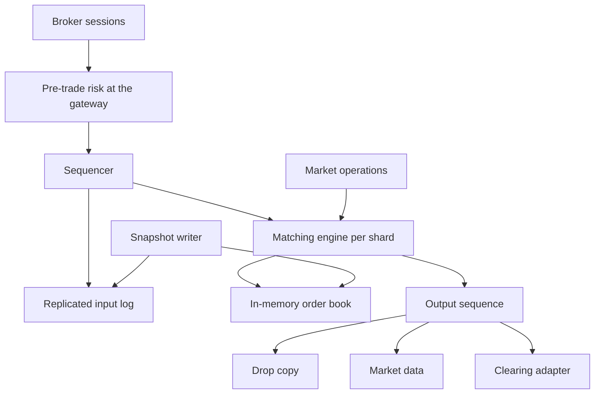

## Concept

A stock exchange, for this design, is a deterministic matching engine, a market-data plane, and a boundary where executions leave for clearing. The matching engine is not a web service and it is not a row of stateless replicas behind a load balancer. It is a single-threaded, in-memory order book per instrument, or per a small shard of quiet instruments, that consumes a totally ordered input log and emits a totally ordered output of trades and book changes. Fairness means every participant is sequenced by the same rules. It does not mean every participant has the same wide-area latency to the building. Equalizing distance is a policy on the path into the sequencer. It is not a substitute for one book.

I would put gateways in front, a sequencer that assigns a single order per shard, and an engine that does no IO inside the match loop. Persistence is the replicated input log, plus snapshots so recovery replays from a snapshot rather than from the start of the venue. Clients speak a session protocol, FIX or a binary equivalent. Gateways authenticate, apply coarse pre-trade risk, and append. Outputs — executions, rejects, depth — go to drop copy and to the public feed. Clearing consumes executions. It is not a two-phase commit inside the match. If leadership of a book is uncertain, the market halts. It does not run two books.

### Requirements

The book accepts limit and market orders, cancel, and replace. Stops and reserve orders can wait until the contract needs them. The default match is price-time priority on a central limit order book, unless the instrument’s rules specify an auction or a different allocation. Opening and closing auctions, trading halts, and pre-trade risk are in scope: maximum quantity, maximum notional, price bands, cancel-on-disconnect, and self-trade prevention. Brokers receive a private drop copy of their executions. The public receives top of book, depth, and trades, with whatever delay the venue’s rules impose on the feed that is not colocated. Post-trade give-up hands off to clearing.

The same input log must produce the same trades. Match-loop latency in colocation is a microseconds budget on hardware we measure ourselves. Gateway, risk, and the public path dominate for everyone else. Failover replays the log from a snapshot under a new epoch. A sequence gap is a halt. Inputs are durable before they join the book. Every message is kept for the audit window. A trade that cannot be reproduced from the log and the snapshot is not a trade we can defend.

Out of scope for the first venue: a request-for-quote market, a dark pool as a second product, and a general-purpose log system inside the match loop. Matching by updating a row in a SQL database is out of scope. So is a retail brokerage that displays a price it did not match. That brokerage is a customer of this venue or of a wholesaler.

### Capacity sketch

Assumptions for one venue, not a claim about any named exchange’s peak. On the order of four thousand listed instruments, a few dozen of them active, and a peak on the order of fifty thousand inbound order and cancel messages per second across the venue, with a heavy tail on the hottest symbol. Assume something like one in ten inbound messages becomes a trade, and that market data fans out to a few hundred sessions. Resting orders live from a short time to the end of the session. One hot symbol gets its own core and its own sequence. Quiet names can share an engine, with an explicit rule that two busy names never share a core. These rates are a ceiling to design toward. Publish the ceiling and throttle a symbol before a queue forms inside the match loop.

The book is memory: price levels and time-ordered queues. Disk is the input log and the snapshots. A queue inside the engine is a second ordering the sequencer did not assign, so the engine’s input is a single consumer of the log and it does not buffer a second reordering. Clearing can lag as long as the execution log is durable and gap-free. I would size snapshot frequency so a failover replays a bounded tail, and I would measure that replay on the production binary before calling the halt duration acceptable. The measurement is ours. A number from another venue’s marketing page is not a budget.

### API or control-plane shape

Order entry is new order, cancel, and replace. A new order carries a client order id, instrument, side, quantity, optional price, type, time in force, and account. Cancel and replace refer to the client id or the exchange id. The session has logon, heartbeat, and inbound and outbound sequence numbers so a drop can be detected and replayed. The client order id is unique per session and trading day. A duplicate is a reject or a replay of the original acknowledgement. It is not a second order.

Market data yields a sequenced trade, a book delta, or a snapshot. A client that sees a gap requests a snapshot at a sequence and resumes. Operations halt an instrument, set bands, and run an auction to uncross. Those operations are messages on the same sequencer, so they have a place in the order and a place in the replay. Pre-trade checks sit on the gateway, before the sequencer, and they are a pure function of the message and the session limits. Self-trade prevention stays in the engine so replay does not call out. A risk check that calls a remote service inside the match loop makes the match depend on that service’s latency and on its answers, and two replays can diverge.

### Core data model

An instrument has a symbol, tick size, lot size, a status of pre-open, open, halt, auction, or closed, a price band, and a matching shard. An order has an exchange id, a client id, a session, an account, a side, a quantity, a leaves quantity, a price, a type, a time in force, an inbound sequence, an inbound time, and a state. Resting orders live in the book. History is the log. You do not update a historical row in place to change a trade. A correction, if the rules allow one, is a new event that names the trade it corrects, and it is itself sequenced.

A price level is an instrument, a side, a price, a time-ordered queue of orders, and an aggregate quantity. A trade has an id, an instrument, a sequence, a price, a quantity, the two order ids, and the exchange time from the sequencer. A session tracks the participant and the next inbound and outbound sequence. The input log is sequence, epoch, bytes, and a checksum, replicated to a majority before the sequencer acknowledges. A snapshot is the book at a sequence, versioned with the engine build that wrote it. Execution reports are generated from output events for the owning session. They are a projection. Positions and cash live in clearing, on a settlement cycle, subscribing to the trade log. The engine does not keep a cash balance, and it does not call the clearing house to decide whether two orders match.

## Trade-offs

| Approach | When it wins | Cost / risk |
| -------- | ------------ | ----------- |
| Single-threaded deterministic engine plus an input log | Replay, one sequence, an explainable trade | One core per hot book; the book does not scale out horizontally |
| Multi-threaded matching on one book | A diagram that claims more cores | Races, unfairness, and trades you cannot replay |
| Price-time priority | Lit markets whose contract says so | Wrong for products whose contract says pro-rata |
| Pro-rata or size-time allocation | Some derivatives | A different fairness rule, still one sequence |
| Software sequencer on commodity hardware | A venue at this design’s size | You will not win a hardware timestamp race |
| Hardware timestamp at the gateway | A venue that sells nanoseconds | Cost, rigidity, and a specialist operations burden |
| A general-purpose log as the sequencer | Familiar operations tooling | Its latency tail is not an exchange tail |
| Persist the input before it is matched | Durability you can explain to an auditor | The write is on the critical path |
| Match, then persist asynchronously | A lower number on a benchmark | A crash can lose a fill you already sent |
| Many quiet symbols on one engine | The cold tail of the list | Two hot symbols on one core will miss the ceiling |

I would persist the sequenced input under a fencing epoch, then match. Two busy names do not share a core. An uncertain epoch halts the shard. The halt is the feature that keeps one market.

## Diagram

## Failure modes

### Two books for one instrument

Two engines both believe they are primary and print different trades for the same sequence, or for overlapping sequences. A single sequencer lease per shard, a fencing epoch on every append, and a halt when leadership is uncertain are the mitigation. Active-active matching on one central limit order book is a market-integrity incident. Detect it by divergent trade ids or by holes and overlaps in the output sequence. The response is halt, fence the old epoch, and reconcile from the log. Letting both run and repairing the difference in clearing publishes two markets. The detection has to be automatic. A human comparing two drop copies after the close is an after-action report, not a control.

### A match function that is not a function

A hash-map walk in undefined order, a read of the wall clock inside the loop, or a network call makes two replays differ. The match function takes the sequenced message and the book and returns events. No IO, no random source, and no clock other than the timestamp the sequencer already stamped. Replay production logs in a deterministic test. One ordering bug is a clearing break even if the process never crashed. A scripted test of two orders is not that test. The test replays a recorded session, including cancels, replaces, and a halt, and asserts the trade ids.

### A runaway order or a runaway client

A market order that would walk through the book, or a tight loop of cancel-replace that saturates the shard. Price bands, maximum notional, maximum quantity, cancel-on-disconnect, and per-session rate limits at the gateway exist for this, plus a kill switch that halts the instrument. Rate limits are published. An unpublished limit is a private rule, and a private rule is a fairness problem of its own. The kill switch is an operations message on the same sequencer, so it has a place in the order and a place in the replay. A limit that exists only in a gateway process and not in the log will vanish on failover and the runaway will resume.

### A subscriber with a hole

A market-data client misses a delta and trades against a book that is no longer true. Every feed message carries a sequence per instrument. Clients detect a gap and request a snapshot at a sequence, then resume. There is no path that delivers the book as an unordered datagram without a recoverable channel. Colocation removes distance. It does not remove loss, and it does not remove the need for the sequence. Drop copy uses the same rule for the private execution stream. A broker that misses an execution report must be able to ask for the gap. A snapshot without a sequence number cannot be joined back to the live delta stream.

### Replay that cannot catch the live rate

The snapshot is old, the log is long, and the halt lasts longer than the session can tolerate. Snapshot often enough that the replay length is bounded. Practice failover on the production binary and the production log shape. Pin the engine so replay runs at least as fast as the live loop. If replay cannot keep up with the live message rate, the failover duration is unbounded and you have not measured it. A snapshot that cannot be loaded because it was written by a different build is the same outage. Version the snapshot with the engine. A snapshot format change ships with a dual-read window, or it ships with a planned halt.

### A participant trading with itself

Self-trade prevention in the engine follows the instruction on the order: cancel resting, cancel incoming, or decrement. The decision is a pure function of the two orders, so replay does not call out. Surveillance across a day does not replace that rule. A prevention mode that asks an external service “are these the same beneficial owner” puts that service inside the match, and a timeout becomes a halt or a wrong trade. The mode on the order is the rule. Beneficial-owner questions belong in onboarding and in surveillance, on a path that does not sit between two resting orders.

## Real-world example

A modern lit matching engine, in the tradition of venues such as Nasdaq, CME, and the London Stock Exchange, is the system this design maps to: sequenced input, a deterministic match, sequenced output, and colocation as a product for participants who pay to reduce distance. A speed bump, as at IEX, is a delay applied on the path into that sequence. It changes who can react. It does not change the data model. A retail brokerage is a customer of an exchange or of a wholesaler. Displaying a price does not make the brokerage this design.

Copy a single-threaded match per book, the input log as truth, price-time priority unless the contract says otherwise, pre-trade risk before the sequence, sequenced market data, and a halt when the epoch is uncertain. Leave hardware timestamping, a remote book, and a horizontally scaled engine out of the first build. An internal crossing network can be this shape at a smaller size, and it still matches from a log. A smaller size does not excuse a match function that reads the wall clock.

## What to remember

- The input log and a deterministic match loop are the exchange. Gateways, feeds, and clearing sit around them.
- One live engine per book, fenced by the sequencer epoch. Two live books are a market-integrity failure.
- Fairness is one sequence everyone shares. It is not equal latency across the wide area.
- Pre-trade risk and the kill switch are sequenced with the orders. Surveillance does not replace the match rule.
