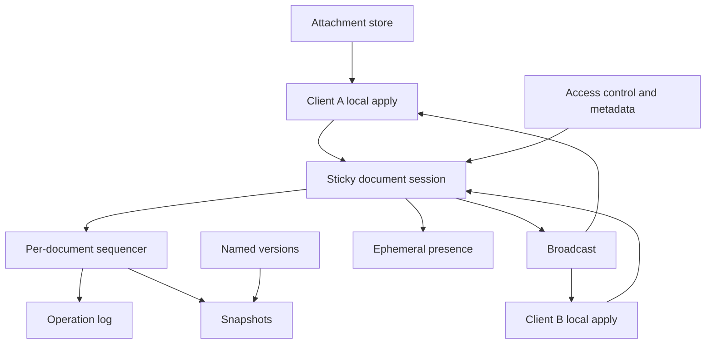

## Concept

A collaborative editor is a replicated document whose concurrent edits must converge, plus presence — cursors, selections, display names — that does not have to. The product is a shared document with low-latency typing, several people, comments, and a history you can name. The architectural fork is operational transformation versus a conflict-free replicated data type. I would pick one for a document and I would not mix them in the same log. For the first system I would ship a central session that assigns a total order per document. The payload can be a CRDT operation, or an OT operation transformed against that order. The server is the authority for the sequence. Clients apply locally so a keystroke does not wait on a round trip, then reconcile when the acknowledgement arrives.

One session process owns an open document. Clients send an operation and the revision they believe they have applied. The server assigns the next revision, persists the operation, and broadcasts it. Snapshots compact the log so a new client does not replay from the beginning. Presence is ephemeral and stays out of the log. Comments are a side structure. Their anchors are stable positions in the CRDT, or explicit bookmarks. An integer character index moves when someone types above it, so it is not an anchor.

### Requirements

Users create and open a document, insert and delete text concurrently, and apply character or paragraph marks if the product needs structure. Undo undoes that user’s own operation. It does not delete whatever character now sits under the cursor, which may belong to someone else. Presence, comments, and suggestions are separable features. Named versions and replay exist. Sharing is an access-control list checked on subscribe and on every accepted operation. Export exists. Offline edit with a later merge is optional. If you promise it, you have chosen a CRDT and you will test the merge. Images are attachments by identifier. They are not characters in the sequence.

Local echo is immediate. Other users in the same region should see the edit on a fan-out budget of tens to low hundreds of milliseconds. That is a budget for the path, not a measured figure from a vendor. Convergence means two clients that have applied the same set of operations hold the same document, and a partition heal does not duplicate a paragraph. Accepted operations are durable before the acknowledgement. One document is unavailable if its session and the replicas of its log are down. A hot document does not take an unrelated document down with it. A document past a declared size is refused or split by the product. A revoked user cannot apply an operation. Transactions across documents, and a merge model copied from a version-control system, are out of scope. Persisting every cursor move is out of scope.

### Capacity sketch

Assumptions. On the order of two million documents, about twenty thousand open at once, and a hot document with around eighty simultaneous editors — a classroom, an incident review, a launch document. An operation is a few characters or a short paste. An active editor might emit several operations a second, so a hot document sees on the order of a few hundred operations a second. Snapshots every few thousand operations, or when the log segment passes a size. Payloads are small. The constraint is fan-out and the log of that one document, not a global query rate. These are sizing assumptions. Measure the hot document before you believe them.

Eighty sockets on one document process is comfortable. Tens of thousands is not, so presence can leave the operation channel, and the product caps concurrent editors. An unbounded operation log becomes the cost and the recovery time. Compact to snapshots and prune operations every replica has passed. Titles and access-control lists live in a small relational store. Image bytes live in object storage and the document holds an id. I would place the session in the document’s home region. I would not multi-master one document across long distances unless the CRDT and the product both accept the conflict behavior, including comments and permissions. Most documents are closed. The load is the one that is not. A capacity plan that averages operations across all documents will miss the classroom and overbuild the archive.

### API or control-plane shape

Document lifecycle is ordinary HTTP. Create returns an id and revision zero. A snapshot read returns the blob and the revision it represents. Operations after a revision can be fetched for catch-up, with a limit, so a client cannot request an unbounded history in one call. The realtime channel is a socket bound to one document and one session process. Messages are operation, acknowledgement, presence, and error. An operation carries a client id, the base revision, the payload, and an idempotency id. The acknowledgement returns that id and the assigned revision. Presence carries a cursor and a user and is last-write-wins per user. It is not written to the operation log.

Access-control changes, named versions taken from a snapshot, and a forced compaction are control operations. Apply is serialized per document. There is no lock across documents, and there is no need for one. A client that reconnects loads the latest snapshot at or before its last acknowledged revision, then the operations after that snapshot. It does not treat its memory of the socket as the log. If the idempotency id was already assigned a revision, the server returns that revision again and does not append a second operation. A client that has been offline longer than the prune window reloads the snapshot and drops its unacknowledged buffer, unless offline merge was an explicit promise and the payload can merge.

### Core data model

A document has an owner, an access-control version, a latest snapshot revision, a home region, and a size. The operation log is document id, revision, client id, payload, time, and a unique idempotency id. Snapshots are document id, revision, blob, and time. Presence lives in the session process: document, user, cursor, and a time used only to expire a stale cursor. A comment has an id, a document, an anchor, a body, and an author. The anchor is a stable position or a bookmark id. An access-control row is document, principal, and a role of owner, editor, commenter, or reader. The session stores the access-control version it checked. An operation from a session whose version is stale is rejected, and the socket is dropped.

If the payload is a CRDT, it is an insert or delete addressed by stable identifiers, in the family of sequence CRDTs that production libraries already implement. Deletes leave tombstones until compaction can prove every replica has seen them. If the payload is operational transformation, it is a retain, insert, and delete, transformed against every operation between the client’s base revision and the server revision. The server revision is the linearization either way. Undo stacks live on the client as inverse operations in the same framework. “Delete the character at the current index” is a new edit. It will race, and it is not undo. Rich-text marks are operations in the same sequence, or they are annotations whose ranges use the same stable identifiers as the text. A mark stored as a pair of integer offsets will point at the wrong sentence after the next insert above it.

## Trade-offs

| Approach | When it wins | Cost / risk |
| -------- | ------------ | ----------- |
| A central sequencer plus operational transformation | Small operations and a simple authority | Transform bugs; the server is required for a correct merge |
| A CRDT with central fan-out | Convergence you can test, and a path to offline | Metadata, tombstones, and rich-text complexity |
| A peer-to-peer CRDT with no authority | Offline-first clients and no server on the keystroke | Access control, abuse, and compaction become the product |
| Last write wins on the whole document | Titles and presence | Lost characters; unusable as the editor |
| A structural merge of a JSON document | Configuration, not prose | Concurrent edits of the same string drop one side |
| Stable identifiers per character or per run | Fine-grained merges | Memory, and you must compact tombstones |
| A checkout lock | One editor at a time | The product is no longer collaborative |
| Persist every cursor in a database | An audit story that does not match the product | Write amplification on a path that should be ephemeral |

I would keep a server-assigned revision even if the payload is a CRDT, so access control, compaction, and abuse control have a single choke point. Presence stays off the durable log. A new transform function written against a launch date is how documents diverge while the tests, which used two clients and one race, stay green. I would adopt a library whose random concurrent traces already converge.

## Diagram

## Failure modes

### Two clients that no longer share a document

A bad transform or a dropped CRDT identifier leaves clients that saw the same revisions on different documents. Property tests demand one end state for a random interleaving of operations. If the team cannot maintain the transform, use a library that already has that suite. Repair is one new snapshot everyone loads after the log is known to be good. Shipping a “small” change to the transform without that suite is how a document forks in production while the unit tests, which used two clients and one race, stay green. The repair snapshot is a new revision. It does not rewrite history underneath clients that already acknowledged earlier revisions.

### An operation applied twice

The socket drops after a revision is assigned and before the acknowledgement. The idempotency id returns the same revision on retry. Reconnect replays the snapshot and the log after the last acknowledgement. Replaying the client’s belief duplicates a paragraph. The undo stack is rebuilt from acknowledged operations. A client that treats a timeout as “the server did not see it” and mints a new idempotency id has chosen to insert twice. The protocol has to make that mistake visible in review, because it looks like a reconnect bug and it is a duplicate.

### Tombstones and a log that never shrinks

Deletes in a sequence CRDT leave tombstones so a concurrent insert still has a place to attach. A hot document’s snapshot grows without a bound, and opening history becomes the outage. Compact on a schedule. Collect tombstones only once every connected replica, and every client you still allow to sync, is past the snapshot revision. Cap document size. The history UI reads compacted snapshots and a pruned tail. It does not replay from revision zero on every open. A client that has been offline longer than the prune window reloads the snapshot and drops its unacknowledged buffer, or merges it only if offline merge was an explicit promise. Compaction that runs while a replica is behind will drop an operation that replica still needs, and the document will diverge on the next sync.

### Presence that drowns the document

Dozens of people move cursors many times a second, or a client bug floods the channel. Throttle and coalesce presence, put it on a separate channel with its own queue, cap concurrent editors, and do not persist it. A classroom document should degrade cursors before it drops characters. If presence and operations share one queue, the cursors win, because there are more of them. The operation channel has a priority the presence channel cannot preempt. A presence payload that includes the full selection of a large document on every mouse move will fill the socket before the text does.

### A revoked user whose socket is still open

Sharing changed. The user is no longer an editor. The socket still accepts operations until the next reconnect. The session stores the access-control version, drops sockets on revoke, and rejects an operation whose session version is stale. A copied link takes the same check on subscribe and on apply. Access control that runs only at connect is a window, and the window is long enough to edit. The rejection is visible to the client so it stops optimistic apply and reloads permissions. An operation accepted under a stale version and then broadcast is a write you cannot explain to the owner who just removed that person.

### Comments attached to indexes

A comment stored as “character 142” points at a different sentence after an insert above it. Two users apply marks to overlapping ranges and the second mark uses a stale index. Marks are operations in the same sequence, or annotations inside the CRDT. Comments anchor to stable identifiers. An integer offset in the comment API rots on the first concurrent insert, which is the common case. When the anchor’s target is deleted, the comment becomes orphaned and the product says so. It does not silently attach to a neighbor. Silent reattachment looks like the comment moved, and users will edit the wrong sentence to match it.

## Real-world example

Google Docs is the product this design answers. Its history is operational transformation with a central server, optimistic local apply, and a history that compacts. The lesson to copy is the sequenced server and the snapshot plus the log. A particular paper’s transform functions are not a code base. Later editors moved toward CRDTs. Figma’s multiplayer work is the same convergence problem on a scene graph rather than a character sequence. Etherpad made operational transformation visible in public. Yjs and Automerge are the libraries I would start from rather than inventing a replicated sequence.

Copy optimistic local echo, a server-assigned revision, snapshot plus log, idempotent retries, ephemeral presence, stable comment anchors, and a sticky session. Leave a from-scratch transform and a peer-to-peer-only design out when the company owns the document and the access list. Last-write-wins on the body is lost text, even for three users. A CRDT library does not remove the need for a session that checks the access list on every operation.

## What to remember

- Converge with one CRDT or with operational transformation under a single sequencer. The body is not last-write-wins.
- Serialize per document, stick the session, keep a snapshot plus an operation log, and make retries idempotent.
- Presence and comments are not the keystroke log. Comment anchors have to survive inserts.
- Compaction and a cap on concurrent editors are the capacity plan. The crowded document is the load.
