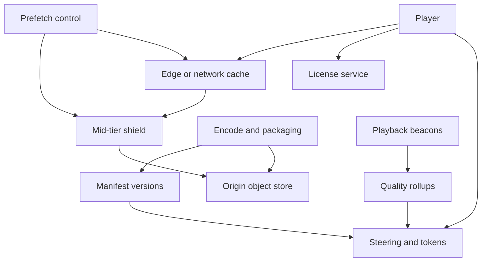

## Concept

A global video CDN is a control plane that tells a player which bytes to fetch, and a data plane that keeps those bytes near the viewer. When the design is working, the player does not talk to origin for a hot title. Video is large, mostly sequential, and cacheable once it is packaged. The hard problems are packaging — bitrate ladders, segments, encryption — the cache hierarchy, the fill paths that decide who carries the bits, and a control plane that can change a manifest without rewriting the catalog.

I would not stream one long file from origin over a single connection as the architecture. I would transcode into renditions, package short segments in a CMAF, HLS, or DASH layout, encrypt with keys from a license service, publish a versioned manifest, and serve segments from caches close to the viewer, including caches inside networks we peer with when the traffic justifies them. Origin is the miss path and the system of record for the bytes. Live is a separate pipeline from video-on-demand: a shorter buffer, a different miss penalty, and a failure domain that does not wait on a catalog encode.

### Requirements

The player can play a title on demand, and live if that product is in scope. It selects a rung, seeks, and resumes. Segments are encrypted. A license request returns the key under a policy. Subtitles and alternate audio are sidecars, cached on their own. At least one widely decodable codec is always present. More efficient codecs are additional renditions. Publishers release a title, set a window, purge, prefetch into a region, and black out a region. We can see rebuffering, startup delay, chosen bitrate, and error rate by site. Those signals steer future sessions. They do not sit on the path that serves the next segment.

A few seconds of startup for on-demand playback is a product budget I would design toward. Live is tighter and depends on segment duration and the player’s buffer. I would not cite another company’s startup number as ours. A hot title whose caches are warm survives an origin outage for as long as the cached segments remain valid. A brand-new title does not. A takedown must stop serving inside a declared bound, by short lifetimes or by explicit invalidation. Bandwidth dominates compute. Peering and fill traffic are the cost. A commercial CDN can sit in front as a shield and as a failover while our own caches are incomplete. Tokens on manifests and segments stop a URL from being a permanent public object. A social product around the player is out of scope. User-generated upload at short-video scale is a different ingest problem even when the ladder still applies. The application origin is not the video origin.

### Capacity sketch

Assumptions, so the hierarchy can be argued about. On the order of ten million monthly viewers, on the order of four hundred thousand concurrent at a peak we are willing to design for, and an average selected bitrate of a few megabits per second. The product of concurrency and bitrate is why the bits cannot hairpin through one region. I am not claiming we have measured that peak. I am claiming the design is unjustified if concurrent bitrate does not force a distributed cache. If the real concurrent population is a small regional audience, a commercial CDN in front of object storage is the design, and the rest of this review is premature.

The hot working set of titles is much smaller than the catalog. The long tail lives in object storage. Segments of a few seconds, a ladder of several renditions, audio and subtitles beside them. Hit ratio on popular titles should be very high at the edge once prefetch and natural demand have filled them. The bytes that hurt are misses, especially a premiere that every cache asks for in the same minute. Origin holds every rendition. A studio-scale catalog is large enough that replicating it to every site is the wrong plan. Treat catalog size as something you measure. Edge caches hold the working set of their catchment. Control-plane traffic — manifests, licenses, steering — can be a large request rate and is still small beside segment bytes. Manifests and multi-megabit segments do not share a disk layout without a plan for small objects and for large ones.

### API or control-plane shape

The player asks a steering endpoint for a title, a device class, and a rough network location, and receives a site or CDN choice, a manifest URL, and a short-lived token. It then fetches the manifest and the segments. Segment URLs are cacheable. The token is bound to a path prefix and an expiry, and the cache key includes the content identity so two versions never collide. The license request is not cacheable at the edge and stays with the license service.

Publish submits assets, a ladder, a protection policy, and a region list, and becomes an encode and packaging job. Availability, purge, and prefetch are separate operations. Purge names a title and a version. Prefetch names a title, a set of renditions, and a set of sites, and it runs before the availability window. Origin is an object store keyed by content hash or by an immutable version path. Mid-tier caches fill from origin and collapse concurrent fills for the same key. Edges fill from the mid-tier. Player quality events go to an analytics pipeline on a path that cannot stall the cache. Steering reads a rolled-up view of capacity, cache residency, and quality. It does not query the raw event stream on the play path.

### Core data model

A title has a package id, a region list, a status, and a current manifest version. A rendition has codec, bitrate, dimensions, and a path prefix. A segment has a sequence, a duration, a size, a content hash, and an entity tag. The bytes live in object storage under a path that includes the hash or a version that is never overwritten. A manifest has a protocol, a body, and a version that changes when the ladder changes, a segment is replaced, or a region is removed. A token binds a session, a title, an expiry, and a signature over the path prefix. A site has a location, a capacity, a fill parent, and a health signal that includes link utilization, not only process liveness. A cache index, if we keep one, records which titles a site holds, because prefetch and steering both need it. A license key has an id and a policy. A playback summary in analytics records startup, rebuffers, bytes, and the last bitrate, and it is sampled. It is not a row the player must write before the next segment is allowed.

## Trade-offs

| Approach | When it wins | Cost / risk |
| -------- | ------------ | ----------- |
| Segmented adaptive bitrate and a cache hierarchy | Internet-scale on-demand and live | Packaging complexity and many objects |
| One progressive file | A tiny catalog or a download | No bitrate switching; seek and cache behavior suffer |
| Appliances inside access networks | A large, predictable catalog and real peering | Useless until the traffic and the contracts exist |
| A commercial CDN in front of your origin | Fast global presence | Egress cost and less control of fill |
| Anycast to a site | A simple client | A site failure mid-session is hard to steer away from |
| An API or DNS answer that steers the player | Health, capacity, and where the title sits | An extra lookup; the client has to obey it |
| Long segments | Fewer requests | Slower bitrate switches and worse live latency |
| Segments of a couple of seconds | Live and fast switching | Request rate and small-object overhead |
| A mid-tier shield in front of origin | A miss storm does not hit origin directly | An extra hop on the cold tail |

I would steer the player, shield origin with a mid-tier that collapses duplicate fills, and treat network caches as a tier we prefetch into only when we have the traffic. I would not discover at the start of a premiere that the only warm copy is in one region.

## Diagram

## Failure modes

### Every edge misses at once

A publish or a purge at the peak makes every cache miss the same segment. Prefetch before the window, collapse concurrent fills so many misses become one origin read, and let invalidation win over a stale copy when the title must disappear.

### Steering into a full link

The map sends a city at a site whose uplink is saturated, or anycast keeps a session on a distant site because the address still answers. Steer on capacity, on where the title is already cached, and on a quality rollup for that site. The client needs a documented retry onto an alternate manifest host. A site with idle CPUs and a full peering link is unhealthy. A health check that only pings the cache process will call it healthy and will keep sending viewers into the loss.

### A manifest that names bytes you overwrote

A new encode reuses segment names, or a key rotation leaves caches holding ciphertext the new manifest cannot describe. Segment URLs are immutable. A version or a content hash is in the path. Manifests are versioned and short-lived relative to the media. Purge by prefix when a title must disappear. Overwriting a hot object in place is how a cache serves a mismatched segment with a successful status. The player reports a decode error, and the investigation starts in the client. The defect was the cache key.

### A URL that outlives the session

A copied URL plays the catalog without a session if the token is long-lived or the edge skips the check. Tokens are short, bound to a path prefix, and part of a cache key you accept. The lifetime is the revocation you can actually enforce.

### Live and catalog sharing one failure domain

A live encode stall holds a packager pool that on-demand fill also uses, or a live miss path shares origin bandwidth with a premiere. Separate ingest, packaging, and cache space for live. Give them different objectives and different people on call if you must. Live does not wait on a catalog encode queue. A catalog job does not wait on a live ladder. Sharing the pool looks efficient until the event starts and both products miss.

### Segments as a storm of tiny files

Short segments are a request-rate problem. Test requests per second and simultaneous fills, not only uplink size. Collapsed fills at the shield matter most in the first minute of a title.

## Real-world example

Netflix Open Connect is the extreme form of this design: appliances in ISP networks, prefetch of a catalog the service can predict, a backbone, and a control plane that decides what is where. YouTube is a cache and peering system at a scale where the working set is hotter and less predictable because so much of it is uploaded continuously. Commercial CDNs are what most teams deploy first, with origin in object storage and the CDN as the edge.

Copy adaptive ladders, immutable segment URLs, prefetch of titles you know will be popular, an origin shield with collapsed fills, steering informed by capacity and playback quality, and an explicit relationship to the networks that carry the bits. Leave ISP appliances and a private backbone until the traffic makes that conversation real. Copy a separate live path. Leave a user-generated encode fleet out of the first project. If the viewers are in one region, one origin plus a commercial CDN is the honest design. “Global” here is a traffic and peering problem. It is not a count of clusters you can schedule.

## What to remember

- The bytes the player reads live in a cache hierarchy. Origin is the miss path and the source of truth.
- Segment URLs are immutable and tokens are short-lived. A hot object is not overwritten in place.
- Steer on capacity, cache residency, and quality. Anycast alone will not place a peak of concurrent bitrate.
- Prefetch and collapsed fills are how a premiere stays off a cold origin.
