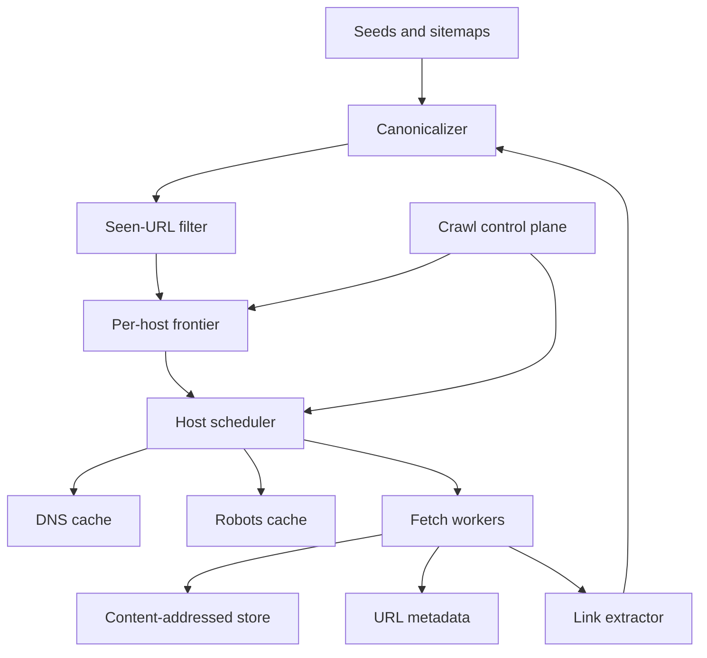

## Concept

A web crawler at scale is a polite distributed fetcher with a frontier that must not explode. It has a DNS and robots layer that must not become an accidental load on resolvers or on small origins, and a content store that can answer whether we already have these bytes. Ranking and the search index are downstream. They are not this system. I would not shard URLs at random across workers. I would own crawl by host, or by registrable domain, so politeness is a local decision inside one shard and a global budget across shards that share an address. The frontier is prioritized. URLs are canonicalized before they are admitted. Fetch results go to a content-addressed store. Metadata remembers status, hashes, validators, and when to come back. Recrawl is a schedule on that metadata. It is not a fresh walk from the seeds every night.

The outline is the one public crawler practice has made familiar: a URL frontier, a DNS cache, a robots cache, fetchers with a per-host rate, a parser that emits links and a content hash, duplicate suppression on URL and on bytes, and a scheduler that respects both the site’s crawl delay and our own budget. Discovering a URL is not the same as earning a fetch slot. A URL that fails canonicalization, trips a trap cap, or loses to a higher-priority neighbor stays in a skip state with a reason. It does not sit in a retry loop that admits it again under a new session parameter.

### Requirements

The crawler takes seeds, fetches HTTP and HTTPS, follows redirects up to a cap, parses HTML, and accepts sitemaps and feeds as first-class input. It extracts links, honors robots rules and robots directives in the document, and applies a per-host politeness limit and a per-address limit. Recrawl intervals shrink or stretch with observed change. We store raw bytes for a declared retention and an extracted text for the downstream index. Near-duplicates can be detected from a fingerprint computed off the hot path. Operators can block a domain, boost a domain, pause a host, pause the crawl, and ask why a URL was skipped.

Not harming a small origin is a correctness requirement. Politeness is not a flag we disable to catch a deadline. A public search crawler and an internal crawler of a site we own differ by orders of magnitude in fetch rate. I would size the deployment we intend. I would not copy a rate from a paper into a configuration file. News hosts are recrawled on a short interval. Stable documents are recrawled on a long one. Our crawler may restart. Origins should not see a thundering herd when it does. We honor robots. Authenticated user content is outside the default crawl. Some sites require an agreement rather than a fetcher. The ranking index is out of scope. A full browser-rendering farm is out of scope for the first version. A small, budgeted rendering pool can come later for a sample of pages. A single in-memory set of every URL is not a frontier.

### Capacity sketch

Assumptions to argue the design, not a measurement of a fleet. A frontier on the order of several billion known URLs, of which a much smaller set is worth fetching in a given month. Pages that are often a few hundred kilobytes and sometimes larger, with a hard cap that refuses the rest. A serious internal or vertical crawler might run at hundreds of fetches per second. A search-scale crawler is a different budget, in the tens of thousands of fetches per second, and it is mostly a bandwidth, DNS, and politeness problem. I will not treat either number as a target we have achieved. The design has to make the chosen rate explicit, because the NIC, the frontier disks, and the per-host budgets have to match it. Writing a large rate into a config without the bandwidth plans a failure and, worse, plans harm to other people’s sites.

The frontier is the capacity problem. A naive queue duplicates URLs and livelocks on a generator. Use a disk-backed priority structure per host shard, with an in-memory head of what is due. Content is object storage plus URL metadata. Parse runs off the socket pool. DNS and robots are cached, or lookup rate exceeds fetch rate. I would also assume the distribution of hosts is uneven: a handful of hosts can be a large fraction of the frontier, and a shard plan that balances URL hashes will still overload those origins if politeness is not global per host. Disk for the frontier is sized for the known-URL set, not for the fetch rate. Object storage is sized for retention of raw bytes, and retention is a policy with an owner.

### API or control-plane shape

This is an internal control plane. Enqueue accepts URLs, a source of seed, sitemap, or extract, and a priority. Host policy sets a maximum rate, a crawl delay, a blocked bit, a render budget, and a recrawl hint. Operators pause a host or pause the world. URL state returns the last fetch time, the status, the next due time, the content hash, and a skip reason. A robots or legal override exists for removals and is audited: who, what, when, and why. An override that ignores robots is exceptional, scoped, and visible in the same audit.

Workers pull a leased batch for the hosts they own and complete each URL with a result. The lease expires so a dead worker returns the URL to the frontier. Sitemaps are refreshed on a slower loop than HTML fetch. An optional render call has a hard concurrency cap and a separate queue. Nothing in this API is a public “fetch this URL now” service that bypasses politeness. A debug fetch for an operator still goes through the host scheduler, possibly at the head of that host’s queue, and it still counts against the host budget. A pause is a control-plane write the scheduler reads before it hands out the next lease. A worker that has already leased a batch finishes or returns it. It does not keep fetching through a pause because it cached the policy at startup.

### Core data model

A canonical URL has an id, the canonical form, the host, the registrable domain, and a hash of the path and the query we consider material. Canonicalization lowercases the host, drops default ports and fragments, sorts the query parameters we keep, and strips a denylist of tracking parameters. The frontier row is URL, host, priority, next-fetch time, and a state of waiting, leased, succeeded, retry, or permanently failed. Host state holds addresses, the robots body and the time we fetched it, the rate budget, the in-flight count, the last fetch time, a consecutive failure count, and a circuit state.

A fetch result records time, status, redirect target, content hash, size, elapsed time, and validators such as an entity tag and a last-modified value. Content is addressed by hash, with pointers to the raw object and to extracted text. Link edges, if we keep them, are a batch job. They are not a transactional row per link written on the fetch path. Recrawl state stores the validators and an estimate of how often the bytes change. Traps are data: a depth cap, a cap on distinct URLs per host per day, a cap on query-string variants, and a detector for spaces that generate infinite calendars or session identifiers. A URL that trips a cap is recorded as skipped, with a reason an operator can query. The reason is a column. A log line is not a state, because the next worker will not read it.

## Trade-offs

| Approach | When it wins | Cost / risk |
| -------- | ------------ | ----------- |
| Shard by host or registrable domain | Politeness is enforceable in one place | Shards are uneven; a huge host needs its own budget |
| Shard by URL hash | The queue looks balanced | Two workers can overload one origin |
| A priority frontier plus a change-based recrawl | Freshness where pages actually change | The tail starves unless you still sample it |
| Breadth-first from seeds | Easy to explain | Traps and low-value clusters dominate the disk |
| Workers pull leases | A crash returns the URL | Lease time is a parameter you will get wrong once |
| Push URLs to workers | The control flow looks simple | Lost work on a crash; politeness is harder to keep global |
| Render every page in a browser | Sites that exist only after scripts run | Cost, and a crawler that looks like an attack |
| HTML first, render a budgeted subset | Cost stays bounded | Script-only content waits until you spend the budget |
| Keep raw bytes and a hash | You can reparse and you can show the fetch | Storage, with a retention you must enforce |
| Index on the way in and discard the body | Cheap | You cannot reparse and you cannot prove the bytes |

I would shard by host, keep raw bytes under a retention policy, and render only inside a budget. Regions share one politeness budget per host. Two independent one-per-second caps are two requests per second at the origin.

## Diagram

## Failure modes

### Politeness fails and a small site suffers

Two shards, two regions, or a restarted fleet each believe they may fetch a host at the configured rate. The origin sees the sum. Budgets exist per host and per address, and they are one budget. A rising error rate lengthens the delay. A global pause exists and is tested. The page is origin errors together with our request rate, not our success counter alone. A success counter can stay high while a small site is returning errors to everyone else. The circuit opens on error rate and on a consecutive-failure count, and it stays open until a probe, not until the next enqueue.

### The frontier fills with a trap

A calendar, a session id in the query, or a redirect cycle enqueues without bound and a shard’s disk fills. Canonicalize, drop known junk parameters, cap URLs per host per day, cap depth, and refuse to enqueue past the quota. Alert on frontier growth per host, not only on a global disk percentage. One host can be most of the queue while the average looks fine. Permanent skip with a reason is better than a retry that admits the same URL under a new session parameter. A redirect cycle that rotates through a handful of URLs will pass a naive “have I seen this URL” check if each hop is new, so the cycle detector looks at the chain, not only at the current URL.

### DNS and robots become the crawl

Every URL resolves from scratch, and every URL fetches robots. Cache DNS with a TTL bounded on both sides so a very long TTL cannot pin a dead address and a very short TTL cannot turn the resolver into the workload. Fetch robots once per host per refresh interval, and reuse it for every URL on that host. A resolver outage is a crawl outage if the cache is empty. Robots that fail closed versus fail open is a written policy. Silent fail-open is how a missing file becomes a full-speed crawl of a site that wanted to be left alone. I would fail closed for a host we have never successfully fetched robots for, and keep serving the last good copy, with a refresh, for a host we have. A robots body that is enormous is itself a fetch with a size cap. Parsing it on the socket thread stalls the host.

### The same document under many URLs

Tracking parameters, alternate hosts, and printer-friendly paths store the same bytes many times and enqueue the same links. Hash the content. A canonical link is a hint, and a sample is still fetched so one tag cannot hide a host. Near-duplicate fingerprints run as a batch. They do not block the fetch path. A hash that ignores the bytes and trusts the canonical tag will suppress a page the site wanted crawled and will keep a page the tag was lying about. The hash is the duplicate signal. The tag is a scheduling hint.

### A page that stalls the worker

A huge body, a decompression bomb, or a parser crash. The URL is retried forever and the host queue sits behind it. Cap size, cap time, cap decompression ratio, isolate parse in a process that can die, and mark the URL permanently failed after a small number of attempts. One URL does not block the host. Permanent failure is a queryable state. A log line is not a state, because the next worker will not read it. A parser that shares a process with the fetcher will take the host’s lease with it when it crashes, and the lease expiry is then the only thing that returns the rest of the batch.

### Freshness that froze

Change estimates stretch every interval, including news, or a sitemap refresh stops and the frontier only recrawls what it already has. Sitemaps and feeds have their own schedule. A change estimate may lengthen recrawl, and it may not stretch a news host past its freshness target. Operators can pin a maximum interval. The pin is data, on the host row, and a missing pin is visible. A crawler that only follows links it already extracted will never see a new section of a site that stopped linking the old pages. The sitemap loop exists for that reason, and its lag is a metric.

### Robots and removal state drift

A site updates robots and we keep the old copy for days, or a removal request is a ticket that nobody turns into a suppression. Refresh robots on a schedule. Log skip reasons. Removals are a control-plane operation that records the actor and the scope, and they suppress recrawl. An override that ignores robots is exceptional, audited, and scoped. A removal that deletes the object and leaves the frontier row will fetch the page again on the next due time. The suppression and the deletion are one operation.

## Real-world example

Google’s crawler is the system this design maps to: politeness, host-centric scheduling, a large frontier, canonicalization, sitemaps, and an index that is a separate pipeline. The public research line on crawlers is useful for frontier structure and for traps. It is not permission to ignore robots. Common Crawl is the public, more batch-oriented cousin: less freshness, still aware of hosts, and a reminder that a crawl can be a dataset rather than a live index.

Copy host-based politeness, sitemaps, canonical hygiene, recrawl driven by change and by feeds, content hashes, and a control plane that can stop a host. Leave a rendering farm and a search-engine fetch rate out of an internal crawler. The frontier is a disk structure with a memory head. The HTML corpus does not belong in a transactional database. A site you own needs a sitemap and a rate. This design is for a host set that is large, uneven, and not trying to help you. A paper’s crawl rate is a historical measurement of someone else’s bandwidth, and it is not a configuration value.

## What to remember

- Politeness is per host and per address, and it is one global budget. Hashing URLs onto workers splits that budget by accident.
- Canonicalize and cap before a URL enters the frontier. Frontier growth per host is the outage.
- DNS and robots caches are part of the crawler, with an explicit policy when they fail.
- Recrawl is a schedule over metadata and feeds. Fetching the web from scratch on a timer is not a strategy.
